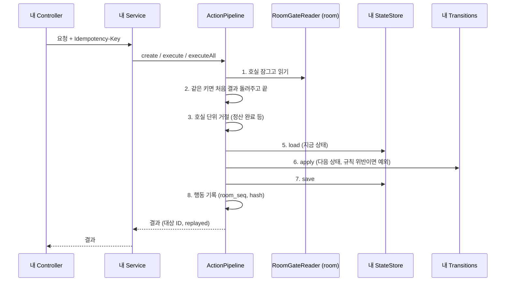

# ActionPipeline 사용 안내

내 도메인에서 "상태를 바꾸는 요청"을 만들 때 따라 하는 안내서예요. **규칙의 원본은 `rules/09-프로젝트-구조.md` 3-1**이고, 여기에는 규칙을 다시 적지 않고 "어떻게 쓰나"만 적어요. 둘이 다르면 09가 맞고, 이 안내서를 고쳐요.

| 더 읽을 곳 | 무엇 |
|---|---|
| `rules/09-프로젝트-구조.md` 3-1 | 계약, 타입 표, pipeline이 지키는 순서 1~9, 트랜잭션 경계 |
| `rules/06-요구사항-명세.md` 4-0 | `Idempotency-Key`, 다시 온 요청의 응답 |
| `rules/06-요구사항-명세.md` 4-10 | 호실 단위 거절(`SETTLED`·`ROOM_ENDED`·`JOINED_RECORD`·`SHARING_STOPPED`)의 순서 |
| `rules/05-ERD-초안.md` 2-3 | 행동 종류 목록(`ActionType`)과 `action` 테이블 |
| 코드 `back/src/test/java/.../action/ActionPipelineFixtureTest.java` | 이 안내서의 예시가 실제로 도는 테스트 |

---

## 1. 한 줄로

**행동 기록을 남기는 요청은 모두 `ActionPipeline`에 맡겨요.** 내 도메인은 "상태 값·규칙·저장" 세 가지만 만들고, 잠금·같은 요청 다시 오기(멱등)·호실 단위 거절·행동 기록·트랜잭션은 pipeline이 해요.



## 2. 언제 쓰나

| 쓴다 | 쓰지 않는다 |
|---|---|
| 06 4-0에서 `Idempotency-Key`가 필수인 요청(행동 기록을 남기는 요청) | 로그인, 인증 문자, 업로드 표, 사진 주소, 알림 읽음 |
| 하자 등록, 응답, 초대, 지불 기록, 점검 항목, 정산 … | 회원 신원 칸 바꾸기(05 0장 신원 예외), 조회만 하는 API |

헷갈리면 05 2-3 행동 종류 표에 그 행동이 있는지 보세요. 있으면 pipeline이에요.

## 3. 내 도메인에 만들 것

이름은 09 4장을 따라요. `Xxx`에 도메인 이름을 넣어요(예: `Repair`). 아래 수리 코드는 **실제 하자 등록(REP-1, #134)을 줄인 것**이에요. 전체는 `repair` 패키지의 `RepairTransitions`·`RepairStateStore`·`RepairService`·`RepairController`이고, 보안·pipeline·DB까지 끝까지 도는 테스트는 `RepairRegisterApiTest`예요.

| 만들 것 | 위치 | 하는 일 | 지킬 것 |
|---|---|---|---|
| `XxxState` | `rule/` | `apply`가 다루는 상태 값 | 불변 `record` |
| `XxxTransitions` | `rule/` | `Transitions<XxxState>` 구현. 지금 상태 + 행동 → 다음 상태 | **순수 함수**. Repository·Clock·다른 서비스를 부르지 않아요. 시각은 `action.createdAt()` |
| `XxxStateStore` | `repository/` | `StateStore<XxxState>` 구현. 엔티티 ↔ 상태 값 | 규칙을 검사하지 않아요. 다른 도메인 값은 공개 서비스·포트로 읽기만 |
| `XxxService` | `service/` | 요청을 `ActionCommand`로 바꿔 pipeline에 넘김 | **`@Transactional`을 두지 않아요** |
| `XxxController` | `controller/` | `Idempotency-Key`를 받아 서비스로, 다시 온 요청이면 헤더 | 06 4-0 |

### 3-1. 상태 값과 규칙

```java
// repair/rule/RepairState.java
public record RepairState(
    RepairStatus status, AckState defectAck, MoneyStatus moneyStatus, PartySide registeredBy) {
  public static final RepairState NONE = new RepairState(null, null, null, null); // 아직 없는 기록
}

// repair/rule/RepairTransitions.java
@Component
public class RepairTransitions implements Transitions<RepairState> {

  @Override
  public RepairState initial() {
    return RepairState.NONE;
  }

  @Override
  public RepairState apply(RepairState now, ActionEntry action) {
    return switch (action.type()) {
      case REGISTER -> register(now, action); // 시작 전 · 확인 기다림 · 부담 미정, 등록한 측 = action.actorSide()
      // 응답(RESPOND_DEFECT)은 REP-2부터 AnswerSupport로 붙여요(8장). payload는 action.payloadAs(내 record.class)로 바꿔 읽어요
      // 내 영역이 아닌 행동이나 지금 상태에서 안 되는 행동은 예외 → 저장도 기록도 남지 않아요
      default -> throw new BusinessException(ErrorCode.INVALID_STATE);
    };
  }
}
```

`apply`에서 **보지 않는 것**: 정산 완료·합류 전 기록·내 공유 중단, 거주 종료 뒤 새 수리 건(`REGISTER`). pipeline이 3단계에서 먼저 막아요(09 3-1 순서 3). **그 밖의 "거주 중에만" 규칙**(거주 종료 뒤 수리 시작·종료 요청·종료 확인, 진행 상황 묻기 등)은 pipeline이 막지 않으니 `load`가 호실 단계를 상태에 담고 `apply`에서 막아요.
`apply`에서 **보는 것**: 기록 단위 규칙(`NOT_COUNTERPART_SIDE`, `ACK_FINAL` …), 그리고 행동마다 결과가 다른 호실 사실(예: 상대 공유 중단에 따른 정산 끝내기 막기). 뒤의 것은 `load`가 상태 값에 담아 줘요(09 3-1 "계약").

### 3-2. 저장

```java
// repair/repository/RepairStateStore.java
@Component
public class RepairStateStore {

  // 하자 등록의 저장 방법. 제목·설명은 payload에 넣지 않고(05 2-3 "작은 부가 값만") 요청마다 담아 넘겨요
  public StateStore<RepairState> registering(UUID roomPartId, String title, String description) {
    return new Registering(roomPartId, title, description);
  }

  RepairState load(ActionCommand command) {
    if (command.target() == null) {
      return RepairState.NONE; // 새로 만드는 행동이면 빈 상태
    }
    RepairCase row = cases.findByIdAndRoomRecordId(command.target().id(), command.roomRecordId())
        .orElseThrow(() -> new BusinessException(ErrorCode.NOT_FOUND)); // 같은 키로 다시 온 요청도 여기로
    return new RepairState(row.getStatus(), row.getDefectAck(), row.getMoneyStatus(), row.getCreatedBySide());
  }

  private final class Registering implements StateStore<RepairState> {
    @Override
    public SavedState save(ActionCommand command, RepairState next) {
      rooms.findPart(command.roomRecordId(), roomPartId);   // 남의 부위면 NOT_FOUND(room 창구)
      Instant at = requestContext.at();                      // 행동 기록과 같은 시각
      UUID caseId = Uuids.v7(), contentId = Uuids.v7();      // 머리·판이 서로 가리켜서 미리 만들어요(05 0장)
      RepairCase head = new RepairCase(caseId, room, contentId, next.registeredBy(), null, at);
      if (counterpartSeesNow(...)) head.markShown(at);       // 상대가 지금 볼 수 있으면(03 3-1)
      cases.save(head);
      contents.save(new RepairContent(contentId, room, caseId, 1, roomPartId, title, description, ...));
      return new SavedState(ActionTarget.repairCase(caseId), digest(contentId)) // 대상 + 판 #1 지문(글만)
          .withPhotos(photos.attach(...));             // 사진은 판 지문이 아니라 행동 payload "photos"에(#141)
    }
  }
}
```

- `load`는 호실을 잠근 **뒤**에 불려서, 여기서 읽은 값은 최신이에요.
- 링크·응답 요청·문자처럼 행동이 아닌 딸린 일은 `save` 안에서 주인 서비스를 불러요(같은 트랜잭션).
- 서버 기록이 하나 더 필요하면 `ActionFollowUps.add(Actor.server(), 종류, 대상, payload)`를 `save`에서 불러요. pipeline을 다시 부르지 않아요.
- 이 요청의 시각이 필요하면(응답 요청·통지를 만든 시각 등) `Clock`을 다시 읽지 말고 `save`에서 `ActionRequestContext.at()`을 써요. 행동 기록의 `created_at`과 같은 값이에요. `requestId()`도 있어요. 테스트에서는 `fx.requestContext()`를 넣어요.
- 기다림(48시간)의 시작은 `at()`이 아니라 통지가 **전달된 시각**이에요(03 1-1 「타이머 시작점」). 그건 notification이 정해요.
- `load`에서는 `at()`을 읽을 수 없어요. 같은 키로 다시 온 요청에서도 `load`가 불리는데, 그때는 새 행동이 없어 시각도 없어요. 시각으로 판단할 일(기한이 지났나 등)은 `apply`에서 `action.createdAt()`으로 해요.

### 3-3. 서비스

```java
// repair/service/RepairService.java
@Service
public class RepairService {

  private final ActionPipeline pipeline;
  private final RepairStateStore store;
  private final RepairTransitions rules;

  // @Transactional 없음: 트랜잭션은 pipeline이 열어요
  public RepairCaseCreated register(UUID roomRecordId, UUID memberId, String idempotencyKey, RegisterRepairRequest req) {
    PipelineResult<RepairState> result = pipeline.create(
        new ActionCommand(roomRecordId, Actor.member(memberId), ActionType.REGISTER, idempotencyKey,
            null,              // 대상: 새로 만드는 행동이라 비워요
            null,              // seenVersionNo
            null,              // content: 새 판을 만드는 행동이라 save가 SavedState로 돌려줘요(아래 "어느 판을 넣나")
            null,              // reason
            Map.of()),         // payload
        store.registering(req.roomPartId(), req.title(), req.description()), rules);
    return new RepairCaseCreated(result.action().target().id(), result.action().replayed());
  }
}
```

**어느 판을 내용 지문(`content`)에 넣나**(05 2-3, #87 리뷰): 행동이 **무엇을 보고 했나**로 정해요. 잘못 넣어도 해시 체인은 그대로 이어지니(체인 검증만으로 본문까지 검증되지 않음), 도메인 테스트로 고정해요.

| 행동 | 넣는 판 | 예 |
|---|---|---|
| 새 판을 만드는 행동 | 그 새 판(`save`가 `SavedState`의 `content`로 돌려줌) | 하자 등록, 고치기, 지불 기록, 점검 항목 더하기 |
| 본 판에 대고 하는 행동 | **본 판**(`seenVersionNo`의 판). 지금 판이 아니에요 | 응답하기(맞아요·보류·이견), 확인, 동의 |
| 판을 보지 않는 행동 | 없음(`null`) | 링크 열람, 재통지, 확인 없음 표시 |

### 3-4. 컨트롤러

```java
@PostMapping("/api/rooms/{roomId}/repair-cases")
public ResponseEntity<CreatedResponse> register(
    @PathVariable UUID roomId,
    @LoginMember UUID memberId,                               // 로그인한 회원(#80). 없으면 401
    @RequestHeader("Idempotency-Key") String idempotencyKey,  // 없으면 400
    @Valid @RequestBody RegisterRepairRequest req) {          // 부위·제목 필수 → 빠지면 VALIDATION_FAILED
  RepairCaseCreated r = repairs.register(roomId, memberId, idempotencyKey, req);
  ResponseEntity.BodyBuilder res = ResponseEntity.status(HttpStatus.CREATED);
  if (r.replayed()) {
    res.header("Idempotent-Replayed", "true"); // 다시 온 요청도 처음과 같은 상태 코드·모양(06 4-0)
  }
  return res.body(new CreatedResponse(r.id()));
}
```

만드는 API의 201 본문은 도메인마다 따로 만들지 말고 `global/response/CreatedResponse`를 써요.

## 4. 어느 메서드를 쓰나

| 하려는 것 | 쓸 것 | 예 |
|---|---|---|
| 새 기록 하나 만들기 | `pipeline.create(command, store, rules)`. `command.target()`은 `null` | 하자 등록 `REGISTER` |
| 있는 기록에 행동 하나 | `pipeline.execute(command, store, rules)` | 하자 응답 `RESPOND_DEFECT` |
| 한 요청에 행동 여럿 | `pipeline.executeAll(ActionBatch.of(호실, 주체, 키) .step(...) .record(...))` | 초대 [동의하고 보여 주기] = `SHARE_CONSENT` + `INVITE` |
| 여러 행동 중 새 기록 만드는 단계 | `.creating(종류, store, rules)` | |
| 상태 칸이 없는 행동(기록만) | `.record(종류, payload)` | `SHARE_CONSENT` |
| 상태 칸은 없지만 대상이 있는 행동 | `.record(종류, done -> 대상, payload)` | `LINK_VIEW`(링크), `CONFIRM_ALL`(점검) |
| 앞 단계가 만든 ID를 다음 단계에 | `.step(종류, done -> ActionTarget.xxx(done.get(0).target().id()), store, rules)` | |
| 조건이 맞을 때만 하는 단계 | `ActionStep.of(...).when(now -> 조건)` → `.step(그 단계)`. 거짓이면 기록 없이 건너뜀 | 정산이 없을 때만 `OPEN_SETTLEMENT` |
| `seenVersionNo`·`content`·`reason`까지 주는 단계 | `ActionStep.of(...).withSeenVersionNo(..).withContent(..).withReason(..)` | |
| 호실 만들기 | `ActionBatch.newRoom(Actor.member(id).withSide(side), 키)` | `CREATE_ROOM` (09 3-1 예시) |
| 회원이 아닌 주체 | `Actor.link(linkId, side)` / `Actor.server()` / `Actor.ops(담당)` | 링크 열람, 다시 알림, 운영 명령 |

- `Actor.member(id)`의 측(TENANT/LANDLORD)은 넣지 않아요. pipeline이 `RoomGate`에서 채워요(호실 만들기만 예외).
- `server`·`ops`는 호실 단위 거절을 건너뛰어요.
- `link`는 호실 단위 거절을 거쳐요. 링크 열람은 호실이 정산 완료·합류 전 기록이면 link가 pipeline을 부르기 전에 `LINK_INVALID`로 돌려줘요(호실 상태를 드러내지 않게, 06 LINK-2, #83). 문자 그만 받기(`OPT_OUT`)는 호실 상태로 막히지 않아요.
- 결과: `create`·`execute`는 `PipelineResult`(`state()` 저장 뒤 상태, `action()` 행동 결과), `executeAll`은 `BatchResult`(`actions()` 행동마다, `first()` 첫 행동). 다시 온 요청이면 `replayed()`가 참이고 `target()`에 처음 만든 ID가 있어요.

## 5. 테스트 쓰기

### 5-1. 규칙 테스트: pipeline 없이

`XxxTransitions`는 순수 함수라 그냥 부르면 돼요. 커버리지 대상이고, 03 상태 규칙과 06 시나리오는 대부분 여기서 테스트해요.

```java
@Test
void 확인을_마친_하자에는_다시_응답할_수_없다() {
  RepairState acked = new RepairState(RepairStatus.NOT_STARTED, AckState.ACK);
  assertThatThrownBy(() -> rules.apply(acked, entry(ActionType.RESPOND_DEFECT, Map.of("answer", "ACK"))))
      .hasMessage(ErrorCode.ACK_FINAL.name());
}
```

### 5-2. 서비스 테스트: `ActionPipelineFixture`

`ActionPipeline` 생성자와 행동 기록 저장 가짜는 `action` 안에서만 보여서, 다른 도메인은 테스트 준비물 `ActionPipelineFixture`(`back/src/test/java/.../action/service/`)로 만들어요. Spring·DB 없이 진짜 pipeline이 돌아요.

```java
ActionPipelineFixture fx = new ActionPipelineFixture();
fx.gates().member(roomId, tenantId, PartySide.TENANT);   // 이 회원은 이 호실의 세입자, 막히는 것 없음

RepairService service = new RepairService(fx.pipeline(), store, rules);
service.register(roomId, tenantId, "k1", req);

assertThat(fx.actions().findByRoom(roomId))
    .extracting(ActionEntry::type)
    .containsExactly(ActionType.REGISTER);
```

| 준비물 | 하는 일 |
|---|---|
| `fx.pipeline()` | 서비스에 넣을 pipeline |
| `fx.gates()` | 호실 상태 정하기 (아래 표) |
| `fx.actions()` | 남은 행동 읽기(`findByRoom`, `findByTarget`). 실패해서 되돌린 요청의 행동은 남지 않아요 |
| `fx.followUps()` | `save`에서 딸린 행동을 남길 때 저장 구현에 넣을 것 |
| `fx.rollbacks()` | 되돌린 트랜잭션 수 |
| `new ActionPipelineFixture(clock)` | 기한 계산처럼 시각이 중요할 때 |

호실 상태는 `RoomGate(호실, 측, settled, joinedAway, mySharingStopped, ended)`로 넣어요.

| 보고 싶은 상황 | 넣는 값 | pipeline 결과 |
|---|---|---|
| 거주 중, 막히는 것 없음 | `fx.gates().member(room, memberId, side)` | 통과 |
| 당사자가 아님 | 아무것도 넣지 않음 | `NOT_FOUND` |
| 정산 완료 | `put(memberId, new RoomGate(room, side, true, false, false, true))` | `SETTLED` (예외: `ActionType`에 `AFTER_SETTLED` 표시) |
| 거주 종료 | `new RoomGate(room, side, false, false, false, true)` | `REGISTER`만 `ROOM_ENDED` |
| 합류 전 기록 | `new RoomGate(room, side, false, true, false, false)` | `JOINED_RECORD` (예외: `ON_JOINED`) |
| 내가 공유를 그만둠 | `new RoomGate(room, side, false, false, true, false)` | `SHARING_STOPPED` (예외: `WHILE_SHARING_STOPPED`) |
| 서버·운영 행동 | `fx.gates().putRoom(new RoomGate(room, null, …))` | 호실 단위 거절을 건너뜀 |

어떤 행동에 어떤 표시가 있는지는 `ActionType`(09 3-1 `ActionType` 줄)을 보세요.

### 5-3. DB까지 보는 테스트

엔티티 매핑·제약을 보려면 `@SpringBootTest` + Testcontainers예요(Docker 필요). 이때 잠금은 진짜(`JpaRoomGateReader`, #143)예요. `FakeRoomGateReader`는 테스트 코드에만 있고 빈이 아니라 주입할 수 없어요. 호실 상태는 `room_record`(`status`·`joined_into_id`)와 `party`(당사자·`status`·`sharing_stopped_at`) 행으로 넣어요(예: `RepairRegisterApiTest`의 `seat`). 행동 기록은 진짜(`JpaActionWriter`)라 행동이 가리키는 회원·호실·대상 행을 먼저 넣어 두세요(7장). 예시는 `JpaActionWriterTest`예요.

## 6. 자주 하는 실수

| 실수 | 무슨 일이 생기나 | 고치는 법 |
|---|---|---|
| 서비스에 `@Transactional` | 실행할 때 `IllegalStateException` "pipeline 바깥에 트랜잭션을 두지 않아요" | 지우기. 트랜잭션은 pipeline이 열어요 |
| 새 기록인데 `execute`로 열고 `save`가 새 대상을 돌려줌 | `IllegalStateException` "새 기록을 만드는 행동은 ActionStep.creating·ActionPipeline.create로" | `create` 또는 `.creating(...)` |
| `create`에 대상을 줌 | `IllegalArgumentException` "새 기록을 만드는 행동에는 대상을 주지 않아요" | `target`을 `null`로 |
| 부모 대상을 주고(`step(종류, done -> 부모, …)`) `save`가 새 자식 기록을 돌려줌 | `IllegalStateException` "save가 물어본 대상과 다른 기록을 돌려줬어요". 그냥 두면 같은 요청이 다시 올 때 `IDEMPOTENCY_KEY_REUSED`가 돼요 | 새 기록은 `.creating(...)`으로. 부모 ID는 `payload`에 |
| `creating` 단계인데 `save`가 `SavedState.unchanged()` | `IllegalStateException` "save가 만든 기록을 돌려주지 않았어요" | `SavedState.created(ActionTarget.xxx(id))` |
| `apply`에서 Repository·`Clock.now()` 부르기 | 다시 계산할 때(REP-10) 결과가 달라져요 | 시각은 `action.createdAt()`, 필요한 값은 `load`가 상태에 담기 |
| `apply`에서 정산 완료·공유 중단 다시 검사 | 같은 검사가 두 군데 생겨 어긋나요 | pipeline에 맡기기(09 3-1 순서 3) |
| 도메인이 `RoomGate`를 만들어 넘기기 | 잠그기 전 옛 값으로 판단해요 | 만들지 않아요. 조회 화면의 당사자 확인은 `roomAccessService.require(...)` |
| pipeline 밖이나 단계가 끝난 뒤(`@TransactionalEventListener`·커밋 직전 `BEFORE_COMMIT`·비동기 리스너)에서 `ActionFollowUps.add` | `IllegalStateException` "딸린 행동은 pipeline 단계 안에서만". 요청 전체가 되돌려져요(500) | `save`나 `save` 안에서 동기로 도는 `@EventListener`에서만 |
| `save` 안에서 pipeline을 다시 부름 | `IllegalStateException` "pipeline 안에서 pipeline을 다시 부르지 않아요" | 같은 요청이면 `executeAll` 단계로, 서버 기록이면 `ActionFollowUps.add` |
| 키가 비었거나 `#`가 들었거나 64자를 넘음 | `VALIDATION_FAILED`(400). `ActionBatch`를 만들 때 걸려서 트랜잭션 전에 끝나요. 서버·링크 주체가 만드는 키도 같아요 | 화면 키는 UUID. `<키>#2`는 pipeline이 붙여요. 서버 작업이 키를 만들 때도 64자 안, `#` 없이 |
| `load`·`when`·`apply`나 pipeline 밖(커밋 뒤·비동기 리스너, 예약 작업)에서 `ActionRequestContext.at()` | `IllegalStateException` "요청 시각은 StateStore.save에서만". `load`에서 읽으면 처음 요청부터 실패해요 | `save`나 그 안에서 동기로 도는 `@EventListener`에서 읽기. `apply`는 `action.createdAt()` |
| 같은 키로 다른 행동·대상 | `IDEMPOTENCY_KEY_REUSED`(422) | 버튼마다 새 키 |

## 7. 지금 가짜인 것

pipeline은 진짜이고, 안쪽 부품도 아래 표처럼 하나씩 진짜로 바뀌어요. 진짜로 바뀌어도 **내 도메인 코드는 바뀌지 않아요**.

| 부품 | 지금 | 진짜로 바뀌면 | 누가 |
|---|---|---|---|
| 행동 기록 저장 `ActionWriter` | **진짜** `JpaActionWriter`: `record.action`에 저장, `room_seq`·해시 체인. 메모리 가짜 `FakeActionWriter`는 테스트 코드에만 있고 `ActionPipelineFixture`가 써요 | — | B |
| 호실 잠금·읽기 `RoomGateReader` | **진짜** `JpaRoomGateReader`(#143): `room_record`를 `FOR UPDATE`로 잠그고 `party`로 당사자 확인. `FakeRoomGateReader`는 DB 없는 테스트(`ActionPipelineFixture`)가 `new`로 써요 | — | A (ROOM-2) |
| 부위 조회 `RoomQueryService.findPart` | **진짜** `JpaRoomQueryService`: `room_part`를 읽음 | — | room (#140) |
| 자리 상태 `CounterpartReader` | **진짜** `JpaCounterpartReader`: `room_record`·`party`·`member`를 읽음. 수신 거부(`optedOut`)·가린 이름(`maskedName`)은 아직 채우지 않음(거짓·null, 문자 보내기 PR에서 채움) | — | room (#140) |

배포 서버에서 기능을 확인하려면(07 6장 끝 기준) 잠금·읽기(`RoomGateReader`)가 진짜여야 하는데, #143으로 진짜가 됐어요.

**`@SpringBootTest`로 pipeline을 부르면 행동이 실제 DB에 저장돼요.** 그래서 행동이 가리키는 행이 DB에 있어야 해요(회원 행동이면 `member`, 호실 `room_record`, 대상 행, 대상은 같은 호실이어야 함: 05 0장 복합 FK). DB 없이 규칙만 보려면 `ActionPipelineFixture`를 쓰세요(5-2).

## 8. 응답 공통 처리 (`AnswerSupport`)

맞아요·보류·이견(응답하기)과 [보충하고 다시 확인 요청]·[사진 더해서 다시 요청](다시 요청)은 모든 도메인이 `action/rule/AnswerSupport`로 같은 규칙을 써요(#86). 쓰는 곳: 수리 건 하자, 점검 항목, 지불, 송금, 고친 내용, 원인 설명(응답만. 고치면 새 설명이라 다시 요청이 없어요, 06 4-6). 순수 함수라 `apply` 안에서 불러요.

| 메서드 | 하는 일 | 거절 |
|---|---|---|
| `answer(기록, 답하는 측, 답, 사유, 본 판 번호)` | 다음 응답 값(`AckState`) | `NOT_COUNTERPART_SIDE`(기록한 측), `VERSION_CONFLICT`, `ACK_FINAL`, `INVALID_STATE`(보류·이견에서 맞아요가 아닌 답), `REASON_REQUIRED` |
| `rerequest(기록, 부르는 측, 근거 있음, 요청을 열 수 있음, 지금, 간격)` | `PENDING`(상대가 새로 고름) + 저장할 다시 요청 시각 | `NOT_COUNTERPART_SIDE`(기록한 측이 아님), `INVALID_STATE`(보류·이견이 아님, 지금 열 수 없는 요청), `EVIDENCE_REQUIRED`, `ASKED_RECENTLY`(근거를 간격보다 먼저 봐요) |
| `canAnswer` · `canRerequest` | 화면 `availableActions`·확인 카드 버튼. 위 두 메서드와 같은 결과 | — |
| `nextRerequestAt` | "○월 ○일부터 다시 요청할 수 있어요"의 날짜. 다시 요청한 적이 없으면 null | — |
| `requireEvidence` · `checkInterval` | [상황이 바뀌었어요]처럼 조건이 다른 버튼이 근거·7일만 가져다 써요 | `EVIDENCE_REQUIRED`, `ASKED_RECENTLY` |

### 8-1. 내 상태에서 `Answerable` 만들기

```java
// repair/rule/RepairState.java
public record RepairState(
    RepairStatus status, AckState defectAck, PartySide registeredBy, int contentNo,
    Instant lastRerequestAt, boolean canOpenDefectConfirm) {

  Answerable defect() {
    return new Answerable(registeredBy, defectAck, contentNo, lastRerequestAt);
  }
}
```

- **기록한 측**은 도메인이 정해요. 송금은 보낸 쪽이 기록했으면 받은 쪽이, [받았어요(혼자)]면 보낸 쪽이 답해요(SET-4).
- **판 번호**가 없는 기록이면 `null`. 그러면 본 판 번호를 비교하지 않아요.
- **마지막 다시 요청 시각**은 행동 기록이 원본이에요. `load`가 읽어 담아요. 첫 요청은 세지 않아요(7일은 다시 요청끼리만).
- **요청을 열 수 있음**은 `load`가 `waitService.canOpen(호실, 종류)`로 채워요(거주 종료 뒤 닫힌 요청을 다시 열지 않게, 03 K).

### 8-2. `apply`에서 부르기

```java
case RESPOND_DEFECT -> {
  // 거주 종료 뒤에도 정산 완료 전까지 답할 수 있다(늦은 답, 03 3장 권한 표). 정산 완료는 pipeline이 막는다
  AnswerPayload in = action.payloadAs(AnswerPayload.class);
  AckState next = AnswerSupport.answer(
      now.defect(), action.actorSide(), in.answer(), in.reason(), action.seenVersionNo());
  yield now.withDefectAck(next);
}
case SUPPLEMENT -> {
  // 거주 종료 뒤에는 하자 확인 요청을 열 수 없어(03 K) canOpenDefectConfirm이 false → INVALID_STATE
  AnswerSupport.Rerequested r = AnswerSupport.rerequest(
      now.defect(), action.actorSide(), true /* 서비스가 근거를 확인 */, now.canOpenDefectConfirm(),
      action.createdAt(), interval);
  yield now.withDefectAck(r.state()).withLastRerequestAt(r.rerequestedAt());
}
```

- 시각은 `action.createdAt()`, 간격(`rerequest.interval`, 7d)은 `Transitions`가 설정에서 받아 넘겨요. `Clock`을 부르지 않아요.
- 근거(`SupplementRequest.hasEvidence()`)는 서비스가 pipeline 전에 `AnswerSupport.requireEvidence`로 보거나, payload에 담아 `apply`에서 넘겨요. 어느 쪽이든 같은 메서드를 써요.
- 서비스는 payload를 `Map.of("answer", req.answer(), "reason", req.reason())`로 남겨요. 사유가 없으면 `"reason"` 키를 빼요(`Map.of`는 null을 받지 않아요).

### 8-3. 도메인이 먼저 막는 것 (`AnswerSupport`는 모름)

| 무엇 | 예 | 어디서 |
|---|---|---|
| 상대가 아직 볼 수 없는 기록 | 작성 중 점검의 항목(06 INSP-1a) | `apply`에서 `INVALID_STATE`, `canAnswer`도 `false`. 확인 카드도 같은 기준 |
| 그 단계에서 할 수 없는 행동 | 거주 종료 뒤 열린 수리 건의 [종료 확인](03 A 상태별 표 "열린 수리 건의 수리 행동") | `load`가 담은 호실 단계로 `apply`에서 |
| 규칙이 다른 응답 | 정산 끝내기(`AnswerResult` Javadoc), 돈 안건의 제안·동의(`ProposalService`, `OWN_PROPOSAL`) | 그 도메인 |

### 8-4. 응답 요청(notification)과 잇기

`save`에서 notification의 `waitService`를 불러요(#88).

| 일 | `save`에서 부를 것 |
|---|---|
| 응답(늦은 답 포함) | `waitService.answered(대상, 요청 종류, 답한 측)`. 열린 요청이 있으면 "답함"으로 닫고, 없거나 닫혀 있으면 아무것도 하지 않아요 |
| 다시 요청 | `waitService.restart(new OpenRequestCommand(호실, 종류, 대상, 요청한 측))`만 불러요. 새로 열지·묶을지·기한은 notification이 정해요(`WaitService#restart`). 도메인은 그 규칙을 따로 갖지 않아요 |
| [상황이 바뀌었어요] | 진행 상황마다 새 상황 확인이라 `restart`가 아니라 `open` |

**요청 하나에 기록이 여럿이면**(점검 확인: 점검 × 방향마다 요청 하나, 응답은 항목마다) `answered`는 그 방향에 답하지 않은 항목이 0개가 될 때만 불러요. 항목마다 부르면 첫 답에서 요청이 닫혀 나머지 항목의 재통지·혼자 잠금이 돌지 않아요. 고친 내용 확인도 같아요.

**한 번에 여러 기록에 답하기**(점검 [남은 항목 모두 확인]): 한 요청으로 묶음 표시 하나와 항목마다 응답을 남겨요. 항목 상태는 늘 응답 행동으로만 바뀌어요.

```java
ActionBatch.of(room, actor, key)
    .record(CONFIRM_ALL, done -> ActionTarget.of(TargetKind.INSPECTION, inspectionId), Map.of()) // 버튼을 눌렀다는 표시(상태를 바꾸지 않음). 어느 점검인지 대상으로 남겨요
    .step(RESPOND_ITEM, done -> item1, ...)   // 항목마다
    .step(RESPOND_ITEM, done -> item2, ...);
```
