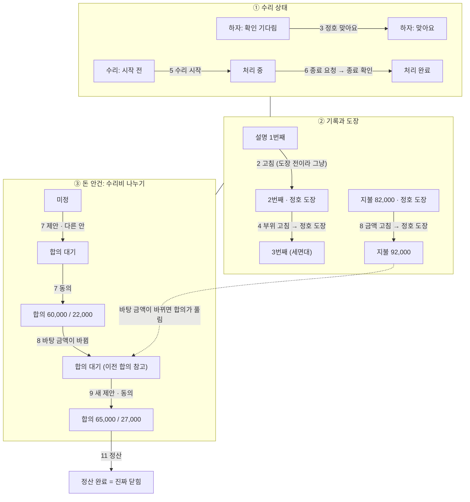
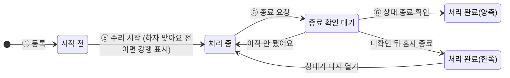
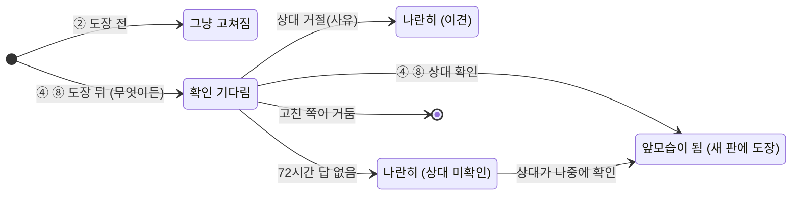
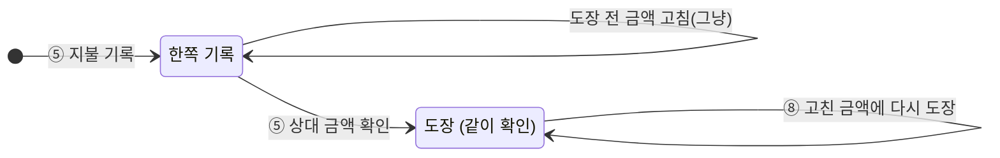
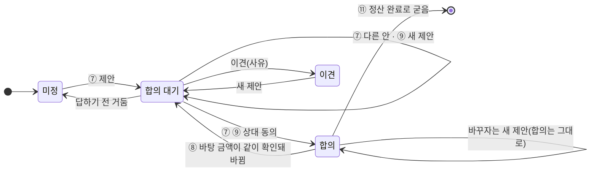

# 이야기로 보는 흐름

> 상태 그림과 규칙 표를 읽기 전에, **한 건이 처음부터 끝까지 어떻게 흘러가는지**를 이야기로 먼저 봐요.
> 이야기 세 개면 서비스 흐름의 대부분이 보여요. 나머지 문서는 궁금한 곳만 찾아보는 사전처럼 써요.
>
> | 이야기 | 무엇을 보여 주나 |
> |---|---|
> | **1. 욕실 수전 한 건** (이 문서) | 하자 등록 → 고치기 → 수리 → 돈 나누기 → 정산까지 |
> | 2. 입주에서 정산까지 (이 문서 끝) | 입주 점검 → 퇴거 점검 → 나란히 보기 → 보증금 정산 |
> | 3. 답이 없을 때 (이 문서 끝) | 문자 → 재통지 → 확인 없음 → 혼자 진행, 늦은 답 |


---

## 먼저 알아 둘 것 (5분)

### 1. 기록에는 세 단계가 있어요

| 단계 | 뜻 | 비유 | 예 |
|---|---|---|---|
| **기록함** | 한 사람이 남긴 것 | 메모 | 서윤이 "세면대 수전이 새요" 등록, "82,000원 냈어요" |
| **같이 확인함** | 상대가 "봤어요/맞아요"를 누른 것 | **도장** | 정호가 하자 [맞아요], 지불 금액 [맞아요] |
| **합의함** | 돈 질문에 둘이 같은 답을 고른 것 | 서명 | "집주인 60,000 / 세입자 22,000"에 동의 |

기록함과 같이 확인함은 **모든 기록**에 있어요. 합의함은 **돈 질문에만** 있어요.

### 2. 고치기: 도장 전과 후만 기억하면 돼요

모든 기록은 [고치기]로 언제든 고칠 수 있어요. 지우거나 덮어쓰지 않고 **고친 이력**이 쌓여요. 다른 점은 도장이 찍혔느냐 하나예요. **무엇을 고치든(설명, 부위, 금액) 똑같아요.**

| | 도장 전 (혼자 쓴 기록, 상대가 아직 확인 전) | 도장 후 (같이 확인함) |
|---|---|---|
| 고치면 | **그냥 고쳐져요** | **앞에 보이는 건 도장 찍힌 내용 그대로**예요. 고친 것은 아래에 **"내가 고친 내용 · 정호 님 확인 전"**으로 바로 남아요 |
| 상대에게 | 알림 | **확인 요청**(문자). 한 기록을 여러 군데 고쳐도 문자는 한 통 |
| 상대가 [맞아요] | - | 고친 내용이 앞으로 와요 |
| 상대가 거절하거나 답이 없으면 | - | 앞모습 그대로, 고친 내용은 기록으로 남아요 |
| 돈 계산 | 지금 값 | **도장 찍힌 값만** |

**한 줄로**: "도장 전엔 마음대로, 도장 뒤엔 무엇이든 두 사람 도장이 있어야 바뀐다." 그리고 "설명은 자유롭게, 사실은 확인받고, 계산은 확인된 것만."

| 범위 | 무엇 | 도장 |
|---|---|---|
| **덧붙이기**(설명을 더함) | 사진 추가, 진행 상황, 원인 설명, "잘못 올린 사진" 표시 | 필요 없음. 계산에 안 들어감. "확인 뒤 추가" 표시와 알림만 |
| **새 기록**(확인받을 새 사실) | 새 수리 건, 새 지불, 정산 항목, 송금 | 자기 확인을 따로 받고, 확인된 뒤에만 계산에 들어감 |
| **고치기**(도장 찍힌 걸 고침) | 설명, 제목, 부위, 금액, 날짜 등 모두. **오타도 같아요** | 필요함 |

오타에도 도장이 필요하지만 부담은 작아요. 정호 화면에는 **바뀐 글자만 색으로** 보여서(물이 ~~셈니다~~ **새요**) 한눈에 오타인 걸 알고 [모두 확인] 한 번이면 끝나요.

그래서 "오타 수정"이라며 정호가 확인한 설명을 크게 바꿔도, **앞에는 정호가 도장 찍은 설명이 그대로** 보이고 정호에게 문자가 가요. 정호 모르게 바뀌지도, 정호 동의 없이 바뀌지도 않아요. 고친 사람에게는 "내가 고친 내용"으로 계속 남아 있어요.

**사진**: 고치기는 없고 추가만 있어요. 엉뚱한 사진은 지우지 않고 "잘못 올린 사진" 표시(흐리게, 맨 뒤). 개인정보가 찍혔을 때만 지우고, 흔적은 남아요.

### 3. 돈 질문(안건), 제안, 합의

**안건**은 돈 질문 하나예요. 정해진 자리에 하나씩 있어요.

| 안건 | 자리 | 질문 |
|---|---|---|
| 수리비 나누기 | 수리 건 카드마다 하나 | "이 수리비를 누가 얼마 낼까?" |
| 정산 항목 | 정산 항목마다 하나 | "이걸 보증금에서 뺄까, 얼마나?" |
| 보증금 | 정산에 하나 | "돌려줄 보증금이 얼마였나?" |

**제안**은 안건에 대한 답안이고, **합의**는 그 안건의 지금 답이에요. 한 안건 안에서 제안은 줄로 쌓이고, 합의는 언제나 하나예요.

```
안건: 이 수리비를 누가 낼까? (수리 건 A)
  제안 1  서윤: 집주인 82,000      → 정호가 다른 안
  제안 2  정호: 60,000 / 22,000    → 서윤 동의 ✔   ← 지금 합의 (정산은 이걸로)
  ── 합의 뒤 ──
  제안 3  정호: 50,000 / 32,000    → 서윤이 답하기 전 ("바꾸자는 안 있음")
          답이 올 때까지 정산은 여전히 제안 2로
```

| 궁금한 것 | 답 |
|---|---|
| 합의하면 그 안건은 끝인가? | 아니요. 합의는 "지금 답"이에요. 정산이 끝나기 전까지는 바꾸자고 할 수 있어요 |
| 합의 뒤에 다시 이야기하려면 새 안건을 여나? | 아니요. **같은 안건에 다음 제안**을 붙여요. 질문이 같으니까요. 새 안건으로 나누면 한 수리비에 합의가 두 개 생겨서 정산 때 무엇을 쓸지 헷갈려요 |
| 합의 뒤 새 제안을 내면 합의가 깨지나? | 아니요. **상대가 동의할 때까지 지금 합의가 그대로** 쓰여요. 상대가 이견을 내거나 답하지 않아도 지금 합의가 남아요 |
| 그럼 합의가 풀리는 건 언제? | 딱 하나예요. 합의의 **바탕 금액이 같이 확인돼 바뀔 때**(82,000원이 92,000원으로 확인됨). 82,000원을 나누자고 한 약속이 더는 맞지 않으니까요. 이때는 같은 안건에서 다시 정하고, 이전 합의는 참고로 보여요 |
| 정산은 무엇으로 계산하나? | **각 안건의 지금 합의**만 모아서요. 합의가 없는 안건은 "정해지지 않은 금액"으로 따로 보여요 |
| 언제 완전히 끝나나? | **정산 완료**. 그 뒤로는 합의가 굳고 새 제안을 낼 수 없어요 |

### 4. 고치기, 새 제안, 새 기록 가리기

| 하고 싶은 것 | 하는 것 |
|---|---|
| 적은 내용이 틀렸어요(부위, 금액, 설명) | **고치기** |
| 누가 낼지를 바꾸고 싶어요 | 그 안건에 **새 제안** |
| 다른 문제를 발견했어요 | **새 수리 건** |

헷갈리면 이렇게 물어요. **"그때 적은 게 틀렸나, 약속을 바꾸고 싶나, 새 일이 생겼나?"**

---

## 이야기 1. 욕실 수전 한 건

**등장인물**: 세입자 정서윤(27세, 원룸 월세), 집주인 김정호(58세, 다른 동네에 살고 새 앱 설치를 꺼림)

### 한눈에

세 줄이 따로 움직이다가 정산에서 만나요. 화살표의 숫자가 아래 장면 번호예요.





### 장면별로

| # | 장면 | 누가 · 무엇을 누름 | 남는 기록 | 상태 | 상대에게 |
|---|---|---|---|---|---|
| 1 | 서윤이 욕실에서 물 새는 걸 발견 | 서윤 · 하자 등록(사진, 부위 "욕조", 제목) → [알리기] | 수리 건 1번째 모습 | 하자: **확인 기다림**, 수리: 시작 전 | 정호에게 문자(링크) |
| 2 | 설명에 오타가 있음 | 서윤 · [고치기] | 2번째 모습. **도장 전이라 그냥 고쳐짐** | 그대로 | - |
| 3 | 정호가 문자 링크로 보고, 가입하고 연결 | 정호 · [맞아요] | 확인 기록에 "2번째 모습을 확인" | 하자: **맞아요**(도장), 수리: 시작 전 그대로 | 서윤에게 알림 |
| 4 | 서윤이 다시 보니 욕조가 아니라 세면대 | 서윤 · [고치기] | **도장 뒤** → 내가 고친 내용(앞모습은 욕조 그대로) | 정호가 확인하면 3번째 모습이 도장 찍힌 모습으로 | 정호에게 확인 요청 |
| 5 | 업체가 와서 고침, 서윤이 82,000원을 냄 | 서윤 · [수리 시작], [지불 기록] → 정호 · 지불 [맞아요] | 지불(도장) | 수리: **처리 중** | - |
| 6 | 물이 더 안 샘 | 서윤 · [종료 요청] → 정호 · [종료 확인] | 행동 두 개 | 수리: **처리 완료** | 서로 알림 |
| 7 | 누가 낼지 이야기 | 서윤 제안 "집주인 82,000" → 정호 다른 안 "60,000 / 22,000" → 서윤 [동의] | 제안 1·2, 동의 | 돈: **합의** | 제안마다 상대에게 |
| 8 | 영수증을 다시 보니 92,000원 | 서윤 · 지불 [고치기] → 정호 확인 | 지불 92,000(도장) | 바탕 금액이 바뀜 → 돈: **합의 대기**(이전 합의 참고) | 정호에게 확인 요청 |
| 9 | 바뀐 금액으로 다시 나눔 | 정호 · 새 제안 "65,000 / 27,000" → 서윤 [동의] | 제안 3, 동의 | 돈: **합의** | - |
| 10 | 같은 욕실에서 배수구 막힘을 발견 | 서윤 · [새로 등록] | **수리 건 B**(따로, 수리 건 A와 연결) | B 하자: 확인 기다림 | 정호에게 문자 |
| 11 | 이사 나감, 퇴거 정산 | 정산에 지금 합의 65,000 / 27,000이 후보로 → 정산 끝내기 | 정산 항목 | **정산 완료 = 진짜 닫힘** | - |

### 장면별 상태 변화 (한 장에서 보기)

행은 장면, 열은 상태 기계예요. **굵은 칸만 그 장면에서 바뀐 것**이에요. 괄호 안 글자는 `3-상태와-규칙.md`의 절이에요.

| # | 장면 | 하자 · 수리 (D) | 수리 건 기록과 도장 (G) | 지불 (F) | 돈 안건 (1-2, E) | 기다리는 답 (1-1) |
|---|---|---|---|---|---|---|
| 1 | 등록 + 알리기 | **하자: 확인 기다림** · 수리: 시작 전 | **1번째, 도장 없음** | - | 미정 | **정호: 하자 확인** |
| 2 | 오타 고치기 | 하자: 확인 기다림 | **2번째**(도장 전이라 그냥) | - | 미정 | 정호: 하자 확인 |
| 3 | 정호 맞아요 | **하자: 맞아요**(수리: 시작 전) | **2번째에 도장** | - | 미정 | **답함** |
| 4 | 부위를 세면대로 | 시작 전 | **확인 후 고친 내용 → 정호 도장 → 3번째에 도장** | - | 미정 | **정호: 고친 내용 확인 → 답함** |
| 5 | 수리 시작, 82,000원, 금액 확인 | **처리 중** | 3번째 | **한쪽 기록 → 도장** | 미정 | **정호: 금액 확인 → 답함** |
| 6 | 종료 요청 → 종료 확인 | **종료 확인 대기 → 처리 완료** | 3번째 | 82,000 | 미정 | **정호: 종료 확인 → 답함** |
| 7 | 제안 → 다른 안 → 동의 | 처리 완료 | 3번째 | 82,000 | **합의 대기 → 합의(60,000 / 22,000)** | **정호 → 서윤 차례로 → 답함** |
| 8 | 지불을 92,000원으로 | 처리 완료 | 3번째 | **확인 후 고친 내용 → 도장(92,000)** | **합의 → 합의 대기**(바탕 금액이 바뀜) | **정호: 고친 내용 확인 → 답함** |
| 9 | 새 제안 → 동의 | 처리 완료 | 3번째 | 92,000 | **합의 대기 → 합의(65,000 / 27,000)** | **서윤: 제안 답 → 답함** |
| 10 | 배수구 새로 등록 | 처리 완료 (**B 하자: 확인 기다림**) | 3번째 (**B: 1번째**) | 92,000 | 합의 | **정호: B 하자 확인** |
| 11 | 정산 끝내기 → 확인 | 처리 완료 | 3번째 | 92,000 | **정산 완료로 굳음** | **답함** |

이 표에서 볼 것:
- **5번과 8번은 한 번에 두 기계가 움직여요.** 8번은 지불(도장 찍힌 사실)이 바뀌어 그 위의 합의(약속)가 풀려요.
- **수리 상태는 6번에서 끝나지만 돈 안건은 11번까지 열려 있어요.** 둘은 따로 닫혀요.
- **2번과 4번의 차이가 고치기 규칙의 전부예요.** 2번은 도장 전이라 그냥 고쳐지고, 4번은 도장 뒤라 정호가 다시 도장을 찍어야 해요.

### 상태 그림에서 이 이야기가 지나간 길

화살표 앞의 숫자가 장면 번호예요. 숫자가 없는 화살표는 이 이야기에서는 지나가지 않았지만 있을 수 있는 길이에요.

**수리 진행 (D-2)** (하자 인정은 ③에서 따로 "맞아요"가 됨, D-1)





**고치기 하나 (G)**: ②는 도장 전, ④와 ⑧은 도장 뒤예요. 무엇을 고치든 같은 길이에요.





**지불 (F)**





**돈 안건 (1-2, E)**





### 그럼 이건?

읽다가 생기는 질문과 지금 규칙의 답이에요. 팀에서 읽을 때 여기에 질문을 더 붙여 주세요.

| 장면 | 그럼 이건? | 지금 규칙 |
|---|---|---|
| 2 | 정호가 확인한 뒤에 서윤이 설명을 크게 바꾸면("터져서 다 젖음")? | 앞에는 정호가 도장 찍은 "조금 새요"가 그대로 보이고, 고친 설명은 아래에 "정호 님 확인 전"으로 붙어요. 정호에게 확인 요청 문자가 가고, 정호가 [맞아요]를 누르면 그때 앞으로 와요 |
| 4 | 서윤이 설명과 부위를 둘 다 고쳤는데 정호가 부위만 확인하면? | 부위만 바뀌고 설명은 앞모습 그대로예요. 고친 내용은 칸마다 따로 저장돼서 하나를 확인해도 다른 것이 딸려 가지 않아요 |
| 2 | 정호가 확인한 뒤에 사진을 더 올리면? | 덧붙이기라 도장 없이 추가돼요. "확인 뒤 추가" 표시가 붙어요 |
| 2 | 엉뚱한 사진을 올렸으면? | 지우지 않고 "잘못 올린 사진" 표시를 붙여요. 흐리게 맨 뒤로 가고 정호에게 알림이 가요. 개인정보가 찍혔을 때만 [개인정보 사진 지우기] |
| 3 | 정호가 [맞아요]를 누르면 고칠 책임을 인정한 건가? | 아니에요. "이런 하자가 있다는 걸 봤다"까지예요. 누가 낼지는 7번에서 따로 정해요 |
| 3 | 정호가 "천장 전체 사진이 필요해요"라고 하면? | [아니에요 · 더 필요해요] → **보류**(보충 요청됨). 서윤은 사진을 더해 [보충하고 다시 확인 요청](7일에 한 번). 정호는 정산 완료 전까지 언제든 [맞아요]로 바꿀 수 있지만, [맞아요]는 되돌릴 수 없어요 |
| 4 | 정호가 고친 부위에 답하지 않으면? | 48시간 뒤 재통지, 24시간 더 지나면 "정호 님 확인 없음". 도장 찍힌 "욕조"가 그대로 쓰이고, "세면대"는 옆에 나란히 남아요. 정호가 나중에 확인하면 그때 바뀌어요 |
| 4 | 정호가 "아니에요, 욕조 맞아요"라며 거절하면? | 사유와 함께 이견으로 나란히 남아요. 누가 맞는지 서버는 판정하지 않아요 |
| 6 | 정호가 종료 확인을 하지 않으면? | 72시간 뒤 확인 없음이 되면 서윤이 혼자 끝낼 수 있어요: "처리 완료(서윤 확인)". 정호는 정산 완료 전까지 [종료 확인]이나 [다시 열기]를 할 수 있어요 |
| 7 | 끝까지 의견이 안 맞으면? | 횟수 제한은 없고, 3회째부터 "직접 이야기해 정한 뒤 제안·동의하면 합의로 남아요" 안내. 끝내 안 맞으면 이견인 채로 정산 때 "정해지지 않은 금액"으로 보여요 |
| 7 | 수리가 끝났는데 돈 이야기를 해도 되나? | 돼요. 수리 상태와 돈 안건은 따로 움직이고, 돈은 정산 완료 전까지 열려 있어요 |
| 7 뒤 | 합의 뒤에 정호가 "50,000만 낼게요"라고 새 제안을 냈는데 서윤이 답하지 않으면? | 합의(60,000 / 22,000)가 그대로 쓰이고 "바꾸자는 안 있음"이 보여요. 정산도 지금 합의로 계산해요 |
| 8 | 정호가 고친 금액에 답하지 않으면? | 도장 찍힌 82,000원이 그대로 쓰여요. 합의도 그대로 남고, 92,000원은 옆에 나란히 보여요 |
| 9 | 새 합의를 정하는 도중에 무엇을 보나? | "이전 합의: 60,000 / 22,000(82,000 기준)"을 같이 보여 줘요. 그 사이 정산을 열면 이 안건은 "정해지지 않은 금액"이에요 |
| 10 | 같은 수전이 또 새면? | 둘 다 확인해 끝난 건이면 이전 건을 가리키는 **새 수리 건**으로, 한쪽만 확인한 상태면 [다시 열기]로 |
| 11 | 정산이 끝난 뒤 영수증 실수를 발견하면? | 정산이 끝나면 둘 다 읽기와 내려받기만 돼요. 고치기와 새 제안은 막혀요 |

### 이 이야기에서 기억할 것 세 가지

1. **도장 전엔 마음대로 고치고, 도장 후엔 원본을 지키고 고친 내용을 옆에 붙여요.** 돈은 도장 찍힌 값만 써요.
2. **돈 질문(안건)마다 합의는 하나**예요. 합의 뒤 새 제안은 같은 안건의 다음 줄이고, 상대가 동의할 때까지 지금 합의가 그대로예요.
3. **합의가 풀리는 건 바탕 금액이 같이 확인돼 바뀔 때뿐이에요**(8번). 진짜로 닫히는 때는 정산 완료예요.

---

## 이야기 2. 입주에서 정산까지 (짧게)

자세한 장면은 `2-사용자-시나리오.md` 시나리오 2·4, 화면은 `10-화면-기본-틀.md` 9·10장이에요.

| # | 장면 | 누가 · 무엇을 | 상태 |
|---|---|---|---|
| 1 | 1년 차에 처음 가입, 입주 점검 시작 | 서윤 · 입주일을 적음(비어 있으면 먼저 물음) → 벽지 얼룩 사진 | 점검: 작성 중, "입주 후 등록(날짜)" |
| 2 | 확인 요청 | 서윤 → 정호 | 점검: 확인 요청 |
| 3 | 정호가 답하고 빠뜨린 하자를 더함 | 정호 · 얼룩 [맞아요], 방충망 [+ 빠뜨린 하자 더하기] | 아직 안 잠김(서윤이 방충망에 답해야 함) |
| 4 | 서윤이 방충망에 답함 | 서윤 · [맞아요] | 점검: **잠김**(입주일도 함께 확인) |
| 5 | 퇴거 점검 → 나란히 보기 | 서윤 · 같은 부위 사진 | 정산이 열림 |
| 6 | 보증금 | 서윤 · 금액 적기 → 정호 [맞아요] | 보증금: 둘 다 확인 |
| 7 | 정산 항목 | 정호 · 도배 −150,000 → 서윤 [아니에요 · 다른 안] 0원 | 도배: 이견, 계산에서 빠짐 |
| 8 | 반환과 받은 금액 | 정호 · 반환 기록 → 서윤 [맞아요](금액이 다르면 [아니에요 · 더 필요해요] + 받은 금액) | 송금: 받은 쪽이 확인한 것만 합계에 |
| 9 | 끝내기 | 서윤 · 정산 끝내기(따로 문자) → 정호 확인 | **정산 완료**, 1년 뒤 삭제 |

기억할 것: 점검은 **그날의 상태**라 살면서 생긴 하자는 수리 건으로, 정산은 **확인된 금액과 합의만** 계산해요.

---

## 이야기 3. 답이 없을 때 (짧게)

자세한 규칙은 `3-상태와-규칙.md` 1-1·1-4, 화면은 `10-화면-기본-틀.md` 8·12장이에요.

| # | 장면 | 무슨 일이 | 화면 |
|---|---|---|---|
| 1 | 서윤이 하자를 알림(정호는 아직 가입 전) | 링크 문자 | "보냈어요 · 받았는지 확인 중" → "받았어요 · 확인 기다림 72시간" |
| 2 | 48시간 답이 없음 | 재통지 문자 한 통 | "다시 알렸어요" |
| 3 | 24시간 더 지남 | 확인 없음 | "정호 님 확인 없음 · 아직 연결하지 않았어요" |
| 4 | 서윤이 수리하고 끝냄 | 이미 혼자 진행 가능이라 **종료 요청 없이 바로** [혼자 종료](문자 없음) | "처리 완료(서윤 확인)" |
| 5 | 서윤이 수리비 지불을 기록 | 정호가 연결 전이라 **요청 없이 혼자 기록** | 돈 화면 맨 위 "정호 님이 아직 연결하지 않았어요 · 돈은 혼자 기록돼요" |
| 6 | 한 달 뒤 정호가 가입·연결 | 서윤에게 "정호 님이 연결했어요", 정호의 확인 카드에 밀린 기록이 모임(첫 문자 없음) | 정호: "정산 전까지 보면 돼요 · 3건" |
| 7 | 정호가 하나씩 답함 | 지불 [맞아요] → 나누기에 들어감, 종료 [종료 확인] → "처리 완료(둘 다 확인)" | 서윤: "정호 님이 2/3 확인했어요" |
| 8 | 끝까지 연결하지 않았다면 | 정산은 혼자 정리해 바로 끝낼 수 있음 | "혼자 정리한 정산 · 정호 님은 연결하지 않았어요" |

기억할 것: 답이 없으면 **72시간 뒤 혼자 진행**할 수 있지만 **합의는 혼자 만들 수 없고**, 늦게 온 사람은 **정산 완료 전까지** 언제든 답할 수 있어요. 문자는 요청마다 많아야 두 통이에요.

---

## 만드는 사람을 위해: 하나로 만들기

자세한 표는 `3-상태와-규칙.md`의 G(저장 규칙)와 G-1.

| | 하나로 만드는 것 |
|---|---|
| 고치기 | 기록마다 고친 이력 + 두 가리킴(지금 모습, 도장 찍힌 모습) + 확인할 때 본 모습 번호. 판단은 "도장이 있나" 하나: 없으면 바로 새 판, 있으면 고친 내용 + 확인 요청(기록당 하나) |
| 고친 내용 저장 | **칸 하나 + 새 값 + 기준 판.** 확인되면 지금 도장 찍힌 판에 그 칸만 합쳐요. 설명과 부위를 둘 다 고친 뒤 부위만 확인해도 설명은 그대로예요 |
| 돈 안건 | 제안·동의·이견·다른 안·거둠은 돈 안건 장치 하나. 수리비·정산 항목·보증금에 같은 모양으로 |
| API | [고치기]는 `POST /api/corrections` 하나, 결과는 `APPLIED`(도장 전) / `REQUESTED`(도장 뒤) |
| 화면 | [고치기] 부품, "내가 고친 내용" 부품(차이 표시), 안건 부품 |
| 계산 | 정산과 상태는 **도장 찍힌 값과 지금 합의**만 읽음 |

**잘못 올린 사진**: 지우지 않고 "잘못 올린 사진" 표시(흐리게, 맨 뒤). 올린 사람이 언제든 붙이고 뗄 수 있어요(덧붙이기).
