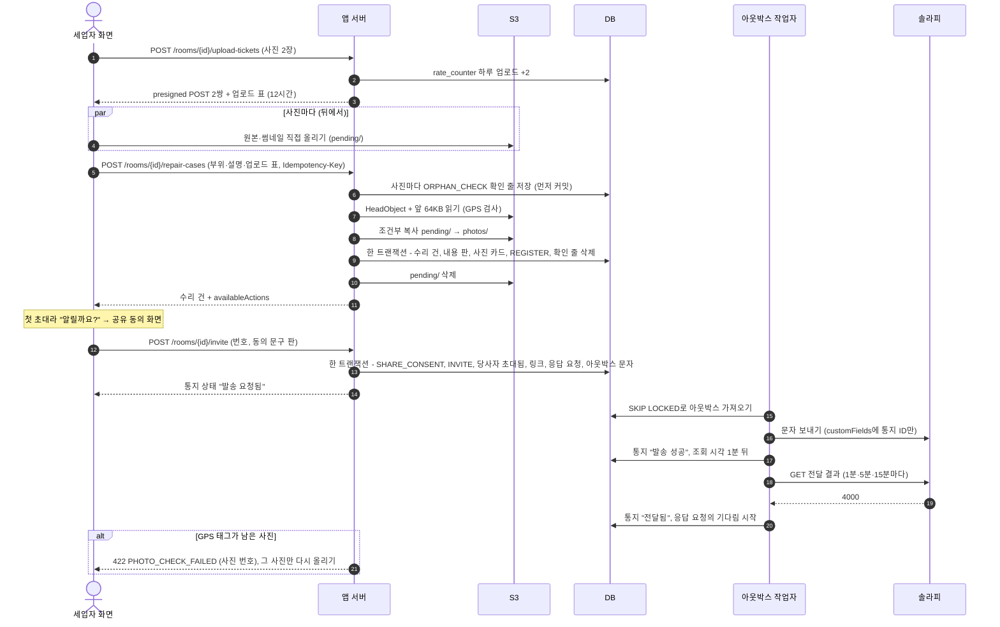
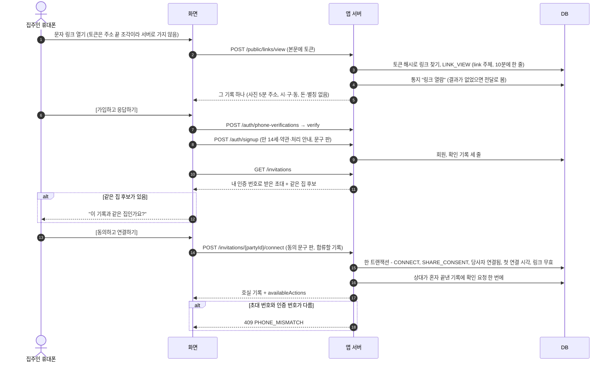
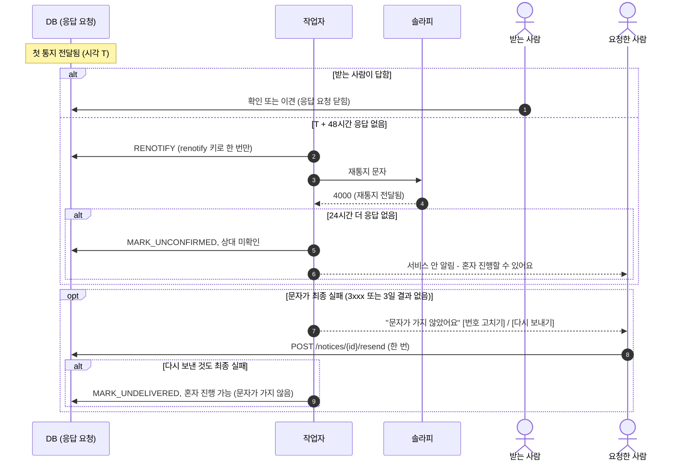
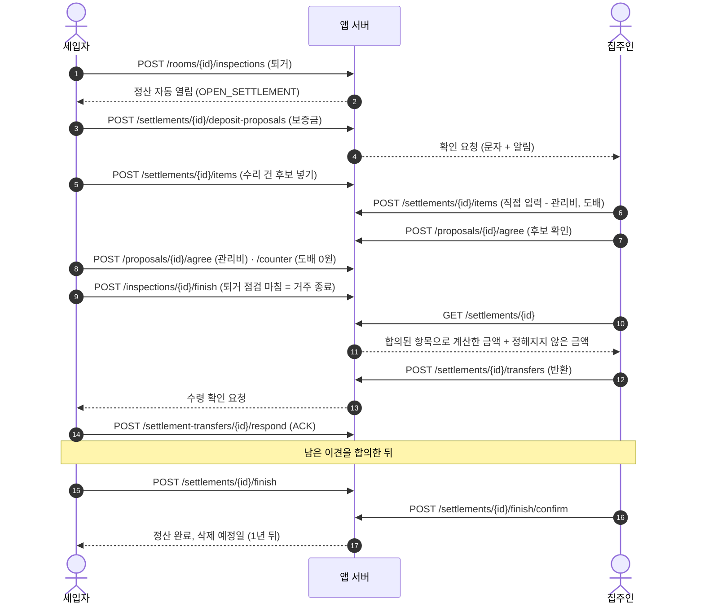
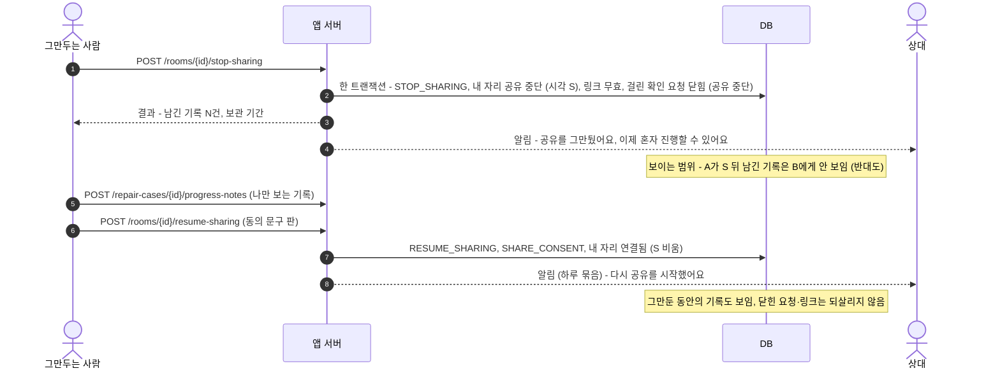
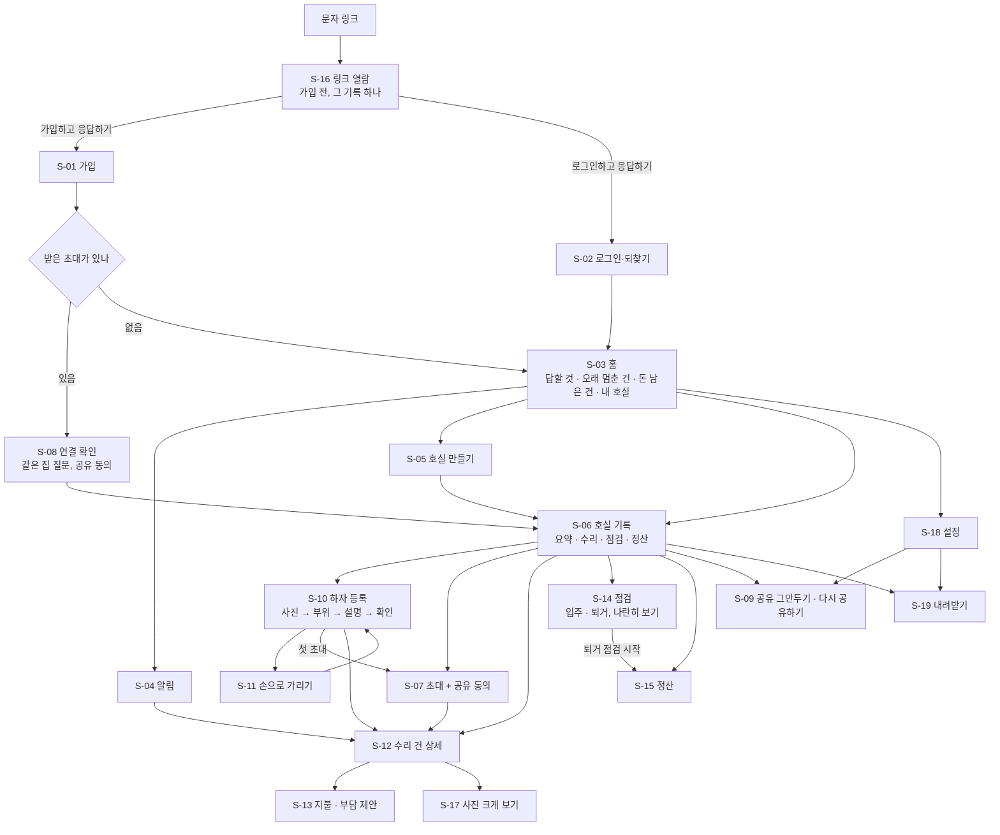

# 요구사항 명세

> `00-개요.md`의 MVP를 **같은 기준표**로 정리한 문서예요. 기능 하나가 시나리오, 상태와 규칙, ERD, API, 화면, 테스트 어디에 있는지 한 줄로 따라갈 수 있어요.
> 규칙의 정확한 정의는 `03-상태와-규칙.md`, 테이블은 `05-ERD-초안.md`가 기준이에요. 이 문서와 다르면 그 두 문서가 맞아요.
> 형식은 널리 쓰는 방식을 따랐어요: 우선순위 **MoSCoW**, 기능은 **사용자 이야기**(누가·무엇을·왜), 수용 기준은 **Gherkin 한국어 키워드**(`조건`·`만일`·`그러면`), 추적은 **요구사항 추적표**, 비기능은 **ISO/IEC 25010**, 지표는 **HEART**, 운영 목표는 **SLO**.
> 구성: 서문(목적·범위·제약·법) → 0 읽는 법·설정값 → 1 기능 표 → 2 추적표 → 3 수용 기준 → 4 API → 5 화면 → 6 비기능 → 7 지표 → 8 SLO → 부록 A 문구 원칙.

---

## 서문: 명세의 틀

ISO/IEC/IEEE 29148의 SRS 절(9.6)을 따라 앞부분을 두었어요. 대부분 이미 있는 문서를 가리켜요.

| 29148 절 | 이 문서의 자리 |
|---|---|
| 9.6.2 목적 · 9.6.3 범위 | 서문 P-1·P-2 |
| 9.6.4 제품 관점 · 9.6.11 외부 인터페이스 | 서문 P-3, 4장 API |
| 9.6.5·9.6.12 기능 | 1장 기능 표 |
| 9.6.6 사용자 특성 | 서문 P-4 |
| 9.6.7 제한 · 9.6.8 가정과 의존 | 서문 P-5·P-6 |
| 9.6.9 요구사항 배분 | 1장 MoSCoW·주차, WBS |
| 9.6.13 사용성 · 9.6.14 성능 · 9.6.18 품질 속성 | 6장 비기능(25010), 7장 지표, 8장 SLO |
| 9.6.15 논리 DB | `05-ERD-초안.md` |
| 9.6.16 설계 제약 | 서문 P-7 |
| 9.6.17 표준·법 준수 | 서문 P-8 |
| 9.6.19 검증 | 3장 수용 기준 |
| 9.6.20 참고 정보 | `GLOSSARY.md`, `../decisions.md`, 부록 A 문구 원칙 |

### P-1. 목적

세입자와 집주인이 한 호실의 집 상태·수리·정산 기록을 **함께, 고칠 수 없게** 남기는 반응형 웹의 요구사항을 정한다. 문제와 가치는 `00-개요.md` 1·2장, 문제 한 문장: "세입자와 집주인은 집 상태와 수리의 기록을 함께 보지 못해서, 수리는 늦어지고 퇴거 때 보증금을 근거 없이 다툰다."

### P-2. 범위

- **안**: MVP 세 개(호실 기록과 참여 / 수리 건의 경과 / 입주·퇴거와 정산 기록), 1장 Must·Should
- **다음**: P1(Could)
- **밖**: `00-개요.md` 4장의 확장·하지 않음(Won't). 특히 실제 송금, 판정·법률 판단, 기록 수정·삭제 기능, 외부 OCR·CDN, 주민등록번호 처리

### P-3. 제품 관점과 외부 인터페이스

시스템 구성은 `04-인프라-아키텍처.md` 맨 위 그림. 우리 시스템 밖과 만나는 곳은 다섯 개다.

| 외부 | 무엇을 주고받나 | 방향 | 규칙 |
|---|---|---|---|
| 사용자 브라우저 | HTTPS API(4장), 정적 화면 | 들어옴 | 유일한 외부 입구(웹훅 없음) |
| S3 | presigned POST 업로드·GET 보기(브라우저 ↔ S3 직접), 서버의 검사·복사·삭제 | 둘 다 | 앱 역할은 경로별 권한, `ListBucket`은 `pending/`만 |
| 솔라피 | 문자 발송, 전달 결과 조회 API | 나감 | API 키는 Parameter Store, 고정 IP 불필요 |
| Parameter Store | 비밀값·설정값 읽기 | 나감 | 앱이 켜질 때 직접(EC2 역할) |
| Slack | 장애 알림(지표 이름·숫자만) | 나감 | 개인정보 없음(국외 이전 없음) |

### P-4. 사용자 특성

| 사용자 | 누구 | 특성 | 화면에 주는 영향 |
|---|---|---|---|
| 세입자 | 정서윤(27세, 개발자, 다가구 원룸 월세) | 휴대폰에 익숙, 하자를 발견하면 바로 찍음 | 사진 먼저, 한 손 조작 |
| 집주인 | 김정호(58세, 원룸 8호실, 다른 동네) | 문자·카톡은 쓰지만 새 앱 설치는 꺼림 | 설치 없는 웹, 가입 없이 열람, 큰 글씨, "휴대폰 인증 한 번" |
| 링크 열람자 | 가입 전 집주인(또는 잘못된 번호의 사람) | 이 서비스를 처음 봄 | 그 기록 하나만, 위치 정보 없음 |
| 운영 담당 | 팀원 2명 | 개인정보취급자 | 운영 명령(`ops:<담당>`), 작업 대장, 1주차 교육 |

### P-5. 제한

- **판정하지 않는다**(`03-상태와-규칙.md` 기본 원칙 3): 책임·과실·금액을 서버가 정하지 않는다. 법이 요구하는 고지(유출 통지)만 예외.
- **덧붙이기만 한다**(원칙 1): 기록 수정·삭제 기능이 없다. 예외는 신원·연락처 칸과 개인정보 사진 파일 지우기.
- **실제 돈은 오가지 않는다**: 돈이 오간 사실만 기록한다.
- **운영 시간**: 서비스 운영 기간(발표 전까지)에는 평일 09~18시에만 서버가 켜진다(과정 규칙). 코드와 규칙에는 운영 시간을 넣지 않는다.
- **사용자**: 시연은 팀원만, 실제 집주인에게 문자를 보내지 않는다.

### P-6. 가정과 의존

| 가정·의존 | 확인 | 안 맞으면 |
|---|---|---|
| 솔라피 조회 API가 4000·3xxx 결과를 준다 | 3주차 실제 연동 | 가짜 발송기로 시연(줄이기 ④) |
| 브라우저가 HEIC·고화소 사진을 열어 다시 그린다(최신 크롬, 사파리 iOS 17 이상) | 1주차 기기 시험 | 안드로이드 크롬 HEIC는 "JPEG로 바꿔 주세요" 안내 |
| 문자 앱이 `#` 들어간 링크를 끝까지 연다 | 1주차 | 토큰은 경로에 두고 로그에서 가림 |
| 과정 계정에서 OIDC, CloudTrail 추적, RDS 로그 내보내기, 운영 역할, 버킷 추가가 된다 | 1주차 문의 | 인프라 문서 16장의 "안 되면" 표 |
| Hibernate가 UUID v7을 만든다 | 1주차 | 작은 생성기 클래스 |
| 도메인을 산다 | `homestamp.cloud`, 구입 확인 | HTTPS 인증서를 받을 수 없음(1주차 첫날 막힘) |

### P-7. 설계 제약

기능 표에서 뺀 "어떻게 만드는지"는 여기와 `04-인프라-아키텍처.md`에 있다.

| 영역 | 제약 | 근거 |
|---|---|---|
| 언어·버전 | Java 25 + Spring Boot 4.1.x, PostgreSQL(RDS), Flyway(`ddl-auto=validate`), React + Vite + TypeScript + shadcn/ui | `04-인프라-아키텍처.md` |
| 데이터 | 행동 기록이 원본(A·B·C 테이블), 수정 불가 행은 `@Immutable` + DB 트리거, 상태 변화는 순수 함수 `apply` 하나, 모든 테이블에 호실 기록 ID, 기본 키 UUID v7(Hibernate 생성) | `05-ERD-초안.md` 1·2 |
| 보이는 범위 | 권한 검사 함수 하나가 03-상태 3-1 표를 따른다 | `03-상태와-규칙.md` 3-1 |
| 통지 | 트랜잭셔널 아웃박스 + 앱 안 작업자(`SKIP LOCKED`), 전달 결과는 조회 API | `04-인프라-아키텍처.md` |
| 인증 | 액세스 JWT 15분(메모리), 리프레시 14일(HttpOnly·Secure·SameSite=Strict 쿠키, 로테이션, 재사용 감지) | `04-인프라-아키텍처.md` 4-1 |
| 사진 | 브라우저에서 다시 그림(원본 2048px·썸네일 480px JPEG), SHA-256 지문, presigned POST 직접 서명, 서버는 GPS 태그 검사·조건부 복사, 썸네일 주소는 자격 증명 수명 안 | `03-상태와-규칙.md` 사진 규칙 |
| 개인정보 | 기기에서 가리고 필요한 만큼만(원칙 7), 번호는 HMAC, 외부 CDN·외부 OCR·외부 분석 도구 없음, 로그에 본문·쿼리·토큰 없음 | 원칙 7, `03-상태와-규칙.md` 6장 |
| 비밀값 | 저장소·이미지·Terraform 파일에 없음, 앱은 EC2 역할 + Parameter Store, CI는 OIDC | 원칙 9, `04-인프라-아키텍처.md` |
| 배포 | EC2 한 대 블루/그린, 컨테이너 메모리 800MB, 운영 환경 하나 | `04-인프라-아키텍처.md` |
| 시간 | 서버 시각만, `Clock` 주입, UTC | 원칙 5 |

### P-8. 표준·법 준수

개인정보 보호법 등 조문별 대응은 `03-상태와-규칙.md` 6장이 기준이다. 요구사항과 이어지는 것만 여기 짝지었다.

| 조문 | 요구사항 |
|---|---|
| 제15조①4(계약 이행), 제22조③ | CONS-1(가입은 안내 후 확인) |
| 제17조①1·②(제3자 제공 동의) | CONS-2 |
| 제37조·제38조①④⑤(동의 철회) | CONS-3 |
| 제22조의2(14세 미만) | ACC-1a, CONS-1 |
| 제15조①6, 제20조(상대 번호, 정보주체 이외 수집) | ROOM-4, NOTI-9 |
| 제20조·제36조·제37조(기록 속 다른 사람) | PHO-7 |
| 제21조(파기), 제30조(처리방침) | KEEP-1~4, CONS-4, OPS-4 |
| 제24조의2(주민등록번호) | REP-1(입력 차단), OPS-5 |
| 제34조(유출 통지·신고) | 런북 `docs/runbooks/유출-대응.md` |
| 안전성 확보조치 고시(제5~8조) | `04-인프라-아키텍처.md` 8장(운영 접근, 접속기록 1년, 권한 대장 3년) |
| 위치정보법 제15조 | PHO-1a(GPS 태그 거절) |
| 정보통신망법 제50조(광고성 정보) | NOTI-9a(정보성 문구만), NOTI-1b(21~08시 보류) |

### P-9. 문서 식별과 변경

이 문서가 바뀌면 맨 아래 "변경 기록"에 판 번호·날짜·바뀐 ID를 한 줄로 남긴다. 결정이 바뀌는 경우는 `../README.md`의 바꾸는 절차(규칙 문서 + `decisions.md` 한 줄, 한 PR)를 따른다(29148 6.6.2 변경 관리에 해당).

---

## 0. 읽는 법

| 칸 | 뜻 |
|---|---|
| ID | `영역-번호`. 영역: ACC 계정, ROOM 호실·참여, LINK 링크, CONS 동의, KEEP 보관·탈퇴, REP 수리, PHO 사진, NOTI 통지, MONEY 돈, INSP 점검, SET 정산, DL 내려받기, OPS 운영 |
| 이야기 | 누가 · 무엇을 · 왜. 세 = 세입자, 집 = 집주인, 둘 = 둘 다, 팀 = 운영 담당 |
| MoSCoW | **Must**(MVP) / **Should**(MVP지만 밀리면 줄이기 순서대로 뺌, 번호 ①~⑤) / **Could**(P1) / **Won't**(이번엔 안 함, 4-2 확장·제외) |
| 규칙 | `03-상태와-규칙.md`의 절. 예: `D` = 상태 전이 표 D, `1-1` = 기다림 타이머, `3-1` = 보이는 범위 표 |
| 수용 기준 | 3장의 시나리오 ID(예: `REP-2a`). 비어 있으면 아직 검증 방법이 없다는 뜻 |
| 주차 | 처음 계획한 주차. **실제 배치와 담당은 WBS 2장이 기준**(팀 역할에 맞춰 일부가 옮겨짐) |

**줄이기 순서(Should)**: ② MONEY-4 역제안 ④ NOTI-11 실제 문자 연동(① 늦은 입주 점검과 ③ 부담 합의는 ⑤ MONEY-6 이체 확인증 사진 ⑥ KEEP-1 무활동 알림(KEEP-2 자동 마감은 ⑦ KEEP-3 보관 뒤 삭제 ⑧ DL-2 내려받기 완성판 ⑨ ROOM-6 같은 집 기록 ⑩ REP-8 원인 설명 ⑪ PHO-6 손으로 가리기 ⑫ LINK-3 정산 초대 링크 ⑬ ACC-5 아이디 찾기와 ACC-4의 번호 변경 ⑭ 모니터링 대시보드 꾸미기. 만들지 않는 것이 아니라 **순서만 뒤로**이고, 1주차 끝 실제 속도가 1.3배 이상이면 다시 Must로 올린다. 판단 지점은 2주차 금요일·3주차 금요일(운영 서버에서).
**Must 비율**: MoSCoW는 Must가 전체 노력의 60%를 넘지 않게 권한다. WBS(팀 역할 기준) 추정으로 개발 일은 약 78인-일이고, 그중 계획에 넣은 Should(줄이기 ② 다른 안, ④ 실제 문자 연동)가 약 2인-일, 계획 밖 Should ⑤~⑯이 약 10인-일이라 **Must가 약 86%**다. MVP 세 기능(하자·수리 기록, 수리비 부담 정하기, 입주·퇴거와 정산)의 핵심 흐름과 법이 요구하는 장치(공유 동의, 탈퇴, 개인정보 사진 지우기, 내려받기)라 더 내리기 어렵다. 그래서 일정의 완충은 Must를 줄이는 대신 **AI로 빨라지는 몫(1.3배 가정)과 4주차 여유**로 잡고, 1주차 끝 실제 속도로 다시 본다(WBS 6장).
**끝(Done) 기준**: 수용 기준 테스트 통과 · 화면 명세대로(`availableActions`) · 운영 서버 배포 · PR 리뷰 1명 · 관련 불변식 테스트 통과. 다섯 개를 모두 채운 기능만 "끝"으로 센다.

### 0-1. 설정값 (이름 = 기본값)

시간·횟수·크기는 모두 설정값이다(Parameter Store). 수용 기준과 테스트는 이 이름을 쓰고, 시연 영상 때만 값을 바꾼다. 기한은 사건이 생길 때 시각으로 저장해서 값을 바꿔도 이미 생긴 기한은 그대로다.

| 이름 | 기본값 | 쓰는 곳 |
|---|---|---|
| `wait.renotify` | 48h | 첫 통지가 전달된 뒤 재통지까지 |
| `wait.unconfirmed` | 24h | 재통지가 전달된 뒤 상대 미확인까지 |
| `notice.quiet-hours` | 21:00–08:00 | 문자 보류 |
| `delivery.unknown-after` | 3d | 전달 결과가 없으면 최종 실패로 |
| `delivery.poll` | 1m, 5m, 그 뒤 15m | 전달 결과 조회 |
| `notice.resend.max` | 1 | 최종 실패 뒤 다시 보내기 |
| `notice.collect` | 2m | 요청 문자를 모으는 시간(같은 받는 사람·같은 호실 회원 문자는 한 통) |
| `respond.draft.ttl` | 24h | 확인 카드에서 고르고 보내지 않은 것을 그 기기에 남기는 시간 |
| `sms.daily.member` | 20 | 한 계정이 하루에 보내는 문자 |
| `sms.daily.recipient` | 5 | 한 번호가 하루에 받는 문자 |
| `sms.daily.total` | 40 | 서비스 전체 하루 문자(솔라피 개인 계정 하루 50건 안쪽) |
| `repair.stale-after` | 14d | 오래 멈춘 건 |
| `progress.ask.interval` | 7d | 같은 사람이 같은 건에 진행 상황 다시 묻기 |
| `upload.ticket.ttl` | 12h | 업로드 표(올린 뒤 등록까지) |
| `upload.policy.ttl` | 5m | presigned POST |
| `verify.code.ttl` | 3m | 인증번호 유효 시간(팀 제안) |
| `verify.attempts.max` | 5 | 인증번호 한 번에 틀릴 수 있는 횟수 |
| `verify.daily.phone` | 5 | 한 번호의 하루 인증 문자 |
| `link.view.rate` | IP당 분당 20 | 링크 조회 제한(nginx `limit_req`) |
| `password.rule` | 8자 이상, 영문·숫자 포함 | 비밀번호 규칙 |
| `upload.batch.max` | 10장 | 한 번에 고르는 사진(행동 하나) |
| `photo.max.repair` | 30장 | 수리 건 카드에 붙는 사진 전부(하자·진행 상황·수리 후·다시 요청 근거·원인 설명·지불 증빙, 지운 사진은 세지 않음, 제출 때 수리 건 행을 잠그고 셈) |
| `photo.max.inspection` | 40장 | 점검 하나 전체 |
| `photo.max.settlement-item` | 10장 | 정산 항목 하나의 증빙 |
| `upload.size.max` | 10MB | 장당(다시 그린 JPEG 기준) |
| `upload.daily.member` | 100장 | 한 회원의 하루 업로드 표 |
| `pending.cleanup-after` | 24h | 등록하지 않은 사진 정리 |
| `orphan.check-after` | 1h | 고아 파일 확인 |
| `photo.url.member` | 정각 + 2h(자격 증명 만료 − 10분을 넘지 않음) | 회원 썸네일 주소 |
| `photo.url.short` | 5m | 원본, 링크 열람자 |
| `link.view.dedupe` | 10m | 같은 링크 열람을 한 줄로 |
| `inactivity.notice-after` | 1y | 거주 중 무활동 알림 |
| `settlement.autoclose-after` | 90d | 거주 종료 뒤 정산 자동 마감 |
| `retention.after-settled` | 1y | 정산 완료 뒤 삭제 |
| `retention.notice-before` | 30d, 7d | 삭제·마감 예고 |
| `notification.ttl` | 30d | 서비스 안 알림 |
| `log.access.retention` | 30d | 접속 로그·S3 접근 로그 |

**하루 문자 한도를 넘으면**(새로 정함): 그 문자는 버리지 않고 **다음 날 08시로 미룬다**(아웃박스 `next_attempt_at`). 보낸 사람에게 "오늘 보낼 수 있는 문자를 다 써서 내일 아침에 보내요"를 서비스 안 알림으로 알린다. 기다림은 전달된 시각부터 세므로 미뤄진 만큼 받는 사람이 불리해지지 않는다. 서비스 전체 한도에 닿으면 Slack에 숫자만 알린다.

**주소 저장 범위**(새로 정함): **시·도, 시·군·구, 읍·면·동**과 호실 별칭만 저장한다. 번지·건물명·도로명은 받지 않는다(동 이름은 구가 달라도 겹칠 수 있어서 시·구까지 둔다). 링크 화면에는 시·구·동까지만 보이고 별칭은 보이지 않는다.

---

## 1. 기능 표

### 1-1. 계정 (ACC)

| ID | 기능 | 이야기(누가 · 무엇을 · 왜) | MoSCoW | 규칙 | 수용 기준 | 주차 |
|---|---|---|---|---|---|---|
| ACC-1 | 회원가입 | 둘 · 이메일·비밀번호·이름과 휴대폰 인증 한 번으로 가입 · 응답하고 기록을 함께 쓰려고 | Must | L, 6-2 | ACC-1a~e | 1 |
| ACC-2 | 로그인과 로그인 유지 | 둘 · 로그인하고 한동안 다시 로그인하지 않기 · 문자 링크를 눌러 바로 응답하려고 | Must | L | ACC-2a~d | 1 |
| ACC-3 | 번호는 한 계정에만 | 둘 · 내 번호를 다른 계정이 쓰면 알기 · 내 이름으로 남이 연결하지 못하게 | Must | L | ACC-3a | 1 |
| ACC-4 | 내 정보 수정 | 둘 · 이름·비밀번호·번호를 바꾸기 · 번호를 바꿔도 기록을 이어 쓰려고 | Must(번호 변경 ACC-4b만 Should ⑬) | L | ACC-4a~b | 2 |
| ACC-5 | 아이디 찾기·비밀번호 재설정 | 둘 · 휴대폰 인증으로 계정을 되찾기 · 관리자가 없어서 | Must(아이디 찾기 ACC-5a만 Should ⑬) | L | ACC-5a~b | 2 |
| ACC-6 | 문자 설정 | 둘 · 문자를 끄고 서비스 안 알림만 받기 · 문자가 귀찮을 때 | Must | K, 1-1 | ACC-6a | 2 |

### 1-2. 호실과 참여 (ROOM)

| ID | 기능 | 이야기 | MoSCoW | 규칙 | 수용 기준 | 주차 |
|---|---|---|---|---|---|---|
| ROOM-1 | 호실 기록 만들기 | 둘 · 이 호실에서 내 쪽(임차인 / 임대인)과 주소(시·구·동)·별칭·입주일로 호실 기록을 만들기 · 한 거주 기간의 기록을 한곳에 모으려고 | Must | A | ROOM-1a~d | 1 |
| ROOM-2 | 권한은 호실마다 쪽으로 | 둘 · 이 호실에서 내가 세입자 쪽인지 집주인 쪽인지로 할 일이 정해지기 · 같은 사람이 다른 호실에서는 다른 역할이어서 | Must | 3, 3-1 | ROOM-2a~c | 1 |
| ROOM-3 | 부위 목록 | 둘 · 기본 6구역 28개를 둘러보고 호실에 맞게 더하거나 숨기기 · 빠뜨리지 않으려고 | Must | H | ROOM-3a | 1 |
| ROOM-4 | 상대 초대 | 세 · 하자를 올리고 집주인에게 알리기 · 중간 전달자 없이 결정권자에게 닿으려고 | Must | B | ROOM-4a~d | 2 |
| ROOM-5 | 연결 | 집 · 문자 링크에서 가입해 그 호실에 연결하기 · 응답하고 내 기록도 남기려고 | Must | B | ROOM-5a~b | 2 |
| ROOM-6 | 같은 집 기록 두 개 | 세 · 이미 만든 내 기록과 상대의 기록 중 하나로 모으기 · 같은 집 기록이 둘로 갈리지 않게 | Should ⑨ | B | ROOM-6a~b | 2 |
| ROOM-7 | 혼자 기록 | 세 · 집주인 없이도 기록하기 · 나중에 근거로 쓰려고 | Must | 1-1 | ROOM-7a~b | 1~2 |
| ROOM-8 | 혼자 진행 가능 | 둘 · 상대가 답하지 않아도 사실은 남기기 · 기다림에 끝이 있게 | Must | 1-1 | ROOM-8a | 2 |
| ROOM-9 | 거주 종료 | 세 · 이사했다고 남기기 / 집 · 거주 종료를 요청하기 · 정산으로 넘어가려고 | Must | A | ROOM-9a~b | 3 |

### 1-3. 링크 (LINK)

| ID | 기능 | 이야기 | MoSCoW | 규칙 | 수용 기준 | 주차 |
|---|---|---|---|---|---|---|
| LINK-1 | 초대 링크 열람 | 집 · 가입하지 않고 문자 링크로 그 기록을 보기 · 무엇인지 먼저 확인하려고 | Must | C, 3-1 | LINK-1a~h | 1(초대·문자는 2주차라 1주차는 개발용 링크 발급으로 확인) |
| LINK-2 | 링크 화면 보호 | 세 · 잘못된 사람이 링크를 열어도 우리 집이 어디인지 모르게 · 번호를 잘못 넣거나 재활용 번호일 때를 대비해 | Must | 6-1 | LINK-2a~c | 1 |
| LINK-3 | 정산 초대 링크 | 둘 · 한 번도 연결되지 않은 상대에게 가입해서 함께 정산을 확인하자고 권하기(연결 전에는 요청을 만들지 않으므로 권하는 문자, 연결하면 요청이 생김) · 퇴거 뒤에도 함께 정산하려고 | Should ⑫ | C | LINK-3a | 3 |
| LINK-4 | 링크 자동 종료 | 세 · 번호를 고치거나 연결·이사·공유 중단이 되면 옛 링크가 닫히기 · 더는 볼 필요 없는 사람이 보지 않게 | Must | C | LINK-4a | 2 |
| LINK-5 | 링크 관리, 수리업체 공유 링크 | 둘 · 링크를 직접 끄고, 업체에 돈 없이 보여 주기 | Could | C | - | - |

### 1-4. 동의와 처리방침 (CONS)

| ID | 기능 | 이야기 | MoSCoW | 규칙 | 수용 기준 | 주차 |
|---|---|---|---|---|---|---|
| CONS-1 | 가입 확인 항목 | 둘 · 만 14세 이상, 약관, 개인정보 처리 안내를 확인하기 · 무엇을 위해 내 정보를 쓰는지 알려고 | Must | 6-2 | CONS-1a | 1 |
| CONS-2 | 기록 공유 동의 | 둘 · 내 기록을 누구에게 무엇을 보여 주는지 보고 동의하거나 나만 보기 · 내가 정해서 보여 주려고 | Must | 6-2 | CONS-2a~b | 2 |
| CONS-3 | 공유 그만두기 | 둘 · 버튼 하나로 공유를 멈추고, 다시 공유하기로 되돌리기 · 동의를 거두고 다시 할 수 있어야 해서 | Must | B, 6-2, 3-1 | CONS-3a~d | 2 |
| CONS-4 | 처리방침·약관 페이지 | 둘 · 바뀐 약관을 알고 다시 확인하기 · 무엇이 바뀌었는지 알려고 | Must | 6-2 | CONS-4a~c | 1~2 |

### 1-5. 보관과 탈퇴 (KEEP)

| ID | 기능 | 이야기 | MoSCoW | 규칙 | 수용 기준 | 주차 |
|---|---|---|---|---|---|---|
| KEEP-1 | 거주 중 무활동 알림 | 둘 · 1년 동안 쓰지 않으면 아직 사는지 묻는 알림만 받기 · 거주 중 기록이 사라지지 않게 | Should ⑥ | 6-3 | KEEP-1a | 4 |
| KEEP-2 | 정산 자동 마감 | 둘 · 이사 뒤 90일이 지나면 정산이 저절로 마감되기 · 끝없이 열려 있지 않게 | Must(정산 끝내기 반대의 안전장치) | A, 6-3 | KEEP-2a | 4 |
| KEEP-3 | 보관 뒤 삭제 | 둘 · 정산 완료 1년 뒤 예고를 받고 기록이 지워지기 · 필요 없는 개인정보가 남지 않게 | Should ⑦ | A, 6-3 | KEEP-3a~b | 4 |
| KEEP-4 | 탈퇴 | 둘 · 언제든 탈퇴하되 상대와 함께 쓴 기록은 상대에게 남기 · 내 정보는 지우고 상대의 근거는 지키려고 | Must | L, 6-4 | KEEP-4a~c | 2 |

### 1-6. 수리 (REP)

| ID | 기능 | 이야기 | MoSCoW | 규칙 | 수용 기준 | 주차 |
|---|---|---|---|---|---|---|
| REP-1 | 하자 등록 | 둘 · 부위·제목·사진(1장 이상)으로 하자를 올리기(설명은 선택) · 언제 무엇을 알렸는지 근거와 함께 남기려고 | Must | D | REP-1a~d | 1 |
| REP-2 | 하자 응답(맞아요·보류·이견)과 다시 요청 | 둘 · 상대가 올린 하자에 맞아요, 더 필요해요(보류), 사실과 달라요(이견)로 답하고, 등록한 쪽은 근거를 더해 다시 요청하기 · 같은 사실을 함께 보려고 | Must | D | REP-2a~f | 2 |
| REP-3 | 하자 인정 표시 | 둘 · 수리와 따로 상대가 하자를 인정했는지 보기 · 먼저 고쳐도 인정 여부가 남게 | Must | D | REP-3a | 2 |
| REP-4 | 수리 시작 | 둘 · 확인 전이나 이견이 있어도 수리를 시작하기 · 급한 하자를 기다리지 않으려고 | Must | D | REP-4a | 2 |
| REP-5 | 종료 | 둘 · 종료를 요청하고 상대가 확인하면 끝내기 · 끝났다는 사실을 함께 남기려고 | Must | D | REP-5a~e | 2 |
| REP-6 | 멈춘 수리 건 | 세 · 오래 멈춘 건을 보고 진행 상황을 묻거나 남기기 · 막힌 사정이 결정권자에게 닿게 | Must | D | REP-6a~d | 2 |
| REP-7 | 고치기 | 둘 · 확인받기 전엔 바로 고치고, 확인받은 내용은 상대가 확인하면 바뀌게 하기 · 기록을 지우지 않고 바로잡으려고 | Must | G | REP-7a~j | 2 |
| REP-8 | 원인 설명 | 둘 · 원인에 대한 내 생각과 근거를 남기기 · 판정 없이 누가 무엇을 근거로 말했는지 보이게 | Should ⑩ | E | REP-8a~b | 2 |
| REP-9 | 사유 필수 | 둘 · "아니오"라고 할 때 이유를 남기기 · 나중에 왜 그랬는지 알 수 있게 | Must | D~I | REP-9a | 2 |
| REP-11 | 경과 보기 | 둘 · 수리 건의 등록·문자 상태·확인·수리·지불·제안·고치기·종료를 시간순으로 보기 · 누가 언제 무엇을 했는지 한눈에 | Must | D, K, 3-1 | REP-11a | 2 |
| REP-10 | 같은 행동은 한 번만 | 둘 · 두 번 눌러도 한 번만 남기 · 기록이 어긋나지 않게 | Must | 1-3 | REP-10a | 1 |

### 1-7. 사진 (PHO)

| ID | 기능 | 이야기 | MoSCoW | 규칙 | 수용 기준 | 주차 |
|---|---|---|---|---|---|---|
| PHO-1 | 사진 올리기 | 둘 · 큰 사진도 빠르게 올리고 위치 정보는 남지 않기 · 휴대폰 사진을 그대로 근거로 쓰려고 | Must | 6-1 | PHO-1a~e | 1 |
| PHO-2 | 사진 보기 | 둘 · 목록은 작은 사진으로 빠르게, 누르면 원본으로 보기 · 데이터를 아끼려고 | Must | 6-1, 3-1 | PHO-2a | 1 |
| PHO-3 | 링크에서 숨김 | 둘 · 내 사진을 링크 화면에서만 숨기기 · 가입 전 사람에게 보이기 싫은 사진이 있어서 | Must | 3 | PHO-3a | 2 |
| PHO-4 | 제출 전 확인 | 둘 · 등록 전에 사진에 개인정보가 없는지 한 번 더 보기 · 실수로 올리지 않게 | Must | 6-1 | PHO-4a | 1 |
| PHO-5 | 개인정보 사진 지우기 | 둘 · 개인정보가 찍힌 내 사진을 언제든 지우기 · 지운 사실은 남기면서 | Must | 6-1 | PHO-5a~d | 2 |
| PHO-6 | 손으로 가리기 | 둘 · 계좌번호·얼굴·송장을 칠해서 가리고 올리기 · 필요한 것만 보여 주려고 | Should ⑪ | F, 6-1 | PHO-6a | 2 끝 |
| PHO-7 | 다른 사람의 요청 | 팀 · 사진 속 다른 사람의 요청을 올린 사람에게 전하고 기한이 지나면 파일만 지우기 · 당사자가 아닌 사람의 권리를 지키려고 | Must | 6-1 | PHO-7a | 3 |
| PHO-9 | 잘못 올린 사진 표시 | 둘 · 엉뚱한 사진을 지우지 않고 흐리게 뒤로 보내기 · 기록은 남기면서 헷갈리지 않게 | Must | G | PHO-9a~b | 3 |
| PHO-8 | OCR 자동 찾기 | 둘 · 계좌번호를 자동으로 찾아 미리 칠해 주기 | Could | F | - | - |

### 1-8. 통지 (NOTI)

| ID | 기능 | 이야기 | MoSCoW | 규칙 | 수용 기준 | 주차 |
|---|---|---|---|---|---|---|
| NOTI-1 | 통지 전달 보장 | 세 · 알리기를 누르면 빠짐없이, 두 번 가지 않게 문자가 가기 · 알렸다는 사실이 확실하게 | Must | K | NOTI-1a~b | 2 |
| NOTI-2 | 문자 대상 | 둘 · 답해야 하는 일만 문자로 받기 · 문자가 많아 무시하지 않게 | Must | K | NOTI-2a | 2 |
| NOTI-3 | 전달 결과 | 세 · 문자가 상대 휴대폰에 닿았는지 알기 · 받지 못한 사람을 미확인으로 몰지 않게 | Must | K | NOTI-3a~d | 2 |
| NOTI-4 | 통지 상태 보기 | 세 · 보냈는지, 받았는지, 열어 봤는지를 한 줄로 보기 · 어디까지 닿았는지 오해 없이 알려고 | Must | K | NOTI-4a~b | 2 |
| NOTI-5 | 재통지·미확인 | 세 · 답이 없으면 한 번 더 알리고 그래도 없으면 미확인으로 남기 · 기다림에 끝이 있게 | Must | 1-1 | NOTI-5a~e | 2 |
| NOTI-6 | 문자 실패 | 세 · 문자가 가지 않으면 번호를 고치거나 한 번 더 보내고, 그래도 안 되면 혼자 진행하기 · 막히지 않게 | Must | K, 1-1 | NOTI-6a~b | 2 |
| NOTI-7 | 서비스 안 알림과 확인 카드 | 둘 · 답할 것을 확인 카드 하나에서 보고 한 번에 보내기 · 놓치지 않고, 보지 않고 도장 찍지 않게 | Must | K, 1-4 | NOTI-7a~d | 2 |
| NOTI-8 | 수신 거부 | 집(비회원) · 문자를 그만 받기 · 원하지 않는 문자를 막으려고 | Must | K | NOTI-8a | 2 |
| NOTI-9 | 문자 규칙과 한도 | 팀 · 정보성 문구만, 하루 한도 안에서 보내기 · 광고로 보이지 않고 비용을 지키려고 | Must | K | NOTI-9a~d | 2 |
| NOTI-10 | 실시간 반영(SSE) | 둘 · 열어 둔 화면이 새로고침 없이 바뀌기 | Could | - | - | - |
| NOTI-11 | 실제 문자 연동(솔라피) | 팀 · 가짜 발송기 대신 실제 문자를 보내고 결과를 받기 · 시연을 실제처럼 | Should ④ | K | NOTI-11a | 3 |

### 1-9. 돈 (MONEY)

| ID | 기능 | 이야기 | MoSCoW | 규칙 | 수용 기준 | 주차 |
|---|---|---|---|---|---|---|
| MONEY-1 | 지불 기록 | 둘 · 누가 누구에게 얼마를 냈는지 남기기 · 정산 때 장부를 다시 만들지 않게 | Must | F | MONEY-1a~b | 2 |
| MONEY-2 | 금액 확인·이견·고치기 | 둘 · 상대가 남긴 금액을 확인하거나 이견을 남기기 · 같은 숫자를 보려고 | Must | F, G | MONEY-2a~b | 2 |
| MONEY-3 | 부담 합의 | 둘 · 누가 얼마를 부담할지 제안하고 동의하기 · 판정 없이 합의만 남기려고 | Must(MVP 핵심 기능) | E, 1-2 | MONEY-3a~d | 2 |
| MONEY-4 | 역제안 | 둘 · 이견과 함께 다른 안을 내기 · 대화를 기록 안에서 이어 가려고 | Should ② | 1-2 | MONEY-4a | 3 |
| MONEY-5 | 고쳤지만 돈이 남은 건 | 둘 · 수리는 끝났는데 돈이 남은 건을 모아 보기 · 정산 전에 정리하려고 | Must | E | MONEY-5a | 2 |
| MONEY-6 | 이체 확인증 사진 | 둘 · 지불 증빙으로 이체 확인증을 가려서 올리기 · 금액 확인을 쉽게 | Should ⑤ | F | MONEY-6a | 3 |

### 1-10. 점검 (INSP)

| ID | 기능 | 이야기 | MoSCoW | 규칙 | 수용 기준 | 주차 |
|---|---|---|---|---|---|---|
| INSP-1 | 입주 점검 | 둘 · 입주 때 있던 하자를 함께 확인해 잠그기 · 퇴거 때 "원래 있던 것"을 다투지 않으려고 | Must | H | INSP-1a~e | 3 |
| INSP-2 | 늦은 입주 점검 | 세 · 살다가 가입해도 입주 점검을 남기기(늦었다는 표시와 함께) | Must(핵심 페르소나) | H | INSP-2a~b | 3 |
| INSP-3 | 퇴거 점검 | 둘 · 같은 부위의 입주·퇴거 사진을 나란히 보기 · 원상복구를 근거로 이야기하려고 | Must | H | INSP-3a~b | 3 |

### 1-11. 정산 (SET)

| ID | 기능 | 이야기 | MoSCoW | 규칙 | 수용 기준 | 주차 |
|---|---|---|---|---|---|---|
| SET-1 | 정산 열기·보증금 | 둘 · 퇴거 점검과 함께 정산을 열고 보증금을 확인하기 | Must | I | SET-1a~b | 3 |
| SET-2 | 정산 항목 | 둘 · 수리 건에서 온 금액과 직접 입력한 항목을 하나씩 합의하기 · 한쪽이 혼자 빼거나 넣지 못하게 | Must | I | SET-2a~e | 3 |
| SET-3 | 정산 세 칸과 계산 | 둘 · 합의된 것만으로 계산한 금액을 보기 · 정해지지 않은 금액을 따로 보려고 | Must | I | SET-3a | 3 |
| SET-4 | 반환·추가 송금·수령 | 둘 · 보증금을 돌려준 것과 받은 것을 남기고, 잘못 적으면 바로잡기 · 돈이 오간 사실을 맞추려고 | Must | J | SET-4a~e | 3 |
| SET-5 | 정산 끝내기 | 둘 · 정산을 함께 끝내기 · 이사와 따로 끝내려고 | Must | A, 1-4 | SET-5a~d | 3 |

### 1-12. 내려받기 (DL)

| ID | 기능 | 이야기 | MoSCoW | 규칙 | 수용 기준 | 주차 |
|---|---|---|---|---|---|---|
| DL-1 | 내려받기 최소판 | 둘 · 기록과 원본 사진을 ZIP으로 받기 · 지워지기 전이나 탈퇴 전에 챙기려고 | Must | 6-3 | DL-1a~b | 2 끝 |
| DL-2 | 내려받기 완성판 | 둘 · 인터넷 없이 열리는 기록 보기와 인쇄용 화면 | Should ⑧ | 6-3 | DL-2a | 4 |
| DL-3 | 퇴거 보고서 PDF | 둘 · 한 문서로 내보내기 | Could | - | - | 4 |

### 1-13. 운영 (OPS)

| ID | 기능 | 이야기 | MoSCoW | 규칙 | 수용 기준 | 주차 |
|---|---|---|---|---|---|---|
| OPS-1 | 켜질 때 따라잡기 | 팀 · 서버가 꺼졌다 켜져도 밀린 일을 한 번씩만 하기 · 평일 낮에만 켜져서 | Must | 4 | OPS-1a | 2 |
| OPS-2 | 고아 파일 확인 | 팀 · 카드 없는 사진 파일이 남지 않기 · 지울 수 없는 개인정보가 남지 않게 | Must | 5(17) | OPS-2a~b | 2 |
| OPS-3 | 운영 명령 | 팀 · 법적 요청을 서비스 규칙대로 처리하고 누가 했는지 남기기 · 관리자 화면 없이 | Must | 6-1 | OPS-3a | 3 |
| OPS-4 | 전체 삭제 명령 | 팀 · 발표 뒤 운영 데이터를 기록을 남기며 모두 지우기 · 관리하지 않는 개인정보가 남지 않게 | Must | - | OPS-4a | 4 |
| OPS-5 | 계약 정보 입력 + PDF 자동 채우기 | 둘 · 계약 내용을 함께 확인해 두기 | Could | - | - | - |

**Won't(이번엔 안 함)**: `00-개요.md` 4장의 확장(실사용자 시범 운영, 대시보드, 기록 합치기, 카카오 로그인, 웹 푸시, 동거인·당사자 교체, 채팅 등)과 제외(결제·송금, 판정·법률 판단, 영상, 증빙 판독).

---

## 2. 추적표

기능 하나가 어느 층에 있는지 한 줄로 따라가요. API는 4장 표마다, 화면은 5장 화면 목록마다 기능 ID 칸이 있어서 거꾸로 따라갈 수 있어요.

| ID | 시나리오 | 상태와 규칙 | ERD(테이블 · 행동) | 불변식 |
|---|---|---|---|---|
| ACC-1 | 1-1, 2-1 | L, 6-2 | `member`, `phone_verification`, `member_acknowledgement`(AGE_14_CONFIRMED·TERMS_AGREED·PRIVACY_NOTICE_ACK) | 8 |
| ACC-2 | - | L | `refresh_token` | 12 |
| ACC-3 | - | L | `member.phone` UNIQUE | 8 |
| ACC-4 | - | L | `member`, `refresh_token` | - |
| ACC-5 | - | L | `phone_verification`(RESET/FIND_ID) | - |
| ACC-6 | 5장 | K, 1-1 | `member.sms_enabled` | 4 |
| ROOM-1 | 1-1, 2-1 | A | `room_record`, `room_part`, `party`(EMPTY/NUMBER_ONLY) | 13 |
| ROOM-2 | - | 3, 3-1 | `party.side`, `UNIQUE(room_record_id, member_id)` | 13 |
| ROOM-3 | - | H | `part_template`, `room_part` | - |
| ROOM-4 | 1-2·3, 2-2, 3-3 | B | `party`(INVITED), `link`, `notice` · `SHARE_CONSENT` | 13 |
| ROOM-5 | 1-6, 2-3 | B | `party`(CONNECTED), `room_record.counterpart_first_connected_at` · `CONNECT`, `SHARE_CONSENT` | - |
| ROOM-6 | 2장 메모 | B | `room_record.joined_into_id` · `JOIN` | - |
| ROOM-7 | 3장 | 1-1 | `repair_case.solo`, `first_shown_at` | - |
| ROOM-8 | 1-A, 1-K | 1-1 | `response_request.solo_reason` | 2, 4 |
| ROOM-9 | 4-13 | A | `room_record.status`(ENDED), `response_request`(END_REQUEST) · `MOVE_OUT`, `REQUEST_END` | 9 |
| LINK-1 | 1-5 | C, 3-1 | `link`, `photo_visibility.hidden_on_link` · `LINK_VIEW`(`link:<ID>`) | 5, 7 |
| LINK-2 | 1-G | 6-1 | `link.token_hash`, `failed_view_count` | 7 |
| LINK-3 | 4장 메모 | C | `link`(SETTLEMENT_INVITE) | 7 |
| LINK-4 | 1-G | C | `link.invalidated_at`, `invalidated_reason` | 7 |
| CONS-1 | - | 6-2 | `member_acknowledgement` | - |
| CONS-2 | 1-2, 1-6 | 6-2 | `action`(SHARE_CONSENT, payload에 문구 판) | - |
| CONS-3 | - | B, 6-2, 3-1 | `party`(SHARING_STOPPED, `sharing_stopped_at`), `link` · `STOP_SHARING` | 18 |
| CONS-4 | - | 6-2 | 정적 페이지 + `member_acknowledgement.text_version` | - |
| KEEP-1 | - | 6-3 | `action`(마지막 당사자 행동, 인덱스로 계산), `room_record.inactivity_notice_due_at` | - |
| KEEP-2 | - | A, 6-3 | `room_record.autoclose_due_at` · `AUTOCLOSE` | - |
| KEEP-3 | - | A, 6-3 | `room_record.delete_due_at`, `deletion_log`, `outbox`(S3_DELETE·AUDIT_WRITE) | 1 |
| KEEP-4 | - | L, 6-4 | `member`(WITHDRAWN), `photo_visibility`(WITHDRAWAL), `deletion_log` | 1 |
| REP-1 | 1-2 | D | `repair_case`(NOT_STARTED, `defect_ack` PENDING), `repair_content`, `photo` · `REGISTER` | 14 |
| REP-2 | 1-7, 1-B | D | `repair_case`, `response_request`(DEFECT_CONFIRM) · `RESPOND_DEFECT` | - |
| REP-3 | 1-M | D | `repair_case.defect_ack` | - |
| REP-4 | 1-8, 1-M | D | `repair_case`(IN_PROGRESS) · `START_REPAIR` | - |
| REP-5 | 1-11·12, 1-E, 1-K, 1-L | D | `repair_case.closed_by`, `previous_case_id`, `response_request`(CLOSE_CONFIRM) · `REQUEST_CLOSE`, `CONFIRM_CLOSE`, `NOT_YET`, `REOPEN` | 3 |
| REP-6 | 1-N | D | `progress_note`, `response_request`(PROGRESS_CHECK) · `ASK_PROGRESS`, `NOTE_PROGRESS` | - |
| REP-7 | 1-F | G | `correction_request`, 판 테이블들(`*_content`·`*_version`) · `CORRECT`, `RESPOND_CORRECTION`, `RESUBMIT_CORRECTION` | 15 |
| REP-8 | 1-C | E | `cause_note` | - |
| REP-9 | 1-B·D·E | D~I | `action.reason` | - |
| REP-10 | - | 1-3 | `action.idempotency_key` UNIQUE | 1 |
| REP-11 | 1장 경과 | D, K, 3-1 | `action`, `notice`(보낸 쪽) · `GET /rooms/{id}/timeline`, 수리 건 상세 | 1 |
| PHO-1 | 1-2 | 6-1 | `photo`, `outbox`(ORPHAN_CHECK) | 11, 14, 17 |
| PHO-2 | - | 6-1, 3-1 | (서명 계산, 저장 없음) | 7 |
| PHO-3 | - | 3 | `photo_visibility.hidden_on_link` · `HIDE_PHOTO` | - |
| PHO-4 | - | 6-1 | (화면, 저장 없음) | - |
| PHO-5 | - | 6-1 | `photo_visibility`(PRIVACY), `in_app_notification.group_key` · `ERASE_PHOTO` | 16 |
| PHO-6 | - | F, 6-1 | (화면 부품, 저장 없음) | 14 |
| PHO-7 | - | 6-1 | `photo_visibility`(THIRD_PARTY) · `ERASE_PHOTO`(`ops:<담당>`) | 16 |
| PHO-9 | - | G | `photo_visibility.marked_wrong_at` · `MARK_PHOTO_WRONG`, `UNMARK_PHOTO_WRONG` | - |
| NOTI-1 | 1-3 | K | `outbox`, `notice` | - |
| NOTI-2 | 1-3·9·11 | K | `response_request.kind` | - |
| NOTI-3 | 5장 | K | `notice`(DELIVERED/FAILED, `provider_message_id`, `next_poll_at`) | 4 |
| NOTI-4 | 5장 | K | `notice`(`scheduled_for`) | - |
| NOTI-5 | 1-A | 1-1 | `response_request`(`first_notified_at`, `renotify_due_at`, `unconfirmed_due_at`) · `RENOTIFY`, `MARK_UNCONFIRMED` | 4 |
| NOTI-6 | 5장 | K, 1-1 | `notice`(FAILED), `response_request.solo_reason`(SMS_UNDELIVERED) · `RESEND_NOTICE` | 4 |
| NOTI-7 | - | K | `in_app_notification` | - |
| NOTI-8 | 5장 메모 | K | `sms_opt_out`, `party.invite_phone` NULL | - |
| NOTI-9 | 5장 | K | `rate_counter`(보낸 문자 한 통마다, 모은 문자도 한 통)로 한도, 넘으면 `outbox.next_attempt_at`·`notice.scheduled_for` 다음 날 08시 | - |
| NOTI-11 | 5장 | K | `notice.provider_message_id`, 가짜 발송기 설정 | 4 |
| MONEY-1 | 1-9 | F | `payment`, `payment_version`, `photo`(EVIDENCE) · `RECORD_PAYMENT` | - |
| MONEY-2 | 1-10 | F, G | `payment.confirm_strength`, `correction_request` | 15 |
| MONEY-3 | 1-9·10, 1-C·I | E, 1-2 | `proposal`, `proposal_line`, `repair_case.money_status` · `PROPOSE`, `AGREE`, `DISPUTE`, `WITHDRAW` | 2 |
| MONEY-4 | 1-D | 1-2 | `proposal.counter_of_id`, `round` · `COUNTER` | 2 |
| MONEY-5 | 1-H | E | (조회 계산) | - |
| MONEY-6 | 1-9 | F | `photo`(EVIDENCE), `payment_version.evidence_kind` | 14 |
| INSP-1 | 2-2·4, 4-1·2 | H | `inspection`(MOVE_IN), `inspection_item`, `inspection_item_version`, `photo` · `LOCK` | - |
| INSP-2 | 4장 메모 | H | `inspection.late`, `room_record.move_in_date` | - |
| INSP-3 | 4-4·6 | H | `inspection`(MOVE_OUT), `inspection_item.added_after_end` | - |
| SET-1 | 4-5·7 | I | `settlement`, `proposal`(보증금) | - |
| SET-2 | 4-8·9·10 | I | `settlement_item`, `proposal` | 6 |
| SET-3 | 4-11 | I | (조회 계산) | 6 |
| SET-4 | 4-12·14 | J | `settlement_transfer`, `settlement_transfer_version`, `correction_request`, `response_request`(RECEIPT_CONFIRM) | 15 |
| SET-5 | 4-14 | A | `room_record`(SETTLED), `response_request`(SETTLE_FINISH) | - |
| DL-1·2 | 4장 메모 | 6-3 | (주소 목록 발급, 저장 없음) | - |
| OPS-1 | - | 4 | 각 기한 칸, `outbox`, `notice.next_poll_at` | - |
| OPS-2 | - | 5 | `outbox`(ORPHAN_CHECK, `dedupe_key`) | 17 |
| OPS-3 | - | 6-1 | `action.actor_key = ops:<담당>` | - |
| OPS-4 | - | - | `deletion_log` | - |

화면에 숫자를 세는 한도(업로드)는 `rate_counter`, 보이는 범위는 권한 검사 함수 하나(3-1 표)가 맡아요. 모든 조회 기능이 3-1을 거쳐요.

---

## 3. 수용 기준

**형식**: Gherkin 한국어 키워드. `조건`(Given) · `만일`(When) · `그러면`(Then) · `그리고`(And) · `하지만`(But). 시나리오 하나가 테스트 하나이고, 테스트 이름은 시나리오 ID와 제목을 그대로 쓴다(예: `REP_2a_상대가_확인하면_확인_완료`). Cucumber 실행기는 쓰지 않고 JUnit으로 짠다. 시간은 `Clock`으로 옮기고, 시간·횟수는 0-1 설정값 이름을 쓴다.

### 3-1. 계정

```gherkin
기능: 계정

  시나리오: ACC-1a 만 14세 확인이 없으면 가입할 수 없다
    조건 휴대폰 인증을 마친 가입 화면이다
    만일 "만 14세 이상이에요"를 체크하지 않고 가입하면
    그러면 AGE_CONFIRM_REQUIRED로 거절된다

  시나리오: ACC-1b 가입하면 확인 기록 세 줄이 남는다
    조건 확인 항목 세 개를 체크하고 휴대폰 인증을 마쳤다
    만일 가입하면
    그러면 회원이 만들어진다
    그리고 확인 기록 AGE_14_CONFIRMED, TERMS_AGREED, PRIVACY_NOTICE_ACK가 각각 문구 판과 함께 남는다

  시나리오: ACC-1c 이미 쓰는 이메일로는 가입할 수 없다
    조건 같은 이메일의 회원이 있다
    만일 그 이메일로 가입하면
    그러면 EMAIL_TAKEN으로 거절된다

  시나리오 개요: ACC-1d 비밀번호 규칙
    만일 비밀번호 <값>으로 가입하면
    그러면 <결과>
    예:
      | 값 | 결과 |
      | abc12345 | 가입된다 |
      | abcdefgh | VALIDATION_FAILED(숫자 없음) |
      | 1234567 | VALIDATION_FAILED(8자 미만) |

  시나리오: ACC-1e 인증번호는 3분, 5번까지, 하루 5번 보낸다
    조건 번호 X로 인증 문자를 받았다
    만일 verify.code.ttl이 지나거나 verify.attempts.max번 틀리면
    그러면 그 인증번호는 쓸 수 없고 다시 받아야 한다
    그리고 같은 번호로 하루 verify.daily.phone번을 넘게 받으면 RATE_LIMITED다

  시나리오: ACC-2d 로그인 실패는 어느 쪽이 틀렸는지 말하지 않는다
    만일 없는 이메일이나 틀린 비밀번호로 로그인하면
    그러면 둘 다 같은 LOGIN_FAILED("이메일이나 비밀번호가 맞지 않아요")다

  시나리오: ACC-2a 로그인하면 짧은 액세스 토큰과 리프레시 쿠키를 받는다
    만일 맞는 이메일과 비밀번호로 로그인하면
    그러면 액세스 토큰(15분)과 HttpOnly·Secure·SameSite=Strict 리프레시 쿠키(14일)를 받는다

  시나리오: ACC-2b 동시에 재발급해도 로그아웃되지 않는다
    조건 리프레시 토큰 R이 방금 R'로 바뀌었다
    만일 10초 안에 R로 다시 재발급하면
    그러면 이미 발급한 R'를 돌려준다

  시나리오: ACC-2c 폐기된 토큰을 다시 쓰면 묶음 전체가 폐기된다
    조건 리프레시 토큰 R이 바뀐 지 10초가 지났다
    만일 R로 재발급하면
    그러면 REFRESH_REUSED로 거절되고 같은 묶음의 토큰이 모두 폐기된다

  시나리오: ACC-3a 다른 계정이 같은 번호를 인증하면 이전 계정의 인증이 풀린다
    조건 계정 A가 번호 X를 인증했다
    만일 계정 B가 번호 X를 인증하면
    그러면 A의 인증 번호가 비워지고 A에 서비스 안 알림이 간다
    그리고 그 뒤 A에게는 문자를 보내지 않는다
    하지만 A가 이미 연결된 호실은 그대로다

  시나리오: ACC-4a 비밀번호를 바꾸면 다른 기기는 로그아웃된다
    만일 현재 비밀번호를 확인하고 새 비밀번호로 바꾸면
    그러면 지금 기기를 뺀 리프레시 토큰이 모두 폐기되고 문자로 알린다

  시나리오: ACC-4b 번호를 바꾸면 옛 번호와 새 번호 모두에 알린다
    만일 새 번호를 인증해 바꾸면
    그러면 연결된 호실은 그대로이고 옛 번호와 새 번호에 문자가 간다

  시나리오: ACC-5a 인증된 휴대폰으로 아이디를 찾는다
    조건 번호 X를 인증한 회원이 있다
    만일 X로 문자 인증을 마치고 아이디 찾기를 하면
    그러면 가린 이메일(ho***@gmail.com)을 보여 준다

  시나리오: ACC-5b 휴대폰 인증으로 비밀번호를 다시 정하면 모든 기기가 로그아웃된다
    조건 번호 X를 인증한 회원이 비밀번호를 잊었다
    만일 X로 문자 인증을 마치고 새 비밀번호를 정하면
    그러면 그 회원의 리프레시 토큰이 모두 폐기되고 X로 "비밀번호가 바뀌었어요" 문자가 간다

  시나리오: ACC-6a 문자를 끈 회원은 서비스 안 알림 시각부터 기다림을 센다
    조건 받는 회원이 문자 설정을 껐다
    만일 응답 요청이 생기면
    그러면 문자는 가지 않고 서비스 안 알림이 생긴다
    그리고 기다림은 알림이 생긴 시각부터 센다
```

### 3-2. 호실과 참여

```gherkin
기능: 호실과 참여

  시나리오: ROOM-1a 호실 기록을 만들면 부위 목록이 복사된다
    만일 내 쪽(임차인 / 임대인), 시·구·동, 별칭으로 호실 기록을 만들면
    그러면 거주 중인 호실 기록과 고른 쪽의 내 당사자 자리, 반대쪽의 빈 자리가 생긴다
    그리고 부위 템플릿 28개가 이 호실의 부위로 복사된다
    그리고 입주일은 비워 둘 수 있다(입주 점검을 시작할 때 묻는다)

  시나리오: ROOM-1b 가입할 때는 쪽을 고르지 않는다
    만일 가입하면
    그러면 회원에는 임차인·임대인 값이 없고, 첫 화면은 내 호실이 없으므로 [호실 기록 만들기]다

  시나리오: ROOM-1c 처음 알리기 전에는 내 쪽·주소·별칭을 고칠 수 있다
    조건 내가 만든 호실이고 아직 상대에게 알리거나 초대한 적이 없다
    만일 내 쪽, 주소, 별칭을 고치면
    그러면 바뀌고 행동 기록(EDIT_ROOM_INFO)이 남는다

  시나리오: ROOM-1d 처음 알린 뒤에는 별칭을 바꿀 수 없다
    조건 상대에게 초대 문자를 보냈다
    만일 별칭이나 내 쪽을 바꾸면
    그러면 INVALID_STATE로 거절된다

  시나리오 개요: ROOM-2c 이름은 같은 규칙으로 가린다
    조건 이름이 <이름>인 회원이다
    만일 상대 쪽 화면이나 문자 본문에 이름을 보이면
    그러면 <가린 모양>으로 보인다
    예:
      | 이름 | 가린 모양 |
      | 정 | 정 |
      | 정윤 | 정* |
      | 정서윤 | 정*윤 |
      | 남궁민수 | 남**수 |
      | John Kim | J*** **m |

  시나리오: ROOM-2a 남의 호실은 있는지조차 알 수 없다
    조건 나는 호실 H의 당사자가 아니다
    만일 H를 조회하면
    그러면 NOT_FOUND(404)를 받는다

  시나리오 개요: ROOM-2b 보이는 범위 표의 칸마다 결과가 같다
    조건 3-1 표의 <무엇>과 <보는 사람>이다
    만일 조회하면
    그러면 결과는 <칸>이다
    예:
      | 무엇 | 보는 사람 | 칸 |
      | 합류 전 기록 | 상대 쪽 회원 | 안 보임 |
      | 돈 | 링크 열람자 | 있다는 것만 |
      | 통지 상태 | 상대 쪽 회원 | 안 보임 |
      | 작성 중 점검 | 상대 쪽 회원 | "작성 중"만 |
      | 링크에서 숨김 사진 | 링크 열람자 | 안 보임 |
      | 지운 사진 | 상대 쪽 회원 | 고정 표시 |

  시나리오: ROOM-3a 부위는 지우지 않고 숨기기만 한다
    조건 호실에 부위 "붙박이장"이 있다
    만일 숨기면
    그러면 목록에서 빠지지만 그 부위에 붙은 기록은 그대로 보인다

  시나리오: ROOM-4a 내 번호로는 초대할 수 없다
    만일 내 인증 번호를 상대 번호로 넣고 초대하면
    그러면 SELF_INVITE로 거절된다

  시나리오: ROOM-4b 나만 보기를 고르면 문자가 가지 않는다
    조건 첫 초대이고 공유 동의 화면이다
    만일 [나만 보기]를 누르면
    그러면 문자도 링크도 생기지 않고 기록은 혼자 남긴 기록으로 남는다

  시나리오: ROOM-4c 동의하고 보여 주면 동의와 초대가 함께 남는다
    조건 첫 초대이고 공유 동의 화면이다
    만일 [동의하고 보여 주기]를 누르면
    그러면 한 트랜잭션에 행동 "공유 동의"(문구 판), 당사자 "초대됨", 링크, 아웃박스 문자 한 줄이 생긴다
    그리고 기록 링크면(하자·점검) 그 기록의 확인 요청도 함께 생긴다

  시나리오: ROOM-4d 연결 전에 남긴 새 기록도 자동으로 알린다
    조건 상대가 초대됨이고 아직 연결되지 않았다
    만일 새 하자를 등록하면
    그러면 그 기록의 링크로 문자가 자동으로 가고 확인 요청이 생긴다

  시나리오: ROOM-5a 번호가 같고 동의하면 연결된다
    조건 초대 번호와 내 인증 번호가 같다
    만일 연결 확인 화면에서 [동의하고 연결하기]를 누르면
    그러면 당사자가 "연결됨"이 되고 초대 링크는 무효가 된다
    그리고 호실 기록에 상대 쪽 첫 연결 시각이 남는다
    그리고 상대가 혼자 끝낸 기록에 확인 요청이 한 번에 간다

  시나리오: ROOM-5b 번호가 다르면 연결되지 않는다
    조건 초대 번호와 내 인증 번호가 다르다
    만일 연결하면
    그러면 PHONE_MISMATCH로 거절된다

  시나리오: ROOM-6a 같은 집이면 상대 기록에 합류할 수 있다
    조건 같은 쪽·거주 중·같은 동에 내 기록이 있고 그 기록에 연결된 상대가 없다
    만일 "같은 집이에요"를 고르고 상대 기록에 합류하면
    그러면 내 기록은 합류 전 기록이 되어 나만 읽을 수 있고 새 행동은 받지 않는다

  시나리오: ROOM-6b 내 기록에 이미 상대가 있으면 합류할 수 없다
    조건 내 기록에 연결된 상대가 있다
    만일 다른 초대에서 합류하려 하면
    그러면 JOIN_NOT_ALLOWED로 거절되고 두 기록은 따로 남는다

  시나리오: ROOM-7a 상대 없이 남긴 기록은 혼자 남긴 기록으로 보인다
    조건 상대 번호가 없는 호실이다
    만일 하자를 등록하면
    그러면 수리 건이 "혼자 남긴 기록"으로 표시되고 문자는 가지 않는다

  시나리오: ROOM-7b 혼자 끝낸 기록은 상대가 연결되면 확인 요청이 간다
    조건 상대 없이 처리 완료한 수리 건과 잠근 입주 점검이 있다
    만일 상대가 연결되면
    그러면 두 기록에 확인 요청이 한 번에 생기고 같은 기다림이 시작된다

  시나리오: ROOM-8a 혼자 진행 가능이어도 합의는 생기지 않는다
    조건 응답 요청이 상대 미확인이 되었다
    만일 요청한 쪽이 혼자 종료하면
    그러면 "처리 완료(○○ 확인)"이 된다
    하지만 돈 상태는 합의됨이 되지 않는다

  시나리오: ROOM-9a 세입자 쪽이 이사했다고 하면 바로 거주 종료다
    만일 세입자 쪽이 "이사했어요"를 누르면
    그러면 호실 기록이 거주 종료가 되고 초대 링크가 닫히며 새 수리 건은 만들 수 없다

  시나리오: ROOM-9b 집주인 쪽이 이사함을 누르면 세입자 확인을 기다린다
    만일 집주인 쪽이 "이사함"을 누르면
    그러면 세입자에게 거주 종료 확인 요청이 가고 응답 전까지 거주 중이다
    그리고 세입자가 사유와 함께 "아직 살고 있어요"를 누르면 거주 중이 유지되고 요청은 닫힌다
```

### 3-3. 링크

```gherkin
기능: 링크

  시나리오: LINK-1a 링크 열람자는 공유한 기록 하나만 본다
    조건 수리 건 하나를 공유한 유효한 링크다
    만일 토큰으로 열람하면
    그러면 그 수리 건의 사진·설명·처리 상태·시간·고친 이력만 받는다
    그리고 링크에서 숨김 사진, 돈의 내용(있다는 것만 보임), 별칭, 이름, 번호는 없다
    그리고 행동 "링크 열람"이 link.view.dedupe 안에서는 한 줄만 남는다

  시나리오: LINK-1b 링크 열람자는 아무것도 바꿀 수 없다
    만일 링크 토큰으로 상태를 바꾸는 API를 부르면
    그러면 인증 오류로 거절된다

  시나리오: LINK-2a 링크 응답에는 위치를 특정할 정보가 없다
    만일 기록 링크를 열람하면
    그러면 응답 어디에도 호실 별칭, 건물명, 상세 주소, 연락처, 세입자 이름, 미래 일정이 없다
    그리고 주소는 시·구·동까지다

  시나리오: LINK-2c 링크 조회는 IP당 분당 20번까지다
    만일 같은 IP에서 1분 안에 link.view.rate번을 넘게 열람하면
    그러면 RATE_LIMITED(429)다

  시나리오: LINK-2b 토큰은 서버 로그에 남지 않는다
    만일 문자 링크(/l#토큰)를 열면
    그러면 nginx 접속 로그와 앱 로그 어디에도 토큰이 없다

  시나리오: LINK-1d 링크 화면에는 돈이 있다는 것만 보인다
    조건 그 수리 건에 지불 기록이 있다
    만일 연결 전 상대가 기록 링크를 열면
    그러면 "이 건에 수리비 기록이 있어요 · 가입하면 볼 수 있어요"만 보이고 금액·낸 사람·날짜는 없다

  시나리오: LINK-1e 연결 전 상대에게는 돈 요청이 생기지 않는다
    조건 상대를 초대했지만 연결 전이다
    만일 지불을 기록하면
    그러면 확인 요청과 문자는 생기지 않고 돈 화면 맨 위에 "아직 연결하지 않았어요 · 돈은 혼자 기록돼요"가 한 번 보인다
    그리고 상대가 연결하면 그 지불의 확인 요청이 확인 카드에 생긴다(첫 문자 없음)

  시나리오: LINK-1f 연결 전이면 정산을 혼자 정리해 끝낼 수 있다
    조건 거주 종료 뒤이고 상대는 한 번도 연결하지 않았다
    만일 정산 끝내기를 누르면
    그러면 바로 정산 완료가 되고 "혼자 정리한 정산 · ○○ 님은 연결하지 않았어요"가 화면과 내려받기에 남는다

  시나리오: LINK-1g 연결하면 초대한 쪽에 알린다
    만일 초대받은 사람이 연결하면
    그러면 초대한 쪽에 서비스 안 알림 "○○ 님이 연결했어요"가 가고 문자는 없다
    그리고 연결한 사람의 확인 카드에 쌓인 기록과 미확인이 된 기록이 모인다
    하지만 [연결하지 않기]를 누르면 초대한 쪽에 알리지 않는다

  시나리오: LINK-1h 같은 번호로 초대 다시 보내기는 7일에 한 번이다
    조건 3일 전에 같은 번호로 초대를 보냈다
    만일 [초대 다시 보내기]를 누르면
    그러면 보내지 않고 "4일 뒤 다시 보낼 수 있어요"가 보인다
    하지만 번호를 고쳐 보내면 바로 간다

  시나리오: LINK-3a 정산 초대 링크에는 금액이 없다
    조건 거주 종료 뒤 한 번도 연결되지 않은 상대다
    만일 정산 초대 링크를 열면
    그러면 "퇴거 정산 확인 요청이 있어요"와 가입 버튼만 보이고 금액·항목은 없다

  시나리오: LINK-4a 공유를 그만두면 링크가 닫힌다
    조건 유효한 초대 링크가 있다
    만일 링크를 보낸 쪽이 공유를 그만두면
    그러면 링크가 무효가 되고 열람은 LINK_INVALID다
    그리고 받아 둔 사진 주소도 photo.url.short 안에 닫힌다
```

### 3-4. 동의

```gherkin
기능: 동의

  시나리오: CONS-1a 처리방침에 "동의" 체크는 없다
    만일 가입 화면을 받으면
    그러면 확인 항목은 만 14세, 이용약관 동의, 개인정보 처리 안내 확인 세 개이고 처리방침 동의 항목은 없다

  시나리오: CONS-2a 공유 동의 화면에는 여섯 가지가 있다
    만일 첫 초대에서 공유 동의 화면을 받으면
    그러면 보여 줄 사람(가린 번호), 보여 주는 것, 목적, 기간, 동의하지 않으면, 그만둘 수 있다는 안내가 있다
    그리고 두 버튼에 기본 선택이 없다

  시나리오: CONS-2b 동의 없이는 초대도 연결도 되지 않는다
    만일 공유 동의 문구 판 없이 초대나 연결을 부르면
    그러면 CONSENT_REQUIRED로 거절된다

  시나리오: CONS-3a 그만둔 뒤 남긴 기록은 상대에게 보이지 않는다
    조건 상대가 시각 T에 공유를 그만뒀다
    만일 상대의 기록을 조회하면
    그러면 T 전 기록은 보이고 T 뒤 기록은 보이지 않는다
    그리고 걸려 있던 내 확인 요청은 "공유 중단"으로 닫히고 나는 혼자 진행할 수 있다

  시나리오: CONS-3b 그만둔 사람은 나만 보는 기록만 남긴다
    조건 내가 공유를 그만뒀다
    만일 진행 상황을 남기면
    그러면 저장되고 상대에게는 보이지 않는다
    하지만 공동 기록에 확인을 누르면 INVALID_STATE로 거절된다

  시나리오: CONS-3c 다시 공유하면 그만둔 동안의 기록도 보인다
    조건 내가 공유를 그만둔 동안 기록 두 개를 남겼다
    만일 [다시 공유하기]로 공유 동의를 다시 하면
    그러면 바로 연결됨이 되고 그 두 기록도 상대에게 보인다
    그리고 상대에게 서비스 안 알림이 가고 문자는 가지 않는다
    하지만 그만둘 때 닫힌 확인 요청과 링크는 되살아나지 않는다

  시나리오: CONS-3d 다시 공유하기는 그만둔 사람만 한다
    조건 상대가 공유를 그만뒀다
    만일 내가 다시 공유하기를 부르면
    그러면 INVALID_STATE로 거절된다

  시나리오: CONS-4a 약관이 바뀌면 확인 전에는 보기만 한다
    조건 이용약관 새 판이 나왔고 나는 옛 판에 동의했다
    만일 확인하지 않고 상태를 바꾸는 요청을 하면
    그러면 TERMS_UPDATE_REQUIRED(403)로 거절되고 화면은 확인 화면으로 간다
    하지만 조회는 된다

  시나리오: CONS-4b 새 약관을 확인하지 않아도 권리 행사는 된다
    조건 이용약관 새 판을 아직 확인하지 않았다
    만일 탈퇴, 내려받기, 공유 그만두기, 개인정보 사진 지우기를 하면
    그러면 모두 된다

  시나리오: CONS-4c 처리방침만 바뀌면 알리기만 한다
    조건 처리방침 새 판이 나왔다
    만일 로그인하면
    그러면 서비스 안 알림으로 바뀐 점을 알리고 행동은 막지 않는다
```

### 3-5. 보관과 탈퇴

```gherkin
기능: 보관과 탈퇴

  시나리오: KEEP-1a 1년 무활동이면 알림만 가고 지우지 않는다
    조건 거주 중인 호실 기록에 inactivity.notice-after 동안 당사자 행동이 없다
    만일 작업자가 돌면
    그러면 "아직 거주 중인가요?" 서비스 안 알림만 가고 문자는 가지 않는다
    그리고 답이 없어도 기록은 지우지 않는다

  시나리오: KEEP-2a 90일이 지나면 정산이 자동 마감된다
    조건 거주 종료 뒤 settlement.autoclose-after가 지났고 정산이 끝나지 않았다
    만일 작업자가 돌면
    그러면 정산 완료(자동 마감)가 되고 남은 확인 대기·이견 항목은 그대로 남는다

  시나리오: KEEP-3a 정산 완료 1년 뒤 호실 기록이 통째 삭제된다
    조건 정산 완료 뒤 retention.after-settled가 지났다
    만일 작업자가 돌면
    그러면 그 호실 기록의 모든 행이 지워지고 S3의 그 호실 접두어가 아웃박스로 지워진다
    그리고 삭제 기록이 DB와 S3 두 곳에 남는다

  시나리오: KEEP-3b 삭제 30일·7일 전에 예고한다
    조건 삭제 예정일까지 30일이 남았다
    만일 작업자가 돌면
    그러면 당사자에게 "○○에 삭제돼요" 서비스 안 알림과 내려받기 버튼이 간다

  시나리오: KEEP-4c 탈퇴할 때 비밀번호를 다시 넣는다
    만일 비밀번호 없이 또는 틀린 비밀번호로 탈퇴하면
    그러면 PASSWORD_MISMATCH로 거절된다

  시나리오: KEEP-4a 상대가 연결된 적 없는 기록은 탈퇴 때 통째 지워진다
    조건 상대가 한 번도 연결되지 않은 호실 기록이 있다
    만일 탈퇴하면
    그러면 그 호실 기록이 통째 지워지고 삭제 기록이 남는다

  시나리오: KEEP-4b 함께 쓴 기록은 가려서 남는다
    조건 상대가 연결된 적 있는 호실 기록이 있다
    만일 탈퇴하면
    그러면 내 이름은 "탈퇴한 임차인"으로 보이고 공동 기록은 남는다
    그리고 내가 올린 지불 증빙 사진은 파일만 지워져 "탈퇴로 지운 사진"이 된다
    그리고 상대에게 보인 적 없는 초안은 지워진다
    그리고 상대에게 걸려 있던 확인 요청은 "상대 탈퇴"로 닫힌다
```

### 3-6. 수리

```gherkin
기능: 수리

  시나리오: REP-1a 등록하면 한 트랜잭션에 수리 건·판·사진·행동이 생긴다
    조건 사진 두 장의 업로드가 끝났다
    만일 부위와 설명을 넣고 등록하면
    그러면 수리 건(확인 전), 내용 판 #1, 사진 카드 두 장, 행동 "등록"이 함께 생긴다
    그리고 연결된 상대가 있으면 응답 요청과 아웃박스 문자가 함께 생긴다

  시나리오: REP-1b 업로드가 남아 있으면 끝난 뒤 등록한다
    조건 사진 세 장 중 두 장만 올라갔다
    만일 등록을 누르면
    그러면 "사진 올리는 중 2/3"을 보여 주다가 세 장이 끝나면 등록된다

  시나리오: REP-1c 거주가 끝난 호실에는 새 수리 건이 없다
    조건 호실 기록이 거주 종료다
    만일 하자를 등록하면
    그러면 ROOM_ENDED로 거절된다

  시나리오 개요: REP-1d 부위·제목·사진 1장은 꼭 있어야 한다
    만일 <빠진 것> 없이 하자를 등록하면
    그러면 <결과>
    예:
      | 빠진 것 | 결과 |
      | 사진 | PHOTO_REQUIRED로 거절된다 |
      | 부위 | VALIDATION_FAILED로 거절된다 |
      | 제목 | VALIDATION_FAILED로 거절된다 |
      | 설명 | 등록된다(설명은 선택) |

  시나리오: REP-2a 상대가 맞아요를 누르면 하자 인정만 바뀐다
    조건 확인 전인 수리 건이고 나는 상대 쪽이다
    만일 확인을 누르면
    그러면 하자 인정은 맞아요가 되고 수리 진행은 시작 전 그대로다
    그리고 하자 확인 요청은 닫히고 등록한 쪽에 서비스 안 알림이 간다

  시나리오: REP-2b 내가 등록한 하자는 내가 확인할 수 없다
    조건 내가 등록한 수리 건이다
    만일 확인을 누르면
    그러면 NOT_COUNTERPART_SIDE로 거절된다

  시나리오: REP-2c 보류·이견에는 사유가 있어야 한다
    만일 사유 없이 더 필요해요(보류)나 사실과 달라요(이견)를 남기면
    그러면 REASON_REQUIRED로 거절된다

  시나리오: REP-2d 보류는 기다림을 닫고 보충 요청됨으로 보인다
    만일 상대가 더 필요해요(보류)를 사유와 함께 남기면
    그러면 하자 줄은 "보충 요청됨"이 되고 확인 요청은 닫힌다
    그리고 등록한 쪽에 [보충하고 다시 확인 요청]이 보인다

  시나리오: REP-2e 다시 확인 요청은 근거를 더해야 하고 7일에 한 번이다
    조건 하자가 보류 또는 이견이다
    만일 등록한 쪽이 사진이나 설명 없이 다시 요청하면
    그러면 EVIDENCE_REQUIRED로 거절된다
    그리고 근거를 더해 다시 요청한 뒤 7일 안에 또 요청하면 RATE_LIMITED다

  시나리오: REP-2f 보류·이견은 정산 완료 전까지 맞아요로 바꿀 수 있고 맞아요는 바꿀 수 없다
    조건 상대가 이견을 남겼다
    만일 상대가 나중에 맞아요를 누르면
    그러면 하자 줄은 맞아요가 되고 이전 응답은 이력에 남는다
    하지만 맞아요 뒤에 이견을 누르면 ACK_FINAL로 거절된다

  시나리오: REP-3a 종료 확인 때 하자 인정이 비어 있으면 함께 묻는다
    조건 상대 확인 전에 수리를 시작해 하자 인정이 비어 있다
    만일 상대가 종료 확인을 받으면
    그러면 "이 하자가 있었다는 것도 확인할까요?"가 함께 온다

  시나리오: REP-4a 이견이 있어도 누구든 수리를 시작한다
    조건 확인 전이고 하자 이견이 있다
    만일 누구든 수리 시작을 누르면
    그러면 처리 중이 되고 "이견 유지 중 수리 시작"이 표시된다

  시나리오: REP-5a 상대가 종료를 확인하면 양측 확인으로 끝난다
    조건 처리 중이고 종료 요청이 있다
    만일 요청의 상대 쪽이 종료 확인을 누르면
    그러면 "처리 완료(양측 확인)"이 된다

  시나리오: REP-5b 아직 안 됐으면 처리 중으로 돌아간다
    조건 종료 요청이 있다
    만일 상대 쪽이 사유와 함께 "아직 안 됐어요"를 누르면
    그러면 처리 중으로 돌아가고 종료 요청은 닫힌다

  시나리오: REP-5c 미확인 뒤에는 요청한 쪽이 혼자 끝낸다
    조건 종료 요청이 상대 미확인이 되었다
    만일 요청한 쪽이 혼자 종료하면
    그러면 "처리 완료(○○ 확인)"과 "확인 없음"이 남는다
    그리고 확인하지 않은 쪽은 나중에 사유와 함께 다시 열 수 있다

  시나리오: REP-5d 양측 확인으로 끝난 건은 다시 열지 않는다
    조건 처리 완료(양측 확인)이다
    만일 다시 열면
    그러면 CLOSED_BY_BOTH로 거절되고, 재발은 이전 건을 가리키는 새 수리 건으로 만든다

  시나리오: REP-5e 이미 혼자 진행 가능한 건은 기다리지 않고 혼자 종료한다
    조건 하자 확인이 상대 미확인이 되었고 그 뒤 상대가 이 건에 한 행동이 없다
    만일 요청한 쪽이 혼자 종료하면
    그러면 종료 요청 없이 "처리 완료(○○ 확인)"이 되고 상대에게는 문자 없이 서비스 안 알림만 간다
    하지만 그 사이 상대가 이 건에 답했으면 보통 흐름(종료 요청, 72시간)이다

  시나리오: REP-6a 14일 넘게 멈춘 건은 홈에 모인다
    조건 처리 중인 건에 repair.stale-after 동안 당사자 행동이 없다
    만일 홈을 조회하면
    그러면 "오래 멈춘 건"에 "처리 중 · 15일째"로 보인다

  시나리오: REP-6b 진행 상황은 7일에 한 번 물을 수 있다
    조건 내가 오늘 이 건에 진행 상황을 물었다
    만일 progress.ask.interval 안에 다시 물으면
    그러면 ASKED_RECENTLY로 거절된다

  시나리오: REP-6c 상대가 그 건에 무엇이든 남기면 물음이 닫힌다
    조건 진행 상황 묻기가 기다리는 중이다
    만일 상대가 그 건에 종료 요청이나 진행 상황을 남기면
    그러면 응답 요청은 닫힌다
    하지만 미확인이 되어도 새로 열리는 행동은 없고 "물었는데 답이 없었다"만 남는다

  시나리오: REP-6d 상황이 바뀌면 확인을 요청할 수 있다
    조건 하자가 둘 다 확인된 건이다
    만일 등록 측이 진행 상황(사진 + 설명)에 [상황이 바뀌었어요]를 켜서 남기면
    그러면 상대에게 확인 요청이 가고 상대는 맞아요 / 아니에요 · 더 필요해요로 답한다
    그리고 같은 건에 다시 켜는 것은 7일에 한 번이고 하자 [맞아요]는 그대로다

  시나리오: REP-7a 같이 확인하기 전에는 그냥 고쳐진다
    조건 상대가 아직 확인하지 않은 수리 건이다
    만일 기록한 쪽이 부위나 설명을 고치면
    그러면 바로 바뀌고 응답 요청은 생기지 않는다
    그리고 고친 이력이 남는다

  시나리오: REP-7b 같이 확인한 금액은 혼자 바뀌지 않는다
    조건 양측이 확인한 지불 금액 82,000이다
    만일 기록한 쪽이 92,000으로 고치고 상대 미확인이 되면
    그러면 같이 확인한 값 82,000이 그대로 쓰이고 고친 내용은 "확인 없음"으로 나란히 남는다

  시나리오: REP-7c 같이 확인한 뒤 고친 글도 앞모습을 바꾸지 않고 확인을 요청한다
    조건 상대가 2번째 모습의 설명을 확인했다
    만일 기록한 쪽이 설명을 고치면
    그러면 앞에는 2번째 모습의 설명이 그대로 보이고
    그리고 고친 설명은 그 아래 "내가 고친 내용 · 상대 확인 전"으로 보이며 상대에게 확인 요청이 간다

  시나리오: REP-7d 확인할 때 본 모습의 번호가 남는다
    만일 상대가 수리 건을 확인하면
    그러면 행동 기록에 그때 본 모습의 번호가 함께 남는다

  시나리오: REP-7h 한 기록을 여러 군데 고쳐도 확인 요청은 하나다
    조건 같이 확인한 수리 건이다
    만일 기록한 쪽이 설명과 부위를 연달아 고치면
    그러면 상대에게 가는 확인 요청과 문자는 한 번이다

  시나리오: REP-7i 하나만 확인해도 다른 고친 내용은 딸려 가지 않는다
    조건 설명과 부위를 둘 다 고쳤고 상대는 아직 확인하지 않았다
    만일 상대가 부위만 확인하면
    그러면 부위만 바뀌고 설명은 같이 확인한 모습 그대로다

  시나리오: REP-7j 보지 않은 고친 내용에는 확인할 수 없다
    조건 상대가 고친 내용 1번을 보고 있다
    만일 그사이 기록한 쪽이 같은 칸을 다시 고치고 상대가 1번을 확인하면
    그러면 VERSION_CONFLICT로 거절되고 "내용이 바뀌었어요. 다시 보고 확인해 주세요"가 보인다

  시나리오: REP-7f 고친 글은 바뀐 글자만 표시해 보여 준다
    조건 같이 확인한 설명이 "물이 셈니다"다
    만일 기록한 쪽이 "물이 새요"로 고치면
    그러면 상대 화면에는 바뀐 부분만 표시된다("셈니다" → "새요")

  시나리오: REP-7g 덧붙이기는 도장이 필요 없다
    조건 같이 확인한 수리 건이다
    만일 기록한 쪽이 사진을 추가하거나 진행 상황을 남기면
    그러면 바로 남고 "확인 뒤 추가" 표시와 서비스 안 알림만 간다
    하지만 같이 확인한 내용은 바뀌지 않는다

  시나리오: REP-7e 상대가 고친 글을 확인하면 앞모습이 된다
    조건 확인 후 고친 설명이 있다
    만일 상대가 그 내용을 확인하면
    그러면 고친 설명이 앞에 보이고 같이 확인한 모습이 그 번호로 바뀐다

  시나리오: REP-8a 원인 설명에는 근거 종류가 있어야 한다
    만일 근거 종류 없이 원인 설명을 남기면
    그러면 BASIS_REQUIRED로 거절된다

  시나리오: REP-8b 원인 설명은 부담 합의를 바꾸지 않는다
    조건 부담이 합의됐다
    만일 상대가 원인 설명에 이견을 남기면
    그러면 부담 합의와 하자 인정은 그대로다
    그리고 문자도 기다림 타이머도 생기지 않는다

  시나리오 개요: REP-9a "아니오" 행동은 사유가 있어야 한다
    만일 사유 없이 <행동>을 하면
    그러면 REASON_REQUIRED로 거절된다
    예:
      | 행동 |
      | 하자 이견 |
      | 아직 안 됐어요 |
      | 다시 열기 |
      | 금액 이견 |
      | 고친 내용 거절 |
      | 정산 항목 빼기 제안 |

  시나리오: REP-11a 경과는 시간순이고 보이는 범위를 따른다
    조건 수리 건에 등록, 통지, 확인, 수리 시작, 지불, 고친 내용이 있다
    만일 상대 쪽 회원이 경과를 보면
    그러면 서버 시각 순으로 보이고 고친 내용은 원래 기록 옆에 이력으로 보인다
    하지만 통지 상태는 보낸 쪽에만 보인다

  시나리오: REP-10a 같은 멱등 키는 한 번만 남는다
    조건 멱등 키 K로 하자를 등록했다
    만일 같은 K로 다시 등록하면
    그러면 새 행은 생기지 않고 그 수리 건의 지금 상태를 200으로 받는다
```

### 3-7. 사진

```gherkin
기능: 사진

  시나리오: PHO-1a 위치 정보가 남은 사진은 거절된다
    조건 서버 검사에서 GPS 태그가 나왔다
    만일 그 사진으로 등록하면
    그러면 두 파일이 지워지고 PHOTO_CHECK_FAILED(사진 번호)로 거절된다

  시나리오: PHO-1b 남의 업로드 표로는 등록할 수 없다
    만일 서명이 다르거나 다른 호실 기록의 업로드 표로 등록하면
    그러면 UPLOAD_TICKET_INVALID로 거절된다

  시나리오: PHO-1c 업로드 표가 만료되면 그 사진만 다시 올린다
    조건 사진 하나의 업로드 표가 upload.ticket.ttl을 넘었다
    만일 등록하면
    그러면 UPLOAD_TICKET_EXPIRED(사진 번호)로 거절되고 다른 사진·글은 화면에 남는다

  시나리오: PHO-1d 하루 업로드 한도를 넘으면 표를 주지 않는다
    조건 오늘 upload.daily.member장의 업로드 표를 받았다
    만일 업로드 표를 더 요청하면
    그러면 UPLOAD_LIMIT(429)로 거절된다

  시나리오: PHO-1e 등록하지 않은 사진은 하루 뒤 지워진다
    조건 pending/에 pending.cleanup-after보다 오래된 파일과 12시간 된 파일이 있다
    만일 정리 작업이 돌면
    그러면 오래된 파일만 지워지고 12시간 된 파일은 남는다

  시나리오: PHO-2a 회원 썸네일 주소는 자격 증명보다 오래 살지 않는다
    조건 서버 자격 증명이 10분 뒤 끝난다
    만일 회원 썸네일 주소를 받으면
    그러면 만료는 자격 증명 만료 − 10분을 넘지 않는다

  시나리오: PHO-3a 링크에서 숨긴 사진은 링크 화면에만 안 보인다
    조건 내가 올린 사진을 링크에서 숨겼다
    만일 링크 열람자와 상대 쪽 회원이 조회하면
    그러면 링크 열람자에게는 안 보이고 상대 쪽 회원에게는 보인다

  시나리오: PHO-4a 제출 전 확인 없이는 등록 버튼이 눌리지 않는다
    조건 사진을 고른 하자 등록 화면이다
    만일 확인 단계에서 개인정보 확인을 체크하지 않으면
    그러면 등록 버튼이 눌리지 않는다

  시나리오: PHO-5a 남이 올린 사진은 지울 수 없다
    만일 상대가 올린 사진을 지우려 하면
    그러면 NOT_UPLOADER로 거절된다

  시나리오: PHO-5b 내 사진을 지우면 파일만 지워지고 흔적은 남는다
    만일 내가 올린 사진을 개인정보 이유로 지우면
    그러면 아웃박스에 파일 삭제가 생기고 사진 카드와 지문값은 남는다

  시나리오: PHO-5d 지우고 가린 사본을 올리면 같은 자리에 연결된다
    만일 [지우고 가린 사본 올리기]로 칠한 사진을 올리면
    그러면 원본 파일 삭제와 사본 등록이 한 트랜잭션으로 되고 사본은 "가린 사본"으로 지운 사진 자리에 보인다
    하지만 사본 업로드가 실패하면 원본도 지우지 않는다
    그리고 그 뒤로 그 사진의 주소는 발급되지 않고 "지운 사진 · 측 · 시각"이 보인다
    그리고 상대의 오늘 묶음 알림 개수가 1 늘어난다

  시나리오: PHO-5c 잠긴 점검과 합류 전 기록에서도 지울 수 있다
    조건 잠긴 입주 점검의 내 사진과 합류 전 기록의 내 사진이 있다
    만일 지우면
    그러면 둘 다 지워진다

  시나리오: PHO-6a 가린 사진만 기기를 떠난다
    조건 이체 확인증에 계좌번호를 칠했다
    만일 올리면
    그러면 S3에 올라간 원본과 썸네일 모두 칠한 부분이 덮여 있다

  시나리오: PHO-9a 잘못 올린 사진은 지우지 않고 흐리게 뒤로 간다
    만일 올린 사람이 사진에 "잘못 올린 사진" 표시를 붙이면
    그러면 사진은 남고 흐리게 맨 뒤에 보이며 상대에게 서비스 안 알림이 간다
    그리고 이미 상대가 도장을 찍은 사진이면 상대는 계속 볼 수 있다

  시나리오: PHO-9b 올린 사람만 표시하고 되돌릴 수 있다
    만일 올리지 않은 쪽이 표시하려 하면
    그러면 NOT_UPLOADER로 거절된다
    하지만 올린 사람은 표시를 다시 뗄 수 있다

  시나리오: PHO-7a 다른 사람의 요청은 10일 뒤 운영 명령으로 처리한다
    조건 사진 속 다른 사람의 요청이 와서 올린 사람에게 알렸다
    만일 10일 동안 올린 사람이 지우지 않아 운영 명령을 실행하면
    그러면 파일만 지워지고 지운 이유는 THIRD_PARTY, 행동 주체는 ops:<담당>이다
    그리고 올린 사람에게 알린다
```

### 3-8. 통지

```gherkin
기능: 통지

  시나리오: NOTI-1a 행동이 실패하면 문자도 없다
    만일 행동을 저장하는 트랜잭션이 실패하면
    그러면 아웃박스에 아무것도 남지 않고 문자가 가지 않는다

  시나리오: NOTI-1b 밤에 생긴 통지는 아침에 보낸다
    조건 notice.quiet-hours 안에 응답 요청이 생겼다
    만일 작업자가 돌면
    그러면 문자는 08시 뒤에 보낸다

  시나리오 개요: NOTI-2a 응답이 필요한 일만 문자가 간다
    만일 <일>이 생기면
    그러면 문자는 <문자>다
    예:
      | 일 | 문자 |
      | 하자 확인 요청 | 감 |
      | 진행 상황 묻기 | 감 |
      | 확인됨 알림 | 안 감 |
      | 도장 뒤 고치기 | 감(기록당 하나) |
      | 덧붙이기 | 안 감 |
      | 링크 열람됨 | 안 감 |

  시나리오: NOTI-3a 업체 결과가 4000이면 전달됨이다
    조건 발송 성공한 통지가 있다
    만일 조회 결과가 4000이면
    그러면 통지는 전달됨이 되고 기다림은 그 시각부터 센다

  시나리오: NOTI-3b 결과가 없어도 링크를 열었으면 전달로 본다
    조건 발송 성공 뒤 결과가 아직 없다
    만일 받은 사람이 링크를 열면
    그러면 전달된 것으로 보고 기다림은 열람 시각부터 센다

  시나리오: NOTI-3c 회원이 알림을 열면 전달로 본다
    조건 받는 사람이 연결된 회원이다
    만일 문자 링크(/r/…)나 서비스 안 알림을 열면
    그러면 통지 상태는 "알림 확인"이 되고 전달된 것으로 본다

  시나리오: NOTI-3d 서비스 안 알림은 만들 때 전달된 것이다
    조건 받는 회원이 문자를 껐다
    만일 응답 요청이 생기면
    그러면 서비스 안 알림 통지가 만들어지는 순간 전달됨이 되고 기다림이 시작된다

  시나리오: NOTI-4a 보낸 쪽은 통지 상태를 한 줄로 본다
    만일 보낸 쪽이 그 기록을 조회하면
    그러면 지금 가장 앞선 상태 한 줄(곧 보낼게요 / 내일 아침에 보낼게요 / 보냈어요 · 받았는지 확인 중 / 받았어요 / 열어 봤어요 / 문자가 가지 않았어요)이 보인다
    그리고 지난 단계는 알림 이력에 시각과 함께 있다
    하지만 "발송 성공"이라는 말은 보이지 않고, 받는 쪽에는 통지 상태가 보이지 않는다

  시나리오: NOTI-4b 받기 전에는 남은 시간을 보이지 않는다
    조건 밤 11시에 하자를 등록했다
    만일 보낸 쪽이 그 기록을 보면
    그러면 "내일 아침에 보낼게요"가 보이고 남은 시간은 없다
    그리고 전달된 뒤에야 "받았어요"와 남은 시간이 보인다

  시나리오: NOTI-5a 전달 뒤 48시간이면 재통지한다
    조건 첫 통지가 시각 T에 전달됐다
    만일 T + wait.renotify까지 응답이 없으면
    그러면 재통지가 한 번 간다

  시나리오: NOTI-5b 재통지도 전달되고 24시간이 지나면 미확인이다
    조건 재통지가 전달됐다
    만일 그 뒤 wait.unconfirmed까지 응답이 없으면
    그러면 응답 요청은 상대 미확인이 되고 요청 종류에 따라 요청한 쪽이 혼자 진행할 수 있다(1-4)

  시나리오: NOTI-5c 같은 기록을 더 고치면 그 요청의 기한을 다시 센다
    조건 고친 내용 확인 요청이 기다리는 중이고 재통지는 아직이다
    만일 기록한 쪽이 같은 기록의 다른 칸을 고치면
    그러면 같은 요청에 묶이고 문자는 가지 않는다
    그리고 재통지 기한이 그 시각부터 다시 정해진다

  시나리오: NOTI-5d 거의 동시에 생긴 요청은 문자 한 통으로 간다
    조건 상대가 연결된 회원이다
    만일 같은 호실에서 2분 안에 확인 요청이 세 개 생기면
    그러면 문자는 한 통("확인할 일 3건")이고 통지는 요청마다 하나씩 생긴다
    그리고 전달 결과가 오면 세 통지가 함께 전달됨이 된다

  시나리오: NOTI-5e 미확인 뒤 다시 고치면 문자는 7일에 한 번이다
    조건 고친 내용 요청이 미확인으로 끝났고 그 기록에 문자를 보낸 지 3일이다
    만일 같은 기록을 다시 고치면
    그러면 새 확인 요청이 생기고 서비스 안 알림만 간다

  시나리오: NOTI-6a 다시 보내도 실패하면 혼자 진행할 수 있다
    조건 통지가 최종 실패했다
    만일 다시 보내고 그것도 최종 실패하면
    그러면 응답 요청은 혼자 진행 가능("문자가 가지 않음")이 된다
    하지만 상대 미확인이라고 표시하지 않는다

  시나리오: NOTI-6b 다시 보내기는 한 번뿐이다
    조건 이미 한 번 다시 보냈다
    만일 또 다시 보내면
    그러면 RESEND_USED로 거절된다

  시나리오: NOTI-7a 답할 것이 맨 위에 모인다
    조건 응답 요청 두 개와 알려 줌 알림 세 개가 있다
    만일 알림 목록을 보면
    그러면 응답 요청 두 개가 맨 위에 있다
    그리고 읽음으로 바꿔도 기다림은 멈추지 않는다

  시나리오: NOTI-7b 같은 날 같은 묶음 알림은 한 줄이다
    조건 상대가 오늘 사진 하나를 지워 알림이 생겼다
    만일 상대가 같은 날 사진을 하나 더 지우면
    그러면 새 알림이 생기지 않고 그 알림의 개수가 2가 된다

  시나리오: NOTI-7c 확인 카드는 두 칸으로 나뉜다
    조건 정호가 답할 요청이 다섯 개이고 그중 하나는 기한을 넘기면 서윤이 혼자 진행할 수 있다
    만일 정호가 홈을 열면
    그러면 그 하나는 "먼저 보면 좋아요"에 남은 시간과 함께, 나머지는 "정산 전까지 보면 돼요"에 남은 시간 없이 보인다
    하지만 여러 기록을 한꺼번에 맞다고 하는 버튼은 없다

  시나리오: NOTI-7d 보내기 전에는 답이 아니다
    조건 정호가 카드에서 세 건을 골랐다
    만일 보내지 않고 탭을 닫으면
    그러면 서버의 요청은 그대로 기다리는 중이다
    그리고 같은 기기에서 다시 열면 "아직 보내지 않은 고른 것 3건"과 [이어서 보내기]가 보인다

  시나리오: NOTI-8a 그만 받기를 누르면 그 번호로 어디서도 보내지 않는다
    만일 비회원이 링크에서 문자 그만 받기를 누르면
    그러면 그 번호의 HMAC이 수신 거부 목록에 들어가고 그 호실의 상대 번호는 지워진다
    그리고 서비스 전체에서 그 번호로 문자가 가지 않는다
    그리고 초대한 쪽은 바로 혼자 진행할 수 있다

  시나리오: NOTI-9a 문자 본문에는 정해진 것만 들어간다
    만일 첫 문자를 만들면
    그러면 서비스명, 가린 이름, 별칭, 요청 내용, 링크, 수신 중단 방법만 있고 금액·사진·홍보 문구는 없다

  시나리오: NOTI-9b 계정 하루 한도를 넘으면 다음 날 아침으로 미룬다
    조건 오늘 sms.daily.member건을 보냈다
    만일 응답 요청이 하나 더 생기면
    그러면 문자는 다음 날 08시로 미뤄지고 보낸 사람에게 서비스 안 알림이 간다

  시나리오: NOTI-9c 서비스 전체 한도에 닿으면 Slack에 숫자만 알린다
    조건 오늘 sms.daily.total건을 보냈다
    만일 문자가 하나 더 생기면
    그러면 다음 날 08시로 미뤄지고 Slack에 숫자만 알린다

  시나리오: NOTI-9d 한도는 보낸 문자 수로 센다
    조건 오늘 그 번호에 모은 문자 한 통(통지 세 개)을 보냈다
    만일 한도를 셀 때
    그러면 1통으로 센다

  시나리오: NOTI-11a 가짜 발송기는 세 결과를 돌려준다
    조건 가짜 발송기 설정이 전달됨 / 최종 실패 / 결과 없음이다
    만일 문자를 보내면
    그러면 각각 NOTI-3a, NOTI-6a, NOTI-3b와 같은 흐름이 된다
```

### 3-9. 돈

```gherkin
기능: 돈

  시나리오: MONEY-1a 같은 돈은 두 번 남지 않는다
    조건 상대가 남긴 확인 전 지불 기록이 있다(같은 수리 건·방향·금액, 30일 안)
    만일 내가 같은 지불을 새로 기록하면
    그러면 DUPLICATE_PAYMENT와 그 기록 ID를 받고 새 기록은 생기지 않는다

  시나리오: MONEY-1b 제3자는 관계로만 적는다
    만일 낸 사람을 제3자로 고르면
    그러면 관계 설명(예: 윗집)만 받고 연락처 칸은 없다

  시나리오: MONEY-2a 금액 이견은 원래 기록 옆에 나란히 남는다
    조건 상대가 남긴 지불 기록이다
    만일 사유와 함께 금액 이견을 남기면
    그러면 원래 기록은 그대로이고 이견이 나란히 보인다
    그리고 그 지불은 확인되기 전이라 수리비 나누기의 전체 금액에 들어가지 않는다

  시나리오: MONEY-2b 지불에도 보류와 보충이 있다
    만일 상대가 "영수증을 보여 주세요"로 보류하면
    그러면 기록한 쪽은 영수증 사진을 더해 다시 확인을 요청할 수 있다

  시나리오: MONEY-3a 나눈 금액의 합이 다르면 동의할 수 없다
    조건 나눠서 제안의 합이 전체 금액과 다르다
    만일 동의하면
    그러면 SUM_MISMATCH로 거절된다

  시나리오: MONEY-3b 같이 확인한 지불 합계가 바뀌면 합의가 풀린다
    조건 집주인 82,000 전부로 합의됐다
    만일 지불 금액 92,000이 같이 확인되면
    그러면 돈 상태는 합의 대기("전체 금액이 바뀌었어요")가 되고 이전 합의는 참고로 보인다

  시나리오: MONEY-3d 합의 뒤 새 제안이 와도 합의는 그대로다
    조건 집주인 60,000 / 세입자 22,000으로 합의됐다
    만일 집주인이 50,000 / 32,000을 새로 제안하고 세입자가 답하지 않아 미확인이 되면
    그러면 합의는 60,000 / 22,000 그대로이고 "바꾸자는 안 있음"이 함께 보인다
    그리고 정산 후보는 60,000 / 22,000으로 계산된다

  시나리오: MONEY-3c 내 제안에는 내가 동의할 수 없다
    만일 내가 낸 제안에 동의하면
    그러면 OWN_PROPOSAL로 거절된다

  시나리오: MONEY-4a 역제안은 새 현재 제안이 된다
    조건 상대의 제안이 합의 대기다
    만일 이견과 함께 역제안을 내면
    그러면 현재 제안이 내 역제안으로 바뀌고 차례가 상대에게 가며 회차가 1 늘어난다

  시나리오: MONEY-5a 수리는 끝났는데 돈이 남은 건이 홈에 모인다
    조건 처리 완료(양측 확인)이고 돈 상태가 미정이다
    만일 홈을 조회하면
    그러면 "고쳤지만 돈이 남은 건"에 보인다

  시나리오: MONEY-6a 이체 확인증은 가린 뒤에만 올라간다
    조건 지불 기록에 이체 확인증을 붙인다
    만일 사진을 고르면
    그러면 가리기 도구가 먼저 열리고 칠한 미리보기를 확인해야 올라간다
```

### 3-10. 점검

```gherkin
기능: 점검

  시나리오: INSP-1a 작성 중인 점검은 상대에게 "작성 중"만 보인다
    조건 기준 쪽이 입주 점검을 작성 중이다
    만일 상대가 조회하면
    그러면 "○○이 기준 기록을 쓰고 있어요"만 보인다

  시나리오: INSP-1b 모든 항목이 정리되면 잠긴다
    조건 확인 요청한 점검의 모든 항목에 그 항목을 쓰지 않은 사람의 답(확인·보류·이견) 또는 미확인이 붙었다
    그러면 점검이 잠기고 그 뒤에는 이미 있는 항목은 고치기, 빠뜨린 하자는 잠긴 뒤 추가만 된다

  시나리오: INSP-1d 상대가 더한 항목에 답이 없으면 아직 잠기지 않는다
    조건 정호가 서윤의 항목에 모두 답했고, 정호가 방충망 항목을 더했다
    만일 서윤이 아직 방충망에 답하지 않았으면
    그러면 점검은 잠기지 않는다
    그리고 서윤이 답하거나 72시간이 지나 미확인이 되면 잠긴다

  시나리오: INSP-1e 잠긴 뒤 빠뜨린 하자를 더하면 날짜가 붙는다
    조건 입주 점검이 잠겼다
    만일 누구든 빠뜨린 하자를 더하면
    그러면 "잠긴 뒤 추가 · 날짜"로 남고 더하지 않은 쪽의 확인을 기다리며 잠금은 그대로다

  시나리오: INSP-1c 항목이 없으면 "기록 없음"으로 잠긴다
    조건 하자 항목 없이 확인 요청했다
    만일 상대가 확인하면
    그러면 "기록 없음으로 잠김"이 되고 적지 않은 부위는 "이상 없음"이 아니라 "기록 없음"으로 보인다

  시나리오: INSP-2a 입주일보다 늦은 점검에는 표시가 붙는다
    조건 입주일이 지났다
    만일 입주 점검을 만들면
    그러면 "입주 후 등록(등록일)"과 "입주 당시 상태와 다를 수 있어요"가 붙는다

  시나리오: INSP-2b 입주일이 비어 있으면 점검을 시작하기 전에 묻는다
    조건 호실을 만들 때 입주일을 적지 않았다
    만일 입주 점검을 시작하면
    그러면 먼저 입주일을 물어 저장하고(필수), 그 날짜로 늦었는지 정한다
    그리고 입주일은 점검이 잠길 때 상대가 함께 확인한다

  시나리오: INSP-3a 거주 종료 뒤에도 퇴거 점검은 잠기기 전까지 열려 있다
    조건 세입자가 퇴거 점검 마침으로 거주 종료했다
    만일 집주인이 빠진 하자를 사진과 함께 더하면
    그러면 "거주 종료 뒤 추가"로 남는다

  시나리오: INSP-3b 퇴거 점검은 같은 부위의 입주 기록을 나란히 보여 준다
    조건 욕실 벽에 입주 점검 항목과 수리 건이 있다
    만일 퇴거 점검의 욕실 벽을 보면
    그러면 입주 · 수리 · 퇴거 사진이 나란히 보이고 "입주 기존 하자" 표시가 붙는다
```

### 3-11. 정산

```gherkin
기능: 정산

  시나리오: SET-1a 보증금이 확인되지 않아도 정산은 막히지 않는다
    조건 보증금 금액을 적었고 상대가 아직 확인하지 않았다
    만일 정산 항목을 넣으면
    그러면 넣어지고 계산 금액 자리는 "보증금 확인 전"과 참고값으로 표시된다

  시나리오: SET-1b 보증금 화면에는 제안·합의라는 말이 없다
    만일 상대가 보증금 확인 요청을 열면
    그러면 "서윤 님이 적은 보증금 · 계약서와 같나요?"와 [맞아요] / [아니에요 · 다른 금액]이 보인다
    그리고 둘이 같은 금액이면 "보증금 10,000,000 · 둘 다 확인 ✓"이다

  시나리오: SET-2a 순 지출로 후보를 계산한다
    조건 집주인 부담 65,000, 세입자가 업체에 65,000을 냈다
    그리고 집주인이 세입자에게 보낸 기록이 없다
    만일 정산을 열면
    그러면 후보는 "집주인 → 세입자 65,000"이다
    하지만 보낸 기록 65,000이 있으면 후보는 0원이라 오르지 않는다

  시나리오: SET-2b 후보는 혼자 뺄 수 없다
    만일 한쪽이 후보를 빼면
    그러면 빼기 제안이 되고 상대가 확인하기 전에는 빠지지 않는다

  시나리오: SET-2c 수리 건 금액이 바뀌면 다시 확인 대기다
    조건 수리 건에서 온 항목이 합의됐다
    만일 그 수리 건의 합의가 새로 정해지거나 같이 확인한 금액이 바뀌면
    그러면 그 항목은 확인 대기("65,000 → 50,000")가 되고 이전 합의는 이력으로 남는다

  시나리오: SET-2d 합의 뒤 정산 항목 바꾸기는 바꾸자는 안이다
    조건 "벽지 손상 · 50,000"이 합의됐다
    만일 한쪽이 [바꾸기]로 "벽지 일부 찢어짐 · 40,000"을 내면
    그러면 정산 계산은 50,000 그대로이고 아래에 바꾸자는 안이 보인다
    그리고 상대가 동의하면 40,000과 새 사유가 합의가 되고, 이견이나 답이 없으면 50,000 그대로다

  시나리오: SET-2e 답 전에 여러 번 바꿔도 요청과 문자는 하나다
    조건 내가 낸 안에 상대가 아직 답하지 않았다
    만일 [바꾸기]를 두 번 더 누르면
    그러면 기다리는 안은 하나로 바뀌고 같은 요청에 묶여 문자는 다시 가지 않는다
    그리고 기한은 마지막으로 바꾼 시각부터 다시 센다

  시나리오: SET-3a 합의된 항목만 계산한다
    조건 보증금 10,000,000, 합의 +65,000, 확인 대기 −150,000이다
    만일 정산을 보면
    그러면 합의된 항목으로 계산한 금액은 10,065,000이고 −150,000은 따로 보인다

  시나리오: SET-4a 반환은 여러 번 기록하고 차이만 보인다
    조건 계산 금액이 9,995,000이다
    만일 집주인이 9,845,000을 반환 기록하면
    그러면 세입자에게 수령 확인 요청이 가고 화면에는 "차이 150,000원"만 보인다

  시나리오: SET-4b 받은 쪽은 혼자 받았다고 남긴다
    조건 집주인이 반환을 기록하지 않았다
    만일 세입자가 "받았어요"를 남기면
    그러면 기록되고 "○○ 님 확인 기다림"이 표시된다
    그리고 보낸 쪽이 [맞아요]를 누르기 전에는 송금 합계에 들어가지 않는다

  시나리오: SET-4c 수령 확인 전이면 그냥 고쳐진다
    조건 집주인이 반환 9,485,000을 기록했고 세입자는 아직 수령 확인을 하지 않았다
    만일 집주인이 9,845,000으로 고치면
    그러면 바로 바뀌고 송금 합계는 9,845,000이다
    그리고 세입자의 수령 확인 요청은 바뀐 금액으로 이어진다

  시나리오: SET-4d 수령 확인 뒤에는 상대가 확인해야 고쳐진다
    조건 세입자가 반환 9,845,000을 수령 확인했다
    만일 집주인이 금액을 고치고 세입자가 거절하면
    그러면 원래 기록과 고친 내용이 나란히 남고 송금 합계는 그대로다

  시나리오: SET-4e 받은 금액이 다르면 이견을 남기고 받은 금액을 따로 적는다
    조건 집주인이 반환 9,845,000을 기록했고 세입자 통장에는 9,800,000이 들어왔다
    만일 세입자가 금액이 달라요(사유)를 남기고 [받았어요(혼자)]로 9,800,000을 적으면
    그러면 두 기록은 같은 송금으로 묶여 나란히 보이고 송금 합계에는 두 번 들어가지 않는다
    그리고 집주인이 9,800,000에 [맞아요]를 누르면 그 금액만 합계에 들어간다

  시나리오: SET-5a 정산 끝내기는 상대가 확인해야 완료다
    만일 한쪽이 정산 끝내기를 제안하고 상대가 확인하면
    그러면 정산 완료가 되고 삭제 예정일이 정해진다

  시나리오: SET-5c 끝내기에 반대하면 혼자 끝낼 수 없다
    조건 정산 끝내기 요청이 기다리는 중이다
    만일 상대가 아직 안 끝났어요(사유)로 답하면
    그러면 끝내기 요청은 닫히고 요청한 쪽에 혼자 끝내기가 열리지 않는다
    그리고 요청한 쪽은 7일 뒤 다시 요청할 수 있고, 거주 종료 90일 뒤에는 자동 마감된다

  시나리오: SET-5b 끝내기를 기다리는 동안 정산이 바뀌면 끝내기 요청이 닫힌다
    조건 정산 끝내기 요청이 기다리는 중이다
    만일 누구든 정산 항목을 더하거나 이견을 달면
    그러면 끝내기 요청은 "정산 내용이 바뀌어 닫혔어요"로 닫히고 혼자 끝내기도 열리지 않는다
    그리고 요청한 쪽은 7일 제한 없이 다시 보낼 수 있다

  시나리오: SET-5d 답이 없으면 제안한 쪽이 혼자 끝낼 수 있다
    조건 정산 끝내기 요청에 72시간 답이 없다
    만일 제안한 쪽이 [혼자 끝내기]를 누르면
    그러면 정산 완료가 되고 "정산 완료(○○ 확인)"로 보인다
    하지만 상대가 [아직 안 끝났어요]로 답했거나 정산이 바뀌어 닫힌 요청이면 SOLO_NOT_ALLOWED로 거절된다
```

### 3-12. 내려받기와 운영

```gherkin
기능: 내려받기와 운영

  시나리오: DL-1a 내려받기에는 행동 기록과 원본 사진과 지문값이 있다
    만일 내려받기를 하면
    그러면 ZIP에 기록.json(행동 기록 전체, 사진마다 지문값)과 원본 사진이 들어 있다
    그리고 사진의 SHA-256이 기록.json의 지문값과 같다

  시나리오: DL-1b 내려받는 도중 주소가 끝나면 다음 묶음을 다시 받는다
    조건 50장씩 나눠 받는 중이다
    만일 주소가 끝난 묶음이 있으면
    그러면 그 묶음의 주소만 다시 받아 이어 받는다

  시나리오: DL-2a 완성판은 인터넷 없이 열린다
    만일 내려받은 읽어보기.html을 인터넷 없이 열면
    그러면 기록과 사진이 보인다

  시나리오: OPS-1a 켜질 때 밀린 일을 한 번씩만 한다
    조건 서버가 꺼진 동안 재통지 기한 세 개가 지났다
    만일 앱이 켜지면
    그러면 재통지가 세 건 나가고
    하지만 앱이 곧바로 다시 켜져도 재통지가 더 나가지 않는다

  시나리오: OPS-2a 카드가 없는 정식 사진 파일은 지워진다
    조건 복사 뒤 카드 저장 전에 서버가 멈췄다
    만일 orphan.check-after 뒤 확인 작업이 돌면
    그러면 photos/의 그 파일이 지워진다

  시나리오: OPS-2b 확인 작업과 재등록이 겹쳐도 정식 사진은 남는다
    조건 확인 작업이 그 사진의 확인 줄을 잡고 있다
    만일 같은 사진으로 다시 등록하면
    그러면 재등록은 확인 작업이 끝날 때까지 기다리고, 끝난 뒤 사진 카드와 파일이 모두 남는다

  시나리오: OPS-3a 운영 명령은 서비스 규칙을 거친다
    만일 운영 명령으로 사진 파일 지우기를 실행하면
    그러면 같은 서비스 코드(apply, 아웃박스)를 지나고 행동 주체는 ops:<담당>이다
    그리고 SQL을 직접 고치는 경로는 없다

  시나리오: OPS-4a 전체 삭제는 확인을 받고 기록을 남긴다
    만일 전체 삭제 명령을 실행하면
    그러면 "정말 지울까요? 호실 수: N"을 확인한 뒤 DB와 S3의 운영 데이터를 지우고 삭제 기록을 남긴다
```

---

## 4. API 목록

### 4-0. 공통 규칙

| 규칙 | 내용 |
|---|---|
| 주소 | 모두 `/api`로 시작. 가입 전 링크는 `/api/public/...` |
| 인증 | 회원은 `Authorization: Bearer <액세스 JWT>`. 리프레시는 쿠키(`Path=/api/auth/refresh`). 링크 열람은 **요청 본문의 토큰**(주소의 `#` 뒤에서 화면이 읽어 보냄) |
| 권한 | 모든 요청이 권한 검사 함수 하나를 지난다: 이 호실에서 어느 측인지, 3-1 보이는 범위 표, 상태 전이 표의 "누가·어디서". 링크 토큰으로는 읽기만(불변식 5) |
| 상태를 바꾸는 요청 | 모두 `POST`(행동을 남기는 명령). **행동 기록을 남기는 요청은 `Idempotency-Key` 헤더 필수**(화면이 만든 UUID, `action`의 `UNIQUE(주체, 키)`). 같은 키가 다시 오면 새로 만들지 않고 **그 대상의 지금 상태를 처음 성공과 같은 상태 코드와 모양으로**(만들기면 201 + 만든 ID) 돌려주고 `Idempotent-Replayed: true` 머리를 붙인다(묶음 API는 결과마다 `replayed`, 처음 응답 본문은 저장하지 않음). 한 요청이 행동을 여러 개 남기면 첫 행동에 받은 키, 나머지는 `<키>#2`…. 동시에 온 같은 키는 제약 오류를 잡아 되돌린 뒤 새 트랜잭션에서 다시 찾는다. 같은 키에 다른 대상·다른 행동이면 `422 IDEMPOTENCY_KEY_REUSED`. 행동을 남기지 않는 요청(로그인, 인증 문자, 업로드 표, 사진 주소, 알림 읽음)은 키가 없어도 되고, 두 번 와도 해가 없거나 횟수 제한이 막는다 |
| 동시 수정 | 상태 행의 `version`이 다르면 `409 VERSION_CONFLICT`("다른 쪽에서 먼저 바뀌었어요. 다시 불러올게요") |
| 할 수 있는 행동 | **상세 조회 응답**(호실, 수리 건, 점검, 정산)마다 **`availableActions`**(지금 이 사람이 누를 수 있는 행동 목록)를 준다. 서버의 같은 함수(`apply` 전 검사)가 계산하므로, 화면은 이 목록에 있는 버튼만 보여 주고 규칙 안내 문구를 따로 두지 않는다(와이어프레임의 "~만 할 수 있어요" 문구가 사라짐). 이름은 API 끝 단어와 같다(`confirm`, `start`, `ask-progress`…). 목록 조회(홈, 내 호실)는 무겁지 않게 행동 목록 대신 **다음 할 일 한 줄**(`nextStep`)만. 화면이 목록을 믿고 보낸 요청도 서버는 다시 검사한다 |
| 오류 형식 | RFC 9457 Problem Details(`application/problem+json`, Spring `ProblemDetail`): `type`, `title`, `status`, `code`(아래 목록), `detail`(사용자 문구) |
| 시각 | 응답은 UTC ISO 8601, 화면이 한국 시간으로 |
| 금액 | 원 단위 정수(`long`), 0 이상 |
| 목록 | 커서 방식(`?cursor=&size=`), 기본 20 |
| 버전 | 주소에 버전을 넣지 않는다(MVP는 화면과 서버를 함께 배포). 바꿀 때는 칸을 더하기만 하고 지우지 않는다(블루/그린 중 옛 화면과도 맞게) |

### 4-1. 계정·인증 (ACC, CONS-1)

| 메서드·경로 | 누가 | 하는 일 | 기능 ID | 주요 오류 |
|---|---|---|---|---|
| `POST /api/auth/phone-verifications` | 누구나 | 인증 문자 보내기(`purpose`: SIGNUP/RESET/FIND_ID/CHANGE) | ACC-1·3·5 | `RATE_LIMITED`(429) |
| `POST /api/auth/phone-verifications/{id}/verify` | 누구나 | 코드 확인 → 짧은 인증 표 | ACC-1·5 | `CODE_INVALID`, `CODE_EXPIRED` |
| `POST /api/auth/signup` | 누구나 | 가입(이메일, 비밀번호, 이름, 인증 표, 만 14세·약관·처리 안내 확인과 문구 판) | ACC-1, CONS-1 | `AGE_CONFIRM_REQUIRED`, `TERMS_REQUIRED`, `EMAIL_TAKEN` |
| `POST /api/auth/login` | 누구나 | 로그인 → 액세스 JWT + 리프레시 쿠키 | ACC-2 | `LOGIN_FAILED`, `RATE_LIMITED` |
| `POST /api/auth/refresh` | 쿠키 | 재발급(Origin 확인, 10초 유예) | ACC-2 | `REFRESH_REUSED`(묶음 폐기) |
| `POST /api/auth/logout` | 회원 | 그 기기 토큰 폐기 | ACC-2 | - |
| `POST /api/auth/find-id` | 인증 표 | 가린 이메일 | ACC-5 | - |
| `POST /api/auth/reset-password` | 인증 표 | 비밀번호 재설정, 모든 기기 토큰 폐기 | ACC-5 | - |
| `GET /api/me` | 회원 | 내 정보, 문자 설정, 확인해야 할 새 문구 판 | ACC-4·6, CONS-4 | - |
| `POST /api/me` | 회원 | 이름·문자 설정 | ACC-4·6 | - |
| `POST /api/me/password` | 회원 | 비밀번호 변경(현재 비밀번호), 다른 기기 토큰 폐기 + 문자 | ACC-4 | `PASSWORD_MISMATCH` |
| `POST /api/me/phone` | 회원 | 번호 변경(새 번호 인증 표), 옛·새 번호에 문자 | ACC-3·4 | - |
| `POST /api/me/agreements` | 회원 | 바뀐 약관·처리 안내 다시 확인(확인 전에는 다른 상태 변경이 `TERMS_UPDATE_REQUIRED`, 권리 행사는 예외) | CONS-4 | - |
| `POST /api/me/withdraw` | 회원 | 탈퇴(경고 확인 뒤, 비밀번호 다시 입력) | KEEP-4 | `PASSWORD_MISMATCH` |

### 4-2. 홈·알림 (NOTI-7, REP-6, MONEY-5)

| 메서드·경로 | 누가 | 하는 일 | 기능 ID |
|---|---|---|---|
| `GET /api/me/home` | 회원 | 맨 위 **내가 답할 것**(응답 요청), 오래 멈춘 건, 고쳤지만 돈이 남은 건, 내 호실 목록 | REP-6, MONEY-5, ROOM-1 |
| `GET /api/me/notifications` | 회원 | 서비스 안 알림 목록(응답 필요 먼저) | NOTI-7 |
| `GET /api/me/notifications/unread-count` | 회원 | 안 읽은 수(화면이 1분마다) | NOTI-7 |
| `POST /api/me/notifications/{id}/read` | 회원 | 읽음(응답이 아님, 타이머는 그대로) | NOTI-7 |
| `GET /api/me/sharing` | 회원 | 공유 내역(호실별 동의·그만둔 시각·결과 알림) | CONS-2·3 |

### 4-3. 호실과 참여 (ROOM, CONS-2·3, KEEP-4)

| 메서드·경로 | 누가 | 하는 일 | 기능 ID | 주요 오류 |
|---|---|---|---|---|
| `POST /api/rooms` | 회원 | 호실 기록 만들기(내 쪽 임차인/임대인, 주소·별칭·입주일·상대 번호 선택), 부위 복사 | ROOM-1·3 | `SELF_INVITE` |
| `POST /api/rooms/{id}/info` | 호실을 만든 사람 | 처음 알리거나 초대하기 전에 내 쪽·주소·별칭 고치기 | ROOM-1 | `INVALID_STATE` |
| `GET /api/rooms` | 회원 | 내 호실 목록 | ROOM-1 | - |
| `GET /api/rooms/{id}` | 그 호실 회원 | 요약, 상대 자리 상태, `availableActions` | ROOM-2 | `NOT_FOUND`(남의 호실도 404) |
| `GET /api/rooms/{id}/timeline` | 그 호실 회원 | 행동 기록(3-1 보이는 범위 적용) | REP-11 | - |
| `POST /api/rooms/{id}/parts` · `POST /api/rooms/{id}/parts/{partId}/hide` · `.../toggle` | 그 호실 회원 | 부위 추가·숨김·켜고 끔 | ROOM-3 | - |
| `POST /api/rooms/{id}/invite` | 호실을 만든 측 | 상대 초대(번호, **공유 동의 문구 판**, 기록 링크면 대상) → 링크 + 문자 | ROOM-4, CONS-2 | `SELF_INVITE`, `CONSENT_REQUIRED`, `PHONE_OPTED_OUT` |
| `POST /api/rooms/{id}/counterpart-phone` | 초대한 측 | 번호 고치기 → 이전 링크 무효, 다시 초대 | ROOM-4, LINK-4 | `INVALID_STATE` |
| `GET /api/invitations` | 회원 | 내 인증 번호로 받은 초대(같은 집 후보 포함) | ROOM-5·6 | - |
| `POST /api/invitations/{partyId}/connect` | 초대받은 회원 | 연결(공유 동의 문구 판, 합류할 내 기록 선택) | ROOM-5·6, CONS-2 | `PHONE_MISMATCH`, `CONSENT_REQUIRED`, `JOIN_NOT_ALLOWED` |
| `POST /api/invitations/{partyId}/reject` | 초대받은 회원 | "제 집이 아니에요" | ROOM-5 | - |
| `POST /api/rooms/{id}/stop-sharing` | 연결된 회원 | 공유 그만두기 → 결과(남긴 기록 건수·기간) | CONS-3 | `INVALID_STATE` |
| `POST /api/rooms/{id}/resume-sharing` | 공유를 그만둔 사람 | 다시 공유하기(공유 동의 문구 판) → 바로 연결됨 | CONS-3 | `INVALID_STATE`, `CONSENT_REQUIRED` |
| `POST /api/rooms/{id}/move-out` | 그 호실 회원 | 세입자 측은 거주 종료, 집주인 측은 거주 종료 요청 | ROOM-9 | `INVALID_STATE` |
| `POST /api/rooms/{id}/move-out/confirm` · `/move-out/reject` | 세입자 측 | 집주인의 거주 종료 요청에 "맞아요" / "아직 살고 있어요"(사유) | ROOM-9 | `INVALID_STATE`, `REASON_REQUIRED` |
| `GET /api/rooms/{id}/download` | 그 호실 회원 | 내려받기 목록(`기록.json` 내용 + 원본 사진 5분 주소, 50장씩 나눠 줌. 받는 도중 주소가 끝나면 다음 묶음을 다시 요청) | DL-1·2 | - |
| `POST /api/rooms/{id}/still-living` | 그 호실 회원 | 1년 무활동 알림에 "네, 거주 중이에요"(행동 "거주 확인", 다시 1년) | KEEP-1 | - |

### 4-4. 링크 (가입 전, LINK)

| 메서드·경로 | 누가 | 하는 일 | 기능 ID | 주요 오류 |
|---|---|---|---|---|
| `POST /api/public/links/view` | 토큰 | 공유한 기록 하나 + 사진 5분 주소(숨김 제외) + 돈 기록이 있는지(`has_money`, 금액 없음) + "링크 열람" 기록(같은 링크는 10분에 한 줄, 멱등 키 `link-view:<링크>:<10분 단위>`), 정산 초대 링크면 안내만 | LINK-1·3, NOTI-3 | `LINK_INVALID`(무효·없음 모두 같은 응답), `RATE_LIMITED` |
| `POST /api/public/links/stop` | 토큰 | 문자 그만 받기(수신 거부) | NOTI-8 | `LINK_INVALID` |

### 4-5. 사진 (PHO)

| 메서드·경로 | 누가 | 하는 일 | 기능 ID | 주요 오류 |
|---|---|---|---|---|
| `POST /api/rooms/{id}/upload-tickets` | 그 호실 회원 | 사진 장수만큼 presigned POST(5분) + 업로드 표(12시간), 하루 한도는 여기서 셈 | PHO-1 | `UPLOAD_LIMIT`(429), `ROOM_ENDED` |
| (화면 → S3) | 브라우저 | 원본·썸네일 직접 업로드 | PHO-1 | S3가 크기·체크섬 거절 |
| `POST /api/photos/view-urls` | 그 호실 회원 | 사진 ID 목록 → 주소(썸네일 정각 기준, 원본 5분, 지운 사진은 주소 대신 "지움·측·시각") | PHO-2·5 | - |
| `POST /api/photos/{id}/hide-on-link` · `/show-on-link` | 올린 사람 | 링크에서 숨김 / 다시 보이기 | PHO-3 | `NOT_UPLOADER` |
| `POST /api/photos/{id}/erase` | 올린 사람 | 개인정보 사진 지우기(파일만, 되돌릴 수 없음). [지우고 가린 사본 올리기]면 가린 사본의 업로드 표 `redactedUpload`를 함께 보내고, 서버가 사본 등록(`redacted_from_photo_id`)과 원본 지우기를 한 트랜잭션으로 한다(사본 검사가 실패하면 둘 다 안 함) | PHO-5·7 | `NOT_UPLOADER`, `ALREADY_ERASED`, `PHOTO_CHECK_FAILED` |
| `POST /api/photos/{id}/mark-wrong` · `/unmark-wrong` | 올린 사람 | 잘못 올린 사진 표시 / 떼기(사진은 남고 흐리게 뒤로) | PHO-9 | `NOT_UPLOADER` |

사진은 따로 "확정" API가 없다. 사진이 붙는 행동(하자 등록, 사진 추가, 지불, 점검 항목, 진행 상황, 원인 설명, 정산 항목)의 본문에 **업로드 표 목록**을 넣으면 그 트랜잭션에서 검사·복사·카드 생성. 오류는 `UPLOAD_TICKET_INVALID`, `UPLOAD_TICKET_EXPIRED`, `PHOTO_CHECK_FAILED`(사진 번호와 함께).

### 4-6. 수리 (REP, MONEY)

| 메서드·경로 | 누가 | 하는 일 | 기능 ID | 주요 오류 |
|---|---|---|---|---|
| `POST /api/rooms/{id}/repair-cases` | 그 호실 회원 | 하자 등록(부위·제목·업로드 표 1~10개 필수, 설명 선택, 알릴지) | REP-1 | `ROOM_ENDED`(불변식 9), `PHOTO_REQUIRED`, `PHOTO_CHECK_FAILED` |
| `GET /api/repair-cases/{id}` | 그 호실 회원 | 수리 건 상세(수리·돈·하자 인정, 경과, 같은 부위 입주 기록, 통지 상태, `availableActions`) | REP-1~8 | - |
| `POST /api/repair-cases/{id}/respond` | 상대 측 | 하자 응답 `{answer: ACK \| NEED_MORE \| DISPUTE, reason, seenVersionNo}`(맞아요 / 더 필요해요(보류) / 사실과 달라요(이견), 보류·이견은 사유 필수). 보류·이견 → ACK는 정산 완료 전까지, ACK는 바꿀 수 없음 | REP-2·3·9 | `NOT_COUNTERPART_SIDE`, `REASON_REQUIRED`, `ACK_FINAL`, `VERSION_CONFLICT` |
| `POST /api/repair-cases/{id}/supplement` | 등록 측 | 보충(사진·설명 하나 이상 필수) + 다시 확인 요청. 한 기록에 7일에 한 번 | REP-2 | `EVIDENCE_REQUIRED`, `RATE_LIMITED` |
| `POST /api/repair-cases/{id}/start` | 누구든 | 수리 시작 | REP-4 | `INVALID_STATE` |
| `POST /api/repair-cases/{id}/request-close` | 누구든 | 종료 요청 | REP-5 | `INVALID_STATE` |
| `POST /api/repair-cases/{id}/confirm-close` · `/not-yet` | 요청의 상대 측 | 종료 확인 / 아직 안 됐어요(사유) | REP-5 | `REASON_REQUIRED` |
| `POST /api/repair-cases/{id}/close-alone` | 요청한 측 | 미확인·혼자 진행 가능 뒤 혼자 종료 | REP-5, ROOM-8 | `SOLO_NOT_ALLOWED` |
| `POST /api/repair-cases/{id}/reopen` | 확인 안 한 측 | 다시 열기(사유) | REP-5 | `CLOSED_BY_BOTH` |
| `POST /api/repair-cases/{id}/photos` | 누구든 | 사진 추가(수리 후 등. 같이 확인한 뒤면 "확인 뒤 추가" 표시) | REP-7, PHO-1 | - |
| `POST /api/repair-cases/{id}/ask-progress` | 누구든(거주 중) | 진행 상황 묻기(응답 요청) | REP-6 | `ASKED_RECENTLY`(7일), `INVALID_STATE` |
| `POST /api/repair-cases/{id}/progress-notes` | 누구든 | 진행 상황 남기기(글, 업로드 표). [상황이 바뀌었어요]를 켜면 `asksCheck: true` → 상대에게 확인 요청(SITUATION_CHECK, 사진이나 설명 하나 이상, 한 건에 7일에 한 번) | REP-6 | `EVIDENCE_REQUIRED`, `RATE_LIMITED` |
| `POST /api/progress-notes/{id}/respond` | 상대 측 | 상황 변화 응답(ACK / NEED_MORE / DISPUTE, 위와 같은 모양) | REP-6 | `NOT_COUNTERPART_SIDE`, `REASON_REQUIRED`, `ACK_FINAL` |
| `POST /api/repair-cases/{id}/cause-notes` · `POST /api/cause-notes/{id}/respond` | 측마다 / 상대 측 | 원인 설명 남기기·고치기 / 응답(ACK / NEED_MORE / DISPUTE, 위와 같은 모양) | REP-8 | `BASIS_REQUIRED` |
| `POST /api/corrections` | 원래 기록한 측 | 고치기(화면의 [고치기] 하나, **결과는 서버가 정함**: 같이 확인하기 전이면 `APPLIED`(바로 바뀜), 같이 확인한 뒤면 무엇이든 `REQUESTED`(앞모습은 그대로, 아래에 "내가 고친 내용", 기록당 확인 요청 하나). 고친 내용은 칸 + 새 값 + 기준 판으로 저장. 응답에 결과와 화면 문구). 대상: 수리 건 내용, 지불, 점검 항목, 정산 송금, 입주일 | REP-7, MONEY-2 | `REASON_REQUIRED`, `SAME_VALUE` |
| `POST /api/corrections/{id}/respond` · `/resubmit` · `/withdraw` | 상대 측 / 고친 측 / 고친 측 | 고친 내용 응답(ACK면 앞모습이 됨, 본 번호를 함께 보냄. NEED_MORE·DISPUTE면 사유와 함께 나란히) / 보류·이견 뒤 [사진 더해서 다시 요청](같은 내용 + 근거 하나 이상, 7일에 한 번) / 거두기 | REP-7 | `REASON_REQUIRED`, `VERSION_CONFLICT`, `ACK_FINAL`, `EVIDENCE_REQUIRED`, `RATE_LIMITED` |
| `POST /api/corrections/accept-all` | 상대 측 | 한 기록(수리 건·지불·점검·송금)의 확인 전 고친 내용 모두 확인(기록 종류·ID와 본 번호 목록을 함께 보냄) | REP-7 | `VERSION_CONFLICT` |
| `POST /api/repair-cases/{id}/payments` | 누구든 | 지불 기록(낸 사람·받는 사람·금액·날짜·증빙 업로드 표), 같은 돈이면 기존 기록 안내 | MONEY-1 | `DUPLICATE_PAYMENT`(기존 기록 ID와 함께) |
| `POST /api/payments/{id}/respond` · `/supplement` | 상대 측 / 기록한 측 | 금액 응답(ACK / NEED_MORE / DISPUTE, 위와 같은 모양) / 보충하고 다시 요청(7일 1회) | MONEY-2 | `NOT_COUNTERPART_SIDE`, `REASON_REQUIRED`, `ACK_FINAL`, `EVIDENCE_REQUIRED`, `RATE_LIMITED` |
| `POST /api/repair-cases/{id}/proposals` | 누구든 | 부담 제안(줄 목록 또는 비용 없음) | MONEY-3 | `SUM_MISMATCH` |
| `POST /api/proposals/{id}/agree` · `/dispute` · `/counter` · `/withdraw` | 상대 측 / 상대 측 / 상대 측 / 제안한 측 | 돈 안건 장치(부담·정산 항목·보증금 공통) | MONEY-3·4, SET-1·2 | `NOT_CURRENT_PROPOSAL`, `OWN_PROPOSAL`, `SUM_MISMATCH` |

### 4-7. 점검 (INSP)

| 메서드·경로 | 누가 | 하는 일 | 기능 ID | 주요 오류 |
|---|---|---|---|---|
| `POST /api/rooms/{id}/inspections` | 누구든 | 입주·퇴거 점검 시작(먼저 시작한 측이 기준), 늦은 입주면 표시. 입주 점검인데 호실의 입주일이 비어 있으면 `moveInDate` 필수(같은 트랜잭션에서 저장) | INSP-1·2·3 | `INSPECTION_EXISTS`, `MOVE_IN_DATE_REQUIRED` |
| `GET /api/inspections/{id}` | 그 호실 회원 | 점검(작성 중이면 상대에게는 "작성 중"만), 나란히 보기 | INSP-1·3 | - |
| `POST /api/inspections/{id}/items` · `/part-photos` | 누구든(정산 완료 전) | 빠뜨린 하자 더하기(새 기록, 더하지 않은 쪽이 확인. 서버가 `added_by_side`·`added_after_lock`·`added_after_end`를 정함, 같은 트랜잭션에서 그 방향 확인 요청을 만들거나 묶음) / 부위 사진 | INSP-1 | `SETTLED` |
| `POST /api/inspections/{id}/request-confirm` | 기준 측 | 확인 요청 | INSP-1 | - |
| `POST /api/inspection-items/{id}/respond` · `POST /api/inspections/{id}/confirm-all` | 그 항목을 쓰지 않은 측 | 항목 응답(ACK / NEED_MORE / DISPUTE) / 남은 항목 모두 맞아요(한 화면의 한 기록이라 가능) | INSP-1 | `REASON_REQUIRED`, `ACK_FINAL` |
| `POST /api/inspection-items/{id}/supplement` | 그 항목을 쓴 측 | 보류·이견 뒤 보충(사진·설명 하나 이상) + 다시 확인 요청. 한 항목에 7일에 한 번 | INSP-1 | `EVIDENCE_REQUIRED`, `RATE_LIMITED` |
| `POST /api/inspections/{id}/finish` | 그 호실 회원(퇴거) | 퇴거 점검 마침: 세입자 측은 바로 거주 종료, 집주인 측은 세입자에게 거주 종료 확인 요청 | INSP-3, ROOM-9 | - |

### 4-8. 정산 (SET, LINK-3)

| 메서드·경로 | 누가 | 하는 일 | 기능 ID | 주요 오류 |
|---|---|---|---|---|
| `POST /api/rooms/{id}/settlement` | 누구든 | 정산 열기 | SET-1 | `SETTLEMENT_EXISTS` |
| `GET /api/settlements/{id}` | 그 호실 회원 | 보증금, 수리 건 후보(계산), 세 칸, 합의된 항목으로 계산한 금액, 송금 기록 | SET-1~4 | - |
| `POST /api/settlements/{id}/deposit-proposals` | 누구든 | 보증금 금액 적기(안은 돈 안건 장치, 화면 말은 "보증금 금액 적기 / 맞아요 / 둘 다 확인 / 보증금 확인 전") | SET-1 | - |
| `POST /api/settlements/{id}/items` | 누구든 | 후보 넣기(수리 건 ID) 또는 직접 입력(방향·종류·금액·사유·부위·증빙) | SET-2 | `REASON_REQUIRED` |
| `POST /api/settlement-items/{id}/exclude` | 누구든 | 빼기 제안(사유) | SET-2 | `REASON_REQUIRED` |
| `POST /api/settlement-items/{id}/proposals` | 누구든 | 정산 항목 [바꾸기] = 새 제안(금액·방향·사유). 답 전이면 내 기다리는 안을 바꿈(같은 요청), 합의 뒤면 바꾸자는 안. 수리 건에서 온 항목은 거절 | SET-2 | `REASON_REQUIRED`, `SOURCE_IS_REPAIR` |
| `POST /api/settlements/{id}/transfers` | 반환은 집주인 측, 추가 송금은 세입자 측, "받았어요"는 받은 측 | 정산 송금 기록. 받은 쪽이 상대 기록에 금액 이견을 단 뒤 실제 받은 금액을 적을 때는 그 기록 ID를 `sameAsTransferId`로 보낸다(서버는 같은 정산·같은 방향인지 확인) | SET-4 | `VALIDATION_FAILED` |
| `POST /api/settlement-transfers/{id}/respond` | 그 기록을 남기지 않은 측(보낸 쪽 기록이면 받은 측, [받았어요(혼자)]면 보낸 측) | 응답(ACK = 맞아요 / NEED_MORE / DISPUTE = 금액이 달라요, 사유). 실제 받은 금액은 [받았어요(혼자)]로 같은 송금에 묶어 남김 | SET-4 | `REASON_REQUIRED`, `ACK_FINAL` |
| `POST /api/settlements/{id}/finish` | 누구든 | 정산 끝내기 제안(응답 요청). [아직 안 끝났어요]로 닫힌 뒤 다시 보내기는 7일에 한 번(정산이 바뀌어 닫힌 경우는 제한 없음) | SET-5 | `INVALID_STATE`, `RATE_LIMITED` |
| `POST /api/settlements/{id}/finish/confirm` | 제안의 상대 측 | 정산 끝내기 확인 → 정산 완료 | SET-5 | `NOT_COUNTERPART_SIDE` |
| `POST /api/settlements/{id}/finish/not-yet` | 제안의 상대 측 | 아직 안 끝났어요(사유): 끝내기 요청이 닫히고 혼자 끝내기는 열리지 않음. 요청한 쪽의 다시 요청은 7일에 한 번(정산이 바뀌어 닫힌 경우는 제한 없음) | SET-5 | `REASON_REQUIRED` |
| `POST /api/settlements/{id}/finish/alone` | 제안한 측 | 72시간 응답이 없거나 상대가 이미 혼자 진행 가능(1-1)이면 혼자 끝내기 → 정산 완료 | SET-5 | `SOLO_NOT_ALLOWED` |
| `POST /api/settlements/{id}/invite` | 그 호실 회원(상대 미연결, 거주 종료 뒤) | 정산 초대 링크 + 문자 | LINK-3 | `INVALID_STATE` |

### 4-9. 통지 (NOTI)

| 메서드·경로 | 누가 | 하는 일 | 기능 ID | 주요 오류 |
|---|---|---|---|---|
| (조회 응답 안) | 보낸 측 | 기록마다 통지 상태 한 줄(곧 보낼게요 / 내일 아침에 보낼게요 / 보냈어요 · 받았는지 확인 중 / 받았어요 / 열어 봤어요 / 문자가 가지 않았어요)과 알림 이력 | NOTI-4 | - |
| `POST /api/responses/batch` | 답할 측 | 확인 카드의 [보내기]. [{기록 종류·ID, 답, 사유, 본 번호}…]를 받아 **기록마다 따로 트랜잭션**으로 처리하고 결과를 기록마다 돌려줌 | NOTI-7 | 기록마다 `VERSION_CONFLICT`, `REASON_REQUIRED` |
| `POST /api/notices/{id}/resend` | 보낸 측 | 최종 실패 뒤 다시 보내기(한 번) | NOTI-6 | `RESEND_USED`, `INVALID_STATE` |

받는 쪽 웹훅은 없다(조회 API로 결과를 가져옴). 발송·재통지·미확인·전달 결과 조회·따라잡기는 앱 안 작업자가 하고 HTTP로 열지 않는다. 운영 명령(다른 사람의 사진 요청, 14세 미만, 전체 삭제)도 HTTP가 아니라 `ops` 프로필 명령이다.

### 4-10. 오류 코드 목록

화면은 `availableActions`에 있는 버튼만 보여 주므로 아래 오류는 대부분 **동시에 누른 경우나 오래 열어 둔 화면**에서만 보인다. 문구는 사실만 쓴다.

| 코드 | HTTP | 사용자 문구 |
|---|---|---|
| `VALIDATION_FAILED` | 400 | (칸마다) "○○을 확인해 주세요" |
| `REASON_REQUIRED` | 400 | "사유를 적어 주세요" |
| `MOVE_IN_DATE_REQUIRED` | 400 | "입주일을 먼저 적어 주세요. 계약서의 입주일이에요" |
| `PHOTO_REQUIRED` | 400 | "사진을 한 장 이상 올려 주세요. 찍기 어려우면 그 부위를 찍어 주세요" |
| `AGE_CONFIRM_REQUIRED` | 400 | "만 14세 이상만 가입할 수 있어요" |
| `RESIDENT_ID_BLOCKED` | 400 | "주민등록번호 형태는 적을 수 없어요" |
| `LOGIN_FAILED` | 401 | "이메일이나 비밀번호가 맞지 않아요" |
| `NOT_FOUND` | 404 | "찾을 수 없는 기록이에요"(남의 기록도 같은 문구) |
| `LINK_INVALID` | 404 | "더 이상 열 수 없는 링크예요" |
| `INVALID_STATE` | 409 | "이미 상태가 바뀌었어요. 다시 불러올게요" |
| `VERSION_CONFLICT` | 409 | "다른 쪽에서 먼저 바뀌었어요. 다시 불러올게요" |
| `NOT_COUNTERPART_SIDE` · `OWN_PROPOSAL` · `NOT_UPLOADER` | 403 | "이 기록에서는 할 수 없는 일이에요" |
| `SUM_MISMATCH` | 422 | "나눈 금액의 합이 전체 금액과 달라요" |
| `DUPLICATE_PAYMENT` | 409 | "같은 돈이 이미 기록돼 있어요. 그 기록을 확인해 주세요" |
| `UPLOAD_TICKET_EXPIRED` · `PHOTO_CHECK_FAILED` | 422 | "이 사진을 다시 올려 주세요"(사진 번호) |
| `ASKED_RECENTLY` | 409 | "○월 ○일부터 다시 물을 수 있어요" |
| `RESEND_USED` | 409 | "다시 보내기는 한 번만 할 수 있어요" |
| `UPLOAD_LIMIT` · `RATE_LIMITED` | 429 | "잠시 뒤에 다시 해 주세요"(`Retry-After`) |
| `TERMS_UPDATE_REQUIRED` | 403 | "약관이 바뀌었어요. 확인하고 계속해 주세요"(확인 화면으로) |
| `ACK_FINAL` | 409 | "맞아요는 바꿀 수 없어요. 덧붙일 말은 진행 상황이나 원인 설명으로 남겨 주세요" |
| `EVIDENCE_REQUIRED` | 422 | "사진이나 설명을 하나 이상 더해 주세요" |
| `IDEMPOTENCY_KEY_REUSED` | 422 | (화면 버그, 사용자에게는 "다시 시도해 주세요") |
| `ROOM_ENDED` | 409 | "거주가 끝난 호실이라 새 수리 건을 만들 수 없어요" |
| `CODE_INVALID` · `CODE_EXPIRED` | 400 | "인증번호가 맞지 않거나 시간이 지났어요. [다시 받기]" |
| `EMAIL_TAKEN` | 409 | "이미 가입한 이메일이에요. 로그인해 주세요" |
| `TERMS_REQUIRED` | 400 | "이용약관과 처리 안내를 확인해 주세요" |
| `PASSWORD_MISMATCH` | 400 | "지금 비밀번호가 맞지 않아요" |
| `REFRESH_REUSED` | 401 | "보안을 위해 로그아웃했어요. 다시 로그인해 주세요" |
| `PHONE_MISMATCH` | 409 | "초대받은 번호와 인증한 번호가 달라요. 초대한 분께 번호를 확인해 달라고 해 주세요" |
| `SELF_INVITE` | 400 | "내 번호로는 초대할 수 없어요" |
| `CONSENT_REQUIRED` | 400 | "기록 공유에 동의해야 함께 쓸 수 있어요" |
| `PHONE_OPTED_OUT` | 409 | "이 번호는 문자를 그만 받기로 했어요. 혼자 기록할 수 있어요" |
| `JOIN_NOT_ALLOWED` | 409 | "이 두 기록은 하나로 모을 수 없어요. 따로 남겨 둘게요" |
| `SHARING_STOPPED` | 409 | "공유를 그만둔 호실이에요. [다시 공유하기]로 이어 쓸 수 있어요" |
| `SOLO_NOT_ALLOWED` | 409 | "아직 상대의 답을 기다리는 중이에요" |
| `CLOSED_BY_BOTH` | 409 | "둘 다 확인해 끝난 건이에요. 다시 생기면 새 수리 건으로 남겨 주세요" |
| `NOT_CURRENT_PROPOSAL` | 409 | "더 새로운 안이 있어요. 다시 불러올게요" |
| `SAME_VALUE` | 400 | "지금 기록과 같은 내용이에요" |
| `BASIS_REQUIRED` | 400 | "근거 종류를 골라 주세요" |
| `ALREADY_ERASED` | 409 | "이미 지운 사진이에요" |
| `INSPECTION_EXISTS` · `SETTLEMENT_EXISTS` | 409 | "이미 시작된 점검(정산)이 있어요. 그쪽으로 열게요" |
| `INSPECTION_LOCKED` | 409 | "잠긴 점검이에요. 내용은 [고치기]로, 빠뜨린 하자는 [+ 빠뜨린 하자 더하기]로 남겨 주세요" |
| `UPLOAD_TICKET_INVALID` | 422 | "이 사진을 다시 올려 주세요"(사진 번호) |

남의 호실·기록은 403이 아니라 **404**로 같은 문구를 준다(있는지조차 알려 주지 않게, IDOR 방지). 403은 "볼 수는 있지만 이 행동은 내 차례가 아님"(예: 내가 등록한 하자를 내가 확인)일 때만 쓴다.

**오류 응답 예시**(Spring의 `ProblemDetail`이 만들어 주는 모양에 `code` 칸 하나를 더한 것)

```json
{
  "type": "about:blank",
  "title": "Conflict",
  "status": 409,
  "code": "VERSION_CONFLICT",
  "detail": "다른 쪽에서 먼저 바뀌었어요. 다시 불러올게요"
}
```

- 서버: 오류 코드 열거형(`ErrorCode`: HTTP 상태 + 사용자 문구) 하나와 `@RestControllerAdvice` 하나가 모든 예외를 이 모양으로 바꾼다. `spring.mvc.problemdetails.enabled=true`.
- 화면: `code`만 보고 처리한다(`VERSION_CONFLICT`·`INVALID_STATE`면 다시 불러오기, `VALIDATION_FAILED`면 칸 옆에 표시, 나머지는 `detail`을 그대로 띄움). 칸별 오류는 `errors: [{field, message}]`를 더한다.
- 서버 내부 정보(예외 이름, SQL, 스택)는 넣지 않는다.


### 4-11. API 호출 순서 (그림)

정상 흐름과 대표 실패 한두 개만 그렸어요. 나머지 경우는 3장 수용 기준이 맡아요. 화살표 이름은 4장 API 경로와 ERD 행동 종류를 그대로 써요.

**① 하자 등록 + 처음 알리기** (REP-1, PHO-1, ROOM-4, CONS-2, NOTI-1·3)




**② 문자 링크 → 열람 → 가입 → 연결** (LINK-1, ACC-1, ROOM-5·6, CONS-2)




**③ 응답과 기다림** (NOTI-5·6, ROOM-8)




**④ 퇴거와 정산** (INSP-3, SET-1~5, ROOM-9)




**⑤ 공유 그만두기와 다시 공유하기** (CONS-3)




---

## 5. 화면 명세

> 와이어프레임을 그릴 때의 기준이에요. 화면마다 **상태 → 보이는 버튼 → 부르는 API → 다음 화면**만 적었어요. 버튼은 서버가 주는 `availableActions`에 있는 것만 그려요. 규칙을 화면이 따로 알 필요가 없어요.

### 5-0. 모든 화면에 공통

| 원칙 | 내용 |
|---|---|
| 할 일 하나 | 상태마다 **가장 중요한 버튼 하나**를 아래쪽에 크게(한 손 엄지 위치). 나머지 행동은 "더 보기" 안에 |
| 상태는 한 줄 | 카드에는 **상태 한 줄 + 다음 할 일 한 줄**만(예: "집주인 확인을 기다려요 · 1일째"). 수리·돈·하자 인정 배지는 상세에서 |
| 사용자 말 | "측" 대신 "세입자 쪽 / 집주인 쪽", "정정" 대신 "고치기", "확인 후 고친 내용" 대신 "내가 고친 내용", "단독 기록" 대신 "혼자 남긴 기록". 전체 목록은 4단계 문구 원칙 |
| 판정 금지 | "책임", "과실", "효력", "증거", "법적으로"를 쓰지 않는다 |
| 기다림이 보이게 | 응답을 기다리는 곳에는 "○○의 답을 기다려요 · N일째"와 다음 일(재통지 예정, 미확인 예정)을 한 줄로 |
| 빈 화면 | 처음 쓰는 사람에게 할 일 하나("첫 호실 기록을 만들어 보세요") |
| 오류 | 4-10의 사용자 문구를 그대로. `VERSION_CONFLICT`·`INVALID_STATE`는 자동으로 다시 불러온 뒤 한 줄 안내 |
| 신호 약함 | 사진 업로드는 뒤에서 계속, 실패한 사진만 "다시 올리기". 작성 중 글은 sessionStorage에 두고 로그아웃하면 지움 |
| 시연 도구 | 시간 넘기기·상대 상태 바꾸기는 **개발 프로필에서만** 보이는 별도 패널. 제품 화면에 섞지 않는다 |
| 접근성 | 기본 글자 16px 이상, 버튼 높이 44px 이상, 대비 4.5:1 이상, 아이콘에는 글자 이름(화면 읽기용) |

### 5-1. 화면 목록

| ID | 화면 | 누가 | 주요 API | 기능 ID |
|---|---|---|---|---|
| S-01 | 가입(휴대폰 인증 → 이메일·비밀번호·이름 → 확인 항목 세 개) | 누구나 | `auth/phone-verifications`, `auth/signup` | ACC-1, CONS-1 |
| S-02 | 로그인, 아이디 찾기, 비밀번호 재설정 | 누구나 | `auth/login`, `find-id`, `reset-password` | ACC-2·5 |
| S-03 | 홈 | 회원 | `me/home` | REP-6, MONEY-5 |
| S-04 | 알림 목록 | 회원 | `me/notifications` | NOTI-7 |
| S-05 | 호실 기록 만들기 | 회원 | `POST rooms` | ROOM-1 |
| S-06 | 호실 기록(요약 · 수리 · 점검 · 정산 탭, 상대 자리 카드) | 그 호실 회원 | `GET rooms/{id}`, `timeline` | ROOM-2·8 |
| S-07 | 초대 + 기록 공유 동의 | 호실을 만든 쪽 | `rooms/{id}/invite` | ROOM-4, CONS-2 |
| S-08 | 받은 초대 · 연결 확인(같은 집 질문, 공유 동의) | 초대받은 회원 | `invitations`, `connect`, `reject` | ROOM-5·6 |
| S-09 | 공유 그만두기 확인 · 결과 | 연결된 회원 | `stop-sharing` | CONS-3 |
| S-10 | 하자 등록(사진 → 부위 → 설명 → 확인 → 등록) | 그 호실 회원 | `upload-tickets`, `POST repair-cases` | REP-1, PHO-1·4 |
| S-11 | 손으로 가리기(사진 위에 칠하기) | 사진을 고른 사람 | (화면 안) | PHO-6 |
| S-12 | 수리 건 상세 | 그 호실 회원 | `GET repair-cases/{id}` + 행동 API들 | REP-2~9, NOTI-4·6 |
| S-13 | 지불 기록 · 부담 제안 | 그 호실 회원 | `payments`, `proposals` | MONEY-1~4 |
| S-14 | 점검(입주·퇴거, 나란히 보기) | 그 호실 회원 | `inspections` | INSP-1~3 |
| S-15 | 정산 | 그 호실 회원 | `settlements` | SET-1~5 |
| S-16 | 링크 열람(가입 전) | 토큰 | `public/links/view`, `stop` | LINK-1·3, NOTI-8 |
| S-17 | 사진 크게 보기(지운 사진 고정 표시 포함) | 볼 수 있는 사람 | `photos/view-urls` | PHO-2·5 |
| S-18 | 설정(내 정보, 문자 설정, 공유 내역, 약관 다시 확인, 탈퇴) | 회원 | `me`, `me/sharing`, `withdraw` | ACC-4·6, CONS-3·4, KEEP-4 |
| S-19 | 내려받기 | 그 호실 회원 | `rooms/{id}/download` | DL-1·2 |

### 5-2. 화면별 상태와 버튼

**S-03 홈**

| 영역 | 보이는 것 | 누르면 |
|---|---|---|
| 맨 위: 내가 답할 것 | **확인 카드**(03-상태 1-4): "먼저 보면 좋아요"(남은 시간과 함께) / "정산 전까지 보면 돼요"(내 답이 무엇을 하는지), 한 건씩 넘겨 고르고 마지막 요약에서 [보내기] | 카드 안에서 한 건씩, 점검·여러 칸 고친 기록은 그 기록 화면 |
| 오래 멈춘 건 | "욕실 천장 · 처리 중 · 15일째" + [진행 상황 묻기] | S-12 |
| 고쳤지만 돈이 남은 건 | "처리 완료 · 돈 미정" + [부담 제안] | S-13 |
| 내 호실 | 호실 카드(상태 한 줄 + 다음 할 일) | S-06 |
| 빈 화면 | [호실 기록 만들기] 하나(만들 때 "이 집에 살아요(임차인) / 이 집을 빌려줬어요(임대인)" 고름) | S-05 |
| 호실이 있음 | 내 호실 목록을 "사는 집" / "관리하는 호실"로 나눠 보여 줌 | S-06 |

**S-07 초대 + 기록 공유 동의**

| 상태 | 보이는 것 | 버튼 → API |
|---|---|---|
| 상대 번호 없음 | 번호 입력(자기 번호면 바로 안내) | 다음 |
| 번호 있음 | 동의 화면: 제목 "이 호실 기록을 집주인에게 보여 줄까요?", 다섯 칸(보여 줄 사람 가린 번호 · 보여 주는 것 · 목적 · 기간 · 동의하지 않으면), 언제든 그만둘 수 있다는 한 줄 | **[동의하고 보여 주기]** → `invite` / [나만 보기] → 닫기(같은 크기, 기본 선택 없음) |
| 보낸 뒤 | 통지 상태 한 줄(보냈어요 · 받았는지 확인 중 → 받았어요 → 열어 봤어요) | - |

**S-08 받은 초대 · 연결 확인**

| 상태 | 보이는 것 | 버튼 → API |
|---|---|---|
| 같은 집 후보 없음 | "○○동, 정*윤님의 302호에 집주인으로 연결할까요?"(어느 쪽으로 연결되는지 굵게) + 상대 기준 공유 동의 다섯 칸 | **[동의하고 연결하기]** → `connect` / [연결하지 않기] / [제 집이 아니에요] → `reject` |
| 같은 집 후보 있음 | 먼저 "이 기록과 같은 집인가요?"(내 기록 요약) → 같은 집이면 [상대 기록에 합류] / [거절하고 내 기록으로 초대](기록이 많은 쪽 추천 표시) | `connect`(합류할 기록) |
| 연결 뒤 | 링크로 보던 그 기록으로 돌아간다(없으면 호실 기록) | - |
| 번호가 다름 | "초대받은 번호와 내 인증 번호가 달라요. 초대한 분께 번호 확인을 부탁해 주세요" | - |

**S-10 하자 등록**

| 단계 | 보이는 것 | 버튼 |
|---|---|---|
| ① 사진(1장 이상) | 카메라·앨범, 고르면 바로 뒤에서 업로드(장마다 진행 막대). 아래 작게 "소리·냄새처럼 찍기 어려우면 그 부위를 찍어 주세요". 이체 확인증·얼굴이 있으면 [가리기] → S-11 | 다음 |
| ② 부위 | 구역 › 부위 두 번 누르기, 마지막에 고른 구역 먼저, "기타" 직접 입력 | 다음 |
| ③ 설명 | 제목(필수), 설명(선택, 도움말: 다른 사람 이름·연락처는 적지 않아도 돼요), 전화번호 자동 가림, 주민번호 형태 차단 | 다음 |
| ④ 확인 | 사진 다시 보기 + "이름·주소·얼굴·신분증이 보이지 않나요? 다른 사람의 얼굴이나 연락처도요" 체크 | **[등록]** → `POST repair-cases`(업로드가 남아 있으면 "사진 올리는 중 2/3" 뒤 자동 등록) |
| 첫 초대 전 | 등록 뒤 "집주인에게 알릴까요?"(기본 선택 없음) | [알리기] → S-07 / [나중에] |
| 실패 | 실패한 사진만 "다시 올리기", 업로드 표가 만료된 사진만 다시 올리기, 글은 그대로 | - |

**S-12 수리 건 상세** (상태별 주 버튼, 버튼은 `availableActions` 기준)

| 수리 상태 | 내가 등록한 쪽일 때 | 상대 쪽일 때 |
|---|---|---|
| 확인 기다림 | (기다림 줄) · 더 보기: 수리 시작, 사진 추가 | **[맞아요]** · [아니에요 · 더 필요해요](보류·이견, 사유) |
| 보충 요청됨 · 이견 | **[보충하고 다시 확인 요청]**(7일 1회, 근거 필수) | (맞아요로 답 바꾸기) |
| 하자 맞아요 · 수리 시작 전 | **[수리 시작]** · 진행 상황 묻기 | **[수리 시작]** · 진행 상황 묻기 |
| 처리 중 | **[종료 요청]** · 진행 상황 남기기 · 지불 기록 · 부담 제안 | 같음 + 하자 응답이 아직 없으면 [맞아요]·[아니에요 · 더 필요해요] → `respond` |
| 종료 확인 대기 | (요청한 쪽) 기다림 줄, 미확인 뒤 **[혼자 종료]** | (상대 쪽) **[종료 확인]** · [아직 안 됐어요](사유) · 비어 있으면 하자 인정도 함께 물음 |
| 처리 완료(한쪽 확인) | - | **[다시 열기]**(사유) |
| 처리 완료(양측) | [같은 곳 재발 · 새 수리 건] | 같음 |

상세의 나머지 영역(위에서 아래로): 사진(수리 전·후, 같은 부위 입주 기록 나란히) → 상태 한 줄 + 기다림 → 돈(부담 합의·지불) → 원인 설명(측마다, 근거 종류) → 진행 상황 → 경과(행동 기록, 고친 이력) → 통지 상태(보낸 쪽에만, 실패면 [번호 고치기] / [다시 보내기]) → 혼자 진행 가능이면 이유 한 줄.

**S-14 점검**

| 상태 | 기준을 쓰는 쪽 | 상대 쪽 |
|---|---|---|
| 작성 중 | 부위 둘러보기(전부 누를 필요 없음), 하자 항목 추가, 부위 사진 · **[확인 요청]** | "○○이 기준 기록을 쓰고 있어요"만 |
| 확인 요청 | 기다림 줄 · 상대가 더한 항목에 답하기 | 항목마다 [맞아요] / [아니에요 · 더 필요해요](보류·이견, 사유) · **[남은 항목 모두 확인]** · [+ 빠뜨린 하자 더하기] |
| 잠김 | 내용은 고치기, 빠뜨린 하자는 "잠긴 뒤 추가" | 같음 |
| 퇴거 | 부위마다 입주 · 수리 · 퇴거 사진 나란히, "입주 기존 하자 / 거주 중 하자" | 거주 종료 뒤에도 잠기기 전까지 확인·이견·추가("거주 종료 뒤 추가") |

**S-15 정산**: 위에서 아래로 보증금(확인 상태) → 수리 건에서 온 후보([넣기]) → 정산 항목 세 칸(합의됨 / 확인 기다림·확인 없음 / 이견, 항목마다 [동의]·[아니에요 · 다른 안]·[빼기 제안], 직접 넣은 항목에만 [바꾸기]) → [+ 항목 추가] → **합의된 항목으로 계산한 금액**과 정해지지 않은 금액 → 송금 기록([반환 기록]·[추가 송금 기록], 상대가 남긴 송금에는 **[받았어요]** · [아니에요 · 더 필요해요](금액이 달라요), 상대가 기록하지 않았거나 금액이 다르면 [받았어요(혼자)]) → **[정산 끝내기]**(상대가 제안했으면 **[정산 끝내기 확인]**). "받아야 할 돈", "반환 예정액" 같은 권리로 읽히는 말은 쓰지 않는다.

**S-06 호실 기록**: 요약 탭 맨 위에 "지금 답할 것" 카드. 그중 거주 종료 카드는 이렇게 보여요.

| 상태 | 보이는 것 | 버튼 |
|---|---|---|
| 집주인이 거주 종료를 요청함(세입자 쪽) | "집주인이 ○월 ○일에 이사했다고 남겼어요" + 남은 시간 | **[맞아요]** → `move-out/confirm` · [아직 살고 있어요](사유) → `move-out/reject` |
| 내가 요청함(집주인 쪽) | "세입자의 답을 기다려요 · N일째" | - |
| 거주 종료됨 | "○월 ○일 거주 종료" + 정산 열기 안내 | [정산 열기] |

**고친 내용과 바꾸자는 안 (S-12·S-13·S-14·S-15 공통 줄)**

| 상태 | 보이는 것 | 버튼 |
|---|---|---|
| 상대가 도장 뒤에 고침(내가 답할 쪽) | 앞모습 아래 "○○ 님이 고친 내용"(바뀐 글자만 표시) | **[모두 확인]** · 칸마다 [맞아요] · [아니에요 · 더 필요해요](사유) |
| 내가 도장 뒤에 고침 | "내가 고친 내용 · ○○ 님 확인 전 · N일째" | [거두기] |
| 합의 뒤 바꾸자는 안(내가 답할 쪽) | "지금 합의: ○○ · 바꾸자는 안: ○○" | **[동의]** · [아니에요 · 다른 안](사유와 다른 안) |
| 정산 후보에 확인 전 고친 금액이 있음 | "계산은 같이 확인한 82,000 · 고친 금액 92,000은 ○○ 님 확인 전" | - |

**S-14 퇴거 점검·S-06 거주 종료 버튼**: 퇴거 점검 화면 맨 아래 **[점검 마침]**(세입자 쪽은 거주 종료, 집주인 쪽은 거주 종료 요청), 호실 기록 요약에 **[이사했어요]**(퇴거 점검을 하지 않는 경우).

**S-16 링크 열람(가입 전)**

| 상태 | 보이는 것 | 버튼 |
|---|---|---|
| 유효한 기록 링크 | 그 기록 하나(사진·설명·처리 상태·시간·고친 이력, 주소는 동까지), "여기서 보기만 해서는 답한 것으로 남지 않아요" | **[가입하고 응답하기]**(이메일과 휴대폰 인증, 약 2분) · [이미 회원이에요: 로그인하고 응답하기] · 맨 아래 작게 [문자 그만 받기](누르면 확인 창: "이 번호로 오는 우리 서비스 문자가 모두 멈춰요. 가입하고 번호를 인증하면 다시 받을 수 있어요" [그만 받기] / [취소]) |
| 정산 초대 링크 | "퇴거 정산 확인 요청이 있어요"만 | [가입하고 확인하기] |
| 기록 링크의 돈 | "이 건에 수리비 기록이 있어요 · 가입하면 볼 수 있어요"(금액 없음) | [가입하고 보기] |
| 무효 | "더 이상 열 수 없는 링크예요" | - |

**S-09 공유 그만두기**: 확인 화면 네 칸(바로 멈추는 것 / 그대로 남는 것 / 나는 계속 / 다시 함께 쓰려면: [다시 공유하기]로 다시 동의) → **[공유 그만두기]** / [취소] → 결과 화면(남긴 기록 ○건, ○○○○년 ○월까지, 다른 의견은 권리 요청 창구). 이메일은 보내지 않고 알림함과 공유 내역에 남긴다.

**S-01 가입**

| 단계 | 보이는 것 | 버튼 → API |
|---|---|---|
| ① 휴대폰 | 번호 → 인증 문자 → 6자리 코드 | `phone-verifications` → `verify` |
| ② 계정 | 이메일(아이디로만, 인증 없음), 비밀번호, 이름(표시용) | 다음 |
| ③ 확인 | "(필수) 만 14세 이상이에요", "(필수) 이용약관에 동의해요 [보기]", 개인정보 처리 안내 상자 [확인했어요] + [처리방침 보기] | **[가입하기]** → `signup` |
| 오류 | 14세 미체크: "만 14세 이상만 가입할 수 있어요" / 이메일 중복 / 코드 만료: [다시 받기] | - |

**S-02 로그인·되찾기**: 이메일·비밀번호 → **[로그인]**. 아래에 [아이디 찾기](휴대폰 인증 → 가린 이메일) · [비밀번호 재설정](휴대폰 인증 → 새 비밀번호). 번호까지 잃으면 "관리자가 없어 되찾을 수 없어요"를 미리 알린다.

**S-04 알림 목록**: 맨 위 "답할 것"(확인 카드로 이동, 남은 시간은 "먼저" 칸만), 그 아래 "알려 드려요"(열람·확인·상태 변경, 묶음 알림은 "사진 3장을 지웠어요"처럼 개수), "서비스 안내"(삭제 예고, 번호 인증 해제, 한도로 미뤄진 문자). 누르면 그 기록으로. 읽음은 응답이 아니라는 한 줄은 처음 한 번만.

**S-05 호실 기록 만들기**

| 칸 | 보이는 것 |
|---|---|
| 내 쪽 | "이 집에 살아요(임차인)" / "이 집을 빌려줬어요(임대인)", 마지막에 고른 쪽이 기본. 처음 알리거나 초대하기 전에는 호실 설정에서 고칠 수 있음 |
| 주소 | 시·도 → 시·군·구 → 읍·면·동 선택(번지·건물명 칸 없음) |
| 호실 별칭 | "302호" 같은 이름. "집주인이 문자로 알아보는 이름이에요. 처음 알린 뒤에는 바꿀 수 없어요" 한 줄(링크 화면에는 보이지 않음) |
| 입주일 | 선택. 비워 두면 입주 점검을 시작할 때 물어요 |
| 상대 번호 | 선택("초대할 때 넣어도 돼요") |
| 버튼 | **[만들기]** → `POST rooms` → 첫 할 일 안내(입주 점검 시작 / 하자 등록) |

**S-13 지불 기록 · 부담 제안** (수리 건 상세 안의 "돈" 영역)

| 상태 | 보이는 것 | 버튼 |
|---|---|---|
| 지불 없음 | "누가 얼마를 냈는지 남겨 두면 정산이 쉬워져요" | [지불 기록](낸 사람 · 받는 사람 · 금액 · 날짜 · 증빙) |
| 상대가 남긴 지불 | 금액, 증빙, "확인 기다림" | **[맞아요]** · [아니에요 · 더 필요해요](보류·금액 이견, 사유) |
| 같은 돈 같아요 | "같은 돈이 이미 기록돼 있어요" + 그 기록 | [그 기록 확인하기] |
| 부담 미정 | 전체 금액(지불 합계) | [부담 제안](집주인 / 세입자 / 나눠서 / 제3자 / 비용 없음, 금액만) |
| 상대 제안 대기 | 제안 줄 목록, 회차 | **[동의]** · [아니에요 · 다른 안](이견 사유, 다른 안 선택) |
| 내 제안 대기 | "답을 기다려요 · N일째" | [제안 거두기](응답 전) |
| 합의됨 | "합의했어요 · 집주인 65,000원" | [바꾸기](정산 전, 동의 전까지 지금 합의 그대로) |
| 3회째부터 | "직접 이야기해 정한 뒤 제안·동의하면 합의로 남아요" 한 줄 | - |

**S-18 설정**

| 메뉴 | 내용 | 버튼 |
|---|---|---|
| 내 정보 | 이름, 비밀번호, 휴대폰 번호(다시 인증) | 바꾸기 |
| 문자 설정 | "답이 필요한 일을 문자로도 받기"(끄면 "72시간 동안 답이 없으면 상대 쪽에 미확인이 표시돼요" 안내) | 켬 / 끔 |
| 공유 내역 | 호실마다 동의 시각·문구 판, 그만둔 시각, 결과 알림 | [공유 그만두기] → S-09 / 그만둔 호실은 [다시 공유하기] → 공유 동의 화면 |
| 약관·처리방침 | 지금 판, 옛 판, 바뀐 점 | [다시 확인](새 판이 있을 때) |
| 내려받기 | 호실마다 | → S-19 |
| 탈퇴 | 비밀번호 다시 입력, 진행 중인 건, "혼자 남긴 기록은 바로 지워져요", 함께 쓴 기록은 남는다는 안내, [내려받기] | [탈퇴하기](한 번 더 확인) |

**S-19 내려받기**: 누르기 전에 "사진 ○장, 약 ○MB"를 보여 준다 → 진행 막대(50장씩, 실패한 사진만 다시) → ZIP 저장. 최소판(2주차)은 `기록.json` + 원본 사진, 완성판(4주차)은 `읽어보기.html`과 인쇄용 화면이 더해진다. 화면에는 "서비스에 남긴 기록의 사본"이라고만 쓴다.

**S-17 사진 크게 보기**: 좌우 넘기기, 지운 사진은 고정 표시("개인정보 때문에 지운 사진 · 세입자 · 11/5" 또는 "탈퇴로 지운 사진"), 내가 올린 사진이면 더 보기에 [링크에서 숨김] · [개인정보 사진 지우기](되돌릴 수 없음, 이미 받은 사본에는 남을 수 있음 안내).


---

### 5-3. 화면 지도 (그림)




- 가입 전 사람이 볼 수 있는 화면은 S-16 하나(정산 초대 링크도 같은 화면, 내용 없음)와 S-01·S-02뿐이에요.
- 모든 상세 화면(S-06·12·14·15)의 버튼은 서버가 준 `availableActions`로만 그려요.


---

## 6. 비기능 요구사항 (ISO/IEC 25010:2023 특성별)

목표 숫자는 **3주차 부하 테스트 전까지 제안값**이다. 측정 뒤 이 표와 8장 SLO를 함께 고친다.

| 25010 특성 | ID | 요구 | 목표 | 확인 방법 |
|---|---|---|---|---|
| 기능 적합성(정확성) | NFR-FUN-1 | 정산 계산은 합의된 항목만 | 매개변수 테스트 모두 통과 | SET-3a |
| 성능 효율성(시간 행동) | NFR-PERF-1 | 읽기 API(홈, 호실, 수리 건 상세) | 운영 서버에서 p95 ≤ 300ms | k6 "장마철 하자 등록 몰림", Micrometer 히스토그램 |
| | NFR-PERF-2 | 쓰기 API(사진 5장 하자 등록 포함) | p95 ≤ 1s(사진 검사·복사는 가상 스레드로 동시에) | k6 |
| 성능 효율성(용량) | NFR-PERF-3 | 동시 하자 등록 | 3주차 1차 측정으로 N을 정하고, 그때 오류율 < 1% | k6 |
| 성능 효율성(자원) | NFR-PERF-4 | 컨테이너 메모리 | `--memory=800m` 안, 배포 겹침 때도 메모리 부족 종료 0회 | 컨테이너 지표 |
| 호환성(상호운용) | NFR-COMP-1 | 문자 업체 결과 코드 4000 / 3xxx / 없음 처리 | 세 경우 테스트 통과 | NOTI-11a(가짜 발송기) |
| 호환성(공존) | NFR-COMP-2 | 배포 중 두 앱이 겹침 | 배포 중 5xx 0건 | 배포 스크립트 점검, 1주차 |
| 상호작용 능력(조작성·포용성) | NFR-UX-1 | 휴대폰 360px 폭에서 핵심 흐름 | 가로 스크롤 없음, 터치 영역 ≥ 44px, 글자 ≥ 16px, 대비 ≥ 4.5:1 | 수동 점검표 |
| 상호작용 능력(자기 설명성) | NFR-UX-2 | 처음 보는 사람이 설명 없이 링크 → 가입 → 확인 | 팀 밖 3명 중 3명 성공 | 4주차 사용성 시험 |
| 상호작용 능력(오류 방지) | NFR-UX-3 | 할 수 없는 버튼은 보이지 않음 | 화면의 버튼 = `availableActions` | 화면 테스트 |
| 신뢰성(가용성) | NFR-REL-1 | 운영 시간 안 가용성 | SLO-1 | Prometheus |
| 신뢰성(고장 감내·복구) | NFR-REL-2 | 꺼졌다 켜져도 밀린 일을 한 번씩만, 두 번 보내지 않음 | 재시작 뒤 밀린 기한 전부 처리, 중복 발송 0 | OPS-1a, NOTI-1a, 1주차 껐다 켜기 |
| | NFR-REL-3 | 자동 백업이 실제로 있음 | 운영 시간 안 백업 창, 매일 스냅숏 존재 | 1주차 확인 |
| 보안(기밀성) | NFR-SEC-1 | 보이는 범위 3-1 표 | 칸마다 테스트 통과, 남의 기록은 404 | ROOM-2a·2b |
| 보안(무결성·부인 방지) | NFR-SEC-2 | 기록은 덧붙이기만, 행동마다 행위자·시각 | 수정·삭제 API 0개, DB 트리거가 UPDATE·DELETE 거절 | 불변식 1 테스트 |
| 보안(책임 추적성) | NFR-SEC-3 | 운영 명령은 `ops:<담당>`, 취급자 접속기록 1년 | 작업 대장과 행동 기록이 하나씩 맞음 | OPS-3a, 4주차 보안 재점검 |
| 보안(진정성·저항성) | NFR-SEC-4 | 링크 토큰 128비트·해시·`#` 뒤, 조회 제한, 리프레시 재사용 감지 | 한도 넘으면 차단, 로그에 토큰 없음 | LINK-2b, ACC-2c |
| 보안(비밀값) | NFR-SEC-5 | 저장소·이미지·로그에 비밀값 없음 | gitleaks·Trivy 통과, 보안 재점검 두 번 | CI, 1주차 끝·4주차 |
| 유지보수성(시험성) | NFR-MAIN-1 | 시각은 `Clock`, 시간·횟수는 설정값 | 기한 테스트가 실제로 기다리지 않음 | 테스트 실행 시간 |
| 유지보수성(모듈성) | NFR-MAIN-2 | 돈 안건 장치·기다림 타이머·권한 검사 공통 모듈 | 정산이 새 상태 기계 없이 재사용 | 코드 검토 |
| 유지보수성(시험 범위) | NFR-MAIN-3 | 불변식 21개, `*Service`·`*Transitions` 커버리지 | 불변식 테스트 모두, 줄 80%·분기 70% 이상 | CI JaCoCo |
| 유연성(적응성) | NFR-FLEX-1 | 운영 시간을 코드에 넣지 않음 | 24시간으로 켜도 코드 변경 0 | 검토 |
| 유연성(설치성) | NFR-FLEX-2 | 새 팀원이 로컬에서 실행 | README대로 30분 안 | 1주차 |
| 안전(위험 경고) | NFR-SAFE-1 | 사진 제출 전 개인정보 확인, 지우기 전 "되돌릴 수 없음" 안내 | 두 화면에 항상 있음 | PHO-4a, 화면 점검 |

개인정보 요구는 25010에서는 보안·안전에 걸치지만 조문 단위로 추적해야 해서 서문 P-8에 따로 둔다.

---

## 7. 서비스 지표 (HEART + 목표 · 신호 · 지표)

Google의 HEART(행복·참여·도입·유지·과업 성공)에서 4주 프로젝트에 맞는 것만 골랐다. 지표는 **행동 기록을 SQL로 조회해** 계산한다(회원·호실 ID를 Prometheus 꼬리표로 쓰지 않음). 시연 데이터는 적어서 발표에는 "N건 중 M건"으로 쓴다.

| HEART | 목표 | 신호 | 지표 | 계산 |
|---|---|---|---|---|
| 과업 성공(효율) | 결정권자가 빨리 안다 | 하자 등록 뒤 상대 쪽의 첫 응답 | **하자 등록 → 상대 응답 시간**(중앙값, p90) | 수리 건마다 `REGISTER` 시각과 상대 쪽 첫 `RESPOND_DEFECT`(맞아요·보류·이견 모두) 시각의 차이. 상대가 연결된 건만 |
| 과업 성공(효과) | 알린 것이 닿는다 | 링크 열람 | **링크 열람률** = 열람이 한 번 이상 있는 초대 링크 / 발송 성공한 초대 링크 | `link`와 `LINK_VIEW` 행동(`link:<ID>`) |
| 도입 | 상대가 들어온다 | 초대받은 번호의 가입·연결 | **상대 연결률** = 7일 안에 연결된 당사자 / 초대한 당사자 | `party`의 `CONNECT` 행동 / `SHARE_CONSENT` 뒤 초대 |
| 과업 성공(끊긴 곳) | 끊긴 곳이 보인다 | 혼자 진행 가능 이유 | **혼자 진행 가능 비율과 이유별 분포** | `response_request.solo_reason`별 개수 / 닫힌 응답 요청 |
| 과업 성공(운영) | 통지가 빠짐없이 간다 | 발송 → 전달 | **전달 성공률**, 행동 → 전달됨 p90 | `notice`의 DELIVERED / (DELIVERED + FAILED) |
| 행복·참여·유지 | (이번엔 뺌) | - | - | 실사용자가 없고 2년 주기 서비스라 4주 안에 의미 있는 숫자가 나오지 않음. 시범 운영(확장) 때 설문과 "다음 수리 건도 서비스로 등록한 비율"을 본다 |

---

## 8. 운영 목표 (SLO)

Google SRE의 SLI/SLO 방식. 유효 이벤트는 **계획된 운영 시간(평일 09:00~18:00 KST) 안에 서버가 받은 것**이다. 꺼진 시간을 넣으면 의미 없는 숫자가 된다. 창은 프로젝트 전체(4주). 사용자와 보상 약속이 없으므로 SLA는 없다.

| SLO | SLI(좋은 이벤트 / 유효 이벤트) | 목표 | 측정 |
|---|---|---|---|
| SLO-1 가용성 | 5xx가 아닌 응답 / 전체 API 응답(헬스 체크 제외) | 99% | Micrometer `http.server.requests`, 운영 시간 중 `sum(up)==0`인 분 수도 함께 |
| SLO-2 지연 | 300ms 안에 끝난 읽기 API 응답 / 읽기 API 응답 | 95% | Micrometer 히스토그램 |
| SLO-3 통지 신선도 | **보낼 예정 시각** 뒤 1분 안에 발송 요청된 아웃박스 줄 / 운영 시간 중 생긴 아웃박스 줄(예정 시각은 모으기 2분·21~08시 보류·한도 미룸을 담음) | 99% | `outbox.next_attempt_at`과 발송 시각 차이(SQL) |

- 꺼져 있던 동안 쌓인 일은 SLO 대신 **"켜진 뒤 10분 안에 따라잡기 완료"**를 점검 항목으로 본다.
- 48시간 재통지 같은 **업무 기한은 SLO가 아니라 기능 요구**(NOTI-5)다. 기한은 꺼진 시간도 포함한 벽시계로 흐르고 따라잡기로 지킨다.
- Grafana 알림 규칙(인프라 11장)을 이 세 SLO에 맞춘다. 알림 쉬는 시간은 평일 18~09시와 주말.

---

## 부록 A. 화면 문구 원칙

**원칙 다섯 줄**

1. **사실만 쓴다.** 무엇이 일어났고 무엇이 남는지, 언제까지인지. 판정·권리·법적 판단으로 읽히는 말은 쓰지 않는다.
2. **할 수 없는 것은 말하지 않는다.** 버튼을 숨기고(`availableActions`), "~만 할 수 있어요" 안내를 두지 않는다.
3. **다음 할 일을 말한다.** 상태 한 줄 + 다음 할 일 한 줄("집주인 확인을 기다려요 · 1일째, 내일 다시 알려요").
4. **사용자 말로 쓴다.** 아래 표.
5. **짧게, "-요"체로.** 한 문장에 한 가지.

**사용자 말 표**

| 내부 말(문서·코드) | 화면에 쓰는 말 |
|---|---|
| 측, 세입자 측 / 집주인 측 | 세입자 쪽 / 집주인 쪽, 또는 그냥 "집주인" |
| 정정, 표현 정정, 사실 정정 | 고치기, 내가 고친 내용 |
| 제안 기계, 역제안 | 제안, 다른 안 |
| 단독 기록 | 혼자 남긴 기록 |
| 상대 미확인 | (집주인이) 답하지 않았어요 |
| 혼자 진행 가능 | 혼자 진행할 수 있어요 |
| 응답 요청 | 확인 요청 |
| 제안 / 역제안 | 제안 / 다른 안 제안 |
| 합의 대기 / 합의됨 | 답을 기다려요 / 합의했어요 |
| 하자 인정 | 하자가 있었다고 확인 |
| 링크 열람 | 링크로 봤어요 |
| 호실 기록 | (그냥) 302호 기록 |
| 합류 전 기록 | 합치기 전 내 기록 |
| 공유 그만두기 | 공유 그만두기 |
| 처리 완료(양측 확인) / (○○ 확인) | 둘 다 끝났다고 확인했어요 / 집주인이 끝났다고 남겼어요 |

**쓰지 않는 말과 바꿀 말**

| 쓰지 않음 | 이유 | 대신 |
|---|---|---|
| 책임, 과실, 잘못 | 판정 | "부담하기로 했어요" |
| 증거, 법적으로, 효력 | 법적 판단 | "서비스에 남긴 기록의 사본", "상대도 함께 남긴 기록이라" |
| 받아야 할 돈, 반환 예정액 | 권리로 읽힘 | "합의된 항목으로 계산한 금액", "차이 ○원" |
| 지연, 방치 | 판정 | "처리 중 · 15일째" |
| 거부, 무시 | 행동을 해석 | "답하지 않았어요", "공유 중단으로 닫힘" |
| 이상 없음 | 적지 않은 것을 확인한 것처럼 읽힘 | "기록 없음" |
| 철회할 수 없어요 | 철회는 된다 | "그대로 남는 것" |

**예외**: 법이 요구하는 고지(유출 통지의 손해배상·분쟁조정 안내)는 정해진 문장 그대로 쓴다(기본 원칙 3의 예외).

---

