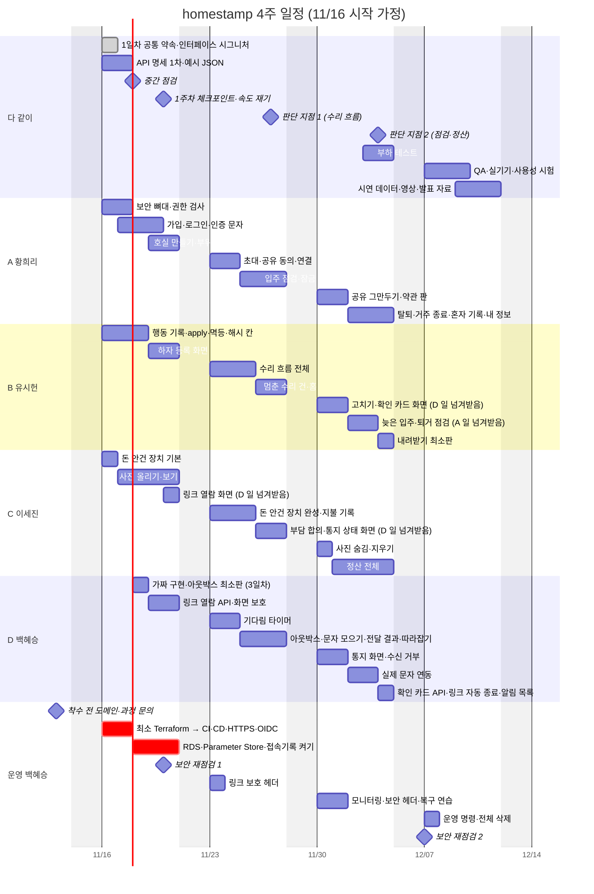
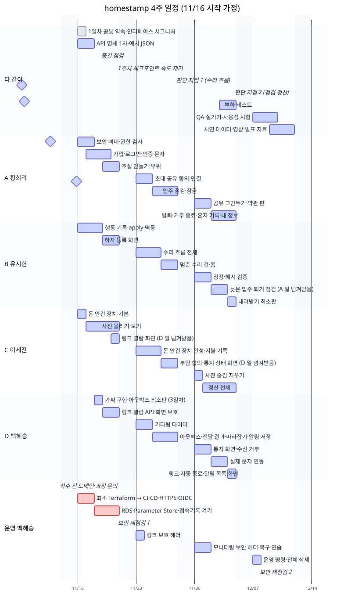
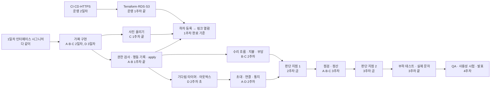

# WBS (작업 분해와 일정)

> 팀 「역할분담」(v10)의 A·B·C·D + 운영을 기준으로, **누가 어느 주에 무엇을 하는지**를 나눈 표예요.
> 인-일(한 사람이 하루 걸리는 양)은 백엔드 + 화면 + 테스트를 합친 **처음 추정**이고, 1주차가 끝나면 실제 속도로 다시 맞춰요.
> 기능 ID는 `7-요구사항-명세.md`의 것이에요.

---

## 0. 두 가지를 나눠서 봐요: 주인과 이번 주 손

도메인으로만 나누면 일이 고르게 나뉘지 않아요. A는 24인-일인데 D는 12인-일이에요. 그래서 두 가지를 따로 정해요.

| | 무엇 | 바뀌나 |
|---|---|---|
| **주인** | 테이블·공개 인터페이스·API 명세·상태 전이 규칙을 책임지고, 그 도메인 PR을 리뷰한다 | 바뀌지 않음 |
| **이번 주 손** | 그 주에 실제로 코드를 쓰는 사람 | 주마다 바뀔 수 있음. 넘겨받은 일도 주인이 리뷰 |

| 역할 | 담당 | 주인인 도메인 | 리뷰 짝 |
|---|---|---|---|
| A | 황희리 | 회원·인증·호실·점검 (`member`, `auth`, `room`, `inspection`, `global/security`) | D |
| B | 유시헌 | 기록과 수리 (`action`, `repair`, `correction`) | C |
| C | 이세진 | 돈과 증빙 (`proposal`, `payment`, `settlement`, `photo`) | B |
| D | 백혜승 | 기다림·통지·링크 (`notification`, `link`, `respond`, `global/scheduler`) | A |
| 운영 | 백혜승 | CI/CD·배포 (`infra/`, `.github/workflows/`) | + 1명 |

---

## 1. 한눈에 보기 (간트 차트)

날짜는 **11/16(월) 시작을 가정**했어요. 팀 일정이 정해지면 날짜만 바꾸면 돼요. 막대 하나는 그 사람이 그 기간에 주로 하는 일이에요.

**4주차가 비어 보이는 이유**: 1~3주차를 꽉 채우고 4주차를 QA·발표와 **여유**로 둬요. 밀린 일이 있으면 여기서 끝내고, 없으면 Should(4장)를 가져가요.

---

## 2. 주차별 할 일 (사람별)

괄호 안은 인-일이에요. 각 주의 **완료 기준**은 배포 주소에서 확인하고, 못 넘으면 Should를 시작하지 않고 남은 기준부터 끝내요.

### 1주차: 뼈대와 공통 장치

다 같이: 1일차 공통 약속(프로젝트 구조·패키지 방향 표·ArchUnit·테스트 이름 규칙·`global/`·ERD 확정·V1 마이그레이션·인터페이스 시그니처), 1~2일차 API 명세 1차 + 예시 JSON (각 1)

| 사람 | 할 일 | 인-일 |
|---|---|---|
| A 황희리 | 보안 뼈대·권한 가짜(2일차) → 권한 검사 실제 ROOM-2 (1.5), 가입·로그인·인증 문자(가짜 문자)·확인 세 개 ACC-1·2·3, CONS-1 (3.5), 호실 만들기·부위 ROOM-1·3 (1.5) | 6.5 |
| B 유시헌 | `ActionWriter` 가짜(2일차) → 행동 기록·`apply` 틀·멱등(여러 행동 키·동시 요청)·재계산 테스트 REP-10 (3.5), **해시 칸·계산**(첫 마이그레이션, 입력 모양을 테스트로 고정) (0.5), 하자 등록 화면·제출 전 확인 REP-1, PHO-4 (2) | 6 |
| C 이세진 | 돈 안건 장치·사진 가짜(2일차), 돈 안건 장치 기본(제안·동의) (1), 사진 올리기·보기(presigned POST 기술 검증 2일차) PHO-1·2 (4), **링크 열람 화면**(D 일, 사진 보기 부품을 그대로 씀) (0.5) | 5.5 |
| D 백혜승 | 응답 요청·통지·링크 가짜 + **아웃박스·가짜 발송기 최소판**(**3일차**, 운영 때문에 하루 늦게) (0.5), 링크 열람 API·화면 보호 LINK-1·2 (1), 문자 업체 서류 | 1.5 |
| 운영 백혜승 | **착수 전**: 도메인 구매, 과정 문의 보내기. 1~2일차: 최소 Terraform(VPC·EC2·탄력적 IP·S3·IAM 역할) → CI·CD·HTTPS·OIDC. 3~5일차: RDS 연결과 Parameter Store 읽기, CloudTrail·RDS 로그 내보내기 켜기, OpenAPI 타입 생성 CI, 운영 접근 30분 교육, **보안 재점검 1** | 5 |

**완료 기준**: 배포 주소에서 가입 → 호실 → 하자 등록 → 문자(가짜) → 링크 열람. 연결·확인은 2주차 월·화에 끝내요(1주차에 넣으면 A가 약 9인-일이 돼서).
**체크포인트(금)**: 실제 속도 재기(6장), 기술 검증 결과로 범위 조정

### 2주차: 수리 흐름 + 입주 점검

| 사람 | 할 일 | 인-일 |
|---|---|---|
| A 황희리 | 초대·공유 동의·연결 ROOM-4·5, CONS-2 (2.5), 연결 때 쌓인 기록의 요청 만들기·연결 알림 (0.5), 입주 점검·잠금 INSP-1(빠뜨린 하자 더하기·두 방향 잠금) (3.5) | 6.5 |
| B 유시헌 | 수리 흐름(하자 응답·시작·종료·다시 열기·경과 보기) REP-2~5·11 (4), **응답 공통 처리**(`respond` 하나: 맞아요·보류·이견, 다시 요청 7일·근거 필수, 맞아요는 되돌릴 수 없음. 지불·점검·송금도 같은 처리를 씀) (0.5), 멈춘 수리 건 REP-6 (1.5), 홈 틀 (1) | 7 |
| C 이세진 | 돈 안건 장치 완성(역제안·회차·철회, 동시 수락 테스트) (1), 지불 기록·금액 확인 MONEY-1·2·5 (2.5), 부담 합의 MONEY-3(Must)·다른 안 MONEY-4 (2, MONEY-4는 Should ②), **통지 상태 화면** NOTI-4(D 일, 수리 건 상세 안이라 C의 돈 카드 옆) (1) | 6.5 |
| D 백혜승 | 기다림 타이머(재통지·미확인·혼자 진행 판단) ROOM-8, NOTI-5 (2), 아웃박스 완성·전달 결과 조회·**문자 모으기** NOTI-1·3 (2), 켜질 때 따라잡기·고아 확인 OPS-1·2 (1), 서비스 안 알림 저장 NOTI-7 (0.5) | 5.5 |
| 운영 백혜승 | 링크 화면 보호 헤더(nginx, D와 함께) | 0.5 |

**완료 기준(금, 판단 지점 1)**: 하자 등록 → 통지 → 확인 → 수리 → 종료 + 돈 협상, 입주 점검 잠금까지

### 3주차: 퇴거·정산 + 마무리

| 사람 | 할 일 | 인-일 |
|---|---|---|
| A 황희리 | 공유 그만두기·다시 공유하기 CONS-3 (1.5), 약관 판·다시 확인 CONS-4 (1.5), 탈퇴 KEEP-4 (1.5), 거주 종료·혼자 기록 ROOM-7·9 (1), 내 정보·비밀번호·문자 설정 ACC-6 등 (1) | 6.5 |
| B 유시헌 | 고치기 REP-7·9 (2), **확인 카드 화면**(D 일, 두 칸·한 건씩·마지막 요약) NOTI-7 (1), **늦은 입주 점검·퇴거 점검·나란히 보기**(A 일) INSP-2·3 (2, 입주일 묻기 포함), 내려받기 최소판 DL-1 (1) | 6 |
| C 이세진 | 사진 숨김·개인정보 사진 지우기·다른 사람의 요청·잘못 올린 사진 표시 PHO-3·5·7·9 (1.5), 정산 전체 SET-1~5(정산 항목 [바꾸기]·끝내기 보호·**끝내기 반대**·**송금 응답과 같은 송금 묶음** 포함) (5.5) | 7 |
| D 백혜승 | 통지 화면·수신 거부·문자 규칙 NOTI-2·6·8·9 (2), 실제 문자 연동 NOTI-11 (1.5, Should ④), **확인 카드 보내기 API·연결 전 돈 요청 검사·링크 `has_money`** (0.5), 링크 자동 종료 LINK-4·알림 목록 화면 (0.5), **정산 90일 자동 마감 KEEP-2**(A 주인, 예약 작업 틀은 D) (0.5) | 5 |
| 운영 백혜승 | 모니터링(수집·알림 세 개), 보안 헤더·CSP, 블루/그린(3주차), 로컬 복구 연습(가짜 데이터) | 2 |

다 같이: 부하 테스트(k6, 백혜승이 앞장. 시작 전 발송기가 가짜인지 확인)
**완료 기준(금, 판단 지점 2)**: 입주 점검 → 퇴거 점검 → 정산 계산 → 반환 기록. 공유 그만두기·탈퇴·내려받기 최소판은 같은 주에 같이 끝나야 해요(내려받기가 있어야 그만둘 수 있어서).

### 4주차: 안정화와 발표

| 사람 | 할 일 |
|---|---|
| 모두 | 갈림길 나머지, 휴대폰 실기기 테스트(iOS·Android), 버그 수정, QA, 사용성 시험(팀 밖 3명), 재측정 → 초기화 → 시연 데이터, 시연 영상, 발표 자료 |
| 운영 백혜승 | 운영 명령·전체 삭제 OPS-3·4 (1), **보안 재점검 2**(QA 전) |
| 여유 있는 사람 | Should(4장)를 체크포인트에서 한 사람당 하나씩 |

**완료 기준**: 시연 시나리오 2개를 처음부터 끝까지 막힘없이, 모든 시나리오 통합 테스트가 CI에서 통과

---

## 3. 사람별 일의 양

| 사람 | 1주 | 2주 | 3주 | 4주 | 개발 합 | 다 같이 | **합계** |
|---|---|---|---|---|---|---|---|
| A 황희리 | 6.5 | 6.5 | 6.5 | - | 19.5 | 2.25 | **21.75** |
| B 유시헌 | 6 | 7 | 6 | - | 19 | 2.25 | **21.25** |
| C 이세진 | 5.5 | 6.5 | 7 | - | 19 | 2.25 | **21.25** |
| 백혜승 (D + 운영) | 6.5 | 6 | 7 | 1 | 20.5 | 2.25 | **22.75** |
| **팀** | 24.5 | 26 | 26.5 | 1 | 78 | 9 | **87** |

- 넘기기 전에는 A 22.75 · B 18.75 · C 18.75 · 백혜승 22.25였어요. 아래 두 개를 넘겨서 **사람마다 20~21로 맞췄어요**.
  - **A → B: 퇴거 점검·나란히 보기**(2). B는 3주차에 수리 흐름이 끝나 손이 비고, 점검 항목 고치기는 원래 B의 고치기 공통 처리를 써요.
  - **D → C: 통지 상태 화면**(1)과 **링크 열람 화면**(0.5). 통지 상태는 C가 만드는 돈 카드 바로 옆이고, 링크 화면은 C의 사진 보기 부품을 그대로 써요. 백혜승은 1주차에 운영(최소 Terraform → 배포 → 비밀값·접속기록)이 몰려서 덜어 냈어요.
- **문서 점검으로 더한 일(+1인-일)**: 응답 공통 처리(`respond`, 보류·다시 요청 한도, B 0.5), 송금 응답·같은 송금 묶음·끝내기 반대(C 0.5).
- **확인 요청 규칙을 정하며 늘어난 일(+2.5인-일)**: 확인 카드(화면 1, API 0.5), 문자 모으기(0.5), 연결 때 요청·알림(0.5), 점검 두 방향 잠금(0.5), 정산 [바꾸기]·끝내기 보호(0.5), 해시 칸(0.5). 해시 검증 API·화면(1.5)은 Should ⑯으로 빠졌어요. 확인 카드 화면은 D의 일을 B가 넘겨받았어요(B는 해시 검증이 빠져 3주차에 손이 남). 백혜승이 22.75로 가장 많아서, 속도가 밀리면 줄이기 ④(실제 문자 연동)가 먼저 빠지고 알림 목록 화면은 C가 넘겨받을 수 있어요.
- 한 사람이 한 주에 할 수 있는 양은 회의·학습·리뷰를 빼면 **약 4인-일**이에요. 이 표는 주당 5~7이라, **AI와 함께해서 1.3배쯤 빨라진다고 가정**한 계획이에요. 1주차 끝에 실제로 재서(6장) 안 되면 Should부터 내리고, 4주차 여유로 받아요.

---

## 4. Should: 두 종류

Should는 설계와 수용 기준은 그대로 두고 **만드는 순서만 뒤로** 둔 것이에요. 두 종류가 있어요.

| 종류 | 무엇 | 계획에 | 밀리면 | 빠르면 |
|---|---|---|---|---|
| **줄이기 ②·④** | 다른 안(역제안), 실제 문자 연동(① 늦은 입주 점검과 ③ 부담 합의는 Must로 올림) | **들어 있음**(2장 표에 "Should" 표시) | 판단 지점(2주차 금, 3주차 금)마다 **②부터** 뺌 | 그대로 |
| **여유 ⑤~⑯** | 아래 표 | **들어 있지 않음** | 처음부터 안 만듦 | 4주차 체크포인트에서 주인이 위에서부터 가져감 |

| 순서 | 기능 | 주인 | 인-일 | 빠져도 되는 이유 | 빠질 때 남기는 최소 |
|---|---|---|---|---|---|
| ⑥ | KEEP-1 무활동 알림 (KEEP-2 자동 마감은 Must로 올라 D 3주차) | A (예약 작업 틀은 D) | 0.5 | 1년·90일 뒤의 일이라 4주 안에 한 번도 돌지 않음 | 기한 칸은 저장 |
| ⑦ | KEEP-3 보관 뒤 삭제 | A | 0.5 | 1년 뒤의 일. 시범 운영 끝 정리는 OPS-4 전체 삭제가 맡음 | 삭제 경로는 탈퇴와 같은 코드 |
| ⑧ | DL-2 내려받기 완성판 | B | 1 | 최소판으로 약속은 지켜짐 | DL-1 |
| ⑨ | ROOM-6 같은 집 기록 두 개 | A | 1 | 시연은 한 기록으로 시작 | "이미 같은 동에 기록이 있어요" 한 줄 |
| ⑩ | REP-8 원인 설명 | C | 1 | 부담 합의·수리와 따로 도는 기능 | 진행 상황 남기기로 글을 남김 |
| ⑤·⑪ | MONEY-6 이체 확인증 사진 + PHO-6 손으로 가리기 | C | 2 | 이체 확인증이 빠지면 필요가 줄어듦 | 제출 전 확인 + 개인정보 사진 지우기 |
| ⑫ | LINK-3 정산 초대 링크 | D | 0.5 | 시연에서는 거주 중에 연결됨 | 연결 안 된 상대는 혼자 정산 기록 |
| ⑬ | ACC-4 번호 변경, ACC-5 아이디 찾기 | A | 1 | 시연 계정은 번호를 바꾸지 않음 | 비밀번호 변경·재설정은 Must |
| ⑭ | 모니터링 대시보드 꾸미기 | 운영 | 0.5 | 수집과 알림만 있으면 됨 | 알림 세 개 |
| ⑮ | PWA manifest(홈 화면에 추가, **서비스 워커 없음**, `display: browser`) | 그 주 여유 있는 화면 담당 | 0.5 | 브라우저로 그대로 씀 | - |
| ⑯ | 해시 체인 검증 API·화면 | B | 1.5 | 칸과 계산은 1주차에 쌓이고 있어 나중에 붙여도 처음부터 검증됨 | 해시 칸·계산 |

모두 합쳐 **약 10인-일**이 여유 목록이에요. 팀 문서 10장의 추가 기능(계약서 PDF, SSE 등)은 이 목록 다음이에요.

---

## 5. 먼저 끝나야 하는 것 (임계 경로)

- **가장 위험한 곳은 1주차의 운영과 A**예요. 운영이 늦으면 아무도 배포 주소에서 확인을 못 하고, A의 권한 검사가 늦으면 모두가 가짜 구현에 오래 묶여요. 그래서 **1주차 3일차 중간 점검에서 이 둘부터** 봐요.
- D의 가짜 구현은 운영 때문에 3일차예요. 그 전에 응답 요청·통지가 필요한 사람은 시그니처만 보고 짜요.

---

## 6. 끝(Done) 기준과 속도 재기

**끝 기준 다섯 개**(모두 채운 기능만 "끝"으로 센다)

1. 그 기능의 수용 기준(Gherkin 시나리오)이 모두 테스트로 통과
2. 화면이 화면 명세대로이고 버튼은 `availableActions`로만
3. 운영 서버에 배포
4. PR 리뷰 1명(주인이 아닌 사람이 썼으면 주인이 리뷰)
5. 관련 불변식 테스트 통과

**1주차 끝 속도 재기**: 1주차에 "끝"이 된 기능의 인-일 합 ÷ 1주차 계획 인-일(24.5) = **계획 달성률**. 계획 자체가 이미 "AI로 1.3배쯤 빠르다"를 넣고 짠 것이라, 1.0이면 계획대로예요.

| 달성률 | 뜻 | 할 일 |
|---|---|---|
| 1.0 이상 | 계획대로 | 그대로. 4주차 여유로 여유 ⑤~⑯을 위에서부터 |
| 0.8~1.0 | 조금씩 밀림 | 4주차 여유로 받음. 여유 ⑤~⑯은 만들지 않음 |
| 0.8 미만 | 많이 밀림 | 판단 지점마다 줄이기 ② 다른 안 → ④ 실제 문자 순서로 빼고, Must 화면은 꾸미기(빈 상태 그림, 애니메이션)를 최소로 |

**AI로 속도를 올리는 법**: 1일차에 인터페이스 고정 → 각자 "이 인터페이스로 이 수용 기준을 통과하게" 맡김 → 수용 기준을 테스트부터 → PR마다 리뷰.

---

## 7. 서로 돕는 규칙

팀 「역할분담」 7장을 그대로 따르고, 이 WBS에서 쓰는 것만 짧게 적어요.

- 할 일은 반나절~하루 단위로 쪼개 **GitHub Projects 보드 하나**에. 카드에 주인 도메인을 표시하되 누구나 가져갈 수 있어요.
- 일찍 끝나면 **화면·테스트·픽스처·시드 스크립트**처럼 경계가 분명한 것부터 가져가요.
- **수요일 중간 점검**에서 "누가 밀리나, 무엇을 넘길까"를 정해요. 2장의 두 넘김(A → B 퇴거 점검, D → C 통지 상태 화면)은 처음부터 정해 둔 것이에요.
- 더 넘겨야 하면 이 순서로 봐요: A의 입주 점검 화면 → 누구나, C의 정산 화면 → B, D의 알림 목록 화면 → 누구나.

---

## 8. 팀 문서와 다른 곳: 추천안으로 정함 (회의에서 확인)

팀 「역할분담」 8-2와 명세가 달랐던 곳을 추천안으로 정했어요. 이유는 `../decisions.md`에 있고, 팀 검토에서 바꿀 수 있어요.

| 팀 문서 | 정한 것 | 팀 안과 |
|---|---|---|
| #6·#8 해시 체인, 기록 검증 API | 칸(`room_seq`·`prev_hash`·`hash`)과 계산은 첫 마이그레이션(B 1주차 0.5), 검증 API·화면은 Should ⑯(1.5) | 일부 다름(검증 API 범위) |
| #9 `member_consent` | `member_acknowledgement` | 일부 다름(`member_` 앞머리는 같음) |
| #10 수리 건 하나에 지불 여러 개 | 같음 | 같음 |
| #14 같은 멱등 키는 첫 결과 그대로 | 그 대상의 지금 상태를 돌려줌 | 다름 |
| #16 점검당 사진 40장, 수리 건당 10장 | 점검 40장, **수리 건 30장**, 한 번에 10장 | 일부 다름(수리 건) |
| #18 `apply`와 공개 인터페이스 80% | 받아들임 | 같음 |
| #22 패키지 이름 | 받아들임(`record` → `action`, `money` → `payment`·`settlement`, `waiting`+`notify` → `notification`), **`photo`는 그대로** | 일부 다름(`evidence`) |
| #25 PWA manifest | Should ⑮(서비스 워커 없음) | 일부 다름(범위) |

---

## 부록: 도메인별 작업 목록 (주인 기준)

| 주인 | 작업 (기능 ID, 인-일) | Must 합 |
|---|---|---|
| A | 권한 검사 ROOM-2 (1.5), 가입·로그인 ACC-1·2·3·CONS-1 (3.5), 호실·부위 ROOM-1·3 (1.5), 초대·동의·연결 ROOM-4·5·CONS-2 (2.5), 연결 때 요청·알림 (0.5), 공유 그만두기 CONS-3 (1.5), 약관 판 CONS-4 (1.5), 탈퇴 KEEP-4 (1.5), 거주 종료·혼자 기록 ROOM-7·9 (1), 내 정보 등 ACC-6 (1), 입주 점검 INSP-1 (3.5), 퇴거 점검 INSP-2·3 (2) | 21.5 |
| B | 행동 기록·`apply` REP-10 (3.5), 해시 칸·계산 (0.5), 하자 등록 REP-1·PHO-4 (2), 수리 흐름 REP-2~5·11 (4), 응답 공통 처리 (0.5), 멈춘 수리 건 REP-6 (1.5), 고치기 REP-7·9 (2), 홈 (1), 내려받기 최소판 DL-1 (1) | 16 |
| C | 돈 안건 장치 (2), 사진 올리기·보기 PHO-1·2 (4), 사진 숨김·지우기 PHO-3·5·7·9 (1.5), 지불 MONEY-1·2·5 (2.5), 부담 합의 MONEY-3·4 (2), 정산 SET-1~5 (5.5) | 17.5 |
| D | 기다림 타이머 (2), 아웃박스·발송기·조회·문자 모으기 (2.5), 따라잡기 OPS-1·2 (1), 링크 열람 LINK-1·2 (1.5), 링크 자동 종료 LINK-4·알림 목록 (1), 통지 화면 NOTI-2·4·6·8·9 (3), 확인 카드 화면·API NOTI-7 (1.5), 연결 전 돈 검사·`has_money` (0.5), 실제 문자 NOTI-11 (1.5) | 14.5 |
| 운영 | CI·CD·HTTPS (2), Terraform (2), OIDC·Parameter Store·nginx (1.5), 모니터링·보안 헤더 (1.5), 운영 명령·전체 삭제 OPS-3·4 (1) | 8 |
| 다 같이 | 기획 제출물·API 명세 (2), 부하 테스트 (1.5), QA·사용성 시험·보안 재점검 (2.5), 발표·영상·시연 데이터 (3) | 9 |
