# 핵심 흐름의 상태와 규칙

> 개요(`00-개요.md`)와 사용자 시나리오의 결정을 **상태 전이 표**와 **역할별 권한 표**로 모은 **읽기용 정리본**이에요. 규칙의 기준 문서이고, ERD·API 설계와 테스트 케이스가 이 문서를 따라요.
> 함께 읽을 문서: `01-이야기로-보는-흐름.md`, `02-사용자-시나리오.md`. 결정의 이유는 `../decisions.md`에 있어요.

---

## 0. 읽는 법

### 기본 원칙 여섯 줄

1. **행동만 쌓는다.** 모든 변화는 "누가, 언제, 무엇을 눌렀나"라는 행동 기록으로 남고, 고치거나 지우지 않는다. 현재 상태는 행동 기록을 모아 조립한다.
2. **사실은 혼자 남길 수 있고, 합의는 혼자 만들 수 없다.**
3. **서비스는 판정하지 않는다.** 같은 안에 양쪽이 동의했는지만 본다.
4. **기다림에는 끝이 있다.** 응답이 필요한 일은 48시간 뒤 재통지, 그 뒤 24시간에도 응답이 없으면 "상대 미확인"(화면: "○○ 님 확인 없음")이 붙는다. 요청 종류에 따라 혼자 진행이 열리거나 표시만 된다(1-4).
5. **시각은 서버 시각만** 쓴다.
6. **새 규칙을 만들기 전에 지금 있는 장치로 되는지 먼저 본다.** 같은 모양이면 같은 규칙을 쓴다.

### 용어

| 용어 | 뜻 |
|---|---|
| 측 | **세입자 측 / 집주인 측.** 권한과 확인은 사람이 아니라 측 단위다(확장의 동거인·관리인도 같은 측에 들어간다) |
| 상대 측 | 그 행동을 한 측의 반대편 |
| 당사자 | 호실 기록에 연결된 회원(세입자 측 또는 집주인 측) |
| 링크 열람자 | 링크로 들어온 가입 전 사람. 읽기만 한다 |
| 응답 필요 | 상대 측이 눌러야 다음으로 가는 일. 문자(링크) + 서비스 안 알림이 나가고 기다림 타이머가 돈다 |
| 표시 | 상태와 별개로 붙는 꼬리표(이견, 상대 미확인, 단독 기록, 입주 후 등록 등). 상태 수를 늘리지 않으려고 따로 둔다 |

### 상태 기계 목록

| # | 상태 기계 | 단위 | 상태 |
|---|---|---|---|
| A | 호실 기록(거주 기간) | 호실 기록 하나 | 거주 중 → 거주 종료 → 정산 완료(1년 보관) → 삭제 |
| B | 당사자 연결 | 상대 자리 하나 | 비어 있음 / 번호만 → 초대됨 → 연결됨 ⇄ 공유 중단 / 거절됨 / 탈퇴함 |
| C | 링크 | 링크 하나 | 유효 / 무효 (종류: 초대 링크, 정산 초대 링크) |
| D | 수리 건(두 줄) | 수리 건 하나 | **하자 인정**: 확인 기다림 / 맞아요 / 보충 요청됨 / 이견 / 상대 미확인. **수리 진행**: 시작 전 → 처리 중 → 종료 확인 대기 → 처리 완료(○○ 확인 / 양측) |
| E | 돈 상태(부담 합의) | 수리 건 하나 | 미정 / 합의 대기 / 합의됨 / 이견 / 비용 없음 |
| F | 지불 기록 | 지불 하나 | 한쪽 기록 → 양측 확인 |
| G | 고치기 | 고친 내용 하나 | 도장 전: 그냥 고쳐짐 / 도장 뒤: 내가 고친 내용(앞모습 그대로, 확인 요청 → [맞아요]면 앞모습 / [아니에요 · 더 필요해요]면 보류·이견 / 무응답이면 미확인으로 나란히) |
| H | 점검(입주·퇴거) | 점검 하나 | 작성 중 → 확인 요청 → 잠김 |
| I | 정산 항목 | 항목 하나 | 확인 대기 / 합의됨 / 이견 (+ 제외됨) |
| J | 정산 송금 기록 | 송금 하나(반환 / 추가) | 한쪽 기록 → 수령 확인 |
| K | 통지 | 문자 하나 | 발송 요청됨 → 발송 성공 → (전달됨) → 링크 열람 → 응답 / 최종 실패 (화면은 지금 상태 한 줄, K 표) |
| L | 계정 | 회원 하나 | 활성 → (번호 인증 해제) → 탈퇴 |

E·I(돈 쪽)와 보증금은 **같은 돈 안건 장치**(제안과 합의)를 쓴다(1-2).

---

## 1. 공통 장치

### 1-1. 기다림 타이머 (응답 필요인 모든 일)

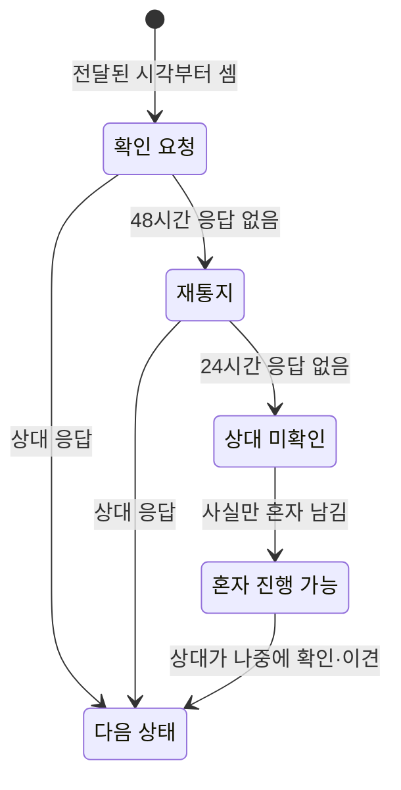


| 규칙 | 내용 |
|---|---|
| 적용 대상 | 하자 확인 요청, 도장 뒤 고친 내용의 확인(기록당 하나), 금액 확인, 부담 제안·역제안, 종료 확인, **진행 상황 묻기**(미확인이 돼도 새로 열리는 행동은 없고 기록만), 점검 확인, 보증금·정산 항목 확인, 반환 수령 확인, 정산 끝내기, 집주인 측의 거주 종료 요청 |
| 미확인이 붙는 조건 | 통지 두 건이 모두 **전달됨**(문자 업체의 최종 결과 4000, 또는 링크 열람·회원의 알림 열람. 아래 "타이머 시작점"과 같음)이고 시간이 지났을 때만. 결과를 3일 동안 모르면 최종 실패로 본다. 발송이 최종 실패했으면 미확인이 아니라 "집주인에게 문자가 가지 않았어요" 알림과 **[번호 고치기] / [이 번호가 맞아요, 다시 보내기]**(통지마다 한 번). 다시 보낸 것도 최종 실패하면 혼자 진행 가능(이유 "문자가 가지 않음"). 받지도 못한 사람을 미확인으로 몰지 않는다. **문자를 끈 회원**은 서비스 안 알림 생성 시각을 통지 시각으로 본다(스스로 알림을 고른 사람이라 "받지 못함"이 아니다). 재통지도 서비스 안 알림으로 |
| **혼자 진행 가능** | 상대 응답 없이 요청한 측이 사실을 혼자 남길 수 있는 상태. **이유 여섯 가지**를 화면에 보여 준다: ① 상대 미확인(위 타이머) ② 상대 수신 거부(비회원이 "그만 받기") ③ 상대 탈퇴 ④ 상대 공유 중단(상대가 공유를 그만둠) ⑤ 문자가 가지 않음(다시 보내기까지 최종 실패) ⑥ 상대 없음(번호가 없거나 초대 전, "단독 기록") 또는 **연결 전**(초대했지만 아직 연결하지 않음: 돈은 바로 혼자 기록, 링크로 볼 수 있는 기록은 72시간 뒤 "아직 연결하지 않았어요", 1-4). 판단은 기다림 타이머 모듈의 함수 하나가 하고, 수리·점검·정산·거주 종료가 모두 이 함수를 부른다 |
| 혼자 할 수 있는 것 | (혼자 남긴 지불·송금은 기록으로 남지만 상대가 확인하기 전에는 계산·합의에 들어가지 않는다) **사실**: 수리 진행, 종료 "처리 완료(○○ 확인)"(○○ = 행동한 측), 지불·수령 기록, 점검 잠금, 집주인 측 거주 종료 요청 적용(상대 없음이면 바로 거주 종료), 정산 끝내기 → 정산 완료 |
| 혼자 못 하는 것 | **합의**: 돈 상태는 합의됨이 되지 않는다. 정산 항목도 합의됨 칸에 가지 않는다 |
| 상대가 나중에 오면 | 미확인·수신 거부: 상대가 들어와 확인·이견을 덧붙인다. **상대 없음으로 끝낸 기록**(점검, 처리 완료 건, 지불): 상대가 연결되면 기록마다 평소와 같은 확인 요청이 생기고 같은 기다림 타이머가 돈다. 연결한 사람은 그 순간 화면을 보고 있어 첫 통지는 연결 시각이고(첫 문자 없음), 요청은 확인 카드에 모인다(1-4). 탈퇴: 돌아오지 않는다 |
| 타이머 시작점 | 통지가 **상대에게 전달된 시각**부터 센다: 문자 업체 결과 "전달됨" 시각, 링크 열람 시각, 회원의 알림 열람 시각(문자 링크나 서비스 안 알림을 연 시각) 중 빠른 쪽(열었으면 결과가 없어도 전달된 것으로 본다, 06 NOTI-3b·3c). 문자를 끈 회원은 알림 생성 시각. 휴대폰이 꺼져 있다가 늦게 받은 사람이 받자마자 미확인이 되지 않게 한다. 21~08시라 아침으로 미뤄진 통지는 아침 발송 뒤 전달 시각부터 |
| 시간 값 | 모두 설정값(Parameter Store). **기한은 사건이 생길 때 시각으로 저장**하고 작업자는 기한이 지난 것만 처리한다. 설정 변경은 그 뒤에 생기는 사건에만 적용된다(시연 영상 때 시간을 줄여도 기존 기록의 기한은 그대로) |

### 1-2. 돈 안건: 제안과 합의 (수리비 나누기, 정산 항목, 보증금)

**안건**은 돈 질문 하나예요. 정해진 자리에 하나씩 있어요.

| 안건 | 자리 | 질문 |
|---|---|---|
| 수리비 나누기 | 수리 건마다 하나 | "이 수리비를 누가 얼마 낼까?" |
| 정산 항목 | 정산 항목마다 하나 | "이걸 보증금에서 뺄까, 얼마나?" |
| 보증금 | 정산에 하나 | "돌려줄 보증금이 얼마였나?" |

**제안**은 안건에 대한 답안 하나, **합의**는 안건의 지금 답(같은 제안에 상대가 동의)이에요. 한 안건 안에서 제안은 줄로 쌓이고, **합의는 언제나 하나**예요. 하자 확인·점검·지불 금액은 안건이 아니라 "같이 확인"으로 끝나요(G).

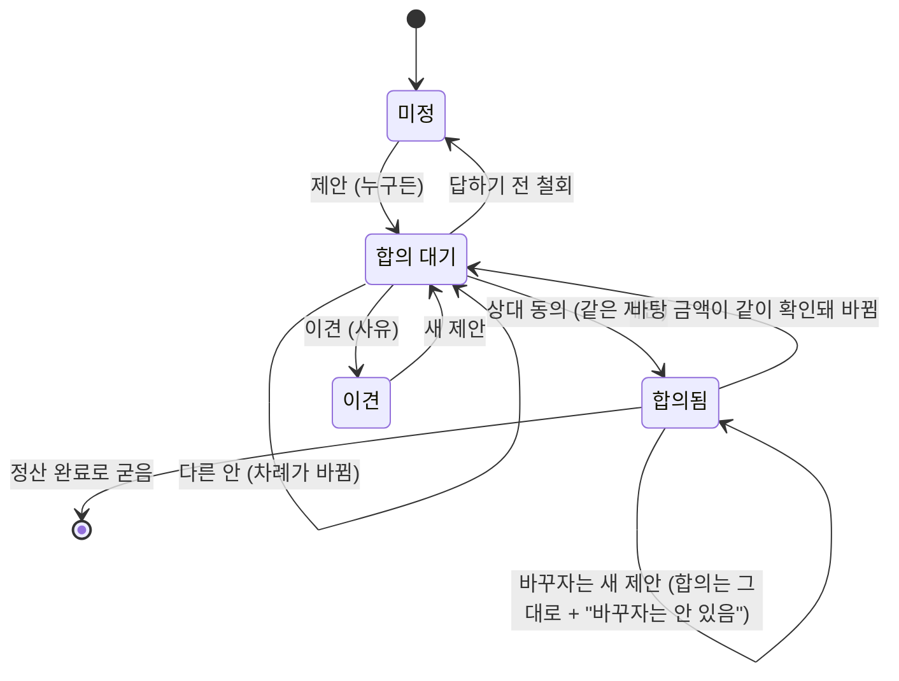


| 규칙 | 내용 |
|---|---|
| 합의가 되는 유일한 길 | **같은 제안**에 양 측의 행동(제안 + 상대 동의)이 모두 있을 때 |
| 합의 전 | 제안·다른 안·답하기 전 철회가 자유. 모든 제안은 줄로 남음 |
| **합의 뒤 새 제안** | 같은 안건에 다음 줄로 붙는다(새 안건이 아님). **상대가 동의할 때까지 지금 합의가 그대로 정산에 쓰이고**, 화면에는 "바꾸자는 안 있음"을 함께 보여 준다. 동의하면 새 합의, 이견(사유)이면 합의 그대로 + 새 안은 이견으로 나란히, 답이 없으면 합의 그대로 + 새 안은 상대 미확인으로 나란히. 낸 쪽은 답하기 전에 거둘 수 있다 |
| **합의가 풀리는 유일한 경우** | 안건의 바탕 금액이 **같이 확인돼** 바뀌어, 합의한 금액의 합과 새 전체 금액이 달라질 때(지불 금액 고치기 확인, 추가 지불 확인). 나눠서든 한쪽 전부든 합의 대기로 돌아가고 이전 합의는 참고로 보여 준다 |
| 바꾸기 | 돈 줄·정산 항목·보증금 카드의 [바꾸기] 하나(양쪽 다). 상대가 답하기 전이면 내 안이 바로 바뀌고, 합의 뒤면 "바꾸자는 안"(위 줄). **한 안건에 내 쪽 기다리는 안은 하나**: 기다리는 동안 또 바꾸면 그 안을 바꾸는 것이라 같은 요청에 묶이고 문자는 다시 가지 않으며 기한은 바꾼 시각부터 다시 센다(1-4 고친 칸 더하기와 같음). 역제안(다른 안)도 같은 일이다(같은 안건에 새 제안 한 줄). 고치기(G)와 움직임이 같다: 사실은 고치기, 돈은 바꾸기 |
| 이견 | 사유 필수. 다른 안은 선택 |
| 회차 | 횟수 제한 없음. "제안 3회째" 표시, 3회째부터 안내 한 줄("직접 이야기해 정한 뒤 제안·동의하면 합의로 남아요") |
| 응답이 없을 때 | 1-1 타이머. 미확인이 붙어도 합의 대기는 합의 대기 그대로(합의가 저절로 생기지 않음) |
| 금액 | 제안의 줄 금액의 합 = 전체 금액(서버 검사). **전체 금액 = 확인된 지불의 합**(상대가 [맞아요]를 누른 지불만). 확인 중인 지불은 "확인 중 +○원 · 확인되면 나누기에 들어가요"로 따로 보인다. 합의는 확인된 금액이 바뀔 때만 풀리고, 한쪽이 혼자 더하거나 고친 금액으로는 풀리지 않는다 |
| 정산 | 정산은 **각 안건의 지금 합의**만 모아 계산한다. 합의가 없는 안건은 "정해지지 않은 금액"으로 따로 보여 준다. 정산 완료가 되면 합의가 굳고 새 제안을 낼 수 없다 |

**말 정리** (안건 세 가지, 안은 같은 장치이고 화면 말만 다르다. 화면에 "안건"이라는 말은 쓰지 않는다)

| | 수리비 나누기 | 정산 항목 | 보증금 |
|---|---|---|---|
| 묻는 것 | 이 수리비를 누가 얼마 낼까? | 이걸 보증금에서 뺄까, 얼마나? | 계약 보증금이 얼마였나? |
| 내는 것(안: 제안) | 나누는 안("서윤 님 제안") | 빼는 안: 금액·방향·사유("서윤 님 제안") | **보증금 금액 적기**("서윤 님이 적은 보증금") |
| 상대 버튼 | [동의] / [아니에요 · 다른 안] | [동의] / [아니에요 · 다른 안] | **[맞아요] / [아니에요 · 다른 금액]** |
| 둘이 같은 안(안: 합의) | 합의 ✓ | 합의 ✓ | **둘 다 확인 ✓** |
| 아직 | 확인 기다림 | 확인 기다림 | **보증금 확인 전** |
| 합의 뒤 다시 | [바꾸기] → "○○ 님이 바꾸자고 해요" | 같음 | 같음 |

보증금만 "합의" 대신 "둘 다 확인"을 쓰는 이유: 보증금은 나누는 돈이 아니라 지나간 사실(계약 금액)을 맞추는 것이라, 협상 말(제안·합의)을 쓰면 계약 금액을 깎거나 정한 것처럼 읽힌다. "보증금 미확인"은 쓰지 않는다("미확인"은 72시간 동안 답이 없다는 다른 뜻, 1-1).

### 1-3. 동시에 눌렀을 때

- 같은 대상에 두 행동이 동시에 오면 **먼저 저장된 것만** 반영하고, 뒤 것은 "이미 처리됐어요"로 돌려보낸다(버전 검사).
- 같은 사람이 두 번 누른 확인은 하나로 처리한다(멱등).

### 1-4. 확인 요청이 움직이는 법 (요청·기한·문자·화면)

한 줄로: **요청과 기한은 기록마다, 문자만 모아서, 화면은 확인 카드 하나에서 내 답이 무엇을 하는지.** 지켜야 할 것(닫히지 않음, 누구에게도 불리하지 않음, 보지 않고 도장 찍지 않음, 문자 도배 없음)은 그대로 두고, 그것을 지키는 방법을 하나로 모은 절이다.

| 층 | 규칙 |
|---|---|
| 요청 | **기록마다 하나**: 하자 확인, 종료 확인, 지불 금액 확인, 점검 확인, 송금 수령 확인, 정산 항목·보증금·부담 제안, 정산 끝내기, 거주 종료 요청, 진행 상황 묻기, 상황 변화 확인. 한 기록의 고친 칸 여러 개는 그 기록의 요청 하나(G) |
| 기한 | 요청마다 1-1 타이머. 기다리는 고친 내용 요청에 같은 기록의 칸을 더 고치면 문자 없이 같은 요청에 묶고(서비스 안 알림만), 그 요청의 기한을 **마지막으로 더한 시각부터 다시 센다**(재통지 전이면 재통지 48시간을, 재통지 뒤면 미확인 72시간을 다시 정함). 재통지 문자는 요청당 한 번. 늘어나는 기다림은 더한 쪽만 늦춘다 |
| 72시간 뒤 | 요청 종류마다 정해진 대로. **혼자 진행이 열리는 요청**: 하자 확인(혼자 수리 진행), 종료 확인(혼자 종료), 점검 확인(혼자 잠금), 정산 끝내기(혼자 끝내기), 거주 종료 요청. **표시만 되는 요청**: 그 밖의 것. 확인된 것만 계산하고 미확인으로는 합의가 생기지 않으므로 답하지 않은 쪽에 유리해지는 일이 없고, 정산 완료 전까지 늦게 답해도 그대로 반영된다. 열리는 요청의 기한은 보낸 뒤 고정이다(답하는 중이라도 다시 세지 않음. 잠긴 뒤에도 늦게 답할 수 있어 잃는 것이 없다) |
| 연결 전 상대 | **확인과 합의는 연결한 사람끼리.** 초대했지만 아직 연결하지 않은 상대에게는 ① 링크로 볼 수 있는 기록(하자, 점검, 종료)만 링크로 알리고 기다린다(이 문자가 곧 초대다). 72시간이 지나면 "○○ 님 확인 없음 · **아직 연결하지 않았어요**"(답하지 않은 사람처럼 보이지 않게) ② 돈(지불, 부담, 정산 항목, 보증금, 송금)은 **요청 없이 혼자 기록**하고 문자도 보내지 않는다. 링크 화면에는 돈이 **있다는 것만** 보인다("이 건에 수리비 기록이 있어요 · 가입하면 볼 수 있어요", 금액·사람·날짜 없음, 6-1). 돈·정산 화면 맨 위에 한 번만 "○○ 님이 아직 연결하지 않았어요 · 돈은 혼자 기록돼요" + (거주 중이면) [초대 다시 보내기](같은 번호로는 **7일에 한 번**, 7일 안이면 "3일 뒤 다시 보낼 수 있어요". 번호를 고쳐 보내기는 제한 없음) ③ 거주 종료 뒤에도 연결 전이면 정산은 혼자 정리하고 바로 혼자 끝낼 수 있다. 화면과 내려받기에 "**혼자 정리한 정산 · ○○ 님은 연결하지 않았어요**". 바깥에서 이야기할 때는 정산 화면 인쇄·캡처와 내려받기로. 정산 초대 링크(Should)는 가입해서 함께 확인하자고 권하는 문자이고, 끝내기 전에 연결하면 연결된 상대의 규칙을 따른다 |
| 연결하는 순간 | 초대한 쪽에 서비스 안 알림 "○○ 님이 연결했어요 · 이제 함께 확인할 수 있어요"(문자 없음). 연결하는 사람에게는 연결 확인 화면에 "연결하면 ○○ 님에게 알림이 가요". [연결하지 않기]와 합류 여부는 알리지 않는다(본인이 고를 일, 합류 전 기록은 쓴 사람만 보는 기록). 연결한 사람은 앞서 남긴 기록을 모두 보고(3-1), 쌓인 기록과 돈 기록의 요청이 기록마다 생겨 확인 카드에 모인다(첫 문자 없음, 연결 시각이 첫 통지) |
| 문자 모으기 | 같은 받는 사람에게 같은 호실 문자가 **거의 동시에**(2분 안에 생겼거나, 밤·한도로 미뤄져 같은 시각에 나가게 됨) 나가면 **한 통**으로 보낸다("확인할 일 3건이 있어요"). 재통지와 다시 보내기도 같은 사람 것끼리 모은다. **연결된 상대(회원)에게만**: 회원은 링크 하나로 확인 카드를 연다. 비회원은 기록마다 링크라 지금처럼 하나씩 보내고 하루 한도가 막는다 |
| 한 번에 확인 | **한 화면에 다 보이는 한 기록 안에서만** 한 번에 확인할 수 있다: 점검의 "남은 항목 모두 확인", 한 기록의 고친 칸 [모두 확인]. 여러 기록을 한꺼번에 맞다고 하는 버튼은 두지 않는다(남이 혼자 쓴 기록에 보지 않고 도장 찍지 않게) |
| 미확인 뒤 다시 고침 | 고친 내용 요청이 미확인으로 끝난 뒤 같은 기록을 또 고치면 새 요청이 생기지만, **그 기록에 마지막 문자를 보낸 지 7일이 지나야** 문자가 가고 그 전이면 서비스 안 알림만(다시 요청 7일 규칙과 같은 카운터) |
| 이미 혼자 진행 가능한 건의 종료 | 그 수리 건에서 상대가 이미 혼자 진행 가능(1-1의 이유 여섯 가지 중 무엇이든)이고 **그 뒤로 이 건에 상대 행동이 없으면**, 종료 요청 없이 바로 [혼자 종료]. 문자 없이 서비스 안 알림만. 그 사이 상대가 이 건에 무엇이든 하면 보통 흐름(종료 요청, 72시간). 혼자 종료는 되돌릴 수 있어(늦은 종료 확인·다시 열기) 상대가 잃는 것이 없다 |
| 정산 끝내기 | 따로 된 요청이라 **언제나 자기 문자**(첫 문자 + 재통지)를 가진다. 상대가 답할 권리를 닫는 유일한 요청이라서다. 끝내기를 기다리는 동안 정산에 무엇이든 더해지거나 바뀌면(항목, 보증금, 송금, 이견, 누가 했든) 끝내기 요청은 "정산 내용이 바뀌어 닫혔어요"로 닫히고 혼자 끝내기도 열리지 않는다. 이렇게 닫힌 뒤 다시 보내기는 7일 제한이 없고, 상대가 (아직 안 끝났어요)로 답한 뒤에만 7일에 한 번. 상대의 확인에는 본 정산 모습의 번호가 함께 가고 그사이 바뀌었으면 `VERSION_CONFLICT`. 일부러 계속 바꿔 막아도 금액은 바뀌지 않고(확인된 것만 계산) 거주 종료 90일 자동 마감이 끝을 보장한다 |

**확인 카드** (회원이 답할 요청을 한곳에서 처리하는 화면, 그림은 `08-화면-기본-틀.md` 12장)

| 부분 | 규칙 |
|---|---|
| 모으는 것 | **지금 답할 수 있는 것** 모두: 기다리는 요청과, 이미 미확인이 됐지만 정산 완료 전이라 늦게 답할 수 있는 요청(연결 전에 미확인이 된 것 포함). 미확인은 늦게 답해도 새로 열리는 것이 없어 "정산 전까지" 칸에 간다 |
| 두 칸 | "**먼저 보면 좋아요**"(이 요청이 기한을 넘기면 상대에게 혼자 진행이 **새로** 열리는 것. "혼자 진행할 수 있나" 함수로 계산) / "**정산 전까지 보면 돼요**"(나머지. 이미 혼자 끝난 밀린 기록도 여기). 칸 이름은 사실만 말하고 서두르게도 늦추게도 하지 않는다 |
| 남은 시간 | "먼저" 칸에만: "14시간 안에 답하지 않으면 서윤 님이 혼자 진행할 수 있어요". "정산 전까지" 칸은 시간 대신 **내 답이 무엇을 하는지**("확인해야 수리비 나누기에 들어가요", "확인해야 고친 내용으로 바뀌어요") |
| 한 건씩 | 날짜순으로 한 건씩 넘기며 보고 고른다. 점검이나 고친 칸이 여러 개인 기록은 그 기록 화면을 열어 고른다. 카드 안의 버튼은 **고른 표시(✓)가 남는 모양**이고 맨 위에 "다 고른 뒤 한 번에 보내요" |
| 마지막 요약 | "맞아요 9 · 더 필요해요 2 · 이견 1" + [하나씩 다시 보기] + [보내기]. [맞아요]는 뒤집지 않으므로 보내기 전에 다시 볼 수 있게 한다. 고른 것만 보내기도 된다 |
| 보내기 전에는 답이 아니다 | [보내기]를 눌러야 답이 되고 **자동으로 보내지 않는다**. 카드를 떠나려 하면 "고른 3건을 보낼까요? [보내기] [버리기]". 앱이나 탭을 닫으면 고른 것(기록, 답, 사유, 본 번호)을 **그 기기에만 24시간** 남기고(계정마다 따로, 로그아웃하면 지움, 사진·금액은 담지 않음), 돌아오면 "아직 보내지 않은 고른 것 3건이 있어요 · [이어서 보내기] [버리기]". 그사이 다른 곳에서 답했거나 닫힌 건은 뺀다. 보내지 않은 건은 "답할 것"과 재통지가 그대로라 놓치지 않는다 |
| 보낸 뒤 | 기록마다 따로 처리된다. 그사이 바뀐 건만 "내용이 바뀌어 보내지 못했어요 · [다시 보기]"로 돌아온다 |
| 요청한 쪽 | 여러 건이면 "정호 님이 5/12 확인했어요", 기록마다는 1-1 표시 |
| 카드 밖 | 기록 화면(호실 기록·수리 건)에서 누르는 응답은 지금처럼 바로 보내진다. 정산 끝내기 확인 화면에는 "아직 답하지 않은 확인 N건 · [먼저 보기]"(그 사람이 답할 쪽인 요청만 셈, 막지 않음) |

---

## 2. 상태 전이 표

표의 열: **누가**(측) / **어디서**(현재 상태·조건) / **결과** / **문자**(응답 필요면 상대 측에 문자 + 서비스 안 알림)

### A. 호실 기록 (거주 기간)

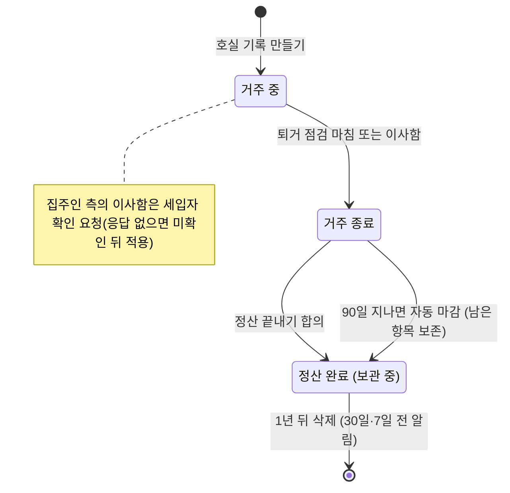


| 행동 | 누가 | 어디서 | 결과 | 문자 |
|---|---|---|---|---|
| 호실 기록 만들기 | 회원 누구든 | - | 거주 중, 만들 때 고른 쪽(임차인 / 임대인)이 만든 사람의 측. 상대 번호는 선택(초대할 때 필수), 본인 번호는 계정 인증 번호 | - |
| 호실 정보 고치기(내 쪽·주소·별칭) | 호실을 만든 사람 | 상대에게 처음 알리거나 초대하기 전 | 잘못 고른 쪽, 주소, 별칭 오타를 고친다. 행동 기록이 남는다. 그 뒤로는 바꿀 수 없다(별칭은 문자 본문에 들어가 집주인이 알아보는 단서) | - |
| 이사함 기록 | 세입자 측 | 거주 중 | **바로 거주 종료**(이사는 세입자의 사실) | 상대 측에 서비스 안 알림 |
| 이사함 기록 | 집주인 측 | 거주 중 | 세입자 측이 없거나 연결 전이면(상대 없음) 바로 거주 종료. 있으면 **거주 종료 요청** → 세입자 측 확인이면 거주 종료. 응답이 없으면 미확인(48시간 + 24시간) 뒤 적용. 세입자가 "아직 살고 있어요"(사유)면 거주 중 그대로(집주인이 혼자 세입자의 기록 권한을 끊지 못하게) | 응답 필요 |
| 퇴거 점검 마침 | 퇴거 점검 작성자 | 거주 중 | 작성자가 세입자 측이면 바로 거주 종료, 집주인 측이면 위의 거주 종료 요청과 같다 | 집주인 측이면 응답 필요 |
| 정산 끝내기 | 당사자 누구든 | 거주 종료 | 상대 측 확인 → 정산 완료. 응답 없거나 혼자 진행 가능(1-1)이면 제안한 측 확인으로. 상대 없음(**연결 전 포함**)이면 바로, "혼자 정리한 정산"으로 표시(1-4) | 응답 필요 |
| (자동) 정산 자동 마감 | 서버 | 거주 종료 후 90일, 정산 완료 전 | 정산 완료(자동). 남은 항목은 그 칸 그대로 보존. 마감 30일·7일 전 알림 | 서비스 안 알림 |
| (자동) 삭제 기한 저장 | 서버 | 정산 완료가 될 때 | "삭제 기한 = 완료 시각 + 1년" 저장. 이때부터 양측 읽기 전용 + 내려받기, 화면에 "정산 완료 · ○○에 삭제돼요" (보관은 상태가 아니라 정산 완료 뒤의 기간) | - |
| 거주 중 오래 쓰지 않음 | 서버 | 거주 중 1년 동안 활동 없음(활동 = 당사자가 남긴 행동 기록. 조회·로그인·서버 자동 행동은 치지 않는다) | **삭제하지 않는다.** 양측에 "아직 거주 중인가요? [네 / 이사했어요]" 서비스 안 알림만(문자 없음). "네"는 행동 "거주 확인"으로 남아 다시 1년을 센다. 아무도 답하지 않으면 아무 일도 없고 1년 뒤 다시 알린다. 세입자 측의 "이사했어요"는 바로 거주 종료, 집주인 측의 "이사했어요"는 거주 종료 요청(거주 중 기록이 퇴거 전에 지워지면 안 된다) | 서비스 안 알림 |
| (자동) 삭제 알림 | 서버 | 삭제 기한 30일·7일 전 | 알림 + 내려받기 버튼 | 서비스 안 알림 |
| (자동) 삭제 | 서버 | 삭제 기한(정산 완료 + 1년) | 호실 기록 전체(사진 포함) 삭제, 삭제 기록 남김 | - |
| (자동) 즉시 삭제 | 서버 | 상대 측이 한 번도 연결된 적 없는 호실 기록의 주인이 탈퇴 / 양 측 모두 탈퇴 | 삭제 | - |

**상태별로 할 수 있는 일**

| | 거주 중 | 거주 종료 | 정산 완료(1년 보관) |
|---|---|---|---|
| 새 수리 건 | ○ | ✕ | ✕ |
| 열린 수리 건의 수리 행동 | ○ | ✕ (수리 상태는 "거주 종료 시점"으로 멈춤 표시) | ✕ |
| 돈·정산 행동 | ○ | ○ | ✕ |
| 고치기 | ○ | 정산 항목 [바꾸기](고치기가 아니라 새 제안, I), **잠기지 않은 퇴거 점검**, 지불·송금 고치기(정산 근거라서). 거주 종료 전에 남긴 고친 내용은 정산 완료 전까지 확인·거절할 수 있다 | ✕ |
| 사진 올리기 | ○ | 퇴거 점검, 두 점검의 빠뜨린 하자 더하기, 정산 항목 증빙, 개인정보 때문에 지운 사진의 가린 사본(모두 정산 완료 전까지) | ✕ |
| 퇴거 점검 확인·이견·항목 추가 | ○ | ○ (잠기기 전까지) | ✕ (그 상태로 보존) |
| 링크 | 초대 링크 유효 | 초대 링크 무효, **정산 초대 링크만**(Should, 연결 전 상대에게 가입 권유) | 무효 |
| 읽기·내려받기 | ○ | ○ | ○ |

### B. 당사자 연결 (상대 자리 하나)

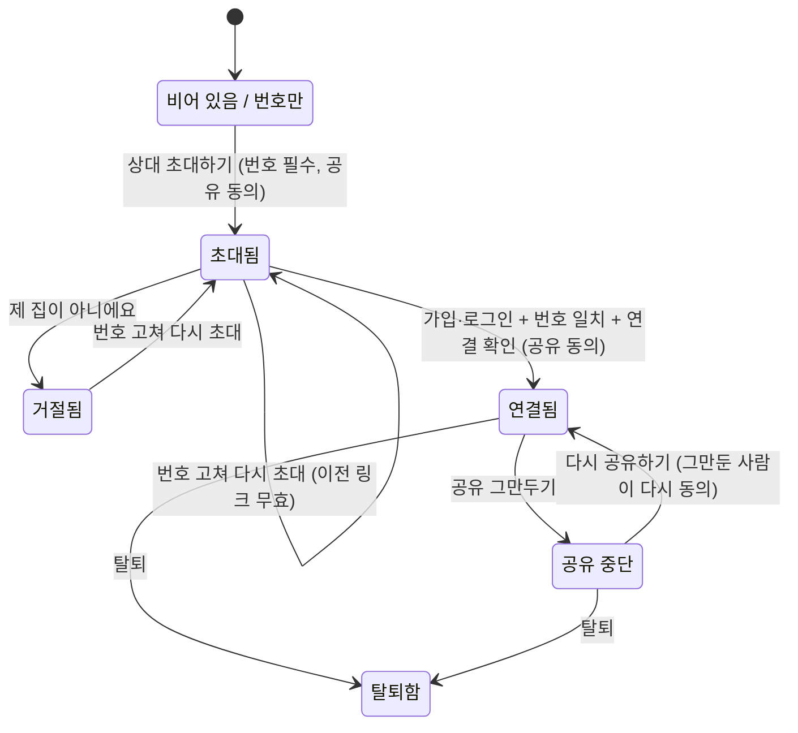


| 행동 | 누가 | 어디서 | 결과 | 문자 |
|---|---|---|---|---|
| 상대 초대하기 | 호실을 만든 측 | 비어 있음·번호만 | 번호가 없으면 이때 입력(필수). 초대됨, 초대 링크 발급. **이때 처음 문자가 나간다.** 초대하는 곳은 두 군데: 하자 등록·입주 점검 화면의 "상대에게 알리기"(링크 = 그 기록), 호실 화면의 "상대 초대하기"(링크 = 호실 초대 화면). 첫 초대 전에는 기록할 때마다 "알릴까요?"를 묻고 기본 선택은 없다. 처음 알리기·초대할 때 **기록 공유 동의 화면**(6-2) → [동의하고 보여 주기], 행동 "공유 동의". [나만 보기]면 보내지 않는다 | 초대 문자 |
| (자동) 초대 뒤 새 기록 | 서버 | 초대됨(연결 전) | 새 기록마다 그 기록의 링크로 통지. **돈 기록은 빼고**(요청 없이 혼자 기록, 연결하면 확인 카드로, 1-4) | 응답 필요 |
| 번호 고치기 | 초대한 측 | 초대됨·거절됨 | 번호 변경 기록, 이전 링크 무효, 새 초대 | 초대 문자 |
| 연결 확인 | 초대받은 사람(인증 번호 = 초대 번호) | 초대됨 | 연결됨, 초대 링크 무효. 연결 확인 화면에서 기록 공유 동의(6-2) → [동의하고 연결하기], 행동 "공유 동의". [연결하지 않기]면 초대됨 그대로, 받은 링크는 계속 볼 수 있다(초대한 쪽에 알리지 않음). 연결 확인 화면에 "연결하면 ○○ 님에게 알림이 가요". 연결하면 앞서 남긴 기록을 모두 보고, 쌓인 기록의 요청이 확인 카드에 모인다(1-4) | 초대한 측에 서비스 안 알림 "○○ 님이 연결했어요"(문자 없음, 합류 여부는 알리지 않음) |
| 같은 집 기록이 있을 때 | 초대받은 사람 | 연결 확인 화면 | 같은 측·거주 중·같은 동의 내 기록이 있으면 **"이 기록과 같은 집인가요?"**를 먼저 묻는다(아니면 그냥 연결). 같은 집이면 ① 합류(내 기록은 "합류 전 기록": 새 행동 없음(개인정보 사진 지우기는 예외), 읽기·내려받기만, 나만 봄, 삭제는 합류한 기록을 따라감) ② 거절하고 내 기록으로 상대 초대. 기록이 많은 쪽 추천. **내 기록에 이미 연결된 상대가 있으면 합류는 없다**(그 상대의 공동 기록을 닫지 않게, 두 기록을 따로 둔다) | ②면 초대한 측에 알림 |
| 제 집이 아니에요 | 초대받은 사람 | 초대됨 | 거절됨 | 초대한 측에 서비스 안 알림 |
| 공유 그만두기 | 연결된 당사자 누구든 | 연결됨 | 공유 중단. 그만둔 뒤 남긴 기록은 상대에게 보이지 않는다(양방향). 그만둔 사람은 기존 기록 보기·내려받기와 나만 보는 기록을 계속하고, 공동 기록에 확인·이견 붙이기와 초대는 못 한다. 걸려 있던 확인 요청은 "공유 중단"으로 닫히고 상대는 혼자 진행 가능(1-1), 링크 닫힘. 이미 함께 본 기록은 보관 기간까지 남는다. 다시 함께 쓰려면 그만둔 사람이 [다시 공유하기] → 공유 동의 → 바로 연결됨(그만둔 동안의 기록도 보인다, 상대에게 서비스 안 알림, 닫힌 요청·링크는 되살리지 않음) | 상대에게 서비스 안 알림, 그만둔 사람에게 결과 알림 |
| 다시 공유하기 | 공유를 그만둔 사람 | 공유 중단 | 공유 동의 화면을 다시 거쳐 연결됨. 그만둔 동안의 기록도 상대에게 보인다. 닫힌 확인 요청·링크는 되살리지 않는다 | 상대에게 서비스 안 알림(하루 묶음) |
| 번호 불일치 | - | 초대됨 | 연결 안 됨(초대한 측이 번호를 고쳐야 함) | - |
| 자기 번호로 초대 | 초대한 측 | 비어 있음·번호만 | **막는다**: 상대 번호가 내 계정의 인증 번호와 같으면 "내 번호는 상대로 넣을 수 없어요"(한 사람이 한 호실의 양쪽 측이 되어 혼자 합의를 만드는 것을 막음) | - |
| 탈퇴 | 연결된 당사자 | 연결됨 | 탈퇴함(L 참고), 자리는 비어 있음(당사자 교체는 확장) | 상대 측에 서비스 안 알림 |

### C. 링크

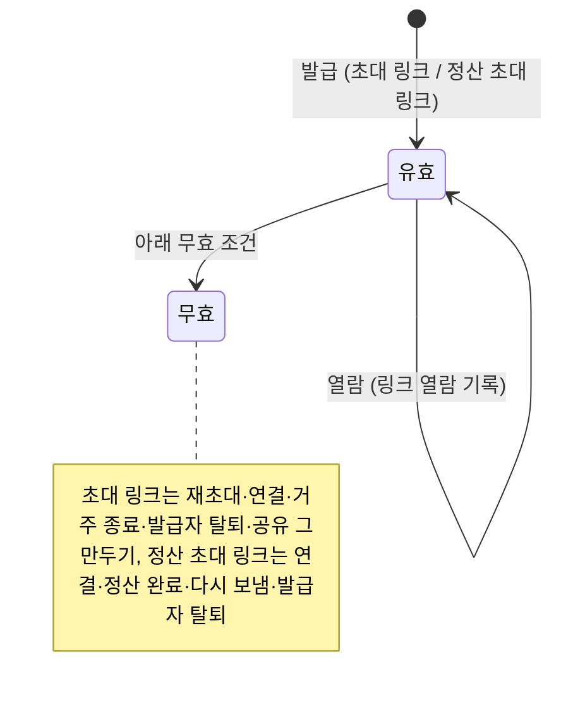


| 행동 | 결과 |
|---|---|
| 발급 | **초대 링크**: 거주 중 초대할 때(기록 하나 또는 호실 초대 화면). **정산 초대 링크**(Should): 거주 종료 뒤 연결되지 않은 상대에게 가입해서 함께 확인하자고 권할 때(연결 전에는 돈 요청을 만들지 않으므로 요청이 아니라 권유, 1-4). 토큰 128비트 이상, 해시 저장 |
| 정산 초대 링크 화면 | "퇴거 정산 확인 요청이 있어요"(호실 별칭 없음, 6-1) + [가입하고 확인하기]만. 금액·항목은 보이지 않는다. 처음 보내는 문자라면 기록 공유 동의와 출처 문구가 똑같이 적용 |
| 열람 | 링크 열람자는 공유한 기록 하나만 읽는다. 화면 아래에 "응답하려면 가입해 주세요. 휴대폰 인증 한 번이면 돼요"와 [가입하고 응답하기]. "링크 열람" 기록이 남는다(가입·연결 뒤에 연 것만 "집주인 열람") |
| 무효 (MVP 자동) | 초대 링크: 번호를 고쳐 다시 초대 / 연결됨 / 거주 종료 / 발급한 사람 탈퇴 / 공유 그만두기. 정산 초대 링크: 연결됨 / 정산 완료(자동 마감 포함) / 번호 고쳐 다시 보냄 / 발급한 사람 탈퇴 |
| 무효 (P1) | 직접 끄기, 기간 만료(초대 14일) |

### D. 수리 건: 하자 인정과 수리 진행 (두 줄)

수리 건 하나에는 **서로 다른 두 가지 일**이 따로 움직인다. 카드에도 두 줄로 보인다: "하자: 정호 님 확인 ✓" / "수리: 처리 중". 돈은 세 번째 줄(E, 돈 안건)이다.

| 줄 | 묻는 것 | 누가 움직이나 |
|---|---|---|
| **하자 인정** | "이런 하자가 있나?" | 상대의 응답(G의 응답 두 버튼) |
| **수리 진행** | "고치고 있나, 다 고쳤나?" | 누구든 시작, 종료는 두 사람 확인 |

**D-1. 하자 인정**

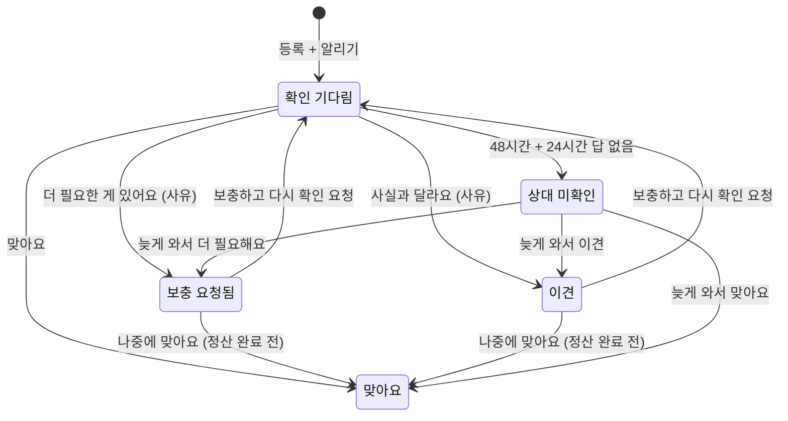


| 행동 | 누가 | 결과 | 문자 |
|---|---|---|---|
| 하자 등록 | 당사자 누구든(거주 중) | 필수는 부위·제목·사진 1장 이상(최대 10장), 설명은 선택. 하자 인정 "확인 기다림"(상대가 없으면 "○○ 님 확인 없음 · 아직 초대 전") | 상대가 있으면 응답 필요 |
| 맞아요 | 상대 측 | 하자 인정 "맞아요"(도장). **수리 진행은 바뀌지 않는다** | - (서비스 안 알림) |
| 더 필요해요(보류) / 사실과 달라요(이견) | 상대 측 | "보충 요청됨" / "이견"(사유 필수, 도장). 기다림 닫힘 | - (서비스 안 알림) |
| 보충하고 다시 확인 요청 | 등록 측 | 사진·설명 추가(덧붙이기) + 확인 기다림. 7일에 한 번, 근거 하나 이상 필수 | 응답 필요 |
| 책임 다툼 | 상대 측 | "하자는 맞지만 책임이 다르다"는 **맞아요 + 부담 제안**(E). 하자 [맞아요]는 돈을 내겠다는 뜻이 아니다 | 부담 제안 응답 필요 |

[맞아요]는 뒤집지 않는다. 확인 뒤 상황이 바뀌면 진행 상황 + [상황이 바뀌었어요](G).

**D-2. 수리 진행**

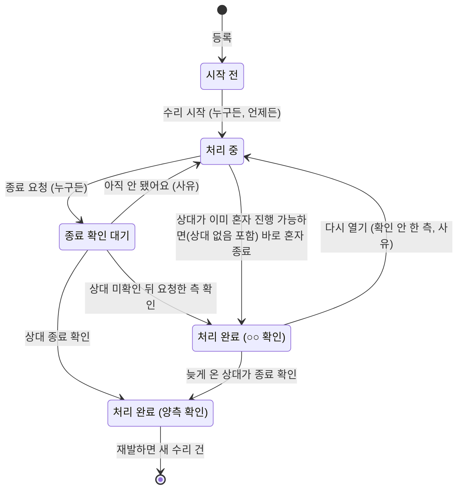


| 행동 | 누가 | 어디서 | 결과 | 문자 |
|---|---|---|---|---|
| 수리 시작 | 당사자 누구든 | 시작 전 | 처리 중. 하자 인정이 "맞아요"가 아니면 **강행 표시**("○○ 님 확인 전에 / 보충 요청 중에 / 이견 중에 시작했어요") | - (서비스 안 알림) |
| 진행 상황 묻기 | 당사자 누구든(거주 중) | 시작 전·처리 중 | 상태는 그대로. 응답 요청(같은 기다림). 한 건에 7일에 한 번. 그 건에 상대가 남긴 행동은 모두 응답으로 본다 | 응답 필요 |
| 진행 상황 남기기 | 당사자 누구든 | 언제든 | 덧붙이기(글 + 사진). [상황이 바뀌었어요]를 켜면 상대에게 확인 요청(7일에 한 번) | 켰을 때만 응답 필요 |
| (보이기) 멈춘 기간 | - | 시작 전·처리 중 | "N일째". 14일 넘게 당사자의 새 행동이 없으면 홈의 "오래 멈춘 건"(계산, 저장 안 함) | - |
| 종료 요청 | 당사자 누구든 | 처리 중 | 종료 확인 대기 | 응답 필요 |
| 종료 확인 | 요청의 상대 측 | 종료 확인 대기 | 처리 완료(양측). 하자 인정이 아직 "확인 기다림"이면 함께 묻는다 | - |
| 아직 안 됐어요 | 요청의 상대 측 | 종료 확인 대기 | 처리 중(사유 필수) | - (서비스 안 알림) |
| 혼자 종료 | 요청한 측 | 종료 확인 대기 + 상대 미확인, 또는 처리 중 + **이 건에서 상대가 이미 혼자 진행 가능하고 그 뒤 상대 행동 없음**(상대 없음 포함, 1-4) | 처리 완료(○○ 확인) + "○○ 님 확인 없음 · 이유". 바로 혼자 종료면 종료 요청 없이, 문자 없이 서비스 안 알림만 | - |
| 늦게 종료 확인 | 확인하지 않은 측 | 처리 완료(○○ 확인), 정산 완료 전 | 처리 완료(양측) | - |
| 다시 열기 | 확인하지 않은 측 | 처리 완료(○○ 확인) | 처리 중(사유 필수) | 응답 필요 |
| 재발 | 당사자 누구든 | 처리 완료(양측) | 다시 열지 않고 새 수리 건, 이전 건 연결 | 하자 등록과 같음 |

**완전히 끝남** = 수리 처리 완료 + 돈 상태 합의됨 또는 비용 없음 + 부담과 순 지출이 같음. 홈에는 "고쳤지만 돈이 남은 건"을 모아 보여 준다. **돈이 남은 건** = 돈 상태가 미정·이견이거나, 합의됐는데 부담과 순 지출(낸 돈 − 상대에게서 받은 돈)이 다른 건. 뒤의 경우 그 수리 건과 홈에 "집주인 부담 65,000 · 세입자가 냄 → 돌려줬다면 기록하기 [보냈어요] [받았어요]" 카드를 보여 준다(문자 없음).

**원인에 대한 설명**(Should, 빠지면 진행 상황에 글과 사진으로): 수리 상태·돈 상태와 따로, 측마다 하나씩 선택으로 남긴다. 서비스는 원인이 맞는지 판정하지 않고 "누가 무엇을 근거로 말했나"만 남긴다.

| 칸·행동 | 내용 |
|---|---|
| 설명 | 자유 입력("윗집 욕실 배관 누수로 보여요") |
| **근거 종류(필수)** | 내 추측 / 직접 봤어요(사진) / 업체·전문가 소견(업체명 선택) / 다른 사람에게 들었어요(관리인, 윗집 등) |
| 근거 자료 | 소견서·견적서·현장 사진(선택) |
| 상대 응답 | 동의 / 이견(사유). 응답 필요가 아니라서 서비스 안 알림만, 문자·기다림 타이머 없음 |
| 화면 | "세입자의 설명 · 근거: 내 추측", "집주인의 설명 · 근거: 업체 소견(○○설비) · 소견서 사진 1 · 세입자도 동의했어요 ✓". "원인 확인됨"·"책임 있음"은 쓰지 않는다 |
| 고치기 | 문장 수정은 고치기(G). **근거 종류가 바뀌면**(추측 → 업체 소견) 새 설명을 덧붙이고, 상대 동의는 새 설명에 다시 받는다(이전 설명과 동의는 이력) |
| 다른 것과의 관계 | 부담 합의·하자 인정을 바꾸지 않는다. 부담 제안 화면, 정산 후보 옆, 내려받기 ZIP에 함께 보인다 |

**하자 인정과 정산**: 하자 인정(D-1)은 퇴거 정산 후보 옆에 함께 보인다(계산은 바뀌지 않고, 사람이 판단할 근거로).

### E. 돈 상태 (수리 건의 부담 합의)

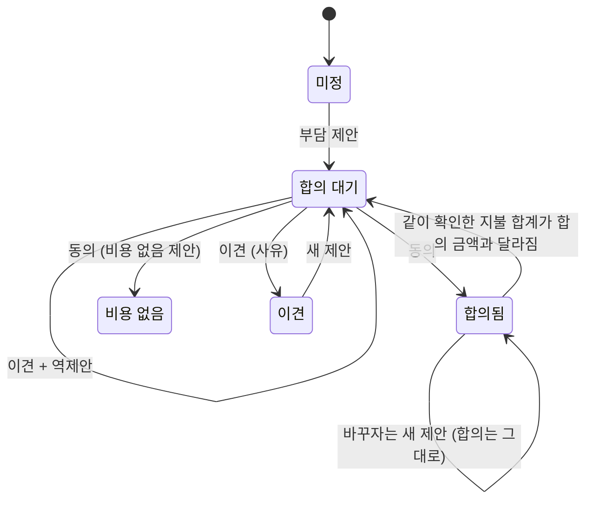


1-2 돈 안건(제안과 합의)을 그대로 쓴다. 제안의 내용만 다르다.

| 제안 내용 | 결과(합의되면) |
|---|---|
| 집주인 / 세입자 / 나눠서(각 금액, 합 = 전체) / 제3자 일부·전부 | 합의됨 |
| 비용 없음 | **비용 없음**(합의됨과 같은 "끝남") |

**부담 안의 모양**: 안 하나는 **(누가, 얼마) 줄 목록**이고 합은 전체 금액이다. 예: (집주인, 300,000) / (집주인, 150,000)·(세입자, 150,000) / (제3자 "윗집", 200,000)·(집주인, 100,000). 제3자는 짧은 설명만 적고 연락처는 받지 않는다(당사자가 아닌 사람의 개인정보). 금액만 적고 비율은 쓰지 않는다(과실 비율처럼 읽히지 않게). 제3자가 낸 돈은 지불 기록의 "낸 사람 = 제3자"로 남기고, 정산 후보는 세입자·집주인 줄만 계산한다. 화면은 기본 버튼(집주인 / 세입자 / 나눠서 / 비용 없음) + "제3자가 일부 내요"를 누를 때만 줄을 더한다.

| 행동 | 누가 | 어디서 | 결과 | 문자 |
|---|---|---|---|---|
| 부담 제안 | 당사자 누구든 | 미정·이견 | 합의 대기 | 응답 필요 |
| 바꾸자는 새 제안 | 당사자 누구든 | 합의됨 | 합의됨 그대로 + "바꾸자는 안 있음"(상대가 동의하면 새 합의, 이견·무응답이면 지금 합의 유지) | 응답 필요 |
| 동의 | 상대 측 | 합의 대기 | 합의됨 / 비용 없음 | - |
| 이견 | 상대 측 | 합의 대기 | 이견(사유 필수) | - (서비스 안 알림) |
| 이견 + 역제안 | 상대 측 | 합의 대기 | 합의 대기(역제안이 현재 제안, 차례가 바뀜) | 응답 필요 |
| 제안 철회 | 제안한 측 | 합의 대기(상대 응답 전) | 직전 상태 | - |
| (자동) 지불 합계 변경 | 서버 | 합의됨(**같이 확인한** 지불의 합이 바뀌어 합의한 금액의 합과 달라짐) | 합의 대기("전체 금액이 바뀌었어요"). 기다리던 제안(바꾸자는 안, 다른 안)은 "금액이 바뀌어 닫힘" | 응답 필요 |
| 거주 종료 | - | 어느 상태든 | 그대로 정산 후보로(I) | - |

### F. 지불 기록

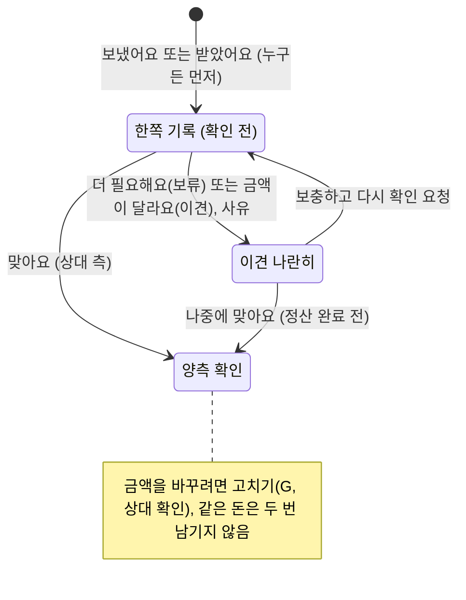


| 행동 | 누가 | 결과 | 문자 |
|---|---|---|---|
| 지불 기록 | 당사자 누구든 | 금액, 낸 사람(세입자 / 집주인 / 제3자), 받는 사람(업체 / 상대 당사자 / 제3자), 증빙 종류·사진(선택). **당사자끼리 보낸 돈**(예: 집주인이 세입자에게 수리비를 돌려줌)도 이 표에 남긴다. 보낸 쪽은 "보냈어요", 받은 쪽은 "받았어요"로 누구든 먼저 남기고 상대가 확인한다. **같은 돈이 두 번 남지 않게**: 상대가 남긴 확인 전 기록이 있으면 새로 만들지 않고 [확인]을 보여 주고, 같은 수리 건·방향·금액의 기록이 30일 안에 있으면 "비슷한 기록이 있어요"로 묻는다. 확인 강도 "한쪽 기록" 또는 "증빙 있음" | 상대 측에 금액 확인 응답 필요(연결된 상대일 때. 연결 전이면 요청 없이 혼자 기록, 1-4) |
| 금액 확인 | 상대 측 | 확인 강도 "양측 확인" | - |
| 더 필요해요(보류) / 금액이 달라요(이견) | 상대 측 | 사유 필수, 기록은 그대로 두고 나란히. 기록한 쪽은 근거를 더해 [보충하고 다시 확인 요청](7일에 한 번), 상대는 정산 완료 전까지 [맞아요]로 바꿀 수 있다(G) | - |
| 금액 고치기 | 기록한 측 | 고치기(G): 금액 확인 전이면 그냥 고쳐짐, 확인 뒤면 상대 확인 | 확인 뒤면 응답 필요 |

서비스는 증빙이 진짜인지 판정하지 않는다.

### G. 고치기 (같이 확인하기 전과 후)

**기록의 세 단계**: ① **기록함**(한쪽이 남김) → ② **같이 확인함**(상대가 "봤어요/맞아요"를 누름. 그 모습에 **도장**을 찍는 것과 같다) → ③ **합의함**(돈 안건만, 1-2). 고치기 규칙은 도장 전과 후, 이 차이 하나로 정해진다. 칸 종류(설명이냐 부위냐 금액이냐)로 나누지 않고, 서버가 글의 뜻(오타인가)을 판단하지도 않는다.

**한 줄 규칙**: 도장 전엔 마음대로, 도장 뒤엔 **무엇이든** 두 사람 도장이 있어야 바뀐다. 새로 더하는 것(덧붙이기)만 예외.

**무엇이 도장인가**: 연결된 상대가 그 기록을 보고 직접 누른 응답이다. **[맞아요]·보류·이견 모두 도장**이다(셋 다 "이 모습을 봤다", 보류·이견 뒤에 내용이 바뀌면 무엇에 답했는지가 사라짐). 링크로 보기, 알림 읽음, **상대 미확인은 도장이 아니다**(미확인 기록은 기록한 쪽이 그냥 고칠 수 있고 고친 이력은 남음).

| 기록 | 도장이 되는 행동 |
|---|---|
| 하자 내용(부위·제목·설명·사진) | 상대의 [맞아요] 또는 [아니에요 · 더 필요해요](보류·이견) |
| 지불 | 상대의 [맞아요] 또는 [아니에요 · 더 필요해요](보류·금액 이견) |
| 점검 항목 | 상대의 [맞아요] 또는 [아니에요 · 더 필요해요](보류·이견) |
| 점검 전체 + 입주일 | **점검 잠김**(잠기면 미확인 항목도 도장 뒤. 입주일은 입주 점검에 함께 보여 주고 입주 점검이 잠길 때 함께 도장) |
| 정산 송금 | 받은 쪽의 [맞아요] 또는 [아니에요 · 더 필요해요](보류·금액 이견) |
| 원인 설명 | 상대의 [맞아요] 또는 [아니에요 · 더 필요해요](보류·이견) |

합의(돈 안건, 1-2)는 도장보다 한 단계 더(같은 제안에 둘 다 동의)이고, 종료 확인은 "수리가 끝났다"는 사실에 대한 두 사람의 확인이다.

| | 도장 전 (혼자 쓴 기록, 상대가 아직 확인 전) | 도장 뒤 (같이 확인함) |
|---|---|---|
| 고치면 | **그냥 고쳐진다.** 상대가 연결돼 있으면 서비스 안 알림 "고쳤어요" | **앞모습(도장 찍힌 내용)은 그대로.** 고친 것은 아래에 "내가 고친 내용 · 상대 확인 전"으로 바로 남는다 |
| 상대에게 | (알림) | **확인 요청**(문자 + 서비스 안 알림, 1-1 기다림 타이머). **한 기록에 확인 요청은 하나**로 묶는다: 설명·부위·금액을 연달아 고쳐도 문자는 한 통. 기록 단위는 수리 건 하나, 지불 하나, **점검 하나**(항목 여러 개를 고쳐도 한 통), 송금 하나 |
| 상대가 확인 | - | 고친 내용이 앞모습이 된다(새 판에 도장). [모두 확인]과 칸마다 [맞아요] / [아니에요 · 더 필요해요]가 있다 |
| 상대가 [아니에요 · 더 필요해요](사유) | - | 앞모습 그대로, 고친 내용은 보류·이견으로 나란히. 고친 측은 [사진 더해서 다시 요청] |
| 답이 없음 | - | 상대 미확인. 앞모습 그대로, 고친 내용은 나란히. 나중에 확인하면 그때 바뀐다 |
| 고친 쪽이 답하기 전에 거둠 | - | 고친 내용이 "거둠"으로 남는다 |
| 계산·정산 | 지금 값 | **도장 찍힌 값만** |

모든 칸이 같다: 제목, 설명, 부위, 금액, 날짜(지불일·입주일·송금일), 낸·받은 사람, 점검 항목, 정산 송금. 고친 이력은 모두 남는다.

**상대 화면**: 고친 글은 **바뀐 글자만** 색으로 표시한다(예: "물이 ~~셈니다~~ **새요**"). 오타인지 내용이 바뀐 것인지 한눈에 보여서 당황하지 않고 [맞아요] 한 번으로 끝낸다.

**응답과 그 뒤 **

| 정책 | 내용 |
|---|---|
| 응답 버튼 두 개 | **[맞아요]** / **[아니에요 · 더 필요해요]**. 두 번째를 누르면 "더 필요한 게 있어요(사진·근거·원인 확인)" = **보류** 또는 "사실과 달라요" = **이견**을 고르고 사유를 적는다. 셋 다 도장이고 기다림을 닫는다 |
| 보충하고 다시 요청 | 보류나 이견이 달린 기록(하자·지불·점검 항목·고친 내용)에 기록한 쪽이 **[보충하고 다시 확인 요청]**(사진·설명 추가 + 요청). 거절된 고친 내용은 **[사진 더해서 다시 요청]**으로 같은 내용에 근거만 더해 다시 보낸다 |
| 나중에 답 바꾸기 | 보류·이견은 정산 완료 전까지 언제든 [맞아요]로 바꿀 수 있다(이전 응답은 이력에). **[맞아요]는 뒤집지 않는다.** 확인 뒤 할 말은 원인 설명, 진행 상황, 상황 변화 요청으로 덧붙인다. 하자 [맞아요]는 "이런 하자가 있다"까지이고 돈을 내겠다는 뜻이 아니다(돈은 안건에서) |
| 강행 표시 | 보류나 이견이 있는 상태에서 수리 시작·종료 등을 하면 경과에 "○○ 님이 보충을 요청한(이견을 낸) 상태에서 진행했어요"를 함께 남긴다. 막지 않는다 |
| 상황이 바뀌면 | 같은 맥락(곰팡이 → 천장 구멍)은 같은 카드에 **진행 상황**(사진 + 설명) + **[상황이 바뀌었어요, 확인해 주세요]**. 상대는 같은 두 버튼으로 답한다. 별개 하자는 새 수리 건 |
| 다시 확인 요청의 한도  | [보충하고 다시 확인 요청]·[사진 더해서 다시 요청]·[상황이 바뀌었어요]는 **한 기록에 7일에 한 번**만 누를 수 있고("○일 뒤 다시 요청할 수 있어요"), 누를 때마다 문자가 간다. 다시 요청에는 **사진이나 설명을 하나 이상 더해야** 한다(같은 요청 반복 방지). 응답은 요청마다 새로 고른다 |
| 바꿀 수 있는 기간  | 보류·이견 → [맞아요]는 모든 기록에서 **정산 완료 전까지** |
| 오래 멈춘 보류 | 보류로 14일 넘게 새 행동이 없으면 "오래 멈춘 건"에 뜬다(하자 줄은 D-1대로 "보충 요청됨"으로 보임) |
| 거절된 고친 내용 | 지우지 않는다. 앞모습은 그대로, 거절된 내용은 "거절된 고친 내용 ▸"으로 접혀 이력에 남는다. 금액이면 정산 화면의 이견에 보인다 |

**화면 규칙 네 줄** (수리 건·지불·점검 항목·송금 공통, 프론트 부품 하나)

1. 앞에는 언제나 **둘이 확인한 내용 하나**만 크게.
2. 답을 기다리는 고친 내용은 그 아래 **상자 하나**, 버튼은 최대 두 개.
3. 반영되면 **"고쳐짐 · ○○ 님 확인"** 한 줄만 남고 상자는 사라진다.
4. 거절·거둠·지난 모습은 **[고친 이력 ▸]** 안에 접혀 있다.

**"확인 없음" 화면 표시 **: 내부의 "단독 기록 / 상대 미확인 / 혼자 진행 가능"은 화면에서 "○○ 님 확인 없음 · 이유" 하나로 모은다. ① 줄마다(하자·수리·돈·지불) 붙인다 ② 기다리는 중("확인 기다림 · 남은 시간")과 답이 오지 않음("확인 없음 · 72시간 동안 답이 오지 않았어요")을 나눈다 ③ 혼자 진행은 표시가 아니라 버튼 + 안내 한 줄 ④ 답하지 않은 쪽에게는 "아직 답하지 않은 확인 요청이 있어요 · 지금 답할 수 있어요" ⑤ 이유가 겹치면 가장 최근 하나(탈퇴 → 공유 그만둠 → 문자 그만 받음 → 문자가 가지 않음 → 아직 연결하지 않음 → 답이 오지 않음 → 아직 초대 전) ⑥ 상대가 아직 없는 호실은 줄마다 표시하지 않고 맨 위에 "혼자 기록하고 있어요 · [상대 초대하기]" 한 번 ⑦ 탓하지 않는 말(사실과 할 수 있는 일만) ⑧ 문자를 끈 사람이면 "문자를 꺼 두어 서비스 안 알림으로만 알렸어요" 덧붙임. 화면 그림은 `08-화면-기본-틀.md` 8장.

**문자 도배 막기**: 기록당 확인 요청은 하나이고, 거의 동시에 가는 회원 문자는 한 통으로 모은다(1-4). 미확인 뒤 같은 기록을 다시 고쳐도 문자는 7일에 한 번. [보충하고 다시 확인 요청]·[상황이 바뀌었어요]·[진행 상황 묻기]는 한 기록에 **7일에 한 번**만 문자(서비스 안 알림은 그때그때). 덧붙이기는 문자 없이 서비스 안 알림만. 받는 번호당 하루 5통·계정당 20통, 21~08시 보류.

**바탕 원칙**: 쉽게 남기고 쉽게 답해야 기록이 쌓인다. 화면 말은 "확인, 고친 내용, 수리비"처럼 쉽게 쓰고 도장·판·안건 같은 내부 말은 쓰지 않는다.

**덧붙이기, 새 기록, 고치기** (한 줄: 설명은 자유롭게, 사실은 확인받고, 계산은 확인된 것만)

| 범위 | 무엇 | 도장 |
|---|---|---|
| **덧붙이기**(설명을 더함) | 사진 추가, 진행 상황 남기기, 원인 설명(쪽마다 따로), "잘못 올린 사진" 표시 | 필요 없음. 계산과 상태에 들어가지 않음. "확인 뒤 추가" 표시와 서비스 안 알림만 |
| **새 기록**(확인받을 새 사실) | 새 수리 건, **새 지불**, 정산 항목, 정산 송금, 점검의 빠뜨린 하자 | 자기 도장을 따로 받음. **확인된 뒤에만** 계산·합의에 들어감 |
| **고치기**(도장 찍힌 것을 고침) | 위 표의 모든 칸. **오타도 같다**(오타인지 의도한 변경인지 미리 가를 수 없어서) | 필요함 |

**사진**: 고치기는 없고 **추가만** 있다. 지우기는 개인정보 때문일 때만(PHO-5, 흔적이 남음). 링크로 보는 사람에게만 감추려면 [링크에서 숨김]. **잘못 올린 사진**(개인정보는 아닌데 엉뚱한 사진)은 지우지 않고 올린 사람이 언제든 **"잘못 올린 사진" 표시**를 붙인다(PHO-9): 사진은 남되 흐리게 맨 뒤로 가고, 상대에게 서비스 안 알림. 상대가 이미 도장을 찍은 사진은 계속 볼 수 있다. 표시는 뗄 수 있다.

**고치기가 아닌 것**: 수리비를 누가 낼지 바꾸는 것은 그 안건의 **새 제안**(1-2). 새로 발견한 하자, 수리 완료 뒤 같은 곳의 재발은 **새 수리 건**(이전 건 연결). 둘 다 원래 기록과 도장을 건드리지 않는다.

**같이 확인할 때 무엇을 확인했는지 남긴다**: 확인을 누르면 그 순간 본 모습의 번호를 확인 기록에 함께 남긴다.

**화면에서는** [고치기] 버튼 하나(사진은 [사진 추가])예요. 결과는 서버가 정해 쉬운 말로 알려요: "고쳤어요"(도장 전) / "고친 내용을 남겼어요. ○○ 님이 확인하면 바뀌어요"(도장 뒤). 링크에서도 고친 이력이 보인다.

예시:

```
수리비 65,000원 (같이 확인 ✓)                     ← 앞모습, 정산은 이걸로
 └ 내가 고친 내용: 95,000원 · 세입자 · 상대 미확인

설명 "수전에서 물이 조금 새요" (같이 확인 ✓)       ← 앞모습
 └ 내가 고친 내용: "수전이 터져서 바닥이 다 젖었어요" · 서윤 · 11/20 · 정호 님 확인 전

욕실 › 천장 (혼자 남긴 기록)
 └ 방 › 벽 → 욕실 › 천장 · 그냥 고쳐짐(고친 이력 2번)
```

**저장 규칙**(확인할 때 잘못 반영되지 않게)

| # | 규칙 | 막는 일 |
|---|---|---|
| 1 | 고친 내용은 **칸 하나 + 새 값 + 기준 판**(그때 도장 찍힌 판)으로 저장한다. 통째 판으로 저장하지 않는다. 상대가 확인하면 **지금 도장 찍힌 판 + 그 칸만** 합쳐 새 판을 만든다 | 설명과 부위를 둘 다 고친 뒤 부위만 확인했는데 설명까지 바뀌는 일 |
| 2 | 응답([맞아요]·보류·이견)은 **본 번호**를 함께 보낸다(고친 내용의 번호, 도장 전 첫 확인이면 본 판 번호). 그사이 바뀌었으면 "내용이 바뀌었어요. 다시 보고 확인해 주세요"로 거절한다 | 보지 않은 내용에 도장이 찍히는 일 |
| 3 | **칸마다 확인 전 고친 내용은 하나.** 다시 고치면 이전 것은 "새로 고쳐서 바뀜"으로 닫히고 기록에는 남는다 | 같은 칸에 고친 내용이 여러 개라 무엇을 확인할지 모호한 일 |
| 4 | 기준 판 이후 **같은 칸**이 이미 바뀌었으면 자동으로 합치지 않고 다시 확인을 받는다. 다른 칸이면 그대로 합친다 | 먼저 확인된 고친 내용을 덮는 일 |
| 5 | 확인 → 새 판 → 돈 합의 다시 계산 → 정산 후보 갱신을 **한 트랜잭션**에. 잠그는 순서: 호실 기록 → 수리 건 → 지불 → 점검·점검 항목 → 정산 → 정산 항목 → 정산 송금 → 제안 → 고친 내용 → 응답 요청 → 통지 | 합의와 정산이 반쯤만 바뀐 채 남는 일 |

정산 완료 때 남은 확인 전 고친 내용, 기다리던 제안, 기다리던 응답 요청은 모두 "정산 완료로 닫힘"이 된다(재통지 문자도 나가지 않음). 공유 그만두기·탈퇴로 응답 요청이 닫히면 그 고친 내용도 "공유 중단으로 닫힘"이 되고(혼자 진행으로 반영되지 않음), 다시 공유하면 고친 쪽이 다시 요청할 수 있다. 링크 열람과 내려받기(`기록.json`)는 도장 찍힌 모습을 기준으로 보여 주고, 확인 전 고친 내용은 상태와 함께 따로 담는다. "개인 기록"을 따로 두지 않는다: 고친 사람에게는 "내가 고친 내용(확인 전)"으로 보이고, 저장은 공유 기록 한 곳이라 맞출(동기화할) 것이 없다.

### G-1. 만드는 법: 프론트와 백엔드는 하나로

| | 하나로 만드는 것 |
|---|---|
| 백엔드: 고치기 | 기록마다 "고친 이력"(B 판 테이블)과 머리(C)에 **지금 모습**·**도장 찍힌 모습** 두 가리킴. 앞모습은 도장 찍힌 모습(없으면 지금 모습). 고친 내용은 `correction_request`(칸 + 새 값 + 기준 판). 판단은 "도장이 있나" 하나: 없으면 바로 새 판, 있으면 고친 내용 + 확인 요청(기록당 하나) |
| 백엔드: 돈 안건 | 제안·동의·이견·다른 안·거둠은 돈 안건 장치 하나(`ProposalService`). 안건이 어디에 붙었는지(수리비 / 정산 항목 / 보증금)만 다름 |
| API | 고치기는 `POST /api/corrections` 하나. 응답에 결과(`APPLIED` 도장 전 / `REQUESTED` 도장 뒤)와 화면 문구. 상대는 `/corrections/{id}/respond`(ACK/NEED_MORE/DISPUTE), 한 기록의 고친 내용을 한 번에 `/corrections/accept-all`. 돈 제안은 안건마다 `…/proposals`, 답은 `/proposals/{id}/…` |
| 화면 | [고치기] 부품 하나, "내가 고친 내용" 표시 부품 하나(차이 표시 포함), **안건 부품 하나**(제안 줄 + 지금 합의 + "바꾸자는 안 있음"). 안건 부품을 수리 건·정산 항목·보증금에 같은 모양으로 붙임 |
| 계산 | 정산과 상태는 언제나 **도장 찍힌 값과 지금 합의**만 읽음 |

### H. 점검 (입주·퇴거)

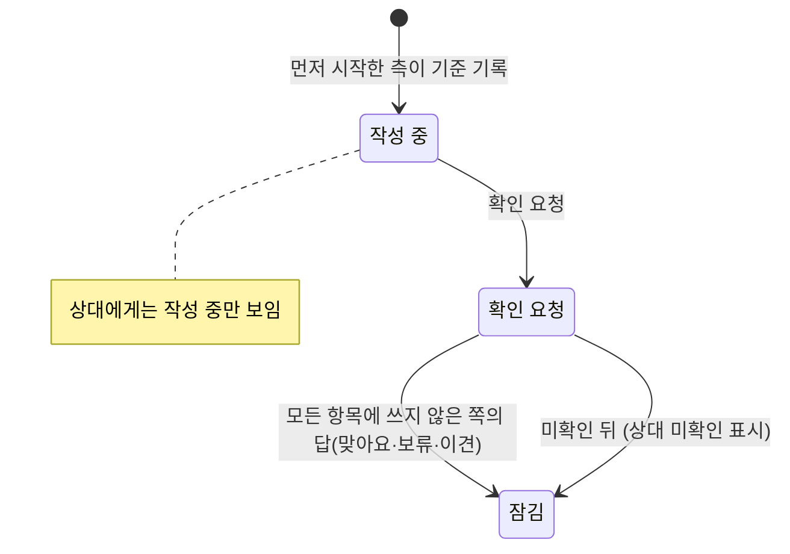


| 규칙 | 내용 |
|---|---|
| 용도 | 점검은 **그날의 상태**를 남기는 기록이다. 입주 점검은 원래 있던 하자, 퇴거 점검은 나갈 때의 상태(입주 점검과 나란히). 살면서 생기거나 나빠진 하자는 점검이 아니라 수리 건이고, 나빠진 상태는 수리 건이나 퇴거 점검에 남긴다(잠긴 입주 점검은 그날의 기록이라 그대로) |
| 무엇을 더하나 | ① 이미 적은 항목에 사진·설명 = 덧붙이기 ② 이미 적은 항목의 내용이 틀림 = 고치기(G) ③ **그날 있었는데 빠뜨린 하자 = 점검 항목 더하기(새 기록)** ④ 살면서 생긴 하자 = 새 수리 건 |
| 부위 | 기본 목록(6구역 28개, 구역 › 부위)을 호실을 만들 때 복사한다. 설비·가전은 호실마다 켜고 끈다. 추가는 그 호실에서만, 지우지 않고 숨기기만(묶인 사진 이력이 끊기지 않게). 기본 목록을 나중에 바꿔도 기존 호실의 부위는 그대로 |
| 입주 점검 기준 기록 | 호실 기록에 입주 점검은 **하나**. **먼저 시작한 측**이 기준 기록을 쓴다(호실을 만든 측에 먼저 안내). 동시에 시작하면 먼저 저장된 쪽만(1-3). 작성 중에는 상대에게 "작성 중"만 보이고, 확인 요청을 보내면 항목이 보인다 |
| **항목** | **사용자가 적은 하자만** 항목이다(부위 + 사진 + 설명). 28개 부위 목록은 빠뜨리지 않게 돕는 둘러보기 안내라 누르지 않아도 넘어간다 |
| 적지 않은 부위 | **"기록 없음"**으로 보인다. 화면 어디에도 "이상 없음"·"정상"을 쓰지 않는다(상태 판단이 고칠 수 없는 기록으로 남지 않게). 퇴거 나란히 보기에서도 "입주 점검에 기록 없음" |
| 부위 사진 | 하자가 아니어도 그 부위의 모습을 남기고 싶으면 선택으로 올린다. 하자 주장이 없어 상대 확인 없이 등록 시각만 남고, 퇴거 나란히 보기에 쓰인다 |
| 상대의 확인 | 항목마다 [맞아요] 또는 [아니에요 · 더 필요해요](보류·이견, 사유), 또는 **"남은 항목 모두 확인"**(확인 창 "7개 항목을 확인할까요?", 저장은 항목마다 확인 행동. 한 화면에 다 보이는 한 기록이라 한 번에 확인할 수 있다, 1-4). 이견은 하나씩 |
| 잠기는 조건 | **모든 항목에, 그 항목을 쓰지 않은 사람의 답(또는 72시간 확인 없음)이 붙으면 잠긴다**: 모든 항목이 **확인 / 보류 / 이견 / 상대 미확인** 중 하나(보류도 답한 것으로 침). 양쪽이 각각 항목을 더했으면 양쪽 모두 상대 항목에 답해야(또는 72시간이 지나야) 잠긴다(안에서는 점검 × 요청 방향마다 확인 요청 하나). 이견 항목은 잠긴 뒤에도 나란히 보존. 항목이 하나도 없어도 "하자 기록 없음"으로 상대에게 확인 요청을 보내고, 상대가 확인(또는 상대 미확인)해야 잠긴다 |
| 빠뜨린 하자 더하기 | **누구든, 점검이 있는 동안 언제든** 더할 수 있고 **더하지 않은 쪽이 확인**한다(새 기록). 작성 중 기준 측이 더한 것은 확인 요청 때 함께, 상대가 더한 것은 기준 측이 확인. 잠긴 뒤면 "잠긴 뒤 추가(날짜)", 거주 종료 뒤면 "거주 종료 뒤 추가(날짜)". 그날 있었는지는 판정하지 않고 날짜만 보인다. 둘이 같은 하자를 따로 적었으면 둘 다 남고, 확인하는 쪽이 이견("이미 적은 항목과 같아요")을 달 수 있다 |
| 잠긴 뒤 | 이미 있는 항목의 내용은 **고치기(G)**로만 바꾼다(잠긴 점검은 도장 뒤와 같다). 빠뜨린 하자는 **"잠긴 뒤 추가"(새 기록, 6-6의 6)**. 미확인이었던 항목에는 상대가 **정산 완료 전까지 늦게 답할 수 있고**(6-6의 1), 답해도 잠금은 그대로다. 잠긴 뒤 추가의 확인 요청은 답이 없어도 열리는 것이 없어 확인 카드의 "정산 전까지" 칸에 간다 |
| 늦은 입주 점검 | 거주 중에도 만들 수 있다. **입주일이 비어 있으면 입주 점검을 시작하기 전에 먼저 묻는다(필수)**: 비면 "호실을 만든 날"과 비교돼 1년 뒤 점검이 늦지 않은 것처럼 보이기 때문이다. 입주일은 점검이 잠길 때 상대가 함께 확인한다. 입주일보다 늦게 시작하면 누가 쓰든 "입주 후 등록(등록일)" 표시 + "입주 후에 등록된 기록이에요. 입주 당시 상태와 다를 수 있어요". 입주일을 바꾸는 것은 고치기(G, 같이 확인한 뒤면 상대 확인) |
| 퇴거 점검 | 입주 점검과 **같은 규칙**(하나, 먼저 시작한 측이 기준, 항목별 확인·이견, 잠금). 작성자가 "점검 마침"을 누르면 거주 종료(A, 집주인 측이면 세입자 확인). **점검은 거주 종료와 따로 잠긴다**: 거주 종료 뒤에도 잠기기 전까지 상대 측이 항목 확인·이견·항목 추가(사진 포함)를 할 수 있고 기다림 타이머도 그대로다(먼저 "점검 마침"을 눌러 상대의 기록을 막지 못하게). 거주 종료 뒤 추가한 항목에는 "거주 종료 뒤 추가(등록일)" + "이사 뒤에 등록된 기록이에요". 정산 완료가 되면 잠기지 않은 항목도 그 상태로 보존된다. 시작하면 정산이 열리고 열린 수리 건을 먼저 보여 준다 |

### I. 정산 항목

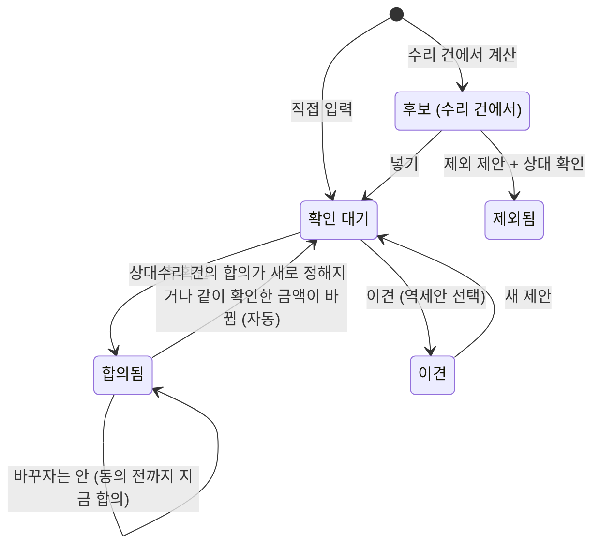


1-2 돈 안건(제안과 합의) + 아래 규칙.

정산의 확인 요청은 모두 연결된 상대일 때만 생긴다. 연결 전이면 요청 없이 혼자 기록(1-4).

| 행동 | 누가 | 어디서 | 결과 | 문자 |
|---|---|---|---|---|
| 정산 열기 | 당사자 누구든(또는 퇴거 점검 시작 시 자동) | 거주 중·거주 종료 | 정산 화면 | - |
| 보증금 제안(화면: 보증금 금액 적기) | 당사자 누구든 | 보증금 확인 전 | 확인 대기. **확인 전에도 정산은 막히지 않음**: 계산 금액은 "보증금 확인 전", 제안 금액 기준 참고값을 따로(6-6의 5) | 응답 필요 |
| 후보 넣기 | 당사자 누구든 | 수리 건에서 온 후보 | 확인 대기(출처: 수리 건). 이미 합의된 수리 건이면 상대는 한 번 눌러 확인 | 응답 필요 |
| 후보 제외 제안 | 당사자 누구든 | 후보 | 확인 대기(내용: 제외, 사유 필수). 상대 확인이면 제외됨 | 응답 필요 |
| 직접 입력 | 당사자 누구든 | 정산 화면 | 확인 대기(출처: 직접 입력, 방향·종류·금액·사유) | 응답 필요 |
| 확인 / 이견 / 역제안 | 상대 측 | 확인 대기 | 1-2와 같음 | 1-2와 같음 |
| 바꾸기 | 당사자 누구든 | 직접 입력 항목 | 정산 항목은 **돈 안건 하나**이고 금액·방향·사유가 한 제안이다(상대가 동의한 것은 "이 사유로 이 금액을 뺀다"는 한 문장). [바꾸기] = 새 제안(1-2): 답하기 전이면 바로 바뀌고, 합의 뒤면 바꾸자는 안(동의 전까지 지금 합의가 정산에 쓰임). 고치기(G) 대상이 아니다 | 1-2와 같음 |
| 다른 항목으로 | 당사자 누구든 | 직접 입력 항목 | 출처·부위·종류가 다르면 다른 항목이다: 이 항목 [제외 제안] + 새 항목 | 응답 필요 |
| 수리 건에서 온 항목 | - | 후보 | 내용은 수리 건에서 고치고(G), 금액은 수리 건 수리비 합의를 따라온다(아래 자동 줄). 정산 항목 카드에는 [바꾸기]가 없고 [수리 건 보기] | - |
| (자동) 수리 건 변경 | 서버 | 수리 건 출처 항목 | 수리 건의 **합의가 새로 정해지거나 같이 확인한 금액이 바뀌면** 다시 확인 대기("65,000 → 50,000"), 이전 합의는 이력. 수리 건에 바꾸자는 안만 있을 때는 그대로 | 응답 필요 |

**후보 계산**: 수리 건마다 세입자·집주인 사이에서 오갈 금액 = 부담하기로 한 금액 − **순 지출**(낸 돈 − 상대 당사자에게서 받은 돈), 제3자 몫 제외. 예: 집주인 부담 65,000, 세입자가 업체에 65,000을 냈고 집주인이 세입자에게 65,000을 보냈으면 후보 0원(정산에 오르지 않음), 보낸 기록이 없으면 후보 "집주인 → 세입자 65,000". 돈이 미정·이견인 수리 건은 바로 확인 대기 칸.

**합의된 항목으로 계산한 금액** = 보증금 − 합의된 공제 + 합의된 추가. 합의되지 않은 항목은 계산에 넣지 않고 금액만 따로 보인다.

### J. 정산 송금 기록 (보증금 반환과 추가 송금)

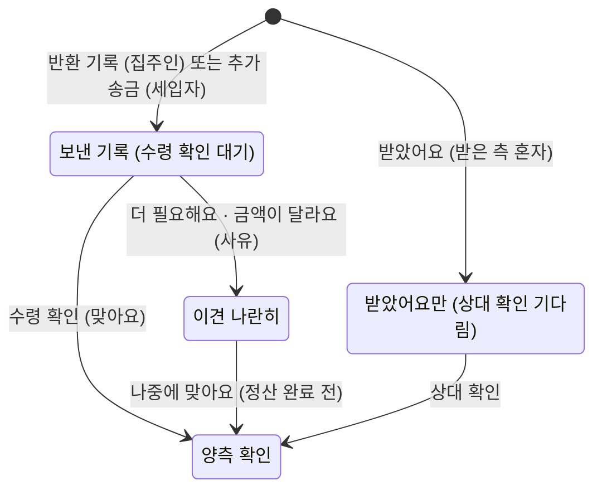


| 행동 | 누가 | 결과 | 문자 |
|---|---|---|---|
| 반환 기록 | 집주인 측 | 금액·날짜. **여러 번** 가능. 계산한 금액과 다르면 "차이 ○원"만 | 세입자 측에 수령 확인 응답 필요(연결된 상대일 때. 연결 전이면 요청 없이 혼자 기록, 1-4) |
| 추가 송금 기록 | 세입자 측 | 합의된 항목으로 계산한 금액이 0보다 작을 때(공제가 보증금보다 큼) 세입자가 보낸 돈. 금액·날짜, 여러 번 | 집주인 측에 수령 확인 응답 필요(연결된 상대일 때. 연결 전이면 요청 없이 혼자 기록, 1-4) |
| 수령 확인 | 받은 측(반환은 세입자, 추가 송금은 집주인) | [맞아요]면 양측 확인. [아니에요 · 더 필요해요]면 보류·이견(사유)으로 나란히, 받은 쪽은 실제로 받은 금액으로 [받았어요(혼자)]를 남길 수 있다(같은 송금으로 묶여 두 번 세지 않음). 송금 합계는 상대가 확인한 기록만(보낸 쪽 기록은 받은 쪽이, [받았어요(혼자)]는 보낸 쪽이 확인) | - |
| 금액·날짜 고치기 | 기록한 측 | 고치기(G). 상대가 수령 확인 전이면 그냥 고쳐짐, 수령 확인 뒤면 상대 확인이 있어야 바뀜(거절·무응답이면 나란히). 정산 화면의 송금 합계는 **상대가 확인한 송금만** 더한다(보낸 쪽 기록은 받은 쪽이, [받았어요(혼자)]는 보낸 쪽이 [맞아요])(보낸 쪽 기록만 있으면 "받았는지 확인 중"으로 따로) | 확인 뒤면 응답 필요 |
| 받았어요(혼자) | 받은 측(반환은 세입자, 추가 송금은 집주인) | 보낸 기록이 없어도 금액·날짜를 남긴다. "○○ 님 확인 기다림"(보낸 쪽 기록이 있으면 같은 송금으로 묶음) | 상대 측에 확인 응답 필요 |

### K. 통지

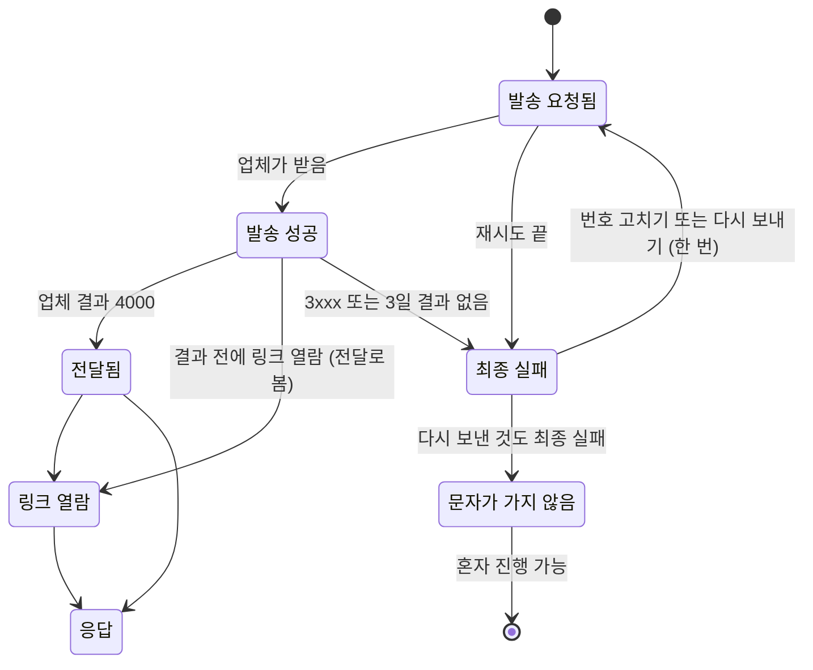


| 규칙 | 내용 |
|---|---|
| 보내는 방식 | 통지와 "보낼 것"을 같은 트랜잭션에 저장, 별도 작업자가 발송·재시도. 빠뜨리지 않고 두 번 보내지 않는다 |
| 보낸 사람에게 | 경과에 **한 줄**로 지금 가장 앞선 상태만 보인다: 미뤄짐 "내일 아침에 보낼게요"(밤인지 받는 번호 한도인지 이유는 말하지 않는다. 받는 번호 한도는 받는 사람의 정보라 이유를 말하면 드러남. 보낸 사람 자신의 계정 한도만 아래 "한도" 줄처럼 따로 알린다. 정확한 시각도 쓰지 않는다: 시범 운영에서는 서버가 9시에 켜져 8시라고 하면 틀린 약속이 된다) / 모으는 동안 "곧 보낼게요" / 보냄 "보냈어요 · 받았는지 확인 중"(남은 시간 없이 "받으면 그때부터 72시간을 세요") / 전달 "받았어요"(이때부터 남은 시간) / 열람 "열어 봤어요" / 최종 실패 "문자가 가지 않았어요" + [번호 고치기] / [이 번호가 맞아요, 다시 보내기] / 문자를 끈 회원 "서비스 안 알림으로 알렸어요" / 재통지면 "다시 알렸어요 · …". 지난 단계는 [알림 이력 ▸]에 시각과 함께(모은 문자면 "다른 확인 2건과 함께 보냈어요", 보낸 사람의 기록끼리만). 화면에 "발송 성공"이라는 말은 쓰지 않는다(받았다는 오해). 받는 사람이 회원이면 "열어 봤어요" 자리는 알림 확인이고, 모은 문자의 링크로 확인 카드를 열면 그 문자에 담긴 통지가 모두 열람이 된다 |
| 문자 모으기 | 같은 받는 사람·같은 호실의 회원 문자가 거의 동시에 나가면 한 통(1-4). 요청 문자는 2분 뒤로 보낼 시각을 잡아 모은다 |
| 서비스 안 알림 | 종류: 응답 필요 / 알려 줌(열람·확인·이견, 고친 내용, 상태 변경, 미확인, **연결**, 수신 거부·탈퇴·거절) / 서비스 안내(발송 최종 실패, 번호 인증 해제, 자동 마감·삭제 예고, 무활동). 읽음은 응답이 아니다. 30일 뒤 삭제, 탈퇴하면 바로 삭제. 사실은 경과(행동 기록)에 남는다 |
| 문자 본문 | **넣는 것**: 서비스명, 누가 번호를 입력했는지(가린 이름 "정*윤"), 호실 별칭, 요청 내용, 링크, 수신 중단 방법. **넣지 않는 것**: 가입 유도·혜택·서비스 소개(광고로 볼 수 있음), 실명·주소, 금액·사진. 첫 문자는 장문, 재통지·회원 문자는 단문 |
| 수신 중단 | 그 호실의 상대 번호를 지우고 서비스 전체에서 그 번호로 보내지 않는다(번호는 비밀 키를 섞은 해시(HMAC)로만 "수신 거부 목록"에. 그냥 해시는 번호 가짓수가 적어 되돌릴 수 있다). 초대한 쪽에 "상대가 문자를 그만 받기로 했어요" → 바로 혼자 진행 가능(이유 "상대 수신 거부", 1-1). 그 번호의 주인이 직접 가입·인증하면 풀린다 |
| 보내는 시간 | 21~08시에는 보내지 않고 아침에 보낸다 |
| 회원의 문자 설정 | "응답이 필요한 일을 문자로도 받기" [켬(기본) / 끔]. 끌 때 "72시간 동안 답이 없으면 상대 쪽에 '확인 없음'이 표시되고, 요청에 따라 상대가 혼자 진행할 수 있어요" 안내. 회원이 문자의 "그만 받기"를 누르면 설정 끔과 같다(번호는 지우지 않음). 가입·비밀번호 재설정 인증 문자는 예외. 경과에 "문자 꺼 둠 · 서비스 안 알림으로 통지"가 남는다 |
| 발신번호 | 팀 대표 번호, 명의자 승낙을 받아 문자 업체에 사전 등록 |
| 한도 | 계정당·받는 번호당 하루 발송 한도. **보낸 문자 수**로 센다(모은 문자는 한 통). 재통지는 서버만 보낸다. 넘으면 다음 날 아침으로 미룬다. **보낸 사람의 계정 한도**에 닿았을 때만 보낸 사람에게 "오늘 보낼 수 있는 문자를 다 써서 내일 아침에 보내요"(자기 정보라서). 받는 번호 한도는 "내일 아침에 보낼게요"만 보이고 이유를 말하지 않는다 |
| 거주 종료 뒤 | 정산 관련 문자, 두 점검의 확인(빠뜨린 하자 포함), 고친 내용 확인(정산 근거라서)만 |

### L. 계정

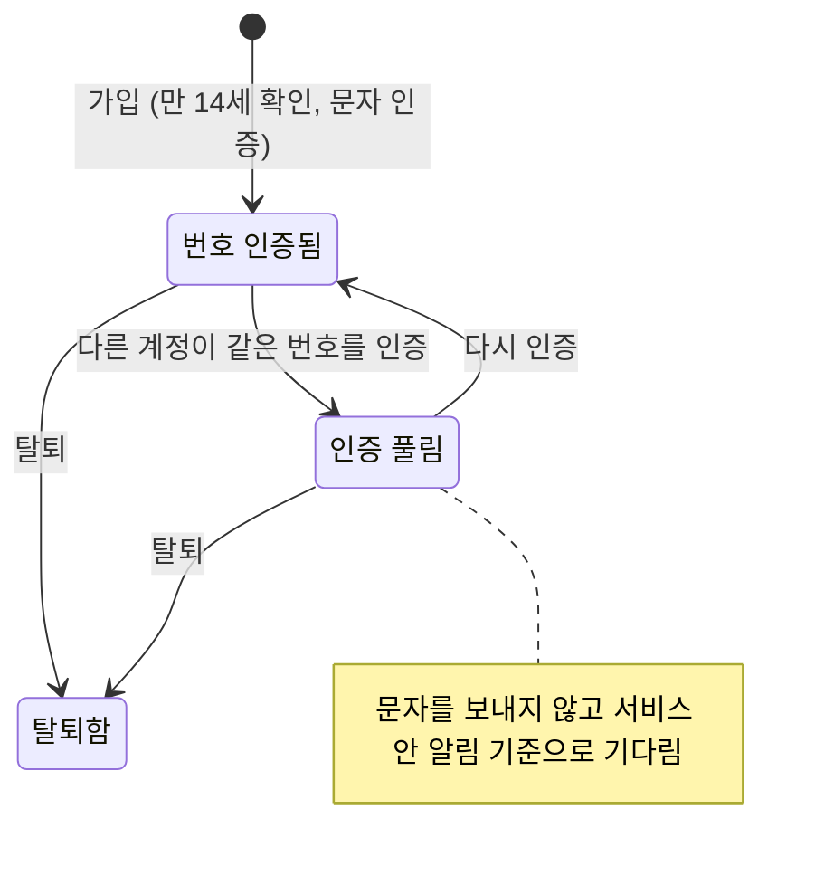


| 행동 | 결과 |
|---|---|
| 가입 | 이메일(아이디, 인증 안 함) + 비밀번호 + 이름(표시용) + 휴대폰 문자 인증 한 번. 이메일과 인증 번호는 각각 **한 계정에만** |
| 비밀번호 재설정 | 인증된 휴대폰으로 문자 인증 후 재설정. 번호까지 잃으면 복구할 수 없다(관리자 없음, 남는 한계) |
| 다른 계정이 같은 번호를 인증 | 이전 계정의 인증 해제 + 서비스 안 알림. 이미 연결된 호실은 유지, 새 연결은 다시 인증해야. **인증이 풀린 계정에는 문자를 보내지 않는다**(그 번호는 이제 다른 사람의 것). 다시 인증할 때까지 문자를 끈 회원처럼 서비스 안 알림 기준으로 기다림을 센다 |
| 번호 변경 | 자기 계정에서 새 번호로 다시 인증. 연결된 호실은 유지. 옛 번호로 와 있던 연결 전 초대는 연결되지 않으므로 초대한 쪽이 다시 초대. 옛 번호와 새 번호 모두에 문자 알림 |
| 비밀번호 변경 | 현재 비밀번호 확인 → 변경 → 다른 기기의 리프레시 토큰 모두 폐기, 서비스 안 알림 + 문자 |
| 이름 변경 | 바꿀 수 있다. 기록에는 회원 ID만 있어 지난 기록의 표시도 함께 바뀐다(변경 사실은 내부 기록) |
| 이메일(아이디) 변경 | MVP에서 하지 않는다(이메일 인증이 없어 오타로 계정을 잃을 수 있음) |
| 아이디 찾기 | 인증된 휴대폰으로 문자 인증 → 가린 이메일(`ho***@gmail.com`) |
| 탈퇴 | 탈퇴 전 안내(진행 중인 건, 공동 기록이 남는다는 사실) → 계정 정보 삭제, 회원 한 줄을 가림("탈퇴한 임대인/임차인"), 혼자 쓴 기록 삭제, 본인이 올린 지불 증빙 사진 삭제(사실은 남김), 토큰 폐기, 보낸 초대 링크 무효. 탈퇴자에게 온 확인 요청은 "상대 탈퇴"로 닫히고 상대는 혼자 진행 가능(이유 "상대 탈퇴", 1-1). 같은 번호로 재가입해도 옛 호실에 다시 붙지 않음 |

---

## 3. 역할별 권한 표

○ 할 수 있음 / △ 조건부 / ✕ 못 함. "상대 측만"은 그 행동을 요청한 측의 반대편이라는 뜻이다. 세입자 측과 집주인 측은 대부분 **대칭**이다.

| 행동 | 세입자 측 | 집주인 측 | 링크 열람자 | 비고 |
|---|---|---|---|---|
| 호실 기록 만들기·상대 초대 | ○ | ○ | ✕ | 쪽은 호실을 만들 때 고른다 |
| 번호 고쳐 다시 초대 | △ 초대한 측 | △ 초대한 측 | ✕ | |
| 연결 확인 / 제 집이 아니에요 | △ 초대받은 사람 | △ 초대받은 사람 | ✕ | 가입·로그인 후 |
| 호실 전체 보기(입주 점검, 돈, 호실 별칭) | ○ | ○ | ✕ | 당사자끼리 휴대폰 번호는 가린 번호만 |
| 공유받은 기록 보기(수리 건 또는 점검 하나: 사진·설명·상태·시간·고친 이력, 주소는 시·구·동까지) | ○ | ○ | ○ | |
| 하자 등록 | ○ | ○ | ✕ | 거주 중만 |
| 하자 맞아요 / 보류 / 이견 | △ 상대 측만 | △ 상대 측만 | ✕ | 정산 완료 전까지 언제든(늦은 답 포함), 맞아요는 뒤집지 않음 |
| 보충(다시 확인 요청) | △ 등록 측 | △ 등록 측 | ✕ | |
| 수리 시작 | ○ | ○ | ✕ | 이견이 있어도 |
| 원인 설명 남기기 | ○ 자기 측 설명 | ○ 자기 측 설명 | ✕ | 근거 종류 필수 |
| 원인 설명에 동의 / 이견 | △ 상대 측 설명에 | △ 상대 측 설명에 | ✕ | 타이머 없음 |
| 종료 요청 | ○ | ○ | ✕ | |
| 진행 상황 묻기·남기기 | ○ | ○ | ✕ | 묻기는 거주 중, 한 건에 7일에 한 번 |
| 종료 확인 / 아직 안 됐어요 | △ 상대 측만 | △ 상대 측만 | ✕ | |
| 혼자 종료 | △ 요청한 측 | △ 요청한 측 | ✕ | 종료 요청이 확인 없음이 된 뒤, 또는 이 건에서 상대가 이미 혼자 진행 가능하면 바로(D-2) |
| 다시 열기 | △ 확인 안 한 측 | △ 확인 안 한 측 | ✕ | 한쪽 확인 종료만 |
| 지불 기록 | ○ | ○ | ✕ | |
| 금액 확인 / 이견 | △ 상대 측만 | △ 상대 측만 | ✕ | |
| 부담·정산·보증금 제안 | ○ | ○ | ✕ | |
| 동의 / 이견 / 다른 안 | △ 상대 측만 | △ 상대 측만 | ✕ | |
| 돈 카드 [바꾸기] | ○ | ○ | ✕ | 새 제안, 합의 뒤면 바꾸자는 안(1-2) |
| 제안 철회 | △ 제안한 측, 응답 전 | △ 제안한 측, 응답 전 | ✕ | |
| 고치기 | △ 원래 기록한 측 | 같음 | ✕ | 같이 확인한 뒤면 "내가 고친 내용"(G) |
| 고친 내용 확인 / 거절 | △ 상대 측만 | △ 상대 측만 | ✕ | 확인하면 앞모습이 됨. 거절·미확인이면 앞모습 그대로(G) |
| 고친 내용 거두기 | △ 고친 측, 상대가 답하기 전 | 같음 | ✕ | |
| 사진 "링크에서 숨김" | △ 올린 사람 | △ 올린 사람 | ✕ | |
| 개인정보 사진 지우기 | △ 올린 사람(언제든) | △ 올린 사람(언제든) | ✕ | 파일만 지우고 "지운 사진 · 시각" 흔적은 남음, 되돌릴 수 없음. [지우고 가린 사본 올리기] 가능. 상대에게 서비스 안 알림(하루치 묶음) |
| 입주 점검 기준 기록 | △ 먼저 시작한 측 | △ 먼저 시작한 측 | ✕ | 호실을 만든 측에 먼저 안내 |
| 늦은 입주 점검 | ○ | ○ | ✕ | "입주 후 등록" 표시 |
| 점검 항목 맞아요 / 보류 / 이견 | △ 그 항목을 쓰지 않은 측 | 같음 | ✕ | |
| 점검 빠뜨린 하자 더하기 | ○ | ○ | ✕ | 새 기록, 정산 완료 전까지(H) |
| 퇴거 점검 작성·점검 마침 | ○ 작성, △ 점검 마침은 작성자일 때(바로 거주 종료) | ○ 작성, △ 점검 마침은 작성자일 때(거주 종료 요청, 세입자 확인) | ✕ |
| 정산 열기 / 직접 입력 / 후보 넣기·제외 제안 | ○ | ○ | ✕ | |
| 반환 기록 / 추가 송금 기록 | △ 보낸 측(추가 송금) | △ 보낸 측(보증금 반환) | ✕ | |
| 수령 확인 / 받았어요(혼자) | △ 받은 측(보증금 반환) | △ 받은 측(추가 송금) | ✕ | |
| 이사함 기록 | ○ 바로 거주 종료 | △ 거주 종료 요청(세입자 확인, 응답 없으면 미확인 뒤 적용) | ✕ |
| 거주 종료 요청 확인 / 아직 살고 있어요 | ○ | ✕ | ✕ | |
| 정산 끝내기 제안 / 확인 | ○ / △ 상대 측만 | ○ / △ 상대 측만 | ✕ | |
| 내려받기 | ○ | ○ | ✕ | |
| 공유 그만두기 | ○ | ○ | ✕ | 연결된 뒤. 그 뒤 기록은 상대에게 안 보임, 나만 보는 기록은 계속 |
| 다시 공유하기 | △ 그만둔 사람 | △ 그만둔 사람 | ✕ | 공유 동의를 다시 거침 |
| 문자 다시 보내기 | △ 보낸 측, 최종 실패 뒤 한 번 | △ 같음 | ✕ | 그것도 실패하면 혼자 진행 가능("문자가 가지 않음") |
| 알림 보기·읽음, 문자 수신 설정 | △ 본인 것만 | △ 본인 것만 | ✕ |
| 정산 초대 링크로 보기 | - | - | △ "정산 확인 요청이 있어요" + 가입하기만(내용 없음) |
| 탈퇴 | ○ | ○ | - | |

**탈퇴한 사용자**: 어떤 행동도 할 수 없고, 그 사람이 남긴 기록은 "탈퇴한 임대인/임차인"으로 보인다.
**관리자(운영자)**: 두지 않는다.

---

### 3-1. 보이는 범위 표 (누가 무엇을 볼 수 있나)

**보이는 범위의 기준은 이 표 하나다.** 권한 검사 함수 `보이나(보는 사람, 대상)`가 이 표를 따르고, 모든 조회 API가 이 함수를 거친다. 테스트는 칸 하나가 한 줄(매개변수 테스트)이라, 규칙이 늘면 표에 줄을 더하고 테스트도 한 줄 더한다. 새 칸은 필요 없고 이미 있는 값(공유 그만둔 시각, 합류한 기록, 링크에서 숨김, 지운 시각, 링크 상태)을 읽기만 한다.

| 무엇을 | 내 측 회원 | 상대 측 회원 | 링크 열람자(초대 링크) | 정산 초대 링크 |
|---|---|---|---|---|
| 내가 남긴 기록(수리 건·점검·진행 상황·원인 설명) | ○ | ○ 공유 동의가 있을 때. 내가 공유를 그만둔 뒤 남긴 것은 ✕ | 기록 링크면 그 기록 하나, 호실 초대 링크면 초대 안내만 | ✕ |
| 작성 중 점검, 보내지 않은 초안 | ○(쓴 사람) | "작성 중"만 | ✕ | ✕ |
| 합류 전 기록 | 쓴 사람만 | ✕ | ✕ | ✕ |
| 사진 | ○ | ○ | 그 기록의 사진, 링크에서 숨김은 빼고 | ✕ |
| 지운 사진 | 고정 표시 | 고정 표시 | 고정 표시 | ✕ |
| 돈(지불, 부담, 정산, 보증금) | ○ | ○ | **있다는 것만**("이 건에 수리비 기록이 있어요 · 가입하면 볼 수 있어요", 금액·사람·날짜 없음) | ✕(정산 확인 요청이 있다는 것만) |
| 호실 별칭 | ○ | ○ | ✕(주소는 시·구·동까지만) | ✕ |
| 이름 | 내 이름 | 가린 이름(정*윤) | ✕ | ✕ |
| 휴대폰 번호 | 내 번호 | 가린 번호 | ✕ | ✕ |
| 미래 일정(방문 예정 등) | ○ | ○ | ✕ | ✕ |
| 통지 상태(발송·전달·열람) | 보낸 측만 | ✕ | ✕ | ✕ |
| 서비스 안 알림 | 본인만 | 본인만 | ✕ | ✕ |

- 링크가 무효가 되면(재초대, 연결, 거주 종료, 발급자 탈퇴, 공유 그만두기) 링크 열람자는 아무것도 볼 수 없고, 받아 둔 사진 주소도 5분 안에 닫힌다.
- 정산이 완료되면 회원도 읽기·내려받기만 한다.
- 탈퇴한 회원은 "탈퇴한 임차인/임대인"으로 보인다.
- 수리업체 공유 링크(P1)는 만들 때 이 표에 열 하나를 더한다(돈 ✕, 방문용 정보는 켰을 때만).

## 4. 시간 규칙 (모두 설정값)

| 이름 | 값 | 쓰는 곳 |
|---|---|---|
| 재통지 | 48시간 | 모든 응답 필요 |
| 미확인 | 재통지 뒤 24시간(재통지 뒤 같은 요청에 고친 칸을 더 묶으면 더한 시각부터 72시간, 1-4) | 모든 응답 필요 |
| 정산 자동 마감(거주 종료 뒤) | 90일 | A |
| 거주 중 무활동 알림 | 1년(답이 없으면 1년마다 다시) | A |
| 보관 기간 | 1년 | A |
| 마감·삭제 알림 | 30일·7일 전 | A |
| 문자 하루 한도 | 요구사항 명세서에서 | K |
| 사진 | 한 행동 10장, 수리 건 30장, 점검 40장, 정산 항목 10장, 장당 10MB | 업로드 |
| 사진 주소 | 회원 썸네일 2시간(정각 기준, 1시간 캐시), 원본·링크 열람자 5분 | 보기 |
| 업로드 정책 | 파일마다 5분 | 업로드 |
| 초대 링크 만료 | 14일 | C (P1) |
| 백업 보관 | 7일 | 탈퇴 뒤 백업에 남는 기간(처리방침) |

---

## 5. 지켜야 할 불변식 (테스트로 확인, 21개)

1. 행동 기록에는 수정·삭제 API가 없다. 탈퇴도 행동 기록을 바꾸지 않는다(회원 한 줄만 가린다). 기록에는 회원 ID만 두고 이름·번호를 복사하지 않는다.
2. 합의됨(돈·정산 항목)은 같은 안에 대한 양 측의 행동이 모두 있을 때만 생긴다. 미확인으로는 절대 생기지 않는다.
3. 처리 완료(양측 확인)는 한쪽의 종료 행동(종료 요청 또는 혼자 종료)과 다른 쪽의 종료 확인(늦게 종료 확인 포함)이 모두 있을 때만 생긴다.
4. "상대 미확인"은 통지 두 건이 실제로 전달된 기록과 시간 경과가 있을 때만 붙는다. 전달은 문자 업체 결과 "전달됨"·링크 열람·회원의 알림 열람 중 빠른 것이고, 문자를 끈 회원은 서비스 안 알림 생성이다(1-1 타이머 시작점).
5. 링크 열람자는 기록의 내용과 상태를 바꿀 수 없다. 예외는 둘뿐이다: 열람한 사실이 남는 것(행동 "링크 열람")과 문자 그만 받기(수신 중단, K).
6. 정산 계산에는 합의된 항목만 들어간다.
7. 무효가 된 링크로는 아무것도 볼 수 없다(새 사진 주소를 받을 수 없고, 이미 받은 사진 주소도 5분 안에 닫힌다).
8. 한 번호는 한 계정에만 인증돼 있다.
9. 거주 종료 뒤에는 새 수리 건이 생기지 않는다.
10. 시각은 서버가 정한다(클라이언트가 보낸 시각을 기록 시각으로 쓰지 않는다).
11. 저장된 사진에는 위치 정보(GPS 태그)가 없다(브라우저가 다시 그려 원본 정보를 지우고, 서버가 업로드 완료 때 GPS 태그를 검사해 있으면 파일을 지우고 거절한다).
12. 폐기된 리프레시 토큰은 10초 유예가 지나면 다시 쓸 수 없고, 쓰면 같은 묶음 전체가 폐기된다.
13. 한 사람(계정)은 한 호실 기록에서 한 측에만 속한다(자기 번호로 초대 금지).
14. 사진 기록은 원본과 썸네일이 모두 올라와 검사를 통과했을 때만, 등록·추가 행동과 함께 생긴다(제출 전에는 기록이 아니다). 썸네일은 가린 뒤의 이미지로 만든다(이체 확인증의 계좌번호가 작은 사진에 남지 않게).
15. 양 측이 확인한 사실은 상대 측의 확인 없이 바뀌지 않는다(미확인으로도. 고친 내용은 나란히 남는다).
16. 사진은 올린 사람만 지울 수 있고(개인정보 이유. 예외: 사진에 찍힌 다른 사람의 요청은 운영 명령으로 처리, 06 PHO-7), 지운 사진은 다시 보이게 할 수 없다. 사진 기록과 "지운 사진 · 시각" 흔적은 남는다.
17. 사진 기록이 없는 정식 사진 파일은 반드시 지워지고(등록이 실패하고 1시간 뒤, 서버가 꺼져 있었다면 켜진 뒤), 사진 기록이 있는 파일은 이 정리로 지워지지 않는다.
18. 상대가 공유를 그만둔 상태라면 그만둔 뒤에 남긴 기록은 나에게 보이지 않는다(양방향, 다시 동의하면 보인다).
19. 정산 끝내기는 상대가 확인할 때 본 정산 모습과 지금 정산이 같을 때만 완료된다. 끝내기를 기다리는 동안 정산이 바뀌면 그 끝내기 요청은 닫힌다(1-4).
20. 연결 전 상대에게는 돈(지불·부담·정산 항목·보증금·송금)의 확인 요청이 생기지 않고, 링크 화면에는 돈의 내용이 보이지 않는다(있다는 것만, 1-4·6-1).
21. 점검은 모든 항목에 그 항목을 쓰지 않은 쪽의 답 또는 미확인이 있을 때만 잠긴다(H).

---

## 6. 정책

### 6-1. 링크 화면에 개인정보가 섞이지 않게

| 위험 | 대응 |
|---|---|
| 위치 특정 | 링크 화면에는 시·구·동까지만. 호실 별칭·건물명·상세 주소·연락처·세입자 이름을 두지 않는다. 집주인이 알아볼 정보(가린 이름 "정*윤", 별칭)는 그 번호로만 가는 문자 본문에 |
| 이름 가리기 | 문자 본문·연결 확인 화면·상대 쪽 회원 화면에서 같은 규칙: 한 글자는 그대로, 두 글자는 끝을 *(정*), 세 글자 이상은 첫 글자와 끝 글자만(정*윤, 남**수). 공백은 세지 않는다. 링크 화면에는 이름이 없다 |
| 설명 속 번호 | 전화번호 형태는 자동으로 가림, 등록 시 안내. **주민등록번호 형태는 입력 자체를 막는다**(제24조의2) |
| 계약서·신분증 | 받지 않는다. 사진을 올리는 모든 곳에 "계약서·신분증·통장 사진은 올리지 마세요" |
| 사진 | 올릴 때 얼굴·우편물·서류 경고, 사진마다 "링크에서 숨김", 위치 정보(EXIF) 제거: 브라우저가 사진을 다시 그려(긴 변 2048px, JPEG) EXIF를 없앤 뒤 올리고, 촬영 시각만 먼저 읽어 "기기 기준 촬영 시각(참고)"으로 보낸다. 크기는 presigned POST 조건(장당 10MB)으로 S3가 막는다. 목록·점검·링크 화면에는 작은 사진(썸네일)을 보여 주고, 누르면 원본을 연다 |
| 잘못 올린 사진 | 사진은 **등록(추가) 버튼을 누를 때** 기록이 되고, 그 전에는 화면에서 자유롭게 뺀다. 등록할 때 사진을 다시 보여 주고 "이름·주소·얼굴·신분증이 보이지 않나요? 다른 사람의 얼굴이나 연락처도요."를 한 번 묻는다. 등록 뒤 평범한 실수는 새 사진을 더한다(옛 사진은 남는다). **개인정보가 찍힌 사진은 올린 사람이 언제든 지울 수 있다**(점검이 잠긴 뒤, 거주 종료 뒤, 합류 전 기록에서도 같다). 사진 파일은 지우고, 그 자리에 "올린 사람이 개인정보 때문에 지운 사진 · 시각"이 회원 화면·링크 화면·내려받기에 남는다. 화면은 아이콘과 문구로 된 정해진 표시 하나를 그리고(사진 개수·나란히 보기·보고서에서도 같은 자리), ZIP에는 파일 대신 `기록.json`에 지운 사실과 지문값이 남는다. 상대에게는 서비스 안 알림만 하루치를 묶어 보낸다(문자 없음). 확인 창에 "이미 내려받은 사본에는 남아 있을 수 있어요". 유예 시간은 두지 않는다. 상대가 "지워 달라고 요청하기"는 확장. 등록하지 않은 사진(뺀 사진 포함)은 하루가 지나면 자동으로 지운다. 지우기 확인 창에 **[지우고 가린 사본 올리기]**: 칠한 사진(가리기 도구나 휴대폰 편집기)을 올리면 원본 파일 삭제와 사본 등록이 한 트랜잭션으로 되고, 사본은 "가린 사본 · 원본은 개인정보 때문에 지움"으로 같은 자리에 보인다(서비스는 같은 사진인지 판단하지 않는다). 상대가 확인한 뒤 지웠으면 흔적에 "○○ 님 확인 뒤 지움". 근거를 지우는 것을 완전히 막을 수는 없지만 확인된 사실(내용·상대 확인)은 남고, 내 사진만 지울 수 있고, 지운 흔적·지문값이 남는다 |
| 다른 사람의 정보 | 설명·진행 상황·원인 설명·지불 메모 칸 도움말: "다른 사람의 이름·연락처는 적지 않아도 돼요. '기사님 방문', '윗집'처럼 적어 주세요." 지불 기록의 제3자는 이름 대신 관계("누가 냈나요? 예: 가족, 윗집, 보험사"). 사진 속 다른 사람이 권리 요청 창구로 요청하면 올린 측에 "사진 속 다른 사람이 이 사진을 지워 달라고 요청했어요. [사진 파일만 지우기] 기록과 지운 흔적은 남아요."를 보내고, 10일 안에 처리되지 않으면 팀이 파일만 지우고(지운 이유 "다른 사람의 요청") 올린 측에 알린다 |
| 돈 | 링크 화면에는 돈 기록이 **있다는 것만** 보인다(금액·낸 사람·날짜 없음). 링크는 누가 여는지 확인할 수 없고(번호를 잘못 넣었거나 전달될 수 있음), 돈은 확인에 꼭 필요하지 않으면서 새면 피해가 커서다. 보려면 가입하고 연결한다(가입은 휴대폰 인증 한 번). 문자 본문에도 금액을 넣지 않는다 |
| 미래 일정 | 방문 일정·부재 시간을 링크 화면에 두지 않는다 |
| 링크 토큰 | 128비트 이상 난수, 해시 저장, 조회 횟수 제한. **주소의 `#` 뒤에 둔다**(`/l#토큰`): 브라우저가 `#` 뒤를 서버로 보내지 않아 접속 로그·앱 로그·Referer 어디에도 남지 않는다. 화면이 읽어 요청 본문으로 보낸다 |
| 링크가 새는 길 | noindex, Referrer-Policy no-referrer, 링크 화면에 외부 스크립트 없음, 토큰은 로그에 남지 않음(`#` 뒤) |
| 사진 주소 | 링크 화면의 사진 주소는 5분짜리를 매번 새로 주고 저장하지 않게 한다(회원 화면만 캐시) |

남는 한계: 잘못 받은 사람이 집 안 사진을 볼 수는 있다. 링크가 닫히면 5분 안에 사진 주소도 닫히지만, 이미 본 것은 되돌릴 수 없다(처리 안내에 적는다).

### 6-2. 공유 동의

| 어디서 | 무엇을 |
|---|---|
| 가입할 때 | "(필수) 만 14세 이상이에요"(체크하지 않으면 "만 14세 이상만 가입할 수 있어요", 생년월일은 받지 않는다) + 동의가 아니라 **안내와 확인**: "(필수) 이용약관에 동의해요" + "개인정보 처리 안내" [확인했어요](가입·로그인·기록 저장·알림에 필요한 정보는 서비스 이용에 꼭 필요해 따로 동의를 받지 않는다, 상대에게 보여 주기는 연결 전에 다시 묻는다). "처리방침에 동의" 체크는 두지 않는다 |
| 처음 알리기·초대할 때 | **"이 호실 기록을 집주인에게 보여 줄까요?" (기록 공유 동의)**. 보여 줄 사람: 집주인 010-****-5678(문자 링크로 보고, 연결하면 함께 봐요) / 보여 주는 것: 표시 이름(가림), 이 호실의 사진·설명, 확인·이견 같은 행동과 시각, 지불 기록(앞으로 남길 기록도) / 목적: 이 집의 상태·수리·정산 기록을 함께 보기 / 기간: 이 호실 기록을 보관하는 동안(정산 완료 뒤 1년까지) / 동의하지 않으면: 알리지 않고 혼자 기록은 계속. **[동의하고 보여 주기] / [나만 보기]** 같은 크기, 기본 선택 없음 |
| 초대받아 연결할 때 | 연결 확인 화면에 같은 다섯 가지를 상대 기준으로("내가 이 호실에 남기는 기록을 세입자 정*윤도 봐요"). **[동의하고 연결하기] / [연결하지 않기]**. 연결하지 않으면 받은 링크는 계속 볼 수 있다 |
| 문구가 바뀌면 | 문구마다 판 번호를 붙이고, 항목이 바뀌면 그 호실 기록에서 다시 동의를 받는다. **이용약관·필수 확인 항목**이 바뀌면 로그인 뒤 확인 화면이 먼저 뜨고, 확인 전에는 보기만 한다. 탈퇴·내려받기·공유 그만두기·개인정보 사진 지우기·권리 요청은 확인 없이도 된다(새 약관에 동의하지 않는 사람도 떠나고 챙길 수 있게). 처리방침은 동의 대상이 아니라 알리기만 한다 |
| 동의 화면에 미리 적기 | "언제든 공유를 그만둘 수 있어요. 그만두면 이 호실에서 함께 기록하기는 끝나요. 이미 함께 본 기록은 상대의 기록이기도 해서 보관 기간(정산 완료 뒤 1년)까지 상대에게 남아요." 다시 동의할 때는 "그만둔 동안 남긴 기록도 보여요" |
| 공유 그만두기 | 설정 › 공유와 호실 화면의 "함께 쓰는 사람" 카드에 버튼. 확인 화면 "○○동 호실 기록 공유를 그만둘까요?": **바로 멈추는 것**(앞으로 남기는 기록은 상대에게 보이지 않음, 보낸 링크 닫힘, 기다리던 확인 요청 닫힘) / **그대로 남는 것**(지금까지 함께 본 기록은 상대도 함께 남긴 기록이라 보관 기간까지 상대에게 보임, 상대가 내려받은 파일은 상대가 가짐) / **나는 계속**(이 호실 기록 보기·내려받기, 나만 보는 기록) / **다시 함께 쓰려면**(설정이나 호실 화면의 [다시 공유하기]로 다시 동의, 초대는 필요 없음). 누른 직후 알림함에 결과(남긴 기록 건수와 기간, 다른 의견은 권리 요청 창구로 10일 안에 답)를 남기고 "공유 내역"에서 다시 볼 수 있다. 상대 알림: "○○님이 이 호실 기록 공유를 그만뒀어요. 지금까지 함께 본 기록은 그대로 볼 수 있어요. 기다리던 확인 요청은 닫혔고, 이제 혼자 진행할 수 있어요." 닫힌 요청은 "공유 중단으로 닫힘". "법에 따라", "증거", "철회할 수 없는" 같은 말은 쓰지 않는다 |
| 최소 공개 | 당사자끼리 휴대폰 번호는 보여 주지 않는다(가린 번호만). 주소는 원래 시·도, 시·군·구, 읍·면·동 + 별칭만 저장한다(번지·건물명 없음) |

상대에게 기록을 보여 주는 것은 제3자 제공으로 보고 따로 동의를 받는다. 동의는 행동 "공유 동의"(누가, 언제, 누구에게, 어느 문구 판)로 남고, 행동 기록은 고칠 수 없으며 호실 기록과 함께 보관·삭제되므로 그 동의로 공유된 기록이 남아 있는 동안 동의 기록도 남는다. 공유 동의를 철회(공유 그만두기)하면 그때부터 새 기록을 제공하지 않고, 이미 제공된 공동 기록은 상대의 이익을 위해 보관 기간까지 남기며 그 사유와 이의 방법을 바로 알린다.

### 6-3. 보관

| 항목 | 규칙 |
|---|---|
| 기간 | 정산 완료(자동 마감 포함) 뒤 **1년**, 그 뒤 호실 기록 전체(사진 포함) 삭제. "보관"은 상태가 아니라 이 기간을 부르는 말이다 |
| 남는 한계 | 이사했는데 거주 종료를 남기지 않으면 기록이 계속 남는다(지우는 것보다 덜 위험). 90일 안에 끝나지 않은 분쟁은 마감 뒤 서비스 안에서 합의할 수 없고, 보존된 이견·제안 이력을 근거로 바깥에서 해결한다. 분쟁 중 연장은 확장 |
| 그동안 | 양측 읽기 전용, 링크 모두 닫힘, 내려받기 가능 |
| 알림 | 삭제 30일·7일 전 서비스 안 알림 + 내려받기 버튼 |
| 가져가기 | MVP(Must)는 브라우저가 만드는 ZIP(기록 JSON + 원본 사진), Should에서 기록 보기 HTML과 썸네일이 든 인쇄용 화면, P1에서 PDF 보고서. 기록 JSON에는 사진마다 올릴 때 저장한 지문값이 들어간다. 화면 문구는 "서비스에 남긴 기록의 사본" |

### 6-4. 탈퇴

**원칙**: 기록은 두 사람의 **공동 기록**이다. 탈퇴가 증거를 지우는 버튼이 되지 않게 하고, 공동 기록에 필요 없는 개인정보는 지운다. 한 줄로: **상대가 보고 응답할 수 있었던 기록은 상대의 증거라 남기고, 상대가 볼 수 없었던 것은 내 것이라 지운다.** 지우는 이유는 서비스가 필요 없다고 판단해서가 아니라 주인의 선택이어서다.

| 경우 | 처리 |
|---|---|
| 혼자만 쓴 기록 | **호실 기록 단위로 판단한다.** 상대 측 회원이 한 번도 연결된 적 없는 호실 기록(번호만·초대만·링크 열람만 있었던 경우, 합류 전 기록 포함)은 통째 삭제(사진, 입력해 둔 상대 번호, 통지 기록 포함). 탈퇴 전 "혼자 쓴 기록이라 바로 지워져요" + 내려받기 버튼 |
| 상대가 연결된 적 있는 호실 기록 | 누가 썼든 **공동 기록**(연결 전 단독 기록도 상대가 보고 확인 요청을 받았으므로). 가린 채 보관. 그 안에서도 본인 지불 증빙 사진과 **상대에게 보인 적 없는 것**(작성 중 점검, 보내지 않은 초안, 본인 알림)은 삭제 |
| 거주 중 탈퇴 | 막지 않는다. 탈퇴 전에 진행 중인 건과 "함께 만든 기록은 보관 기간까지 남아요"를 보여 주고, **내려받기 버튼**을 함께 둔다(혼자 쓴 기록은 탈퇴하면 바로 지워지므로) |
| 퇴거 뒤 탈퇴 | 계정 삭제, 공동 기록은 가린 채 보관 기간까지 |
| 양쪽 다 탈퇴 | 즉시 삭제 |
| 여러 호실을 가진 집주인 | 영향받는 호실과 세입자 수를 보여 주고 확인, 세입자들에게 알림 |

| 데이터 | 처리 |
|---|---|
| 계정(로그인 정보, 비밀번호 해시, 인증 번호, 리프레시 토큰) | 삭제 |
| 행동 기록(확인, 이견, 제안, 종료, 사유)과 하자·점검 사진 | 남김(보관 기간까지). 작성자는 "탈퇴한 임대인 / 탈퇴한 임차인" |
| 본인이 올린 지불 증빙 사진(이체 확인증 등) | 사진 파일은 삭제, 사진 자리는 "탈퇴로 지운 사진"으로 남고(개인정보 사진 지우기와 같은 표시), 금액·날짜·확인 여부는 지불 기록에 그대로 |
| 상대가 입력해 둔 탈퇴자의 번호, 발송 기록의 번호 | 삭제·가림 |
| 보낸 초대 링크 | 즉시 무효 |
| 서버 백업 | 백업 보관 기간(7일)이 지나면 사라짐. 처리방침에 적는다 |
| **삭제 기록** | 모든 삭제(탈퇴 가림, 혼자 쓴 기록, 보관 만료, 증빙 사진, 수신 거부 번호)를 DB 삭제 기록 테이블과 **운영 버킷 `audit/deletions/`**(한 건당 작은 파일) 두 곳에 남긴다. 개인정보 없이 대상 종류·ID·시각·사유만(수신 거부는 번호 HMAC). S3 쓰기는 아웃박스로 재시도. DB를 복구하면 S3 기록으로 그 뒤의 삭제를 다시 적용한다(삭제 기록이 DB 안에만 있으면 복구 때 함께 사라지므로) |

- **"가림"은 법이 말하는 가명처리가 아니고, 완전한 익명도 아니다**(상대는 누구인지 안다). 서비스 안의 식별 정보를 지우는 것까지이고, 남은 기록은 여전히 개인정보로 다룬다. 문서와 화면에서 "가명처리·익명화"라는 말을 쓰지 않는다.
- 탈퇴자가 공동 기록 삭제를 따로 요구하면 개별 검토하고, 거절할 때는 10일 안에 사유를 알린다(제37조②·④).
- **설계 규칙**: 행동 기록에는 회원 ID만 두고 이름·번호를 복사하지 않는다. 탈퇴하면 회원 한 줄만 가린다.
- 확장: 탈퇴 철회 유예, 재가입 제한(번호 HMAC 30일), 분쟁 중 보관 연장.

---

### 6-5. 보관·삭제 일정표 (한 장)

**보관 기간의 기준은 이 표 하나다.** 처리방침의 "보유 기간"과 테스트가 이 표를 따른다. 기간은 설정값(명세 0-1).

| 무엇 | 언제까지 | 그다음 | 이유 |
|---|---|---|---|
| 호실 기록(행동 기록·사실·사진·상태) | 거주 중: 지우지 않음(1년 무활동이면 알림만) / 거주 종료 뒤 정산 완료(또는 90일 자동 마감)부터 **1년** | 통째 삭제 + 삭제 기록, 30·7일 전 예고 | 6-3 |
| 혼자 쓴 호실 기록(상대가 연결된 적 없음) | 탈퇴할 때까지 | 탈퇴 때 통째 삭제 | 6-4 |
| 상대에게 보인 적 없는 초안·작성 중 점검 | 탈퇴할 때까지 | 탈퇴 때 삭제 | 6-4 |
| 회원 정보(이메일·비밀번호 해시·이름·번호) | 탈퇴할 때까지 | 지우고 회원 한 줄은 가림("탈퇴한 임차인") | 6-4 |
| 약관·처리 안내·14세 확인 기록 | 탈퇴할 때까지 | 계정과 함께 삭제 | 가입 확인은 계정의 일부 |
| 기록 공유 동의 | 호실 기록과 같음(행동 기록) | 호실 기록과 함께 삭제 | 동의도 기록의 일부 |
| 지운 사진 파일(개인정보·탈퇴·다른 사람 요청) | 지운 즉시(아웃박스) | 카드와 지문값은 호실 기록과 함께 | 지운 흔적은 남겨 기록이 끊기지 않게 |
| 등록하지 않은 사진(`pending/`) | **24시간** | 앱이 직접 삭제, S3 수명 주기는 안전망 | 등록하지 않은 사진은 기록이 아님 |
| 카드 없는 정식 사진 파일 | 확인 작업 1시간 뒤(꺼져 있었으면 켜진 뒤) | 삭제 | 등록이 실패한 파일 |
| 상대 번호(초대 번호) | 연결·수신 거부·탈퇴할 때까지 | 비움 | 필요한 동안만 |
| 수신 거부 번호 | 계속(HMAC만) | 번호 주인이 가입·인증하면 삭제 | 그만 받기로 한 번호에 다시 보내지 않게 |
| 휴대폰 인증 코드 | 하루 | 삭제 | ERD |
| 리프레시 토큰 | 14일 또는 폐기 | 삭제 | 로그인 유지 기간 |
| 서비스 안 알림 | **30일** | 삭제(사실은 행동 기록에 남음), 탈퇴하면 바로 | K |
| 횟수 세기(`rate_counter`) | 이틀(다시 요청·초대 키는 8일) | 삭제 | ERD |
| 이용자 접속 로그(nginx·앱), S3 접근 로그 | **30일** | 자동 삭제 | 문제 확인에 필요한 만큼 |
| 취급자 접속기록(CloudTrail, SSM 세션, 사람 역할 DB 로그) | **1년** | 자동 삭제 | 안전성 확보조치 고시 |
| 권한 대장(팀 비공개 문서) | **3년** | 삭제 | 안전성 확보조치 고시 |
| 삭제 기록(DB + 운영 버킷 `audit/deletions/`) | 계속(개인정보 없음, 번호는 HMAC) | 프로젝트 종료 결정 때 정리 | 6-3 |
| RDS 자동 백업 | **7일** | 자동 삭제, 복구하면 삭제 기록으로 다시 지움 | RDS 기본 백업 |
| 운영 데이터 전체 | 발표 뒤 결정 지점 | 기본은 전체 삭제(이어 가면 처리방침 새 판) | 프로젝트가 끝나면 지킬 사람이 없음 |

### 6-6. 관계 변화와 마무리 규칙 

| # | 상황 | 규칙 |
|---|---|---|
| 1 | 늦게 온 상대 | 미확인·상대 없음으로 끝난 기록(혼자 종료한 수리, 미확인 점검 항목, 한쪽 지불)에 상대는 **정산 완료 전까지 언제든** 맞아요·보충 요청·이견으로 답할 수 있다. 처리 완료(○○ 확인)에 [종료 확인]을 누르면 처리 완료(둘 다 확인) |
| 2 | 점검 "작성 중"에서 막힘 | 상대는 작성 중에도 항목을 더할 수 있다(기준 측 확인). 확인 요청은 기준 측이 보낸다. **작성 중이 7일을 넘으면** 상대에게 [지금까지 쓴 것으로 확인 요청 보내기]가 열리고 기준 측에 알림이 간다 |
| 3 | 정산 끝내기에 반대 | 상대는 **(아직 안 끝났어요 · 사유)**로 답할 수 있다. 혼자 끝내기는 72시간 답이 없거나 상대가 이미 혼자 진행 가능(1-1)일 때만이고, [아직 안 끝났어요]로 답한 요청에는 열리지 않는다. 반대가 이어져도 **거주 종료 90일 뒤 자동 마감**(Must)이 마지막 안전장치 |
| 4 | 문자 그만 받기 뒤 다시 연결 | 그 번호 주인이 가입·인증하면 **본인 화면에** "이 번호로 받았던 초대가 있어요 · ○○동 호실 기록 [연결하기] [무시]". 초대한 쪽에는 알리지 않고, 본인이 연결할 때만 알게 된다(문자를 멈춘 사람의 뜻을 존중). 초대 자리에는 번호의 HMAC만 남겨 맞춰 본다 |
| 5 | 보증금이 확인 전일 때 정산 | 계산 금액 자리에 "보증금 확인 전"을 띄우고, 제안 금액으로 계산한 **참고값(보증금 확인 전)**을 따로 보인다. 정산 끝내기는 막지 않는다 |
| 6 | 잠긴 점검에 빠진 하자 | **"잠긴 뒤 추가" 항목**(새 기록): 누구든 넣고 상대가 확인한다. 날짜가 붙고 나란히 보기에 "잠긴 뒤 추가(날짜)"로 보인다 |
| 7 | 정산 확인 요청 문자 | **항목마다 요청**(정산 항목·보증금 제안·송금 수령), **문자는 모아서 한 통**, 화면은 확인 카드(1-4). 정산 끝내기는 묶지 않고 언제나 자기 문자, 기다리는 동안 정산이 바뀌면 닫힘(1-4) |
| 8 | 다시 공유한 뒤 | "공유 중단으로 닫힌 요청 N건 [다시 요청]". 다시 공유한 직후 **한 번은 7일 제한 없이** 모두 묶어 문자 한 통으로 보낸다 |
| 9 | 공유를 그만둔 뒤 보이는 범위 | 그만둔 시각 기준으로 **고정**한다(상태도 그 시각까지로 다시 계산, "○월 ○일 기준" 표시, 양방향). 삭제 예정 같은 **서비스 안내는 계속** 받는다 |

