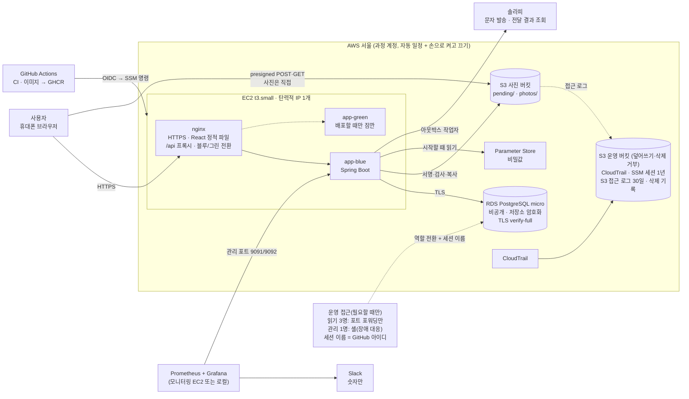

# 인프라·아키텍처

> 기술 스택·아키텍처·배포 결정을 모은 문서예요.
> 근거 자료: 최종 프로젝트 명세서·가이드, 과정 AWS 지침, 강의 #86 도커, #88 GitHub Actions, #89 AWS·Terraform·CI/CD, #91 HA PROXY.
> 결정의 이유는 `../decisions.md`에 있어요.

---

## 한눈에 보기




| 영역 | 결정 |
|---|---|
| 화면 | React(Vite + TypeScript) + shadcn(Base UI) + Tailwind, 모바일 우선, nginx가 정적 파일 제공(OCR·PDF 파일과 글꼴까지 외부 CDN 없음) |
| 서버 | EC2 t3.small 한 대, 앱은 평소 1개. 1~2주차는 **컨테이너 교체**(잠깐 끊김), **3주차부터 블루/그린**(배포 때 새 앱을 띄워 바꾸고, 실패하면 자동 롤백) |
| 입구 | **nginx 하나**(HTTPS, 정적 파일, 프록시, 전환). HAProxy·CloudFront·API 게이트웨이 없음 |
| DB | **PostgreSQL**(RDS micro, 단일 AZ), 스키마는 **Flyway** |
| 캐시 | **Redis 없음** |
| 사진 | S3 비공개 버킷 + presigned URL |
| 비밀값 | **액세스 키를 어디에도 두지 않는다.** 앱은 EC2 IAM 역할 + Parameter Store, CI는 GitHub OIDC |
| 배포 | PR마다 CI(컨벤션·테스트·커버리지·이미지·비밀 검사), main 병합 시 CD(GHCR → OIDC → SSM → 교체, 3주차부터 블루/그린) |
| 인프라 코드 | Terraform |
| 관측 | Actuator + Prometheus + Grafana, k6 부하 테스트 |
| 저장소 | 과정 Organization의 공개 모노레포 `prgrms-be-devcourse/NBE12-14-final-homestamp`(`back/` `front/` `infra/` `docs/`), 서비스 주소 `homestamp.cloud` |
| 버전 | **Java 25(최신 LTS) + Spring Boot 4.1.2(최신 정식)**. 4.1.x 패치만 올리고 4.2는 프로젝트 뒤. 막히면 그 라이브러리만 교체(17장) |

---

## 1. 우리 조건 (과정 AWS 규칙)

| 조건 | 내용 | 설계에 주는 영향 |
|---|---|---|
| 리전 | 서울 | - |
| 바로 만들 수 있는 것 | EC2 medium까지 1대, RDS small까지 1대, S3 범용 버킷 1개 | 서버 한 대 + DB 한 대 + 버킷 하나가 기본. micro로 시작해 medium으로 키우는 것은 문의 없이 된다(medium은 과정 채널·노션에 공유, 키우는 기준은 3-1) |
| 문의가 필요한 것 | 2대 이상, medium 초과, NAT 게이트웨이, 허용 목록 밖의 서비스(용도·근거를 적어 AWS 채널에) | 서버 두 대(스케일 아웃)는 내부 측정으로 한 대가 감당하지 못한다는 근거를 들어 문의 |
| 리소스 이름 | `[프로젝트 이름]-[컴포넌트]` → `homestamp-web`, `homestamp-db`, `homestamp-photos` 등(Terraform `prefix` 변수 = `homestamp`) | 여러 팀이 한 계정을 쓰므로 이름과 태그로 우리 것을 구분 |
| 네트워크 | 팀당 VPC 1개, 인터넷 게이트웨이 1개, **탄력적 IP 1개** | 외부 입구는 하나 |
| 비용 | 팀당 약 75,000원 | RDS를 특히 아낀다 |
| **서버 가동** | 과정 계정의 자동 일정으로 EC2·RDS가 평일 10~19시에 켜진다(수료식 12/11 뒤 일정 기준). 그 밖의 시간이나 일정 중에도 필요하면 손으로 켜고 끈다. 실제 서비스는 24시간 운영을 목표로 한다. 일정 시각은 이 줄에만 적는다 | 자동으로 꺼지는 시각이 있어 배포·백업 시간을 맞춘다(12-1 "배포 시각", 7장 "꺼진 시간과 백업"). 코드와 업무 기한은 이 시각을 모른다 |
| 보안 | IAM MFA 필수(콘솔 로그인 기준, 액세스 키·역할에는 요구하지 않음, 16장), 키 유출 2회면 지원 회수, 태그 `Team: devcos-team07` | 액세스 키 대신 역할 |
| 과정의 방향 | ELB보다 EC2에 nginx를 직접, 관리형 서비스는 꼭 필요한 것만 | 직접 구성한 부분이 역량 |
| 지원 기간 | 최종 프로젝트·수료식 2026-12-11까지, 취업 증빙용 추가 지원 2026-12-21까지. 프로젝트가 끝나고 2주 안에 개인 계정으로 이관(놓치면 삭제) | Terraform으로 재현 가능하게. **운영 데이터는 옮기지 않는 것이 기본**(발표 뒤 전체 삭제 운영 명령, 이어 가면 책임자·처리방침 새 판) |

---

## 2. 화면 (프론트엔드)

| 항목 | 선택 | 이유 |
|---|---|---|
| 빌드 | Vite + React + TypeScript | 자료와 AI 도움이 가장 많다. 타입이 API 응답 구조를 문서처럼 보여 준다 |
| 부품 | **shadcn(Base UI) + Tailwind** | AI가 만든 화면의 기본 사용성이 일정해진다. 인라인 스타일을 쓰지 않아 CSP(`style-src 'self'`)와 잘 맞는다(MUI는 인라인 스타일이라 CSP를 느슨하게 해야 함) |
| 기기 | 모바일 우선 | 문자 링크는 휴대폰에서 열린다 |
| 배포 | 빌드 결과를 EC2의 nginx가 제공 | 서버가 늘지 않고, 같은 도메인이라 CORS가 단순하다 |

**AI가 만든 화면이 좋은지 판단하는 기준**: ① 그 화면을 만들지 않은 팀원이 시나리오를 설명 없이 끝낼 수 있나(처음 보는 사람 대상 사용성 점검은 확장) ② 화면마다 할 일이 하나로 보이나 ③ 상태(확인 기다림, "○○ 님 확인 없음 · 이유" 등. 화면 말은 `08-화면-기본-틀.md` 13장)가 글자와 색으로 보이나 ④ 기록이 잠기는 버튼 앞에 확인 창이 있나 ⑤ 오류 메시지가 무엇을 하면 되는지 알려 주나 ⑥ Lighthouse 접근성 90 이상, 휴대폰 크기에서 깨지지 않나. 이 표를 AI에게 함께 주고 검토를 요청한다.

**모바일에서 자주 막히는 곳** (AI에게 화면을 만들게 할 때 함께 준다)

| 막히는 곳 | 미리 할 것 |
|---|---|
| 화면이 작게 보임 | `<meta name="viewport" content="width=device-width, initial-scale=1">` |
| 누르기 어려움 | 버튼·링크 최소 44px |
| 사진 올리기 | `<input type="file" accept="image/*">`(카메라·앨범), HEIC는 다시 그려 JPEG로 |
| 아이폰 사파리 높이 | `100vh` 대신 `100dvh` |
| 키보드가 입력칸을 가림 | 사유 입력칸을 화면 아래에 고정하지 않는다 |
| 표가 넘침 | 정산 같은 표는 휴대폰에서 카드 목록으로 |

개발은 PC에서 Chrome 기기 모드로 하고, 실제 휴대폰 확인은 1주차부터 배포 주소로 한다.

---

## 3. 서버와 입구

### 3-1. EC2 한 대 + 블루/그린

- **단계**: 1~2주차는 `stop → run` 컨테이너 교체로 시작한다(배포 중 몇 초 끊김, 자동 종료 30분 전부터는 배포하지 않음). **3주차에 블루/그린**으로 바꾼다. 아래는 블루/그린 뒤의 모습이다.
- 평소에는 앱 컨테이너 **하나**. 배포할 때만 새 앱(green)을 띄워 헬스 체크를 통과하면 nginx가 전환하고 이전 앱(blue)을 끈다. 실패하면 이전 앱이 그대로 남는다.
- **t3.small(2GB) + 스왑 4GB**. micro(1GB)는 앱 두 개가 겹치는 순간 모자란다.
- 메모리가 모자라면: ① Actuator로 측정 → ② 힙·스왑 조정 → ③ t3.medium(문의 없이 가능) → ④ 그래도 안 되면 두 대(측정 근거를 들어 문의). **키우기가 나누기보다 먼저**다(두 대는 앞단 분산기와 탄력적 IP 문제가 함께 생긴다).
- **medium으로 키우는 기준**(제안값, 1주차 측정 뒤 다시 정함): 배포 중 스왑을 계속 쓰거나, 새 앱이 헬스 체크를 통과하기까지 120초에 가깝거나, 메모리 부족으로 컨테이너가 한 번이라도 강제 종료되면. 키우기 전에 ②를 먼저 하고, 키우면 측정값을 과정 채널과 노션에 공유한다(과정 지침: medium 1대는 바로 허가, 채널·노션 공유). 빌드는 CI에서 하고 1~2주차는 앱이 하나라, 겹침은 3주차 블루/그린부터 잰다.

### 3-2. 입구는 nginx 하나

| nginx가 맡는 일 | 방법 |
|---|---|
| HTTPS | Let's Encrypt + certbot. 설정 파일은 저장소 `infra/`에. 갱신 타이머는 `Persistent=true`(서버가 꺼진 밤에 놓친 갱신을 켜질 때 따라잡음) |
| 정적 파일 | React 빌드. 배포 때 새 폴더에 풀고 가리키는 링크만 바꾼다 |
| API | `/api` → 현재 앱으로 프록시 |
| 블루/그린 전환 | upstream을 바꾸고 reload. 새 앱의 준비 여부는 배포 스크립트가 `/actuator/health`로 확인 |
| 막기 | Actuator는 외부에 공개하지 않는다 |
| 요청 제한 | `limit_req`로 IP별 요청 수 제한(로그인, 인증 문자, 링크 조회) |
| API 문서 | springdoc-openapi(Swagger UI)는 **local·test 프로필에서만** 켠다. 운영에서는 끄거나 nginx에서 막는다(내부 API 구조 노출 방지). 팀 공유용 명세는 CI가 만든 OpenAPI 파일을 아티팩트로 |
| 보안 헤더 | CSP(아래), `Strict-Transport-Security`, `X-Content-Type-Options: nosniff`, `Referrer-Policy: strict-origin-when-cross-origin`(링크 화면은 `no-referrer`), `Permissions-Policy: geolocation=(), camera=(), microphone=()`(위치 권한 자체를 막음). CSP는 1~2주차 Report-Only → 3주차 강제. 로컬 개발 서버에는 걸지 않는다 |

**넣지 않은 것과 이유**

| 넣지 않은 것 | 이유 |
|---|---|
| HAProxy | 평소 앱이 하나라 분산할 대상이 없다. 전환 판단은 배포 스크립트의 헬스 체크로 충분하다. 능동 헬스 체크가 필요해지면 nginx 뒤에 추가 |
| CloudFront | 사용자가 국내, 서울 리전, 트래픽이 작고, 사진은 presigned URL로 S3에서 직접 받는다 |
| API 게이트웨이 | 앱이 하나다. 게이트웨이는 서비스가 여러 개로 나뉜 구조에서 쓰는 것 |
| ELB | 과정이 직접 구성을 권한다. 탄력적 IP 하나로 충분하다 |

---

## 4. 데이터

| 항목 | 결정 | 이유 |
|---|---|---|
| DB | **PostgreSQL** (팀 합의) | JSONB(행동 기록 내용), 부분 인덱스(아웃박스), `SKIP LOCKED`(작업자 동시 처리) |
| 위치 | **RDS db.t4g.micro(또는 t3.micro), 단일 AZ, 20GB**, 외부 공개 없음, **저장소 암호화**(만들 때만 켤 수 있어 Terraform에 처음부터 `storage_encrypted = true`), 앱 연결은 TLS(`sslmode=verify-full`, 아래 "DB 연결 확인") | 허가 없이 가능, 앱 서버 메모리를 나눠 쓰지 않음, 자동 백업(보존 설정 5일 검토, 탈퇴일 기준 사본 삭제 기한과 구분) |
| 스키마 | **Flyway**. JPA는 `ddl-auto=validate` | 네 명이 같은 스키마, 운영 DB에도 같은 순서로 반영 |
| Redis | **없음** | 쓸 곳이 없다. 토큰·횟수 제한은 DB로 충분 |
| 시간 | DB에는 `timestamptz`(UTC 기준)로 저장, 화면에서 한국 시간 표시 | 재통지 48시간 계산이 어긋나지 않게 |

### 4-0. 데이터 모델 원칙: 행동 기록이 원본

테이블을 세 종류로 나눈다. 바뀔 수 있는 칸을 최소로 줄이는 것이 핵심이다.

| 종류 | 무엇 | 수정 | 예 |
|---|---|---|---|
| **A. 행동 기록** | 누가, 언제, 무엇을 눌렀나 | 안 됨 | 확인, 이견, 동의, 철회, 종료 요청 |
| **B. 사실 행** | 사람이 입력한 내용 | 안 됨. 고치면 이전 행을 가리키는 **새 행** | 지불 판, 사진, 제안과 줄, 원인 설명, 진행 상황, 점검 항목 판, 정산 송금 판, 수리 건 내용 판 |
| **C. 상태 행** | 지금 어디까지 왔나 | 상태·기한·version·"지금 판" 칸만 | 호실 기록, 당사자, 수리 건, 점검, 정산 항목, 링크, 통지, 응답 요청, **고친 내용**(칸 + 새 값 + 기준 판, 만든 뒤 상태만 바뀜) |

```
행동 기록 (A) ──가리킴(ID)──▶ 사실 행 (B, 고치면 새 판)
     │
     └─ 같은 트랜잭션에서 갱신 ──▶ 상태 행 (C) ──current_content_id──▶ 지금 판
                                    ▲
             apply(상태, 행동)으로 처음부터 다시 계산해 같은지 테스트
```

| 장치 | 방법 |
|---|---|
| 수정·삭제 막기 | A·B 엔티티에 Hibernate `@Immutable`(JPA가 UPDATE를 만들지 않음) + DB 트리거(UPDATE 항상 거절, TRUNCATE 항상 거절, DELETE는 테이블 소유자 권한과 `app.purge = on`이 함께 있을 때만. 호실 통째 삭제는 PUBLIC 권한을 제거한 `purge_room_record(uuid)` SECURITY DEFINER 함수로만 삭제 작업 역할에 노출. 부모인 `room_record`의 직접 삭제도 같은 소유자·플래그 조건으로 보호해야 함) |
| 상태 바꾸기 | 순수 함수 `apply(지금 상태, 행동) → 다음 상태` 하나. 서비스는 이 결과를 C에 저장하고, 테스트는 같은 함수로 행동 기록 전체를 접어 C와 비교한다. 이 함수가 상태 전이 표의 단위 테스트 대상이다. 잠금·멱등·apply·저장·행동 기록을 부르는 순서와 인터페이스는 `09-프로젝트-구조.md` 3-1 `ActionPipeline` |
| 두 번 저장 막기 | 요청마다 멱등 키(화면이 만든 UUID), `UNIQUE(주체, 키)`. 서버 행동(재통지·미확인·자동 마감)도 정해진 키(`renotify:<통지 ID>:1`) |
| 동시에 누름 | C 행의 `version` 낙관적 잠금은 **사람이 바꾸는 행**(수리 건, 정산 항목, 점검 등)에만. 작업자도 바꾸는 행(`response_request`, `notice`)은 화면에서 version을 받지 않고 서버가 `SELECT … FOR UPDATE`로 잠근다. 한 행동이 여러 행을 바꾸면 **호실 기록 → 수리 건 → 지불 → 점검·항목 → 정산 → 정산 항목 → 송금 → 제안 → 고친 내용 → 응답 요청 → 통지** 순서로 잠근다(작업자도 같은 순서, 기준은 ERD). 행동 기록의 체인 머리(`action_chain_head`)는 행동을 쓸 때 맨 끝에 잠근다(호실 잠금 안이라 다른 순서와 엇갈리지 않음). 고친 내용 확인 → 새 판 → 돈 합의 다시 계산 → 정산 후보 갱신은 한 트랜잭션이다. 자주 바뀌는 집계 칸(마지막 활동 시각 등)은 C 행에 두지 않고 행동 기록에서 계산한다. 재시도 코드는 실제로 충돌이 보일 때만 넣는다 |
| 한 사실은 한 곳에 | 금액은 지불 행에만, 행동 기록은 ID만 가리킨다. 이름·번호는 회원 행에만(불변식 1). 정산 후보·돈이 남은 건은 저장하지 않고 계산 |
| 끊어진 연결 막기 | 행동 기록의 대상은 종류별 외래 키 칸(수리 건, 점검, 정산 항목 …) + `CHECK(num_nonnulls(...) <= 1)`(0이면 호실 기록 자체: 이사함, 정산 끝내기. 05 `action`, V1 `ck_action_one_target`), 칸마다 부분 인덱스 |
| 지우기 | 호실 소속 기록은 호실 기록 ID 기준으로 삭제하고 **S3 사진 삭제는 아웃박스**로 처리한다(DB와 한 트랜잭션이 될 수 없으므로). 호실 밖의 수신 거부는 인증 완료 시 앱이, 약관·안내 확인 기록은 회원 가림과 같은 탈퇴 트랜잭션에서 제한된 전용 함수가 삭제한다. 삭제 감사와 `AUDIT_WRITE`도 같은 트랜잭션이다. 권한·호출 조건은 `../runbooks/DB-보관-삭제.md`를 따른다 |
| 어긋남 검사 | 하루 한 번 그날 바뀐 호실만 다시 계산해 C와 비교, 어긋나면 Slack 알림만(고치지 않음). **여유가 있을 때 선택**(다시 계산 테스트가 먼저) |
| 신원·연락처 예외 | 위 원칙은 기록 테이블에 적용한다. 회원의 이메일·비밀번호 해시·이름·번호·설정, 당사자의 초대 번호, 토큰·인증 코드는 개인정보라 고치고 지울 수 있다. 바꾼 사실만 값 없이 행동 기록에 남긴다 |
| 공통 장치 | **동작이 같으면 모으고 내용이 다르면 나눈다.** 돈 안건 장치는 `proposal` + `proposal_line`(수리 건 부담, 정산 항목, 보증금), 기다림 타이머는 `response_request` 하나(응답 필요 종류 전부, 기록마다 하나. 작업자는 이것만 본다, 03-상태 1-4). 공통 테이블에는 **공통 칸과 대상 칸만** 두고 기능별 내용은 그 기능의 테이블에 둔다(PR 체크리스트). 새 기능은 대상 칸 하나로 붙는다 |
| 금액 | `bigint`(원 단위), `CHECK(금액 >= 0)`. 부담 줄의 합 = 전체는 여러 행이라 서비스에서 검사 |
| 테스트 | 트리거·제약은 Testcontainers의 실제 PostgreSQL로(H2로는 안 됨) |
| 해시 체인 | `action`에 `room_seq`(호실마다 1부터), `prev_hash`, `hash`, `content_digest`(내용 대상이 없으면 NULL, 있으면 SHA-256 32바이트)를 **첫 마이그레이션에** 둔다. 내용 지문은 당시 본 판의 글 내용으로 계산하고(사진 지문은 그 사진을 붙인 행동의 payload에 들어가 행동 해시로 묶인다, 05 2-3), 행동 해시는 이전 해시·행동 정보·요청 ID·대상 ID·판 번호·내용 지문을 포함한다(입력 형식은 05 2-3 「해시 입력 형식」, 행동마다 `hash_version`에 형식 버전을 적는다). 같은 트랜잭션에서 호실 기록 행을 먼저 잠그고 다음 번호를 정한다(다음 번호·이전 해시는 호실마다 한 행인 체인 머리 `action_chain_head`에서 읽고 올린다. 탈퇴로 마지막 행동이 지워져도 번호를 다시 쓰지 않게, 05 2-3·2-10). 검증은 행동 체인과 실제 내용 지문 비교를 모두 수행해야 한다. 지문은 개인정보의 암호화·익명화를 보장하지 않는다. **계산 로직은 1주차, 검증 API·화면은 Should**. 한계: DB 전체를 다룰 수 있는 사람은 내용과 해시 체인을 함께 재계산할 수 있어 관리자 위조까지 증명하지 못한다. 외부 영수증·외부 해시 고정은 이번 범위에 넣지 않는다. 수정 API 없음·트리거와 아래 DB 권한 분리가 변경 기회를 줄인다 |
| DB 권한 분리 | Flyway 소유자·앱·삭제 작업 역할을 분리한다. 앱은 소유자·superuser·관리 역할 멤버십·스키마 CREATE·TRUNCATE 권한이 없다. 호실 삭제 함수 EXECUTE와 A·B 직접 DELETE를 막고, 회원 확인 기록의 탈퇴 전용 함수만 예외로 허용한다. 스키마 배치는 `05-ERD-초안.md` 0장을 따른다. 삭제 작업 역할에만 호실 삭제 함수 EXECUTE를 준다. 자세한 적용·검증은 `../runbooks/DB-보관-삭제.md`를 따른다. 실제 운영 역할 생성과 GRANT는 배포 단계에서 한다. |
| 사진 | 사진 테이블 하나(B). 붙는 곳 여덟 가지(수리 건, 점검 항목, 부위 사진, 지불 증빙, 원인 설명 근거, 정산 항목 증빙, 진행 상황, 다시 확인 요청의 근거)는 종류별 외래 키 + CHECK. 부위·단계로 나란히 보기(인덱스 `(호실 기록, 부위, 단계)`). "링크에서 숨김"은 행동으로 남기고 지금 상태는 작은 C 행. 탈퇴 때 본인 증빙 사진도 개인정보 사진 지우기와 같은 길로 카드는 남기고 파일만 지운다("탈퇴로 지운 사진") |
| 기본 키 | 모든 테이블 **UUID v7**(`uuid` 타입). **일반 엔티티 id는 Hibernate가 저장할 때 만든다**(`@UuidGenerator(style = VERSION_7)`). 탈퇴 전용 DB 함수의 감사·아웃박스 id는 PostgreSQL `uuidv7()`로 만든다. 앱 코드와 화면이 id를 넣으면 `save()`가 이미 있는 행으로 보고 오류를 내므로 넣지 않는다. **예외는 서로를 가리키는 머리·판 네 쌍**(05 0장 `id`): 앱이 `global/common`의 UUID v7 생성 함수로 ID를 먼저 만들어 생성자로 넣고, `@GeneratedValue`를 두지 않는다. 머리는 `@Version`이 비어 있으면 새 행으로 저장되고, 버전 칸이 없는 판은 `Persistable`로 새 행임을 알린다(merge로 가지 않게). 두 번 저장 막기는 멱등 키가 맡고, 상태 행의 `@Version`은 `Long` 래퍼다. **초대 링크**(`link`의 `INVITE`)도 앱이 같은 함수로 ID를 먼저 만들어 생성자로 넣는다. 머리·판 쌍과 이유가 달라, 링크 ID가 토큰 HMAC의 입력이라 `token_hash`와 함께 저장하려면 저장 전에 ID가 있어야 해서다(05 0장 `id`, 03 6-1 "링크 토큰"). 이번에 더하는 예외는 초대 링크에 한정하고 다른 엔티티로 자동으로 넓히지 않는다. 번호를 짐작할 수 없어 권한 검사에 실수가 있어도 남의 집 기록을 번호 돌려 보기로 찾기 어렵다(권한 검사는 측 확인으로 따로). 시간순이라 인덱스 성능 손해가 없다. 로그에는 앞 8자리만. 1주차에 Hibernate의 시간순 UUID 생성 확인 |

### 4-1. 로그인 토큰

| 항목 | 설계 |
|---|---|
| 액세스 토큰 | JWT, 짧은 수명(예: 15분), 서버에 저장 안 함 |
| 리프레시 토큰 | **DB에 해시로 저장**(사용자, 기기, 묶음 ID, 만료, 폐기 시각) |
| 로테이션 | 리프레시할 때마다 새 토큰, 이전 것은 폐기. 첫 토큰은 256비트 난수, 재발급한 토큰은 받은 토큰과 별도 비밀 키로 다시 계산한다(`R' = HMAC-SHA256(키, "refresh-rotate:v1:" + R)`). 원문을 저장하지 않아도 유예 안에 같은 R'를 돌려줄 수 있고, DB만 새어서는 R'를 만들 수 없다 |
| 탈취 감지 | 폐기된 토큰이 다시 쓰이면 같은 묶음 전체 폐기 → 다시 로그인 |
| 로그아웃 | 그 기기의 리프레시 토큰 폐기 + 쿠키 삭제 + 확인 카드에서 고르고 보내지 않은 것(기기 저장, 24시간) 지우기 |
| **브라우저 보관** | 액세스 토큰은 **자바스크립트 메모리**(새로고침·새 탭이면 재발급으로 다시 받음). 리프레시 토큰은 **HttpOnly·Secure·SameSite=Strict 쿠키**, `Path=/api/auth/refresh`, 14일. localStorage에는 토큰을 두지 않는다 |
| 재발급 요청 보호 | 쿠키를 쓰는 경로라 서버가 **Origin 헤더가 우리 도메인인지** 확인. 나머지 API는 Authorization 헤더라 CSRF와 무관 |
| **동시 재발급** | 탭 여러 개가 동시에 재발급하면 재사용 감지에 걸려 정상 사용자가 로그아웃된다. 서버는 폐기한 지 **10초 안에** 같은 이전 토큰이 오면 이미 발급한 새 토큰을 돌려주고(유예), 프론트는 진행 중인 재발급을 공유해 한 번만 보낸다 |
| 같은 도메인 | nginx가 화면과 API를 같은 도메인에서 제공해 SameSite=Strict가 그대로 동작한다. 문자 링크로 들어온 첫 요청에는 쿠키가 붙지 않지만, 화면이 뜬 뒤의 재발급 요청에는 붙는다 |

### 4-2. 통지 전달 보장 (아웃박스)

- 행동 기록과 "보낼 문자"를 **같은 트랜잭션**에 저장한다.
- 같은 앱 안의 예약 작업자(`@Scheduled`)가 `SELECT … FOR UPDATE SKIP LOCKED`로 가져가 문자 업체에 보내고, 결과를 기록한다. 업체에 닿지 못하면 간격을 늘려 재시도하고(06 0-1 `notice.send.retry`), 넣은 지 `delivery.unknown-after`(3일)가 지나면 최종 실패로 둔다. 최종 실패는 다시 보내기 뒤 혼자 진행으로 이어지므로(03 1-1) 업체 장애를 짧게 포기해 받는 사람 탓으로 돌리지 않는다. 보낼 때 번호가 없으면(그사이 수신 거부·탈퇴·합류) 보내지 않고 통지를 최종 실패로 두지 않는다(이유가 "문자가 가지 않음"이 아니라서).
- **전달 결과는 조회 API로 묻는다**(솔라피 `GET /messages/v4/list`, 웹훅은 확장). 보내고 1분·5분 뒤, 그 뒤 15분마다, 앱이 켜질 때 결과가 없는 통지를 500건씩 묶어 묻는다. 4000이면 전달됨, 3000을 뺀 3xxx면 최종 실패, 상태는 앞으로만. 3일이 지나도 결과가 없으면 실패로 본다. 기다림은 전달된 시각(전달됨과 링크 열람 중 빠른 쪽)부터 센다. 개발·부하 테스트의 가짜 발송기는 전달됨 / 최종 실패 / 결과 없음 세 가지를 설정으로 돌려준다. 웹훅을 쓰지 않는 이유: 서버가 장애나 자동 일정·손으로 꺼진 동안 재시도가 끝나면 웹훅이 꺼지고, 본문 서명이 없어 가짜 "전달됨"을 막기 어렵고, 외부 입구가 하나 늘어난다. 우리 기다림은 48시간 단위라 15분 늦어도 판정에 영향이 없다.
- 재통지 시각도 DB에 저장한다. 서버가 다시 켜지면 **지난 것부터** 보낸다.
- **문자 모으기**(03-상태 1-4): 요청 문자는 `next_attempt_at = 지금 + 2분`으로 잡는다. 작업자는 한 줄을 집을 때 같은 받는 사람·같은 호실의 대기 줄을 함께 잠가 **한 통**으로 보내고(회원만), 통지마다 `notice` 행은 그대로 둔다. 솔라피 사용자 정의 칸에는 통지 ID 대신 **묶음 ID**를 넣고, 결과가 오면 그 묶음의 통지가 함께 바뀐다(같은 `provider_message_id`). 밤 보류·한도로 같은 시각에 나가게 된 줄도 같은 방식으로 모인다.
- 블루/그린 교체 중 두 앱이 겹쳐도 `SKIP LOCKED` 덕분에 같은 줄을 둘이 가져가지 않는다.
- **업체 호출과 결과 저장 사이에 앱이 멈추는 경우**: 보내기 전에 그 줄을 `SENDING`으로 먼저 저장(커밋)하고, 솔라피 요청에 통지 ID를 사용자 정의 칸으로 넣는다. 켜진 뒤 `SENDING`으로 남은 줄은 다시 보내지 않고 조회 API에서 그 통지 ID를 찾아 결과를 맞춘다. 찾지 못하면 실패로 두고 사람이 [다시 보내기]를 누른다. 그래서 약속은 "자동으로 두 번 보내지 않는다"이다(사용자 정의 칸 조회가 되는지는 1주차 확인).
- **인증 문자는 아웃박스를 쓰지 않는다**: 아웃박스는 커밋한 뒤 보내므로 원문 번호를 저장해야 하고, 받는 사람이 호실 당사자가 아니며, 모으기·밤 보류·한도 미루기가 5분짜리 번호에 맞지 않기 때문이다. auth가 인증 행을 커밋한 **뒤** notification의 인증 문자 바로 보내기(가칭 `VerificationSmsSender.send(번호, 원문)` → 보냄·실패·결과 모름, 가짜 발송기는 D가 먼저 냄)를 부르고(09 3장 "기다림·통지": 도메인 → `notification`), 원문 번호는 그 호출 안에서만 쓴다(저장·로그 없음, 번호도 로그에 남기지 않음). 솔라피 호출은 아웃박스 작업자와 같은 외부 호출 부품(`notification/repository/`)을 쓰고, 시간 제한(5초)을 넘으면 결과 모름으로 보고 보낸 것으로 다룬다. 자동으로 다시 보내지 않는다(06 ACC-1j·1k).

### 4-3. 횟수 제한 (Redis 없이)

| 대상 | 방법 |
|---|---|
| IP별 요청 | nginx `limit_req` |
| 계정·받는 번호별·전체 하루 발송 한도 | `rate_counter` 하나로: **실제로 문자 한 통을 보낼 때마다** 번호 HMAC·계정·전체 세 줄을 하나씩 센다(모은 문자도 한 통, 12-1). `notice`를 세지 않는다(모은 문자는 통지가 여러 개). **인증 문자는 전체 한 줄(`sms-total`)만** 센다(06 0-1). 인증 문자는 보내기 전 커밋에서 "한도 미만일 때만 +1"로 세고, 실패해도 되돌리지 않는다(05 `rate_counter`) |
| 번호별 하루 인증 문자 | `phone_verification` 행으로 센다(같은 번호의 오늘 행 수, 목적 구분 없음, 번호 잠금 안에서). 솔라피가 실패로 답한 행은 지워서 세지 않는다(05 `phone_verification`, 06 ACC-1j) |
| 하루 업로드 한도(업로드 표는 저장하지 않음) | `rate_counter`(키·날짜·개수, `ON CONFLICT DO UPDATE`), 이틀 뒤 정리 |
| 링크 토큰 조회 | nginx `limit_req` + 실패 횟수 기록 |

---

## 5. 사진과 기기 안 처리

### 5-1. 사진 올리기와 보기

| 항목 | 결정 |
|---|---|
| 저장 | S3 비공개 버킷 1개, 퍼블릭 액세스 차단 |
| 올리기 | ① 브라우저가 촬영 시각을 읽고 사진을 다시 그림(원본 긴 변 2048px와 **썸네일 긴 변 480px** 두 장) → ② 서버가 두 파일의 presigned POST 발급(`pending/` 경로) → ③ 브라우저가 S3에 직접 올림(썸네일 먼저, 올리는 중 화면에 바로 보여 줌) → ④ 사용자가 **등록(추가) 버튼을 누르면** 서버가 **두 파일 모두** 검사한 뒤 S3 안에서 `photos/`로 복사(CopyObject, 서버가 사진 내용을 받지 않음)하고 `pending/`의 것을 지운 다음 사진 기록 저장(부위·단계, 서버 시각, 촬영 시각(참고), 원본·썸네일 키). 하나라도 없거나 검사에 실패하면 둘 다 지우고 거절. 등록하지 않거나 끊겨서 남은 `pending/` 파일은 **앱이 켜질 때와 1시간마다 24시간 넘은 것을 직접 지운다**(목록 읽기·한꺼번에 삭제, 1,000개씩). S3 수명 주기(1일)는 안전망으로 둔다(수명 주기는 "하루가 지나면 삭제 대상"일 뿐 실제 삭제는 며칠~몇 주 늦을 수 있다). 업로드 표가 12시간이라 등록할 수 있는 사진은 지우지 않는다. 수명 주기와 정리 작업은 `pending/`에만 걸려 확정 사진에는 닿지 않는다. 버킷 CORS는 우리 도메인만 |
| 보기 | 서버가 짧은 수명의 presigned GET URL을 발급. 링크 화면에서는 "링크에서 숨김" 사진을 빼고 발급. **목록·점검·링크 열람 화면은 썸네일, 누르면 원본**, 나란히 보기는 원본. **주소는 보는 사람에 따라 다르게 준다**: 회원은 권한을 잃을 일이 거의 없으므로 썸네일 주소를 정각 기준으로 서명해(2시간 유효) 같은 시간 안에서는 같은 주소를 주고 `Cache-Control: private, max-age=3600`으로 브라우저가 다시 받지 않게 한다(사진은 바뀌지 않는 기록이라 안전). 원본은 누를 때 5분짜리. **링크 열람자**는 재초대·숨김·연결·거주 종료로 언제든 권한을 잃으므로 원본·썸네일 모두 요청마다 새 5분짜리 주소에 `no-store`(링크가 무효가 되면 이미 받은 주소도 5분 안에 닫힌다). 서명은 서버 안의 계산이라 AWS 호출이 없고, 링크 열람은 한두 번이라 부담이 거의 늘지 않는다. 퇴거 보고서 PDF(P1)도 썸네일로. 흐린 자리 표시(blurhash)는 확장 **주소 수명은 서명한 자격 증명을 넘지 않는다**: 서명에 쓰는 EC2 역할의 임시 자격 증명이 끝나면 주소도 같이 무효가 되므로 만료 = min(정한 만료, 자격 증명 만료 − 10분)으로 적고, `max-age`는 주소의 남은 시간보다 짧게 둔다. 사진이 403이면 화면이 그 사진만 새 주소를 한 번 받고, 또 실패하면 "사진을 불러오지 못했어요" |
| 썸네일을 왜 브라우저에서 | 서버·Lambda가 리사이즈하면 서버가 원본을 열어야 해서 "기기에서 처리" 원칙과 맞지 않고 할 일도 는다. 원본을 더 줄이면 하자 사진이 흐려져 근거로 약해진다. 퇴거 점검 25장 기준 받는 양이 약 20MB → 1~2MB |
| 삭제 | 탈퇴·보관 기간 끝·삭제 기록(DB + 운영 버킷 `audit/deletions/`)은 원본과 썸네일 **두 키 모두** |
| 내려받기 | 브라우저가 ZIP으로 묶는다(fflate, Vite 번들). 서버는 원본의 회원용 5분 주소 목록만 한 번에 발급하고 사진을 묶지 않는다. 호실 하나 약 60~70MB, 약 200MB를 넘으면 단계별로 나눠 받는다(아이폰 사파리 메모리) |
| 지문값 | **S3 SHA-256 체크섬**. 브라우저가 다시 그린 JPEG(원본·썸네일 각각)의 SHA-256을 `crypto.subtle.digest`로 계산해 POST 필드(`x-amz-checksum-algorithm=SHA256`, `x-amz-checksum-sha256`, base64)로 보내고, 업로드 표와 정책 조건에 같은 값을 정확히 건다. S3가 받은 파일로 직접 검증해 다르면 거절하고, `photos/`로 복사해도 체크섬이 따라온다. 서버는 HeadObject(`ChecksumMode=ENABLED`)로 받은 base64 값을 **64자 소문자 16진수로 바꿔** 사진 기록(`original_sha256` 등)과 행동 payload에 저장한다(어디서나 같은 글자, `기록.json`도 같은 값이라 `shasum -a 256` 결과와 바로 비교된다). ETag는 암호화 방식에 따라 MD5가 아닐 수 있어 지문으로 쓰지 않고 L6의 같은 파일 확인용으로만 쓴다 |
| 위치 정보 제거, 크기 제한 | **브라우저에서 다시 그려 올린다**. 캔버스에 다시 그리면(긴 변 2048px, JPEG) EXIF가 통째로 사라지고 용량도 준다. 촬영 시각만 먼저 읽어 함께 보낸다. 서버는 presigned **POST**를 발급하고 `content-length-range`(10MB 이하)와 형식(image/jpeg)·경로 조건을 건다(PUT은 크기를 강제하지 못한다). **S3가 진짜로 막는 것은 크기·경로·만료**이고, Content-Type은 폼에 적힌 꼬리표만 비교하므로 내용이 진짜 JPEG인지는 서버가 본다. **서버 검사는 필수**: 업로드 완료 때 HeadObject로 크기·형식을 다시 확인하고, S3에서 앞부분 64KB만 Range로 읽어 JPEG 시작 바이트(FF D8)와 **위치 정보(GPS 태그)**를 검사하고(metadata-extractor, Apache 2.0), JPEG가 아니거나 GPS 태그가 있으면 파일을 지우고 거절("다시 올려 주세요"). 브라우저가 다시 그리면 원본의 EXIF는 모두 사라지고, 브라우저가 새로 붙이는 Exif 머리(사파리 등)에는 원본 정보가 없어 통과시킨다. 그래서 아이폰 전용 처리가 필요 없다. 거절 횟수는 메트릭으로 남겨 브라우저 쪽 고장을 알아챈다. 실패하면 막히는 쪽(fail-closed)으로 설계한다. HEIC를 열지 못하는 브라우저(안드로이드 크롬)는 "JPEG로 바꿔 주세요" 안내만(해독기는 확장). **지원 범위**: 최신 크롬(안드로이드·PC), 사파리 iOS 17 이상 |
| 확정 안전장치 | **업로드 표**: 정책과 함께 회원·호실 기록·원본·썸네일 키·만료(12시간, `pending/` 정리보다 짧게)를 서버 비밀 키로 서명한 표를 주고(단계·부위는 넣지 않는다), 화면이 들고 있다가 제출 때 그대로 돌려받아 서명·회원·호실 기록·만료를 확인한다. 붙일 대상(하자, 점검 항목 등)은 제출 요청이 정하고 서버가 같은 호실 기록인지와 권한을 본다(남의 키나 다른 호실로 확정하지 못하게, 발급 내역 테이블 없음). 같은 키는 한 번만 확정(`UNIQUE(original_key)`). **조건부 처리**: HeadObject로 ETag를 기억하고, 앞 64KB 읽기는 `If-Match`, `photos/` 복사는 `x-amz-copy-source-if-match`로 같은 ETag일 때만 한다. 정책 5분 안에 같은 키로 다시 올려 검사 뒤 바꿔치기하면 S3가 412로 거절하고, 서버는 둘 다 지우고 "다시 올려 주세요" |
| 제출 처리 | 사진 기록은 **등록·추가 행동과 같은 트랜잭션**에서만 생긴다(따로 "올렸어요" 단계가 없고, 제출 전에는 화면에서 자유롭게 뺀다). 순서: 모든 사진 검사(HeadObject·`If-Match` 64KB) → 모두 조건부 복사 → 한 트랜잭션(사진 행 + 행동 기록 + 상태) → `pending/` 삭제. 하나라도 실패하면 제출 전체를 거절하고 어느 사진인지 알려 다시 올리게 한다. **멱등 키와 원본 키(`original_key`)는 S3 작업보다 먼저** 확인한다(이미 등록된 제출이면 복사 없이 그 결과를 돌려준다). DB가 실패해도 복사본을 바로 지우지 않고 아래 고아 파일 확인에 맡긴다(같은 키로 겹친 재시도가 이미 저장된 사진을 지우지 않게). **고아 파일 확인**: 복사와 카드 저장 사이에 서버가 멈추면 카드 없는 파일이 `photos/`에 남는다. 그래서 복사 전에 아웃박스에 파일마다 확인 줄 하나(중복 방지 키 `orphan-check:<원본 키>`, 1시간 뒤)를 먼저 저장하고, 카드를 저장하는 트랜잭션에서 그 줄을 지운다. 남은 줄만 확인 작업이 돌며, 줄을 잠근 채 카드가 정말 없는지 다시 보고 파일을 지운다. 같은 사진으로 다시 등록하면 같은 줄을 건드려야 해서 확인 작업이 끝날 때까지 기다리므로, 확인과 재등록이 겹쳐 정식 사진이 지워지는 일이 없다. DB를 못 읽으면 지우지 않는다. 키는 `pending/{호실 기록}/…`, `photos/{호실 기록}/…`다. 보관 삭제도 접두어로 훑지 않고 **DB에 있는 키로만** 지우며(앱 역할에 `photos/` 목록 권한이 없다, 12-1 "S3 삭제"), DB에 없는 파일은 이 고아 파일 확인이 키로 지운다. 그래도 남은 파일은 프로젝트 끝 전체 삭제(OPS-4)가 운영 역할로 접두어째 정리한다 |
| 화면 흐름과 시간 | 순서는 **사진 → 부위 → 설명 → 등록**. 사진을 고르는 순간 뒤에서 업로드가 시작돼 글을 쓰는 동안 끝난다. 허가서(5분)는 올리는 순간에만 쓰이고 만료되면 화면이 자동으로 다시 받는다. 업로드 표(12시간)는 올린 뒤 등록까지 기다려 주는 시간이고, 지나면 그 사진만 다시 올린다(쓴 글은 그대로). 등록을 눌렀는데 업로드가 남으면 "사진 올리는 중 (2/3)"을 보여 주다가 끝나면 자동 등록, 실패한 사진만 "다시 올리기". 사진의 단계·부위는 서버가 등록 행동과 대상에서 정한다(사진은 대상의 부위를 따른다). 부위는 등록 때 필수(구역 › 부위 두 번, 마지막 구역 먼저, "기타"). 하루 업로드 한도는 표를 줄 때 센다(등록하지 않은 업로드도 포함). 등록 처리는 가상 스레드로 사진들을 동시에(장당 S3 호출 네 번) |
| 개인정보 사진 지우기 | 올린 측만, 언제든. 사진 행은 남기고(트리거 그대로) 원본·썸네일 파일만 아웃박스로 지우며 삭제 기록을 남긴다. 사진 공개 상태에 지운 시각을 쓰고, 그 뒤로는 어떤 주소도 발급하지 않고, API는 주소 대신 "지움·지운 측·시각"을 준다. 화면은 고정 표시 컴포넌트로 그린다(대체 그림 파일 없음). 회원 브라우저 캐시의 썸네일은 이미 받은 것만 남는다(새 주소는 받을 수 없다) |
| POST 서명 | AWS SDK v2에는 presigned POST가 없어 **직접 서명**한다: 정책 JSON(버킷, key, Content-Type, content-length-range, 만료 5분, x-amz-credential·algorithm·date·**security-token**) → base64 → SigV4 서명 키(HMAC 네 번) → 서명. 파일마다 정책 하나(원본·썸네일 두 개). 비밀 키는 EC2 역할에서 SDK가 꺼내고 브라우저로 가지 않는다. 브라우저는 `FormData`에 필드를 넣고 **file을 맨 뒤에**. 서명 클래스는 AWS 문서의 예제 값으로 단위 테스트. 1주차 둘째 날에 실제 업로드까지 확인하고, 하루 안에 안 되면 presigned PUT으로 바꾼다(크기는 서버 확인으로, 프론트는 업로드 함수 하나로 감싸 화면 코드는 그대로) |
| 입력 형식 | 카메라 형식은 달라도(HEIC, JPEG, PNG 스크린샷, WebP, HDR) 브라우저가 열어서 JPEG로 다시 그리므로 올라가는 파일은 언제나 우리가 만든 JPEG다. **최소 규칙**: 회전은 브라우저 기본 동작에 맡긴다(EXIF 회전이 기본 적용되므로 직접 돌리면 두 번 돈다, `imageOrientation`은 `"from-image"`만). 원본 크기 캔버스를 만들지 않고 사진은 **한 장씩** 처리하며, 끝나면 `close()`와 캔버스 비우기로 메모리를 바로 돌려주고 결과가 비지 않았는지 검사한다(4800만 화소 해독은 약 195MB). 촬영 시각은 EXIF가 없으면 `File.lastModified`로 대체하고 출처(exif / file / none)를 함께 보낸다. |

---

### 5-2. 이체 확인증 가리기 (MVP는 손으로 가리기 부품, 아래 OCR 자동 찾기는 P1)

```
[브라우저] 이체 확인증 ─tesseract.js(기기 안)─▶ 글자와 위치 상자
           ─▶ 가릴 곳: 계좌번호 숫자 패턴, "받는 분/보내는 분/예금주" 옆 이름, 카드·전화번호
           ─▶ 검게 칠한 미리보기 ─▶ [확인] (놓친 곳만 손으로 칠하기)
           ─▶ 다시 그리기(EXIF 제거): 가린 캔버스에서 원본·썸네일 둘 다 ─▶ presigned POST로 S3
[S3]       서버 측 암호화(Terraform에 명시), 당사자만 presigned GET
```

- 외부 OCR API를 쓰지 않는다. 금액·날짜는 가리지 않는다.
- 1주차 측정: 모델 크기(숫자는 영문·숫자 모델로 충분한지, 이름은 키워드 위치로 대신할 수 있는지), 휴대폰에서 한 장 처리 시간.
- 이 모듈은 계약서 사진 자동 채우기(확장)에서 재사용한다.

### 5-3. 외부 파일 없이 우리 서버에서 제공

| 파일 | 출처 | 넣는 방법 |
|---|---|---|
| tesseract.js 워커·엔진(WASM) | npm `tesseract.js`, `tesseract.js-core` | Vite 빌드 때 `/static/ocr/`로 복사, `workerPath`·`corePath` 지정 |
| tesseract 언어 모델 | 공식 tessdata(고정 버전, fast 모델부터) | **CI가 빌드 때 내려받고 SHA-256 확인** 후 `/static/ocr/`. 막히면 fast 모델을 저장소에 커밋 |
| pdf.js 워커·한글 cMap | npm `pdfjs-dist`의 `build/`, `cmaps/` | `/static/pdf/`로 복사, `workerSrc`·`cMapUrl` 지정(cMap이 없으면 한글이 안 뽑힘) |
| 글꼴 | Pretendard 등 공개 글꼴 | `/static/fonts/` woff2 |
| ZIP(내려받기) | npm `fflate` | Vite 번들에 포함 |
| 분석 도구 | - | **넣지 않는다** |

- 모델 파일은 이름에 버전을 넣고 오래 캐시한다. OCR 계산은 사용자 기기에서, nginx는 정적 파일만.
- 발표 때 개발자 도구 네트워크 탭에서 **외부 도메인 요청이 없음**을 보여 준다.

```
Content-Security-Policy:
  default-src 'self'; script-src 'self' 'wasm-unsafe-eval'; worker-src 'self' blob:;
  img-src 'self' blob: data: https://<버킷>.s3.ap-northeast-2.amazonaws.com;
  connect-src 'self' https://<버킷>.s3.ap-northeast-2.amazonaws.com;
  style-src 'self'; object-src 'none'; base-uri 'self'; frame-ancestors 'none'
```

### 5-4. 계약서 PDF 자동 채우기 (P1)

```
[브라우저] PDF ─pdf.js─▶ 글자 ─▶ 주민번호·전화·계좌 형태 가림 ─▶ 가린 텍스트
[서버]     가린 텍스트 ─▶ 주민번호 형태 재검사(있으면 버림) ─▶ 표준계약서 규칙 추출 ─▶ 항목 반환
           (가린 텍스트는 저장하지 않고 요청이 끝나면 폐기, 로그에도 남기지 않음)
[브라우저] 미리 채운 칸 확인·수정 ─▶ 저장 요청(항목만) ─▶ 상대 확인
```

- 원본 파일은 업로드하지 않는다. 외부 OCR·AI API를 쓰지 않는다(위탁·국외 이전 없음).
- 추출 규칙은 단위 테스트로 고정하고, 샘플 계약서(가상 데이터)로 항목별 인식률을 잰다.
- 사진 OCR은 확장(브라우저 OCR을 같은 구조 앞에 붙임).

## 6. 비밀값과 권한: 액세스 키를 어디에도 두지 않는다

| 누가 | 필요한 것 | 받는 방법 | 저장 위치 |
|---|---|---|---|
| EC2의 앱 | S3, 비밀값 읽기 | EC2 **IAM 역할**(인스턴스 프로파일) | 없음 |
| 앱의 비밀값 | DB 비밀번호, JWT 서명 키, 리프레시 토큰 재발급 키(JWT 서명 키와 다른 값), 문자 API 키, 번호 HMAC 키, 업로드 표 서명 키, 링크 토큰 키(바꿔도 이미 보낸 링크는 닫히지 않고, 이전 키 없이는 기존 링크의 토큰을 다시 만들 수 없음, 03 6-1 "링크 토큰", #163), Slack 웹훅 주소 | **SSM Parameter Store**(SecureString, `/homestamp/prod/app/...`은 앱 EC2 역할, `/homestamp/prod/monitoring/...`은 모니터링 EC2 역할), 역할은 자기 경로만 읽기(GitHub Actions의 plan 역할은 이 경로를 읽지 못함). 앱 EC2 역할은 `AmazonSSMManagedInstanceCore`가 파라미터 읽기를 계정 전체에 허용하므로 app 경로 밖의 파라미터 읽기와 Secrets Manager 값 읽기를 **명시적 Deny**로 막는다(decisions 2026-11-24). 앱 컨테이너도 이 역할을 받으므로 마이그레이션·삭제 작업의 DB 비밀번호는 이 역할로 읽지 않는다. Migration(`--migrate`·`--apply-grants`)은 SSM 대신 전용 비밀 파일 4개로 받는다(9-2, decisions 2026-11-25. 실행기는 #173 Draft, `--apply-grants`는 로컬 검증만). 비밀 파일의 발급·교체·복구 절차와 삭제 작업·Human 자격 증명 공급은 아직 정하지 않았다(#41) | Parameter Store |
| 공개 파일(비밀값 아님) | RDS 인증서 묶음 | 저장소 `back/certs/rds-ca-ap-northeast-2.crt`(SHA-256 기록) → 이미지에 복사 | 이미지 |
| GitHub Actions | 이미지 올리기, 배포 명령 | **GitHub OIDC → IAM 역할**(과정 확인, 16장) | 없음(OIDC) |
| 이미지 레지스트리 | 올리기 | `GITHUB_TOKEN` | 자동 |
| 팀원(AWS CLI·Terraform) | 리소스 만들기, 운영 접근 | 과정이 준 **팀 IAM 사용자 하나의 액세스 키를 팀원이 함께 가짐**(콘솔 로그인은 AWS 담당만, 과정 안내). 프로필 `homestamp`, 파일 권한 600. Terraform은 첫 구성만 인프라 담당 노트북에서(`AWS_PROFILE=homestamp`, `allowed_account_ids`로 다른 계정이면 멈춤), PR의 plan은 GitHub Actions OIDC. 키가 새면 콘솔에서 즉시 비활성화 → 새 키를 팀에 다시 전달 | 각자 PC(`~/.aws`) |
| 로컬 개발 | 로컬 DB 등 | `.env`(gitignore), 저장소에는 빈 `.env.example`만. 예외: 로그인 토큰 키(`app.keys.access-token`·`app.keys.refresh-token`)는 local·test 전용 고정 값을 `application.yml`에 둔다(진짜 비밀값이 아니고, `prod`가 켜지면 쓰지 않는다) | 각자 PC |

**앱이 비밀값을 읽는 방법**: 운영 프로필의 앱이 시작할 때 AWS SDK의 `SsmClient`로 Parameter Store 경로를 **직접** 읽어 설정에 넣는다(EC2 역할 사용, 약 40줄짜리 설정 클래스). 배포 스크립트는 비밀값을 만지지 않고 경로만 넘긴다. 환경변수로 넘기면 `docker inspect`에 평문으로 보이고 스크립트가 실수로 출력하면 SSM 명령 결과 → Actions 로그로 나갈 수 있기 때문이다(스크립트는 `set +x`, PR 체크리스트에 "비밀값 출력 없음"). Spring Cloud AWS는 Boot 4.1을 공식 지원표에 아직 올리지 않아 쓰지 않는다. 로컬 프로필은 `.env`. 문자 업체도 SDK 없이 `RestClient` + 서명 헤더로 직접 부른다.

**유출을 막는 장치**: `.gitignore`(`.env`, `*.pem`, `terraform.tfvars`, `*.tfstate*`, `.terraform/`), GitHub Secret scanning + push protection, gitleaks(pre-commit과 CI), PR 체크리스트 "비밀값 없음", 사고 대응(즉시 비활성화 → 새 키 → 과정 채널 보고 → CloudTrail 확인).

---

## 7. 서버가 꺼지는 시간과 장애 복구

개발·팀 시연 중에는 실제 운영 데이터 없이, 과정 자동 일정(1장 "서버 가동")과 손으로 켜고 끄기로 서버를 운용한다. 실제 서비스는 24시간 운영을 목표로 하며, 이는 지금 상시 가동이나 무장애를 뜻하지 않는다. 실제 운영 전 과정의 허용 조건과 비용, 장애 대응을 확인한다.

| 문제 | 대응 |
|---|---|
| 서버가 꺼진 시간 | 자동 일정 밖이거나 손으로 끈 동안 서비스에 접근할 수 없다. 팀 시연 전 서버 상태와 가짜 발송기를 확인한다 |
| 코드에는 운영 시간을 넣지 않는다 | 24시간 서비스로 설계한다. 기한에 "운영 시간만 센다" 같은 예외가 없어 규칙이 어디서나 같고, 나중에 24시간으로 켜도 코드를 고치지 않는다. 시각은 Spring `Clock` 빈으로 받아 테스트에서 시간을 옮겨 본다 |
| 켜질 때 따라잡기 | 밀린 기한·재통지·아웃박스, 탈퇴 삭제(5일 안, 03 6-4), 문자 전달 결과 조회, 오래된 `pending/` 정리, 만료 데이터 정리(인증 코드, 횟수 세기, 30일 지난 알림, 끝난 리프레시 토큰)를 앱이 켜질 때 돌린다. 정해진 시각(cron)이 아니라 "켜질 때 + 일정 간격"으로 돌아 밤에 놓치지 않는다. 모두 고정 멱등 키라 두 번 돌아도 결과가 같다 |
| 개발 | 서버가 꺼진 동안에는 로컬(Docker Compose)에서 개발한다 |
| **시범 운영의 한계** | MVP에서는 서버가 꺼졌거나 장애로 접근할 수 없는 시간에도 기한(72시간 등)이 벽시계로 흐르고, 켜질 때 따라잡기(OPS-1)로 지킨다. 문자를 받는 사람은 팀원뿐이고 시연은 시간 넘기기로 한다. 꺼진 시간을 기한에서 빼는 예외는 넣지 않는다(규칙이 두 벌이 된다) |
| **장애 때 기한(실제 운영 전)** | 방향: 장애로 답할 수 없던 요청은 기한이 지났다는 이유만으로 미확인·혼자 진행·자동 마감하지 않고, 복구한 뒤 다시 알려 답할 기회를 준다. 원칙 4(기다림에는 끝이 있다)는 그대로다: 복구 뒤 다시 센 기한에는 끝이 있다. 만들기 전에 정할 것: 장애 구간 판정, 영향받은 요청 고르기, 남은 시간·새 기한 계산, 다시 알림이 실패했을 때, 같은 요청의 중복 처리. 실사용자 시범 운영(00 4장 확장) 전에 만들고, MVP에는 넣지 않는다. 인증번호는 복구 뒤 새로 받는다(06 ACC-1e) |
| 재통지 시각이 밤에 걸림 | 시각을 DB에 두고, 켜지면 지난 것부터 보낸다 |
| 시간 설정과 기한 | 기한은 사건 시각 기준으로 DB에 저장, 시간 값은 Parameter Store. 시연 영상 때만 시연 값으로 바꾸고 되돌린다(재시작은 3주차 블루/그린 뒤에는 끊김 없음, 그 전에는 잠깐 끊김). 체크리스트: (초기화 뒤) 시연 값 → 리허설 → 영상 촬영 → 원래 값 → Actuator로 값 확인 |
| 아침에 RDS가 늦게 켜짐 | 앱은 DB 연결을 재시도, Docker `restart: unless-stopped` |
| 서버가 꺼졌을 때 링크 | 안내 페이지도 띄울 수 없다. 개발 중 문자를 받는 사람은 팀원뿐이다 |

---

## 8. 한 대 + 블루/그린 운영 체크리스트

| 항목 | 할 일 |
|---|---|
| 정상 종료 | `server.shutdown=graceful`, 아웃박스 작업자도 하던 일을 마치고 멈춤 |
| 헬스 체크 | Actuator readiness로 DB 연결까지 확인 |
| 겹치는 시간 | 예약 작업은 DB 잠금으로 한 번만 |
| 스키마 변경 | 이전 버전 앱과도 맞게(추가 먼저, 삭제는 다음 배포). **블루/그린 전인 1주차부터** 이 규칙으로 쓰고 PR 체크리스트에 한 줄 |
| 디스크 | Docker 로그 크기 제한, 오래된 이미지 정리 |
| 이미지 | t3는 x86. CI에서 빌드(맥에서는 `--platform linux/amd64`) |
| 메모리 | 컨테이너마다 `--memory=800m` 한도 + `MaxRAMPercentage=60`(힙 약 480MB, 메타스페이스·스레드에 여유). 한도가 없으면 JVM이 서버 전체 2GB의 비율을 잡아 배포 때 두 앱이 겹치면 넘친다. 1주차에 Actuator로 재고 조정 |
| 시간대 | 컨테이너 `TZ=UTC`, JVM `-Duser.timezone=UTC`. 화면에서만 한국 시간. 단 **한국 시간으로 정해진 규칙**(문자 보류 21~08시(인증 문자 제외), 하루 문자 한도의 "하루", 날짜 단위 횟수 세기)은 설정값 `app.zone=Asia/Seoul`로 계산한다(UTC로 계산하면 21~08시가 한국 낮 06~17시가 됨). Grafana 알림 쉬는 시간도 위치를 `Asia/Seoul`로 지정 |
| 꺼진 시간과 백업 | RDS 백업 시간대 `03:00-03:30` UTC(12:00 KST)와 유지보수 시간대를 자동 일정으로 켜진 평일 낮에 둔다(꺼진 시간이면 백업이 안 생김, 1주차에 스냅숏 확인). 손으로 꺼 둔 날에도 백업이 생겼는지 확인한다. 개발 중에는 자동 일정 밖 시간을 Grafana 묵음 시간으로 둔다(매일 자동 종료 때마다 ⓪ 앱 전체 꺼짐 알림이 울리지 않게, 시각은 "서버 가동" 기준). 실제 서비스의 장애 알림과 대응은 고정 야간·주말 휴지를 전제하지 않는다. CD는 EC2가 꺼져 있으면 배포를 중단하고 켠 뒤 다시 실행하라고 안내한다 |
| 위험한 마이그레이션 | 스키마를 지우는 변경이 있는 배포 전에는 RDS 수동 스냅숏(스테이징이 없으므로). **수동 스냅숏은 저절로 지워지지 않는다.** 생성 시각·목적·삭제 예정 시각·담당자를 기록하고 삭제 결과와 실패를 확인한다. 생성 후 5일 안 삭제를 후보로 검토하며 복구 필요 기간과 예외는 팀 확정 전이다(`docs/research/백업-파기-운영-조사.md`) |
| 백업·이관 | RDS 자동 백업 보존 설정 **5일 검토**(`backup_retention_period = 5`). 백업 설정 기간은 탈퇴일부터 계산한 사본 삭제 기한이 아니며 DB 중지 시 더 오래 남을 수 있다. 수동·최종 스냅숏과 복제본은 별도 목록·기한으로 관리한다. 실제 보존 범위·기간을 검증한 뒤 처리방침에 안내한다 |
| 삭제 기록과 복구 | 삭제할 때 아웃박스로 운영 버킷 `audit/deletions/<날짜>/<id>.json`에 기록하는 방향(앱 역할은 이 경로 쓰기만, 덮어쓰기·삭제는 버킷 정책으로 거부). **복구 목표(구현·검증 전)**: ① RDS를 시점 T로 복구 ② 사용자 접근을 차단한 채 T 이후 삭제 이력을 재적용 ③ 수신 거부 목록 재적용 ④ 이력 누락 여부와 결과를 검증 ⑤ 검증한 뒤 서비스 재개. 삭제 이력이 완전한지 확인할 수 없거나 재적용·검증에 실패하면 복구 DB를 공개하지 않고 조사한다. 외부 대장 누락 감지·재적용 기능과 복구 연습은 실제 사용자 서비스 전 구현·검증이 필요하다(06 탈퇴 파기 운영 검토안). 번호 HMAC 키가 새면: 새 키를 만들고 수신 거부 목록을 다시 받을 방법이 없으므로(번호를 모름) 키를 바꾸지 않고 접근 기록(CloudTrail)을 확인한다. MVP에서 키 교체는 하지 않는다. 시점 복구는 새 RDS 인스턴스를 만들므로 연습은 가짜 데이터로 채운 DB와 테스트용 S3 경로로 한다(운영 데이터를 노트북으로 받지 않는다) |
| 운영 접근 | 운영 DB·S3에 닿는 팀원은 개인정보취급자다. **읽기와 관리로 나눈다**(decisions 2026-11-15). 읽기 `homestamp-ops-read`(팀원 3명): 포트 포워딩만, 셸 없음(Actuator, 사람별 읽기 전용 DB 계정으로 RDS, Grafana. RDS·Grafana는 목적지를 고정한 전용 세션 문서로, 아무 주소나 받는 원격 호스트 포워딩은 메타데이터 자격 증명을 꺼낼 수 있어 쓰지 않음). 관리 `homestamp-ops-admin`(운영 담당 1명): 셸(장애 대응, 운영 명령 OPS-3·4, 첫 설정). 셸은 서버 관리자라 비밀값을 꺼낼 수 있어 운영 담당 1명만 쓰기로 팀에서 약속한다. 공용 키이므로 다른 팀원의 관리 역할 사용을 기술적으로 막지는 못한다. 세션 이름 = GitHub 아이디, 실제 접근은 필요할 때만 하고 접근자·목적·시작·종료 시각을 팀 작업 대장에 남긴다(긴급 작업은 직후 기록). 운영 담당자가 CloudTrail과 대장을 대조해 확인되지 않은 세션을 점검한다. 마무리 주 보안 재점검 때 실제 접근 기록을 보고 줄인다(뺄 때는 이름 목록에서 지우고 권한 대장에 말소 기록). AWS 계정이 팀에 하나이고 **액세스 키도 같은 것을 함께 써서** AWS는 사람을 구분하지 못한다. 그래서 사람 구분은 ① 운영 역할로 전환할 때 세션 이름에 자기 이름(CloudTrail에 남음. 신뢰 정책에서 세션 이름을 운영 접근자 이름 목록으로 제한하지만, 키가 같아 남의 이름을 적는 것까지는 막지 못하는 받아들인 한계다. EC2·DB 접근은 반드시 운영 역할로 하고, 역할 없이 팀 사용자로 들어온 기록은 CloudTrail에서 따로 구분된다) ② 사람마다 따로 만든 PostgreSQL 역할(기본 읽기 전용. 권한은 NOLOGIN 읽기 그룹 `homestamp_human_read`에만 주고 사람 역할은 그 그룹의 멤버, decisions 2026-11-25)로 SSM 포트 포워딩으로만 ③ 팀 비공개 작업 대장. CloudTrail에는 역할과 입력한 세션 이름이 남지만 실제 접속자 신원은 확인할 수 없다. 관리 셸 세션 내용은 SSM 로그에 남기며 포트 포워딩 세션 내용은 SSM에 남지 않는다. 사람별 읽기 전용 DB 계정의 쿼리 로그를 별도로 관리한다. 접속기록은 로그 전용 저장소에 1년 보관한다. 운영 데이터는 노트북으로 받지 않는다. 권한 대장 3년, 점검은 접근이 있었던 주와 마무리 주(12/3~12/4) |
| 유출 대응 | 런북은 `docs/runbooks/유출-대응.md`. 사고 다섯 가지 판단표, 72시간 통지·신고, 서버 없이도 할 수 있게(솔라피 콘솔, 개인정보 포털). 사진 주소가 샜을 때 열렸는지 확인하려고 S3 서버 접근 로그를 30일 보관한다 |
| S3 버전 관리 | **끔**(지운 사진의 이전 버전이 남지 않게) |

---

## 9. CI/CD

### 9-1. CI: PR을 열거나 갱신할 때 (`ci.yml`)

job 하나하나가 따로 돌고, 맨 아래 `ci-result`가 결과를 모은다.

| job | 언제 | 하는 일 |
|---|---|---|
| `conventions` | 모든 PR | 브랜치 이름·PR 제목 정규식(10-3), base가 `main`이면 head가 `dev`인지, PR 본문과 커밋 메시지의 AI 도구 서명(도구 이름이 붙은 `Co-Authored-By`, `Generated with/by …`. 하네스 훅 `guard-bash`와 같은 규칙이라 사람끼리 남긴 `Co-authored-by`는 막지 않는다). 값은 `env`로만 받아 스크립트 주입을 막는다 |
| `decision-record` | 모든 PR | `docs/rules/`가 바뀌었으면 `docs/decisions.md`도 바뀌었는지(라벨 `no-decision`이면 건너뜀) |
| `gitleaks` | 모든 PR | gitleaks **실행 파일**(v8.30.1, SHA-256 체크섬 확인)로 PR 범위의 커밋만. 조직 저장소는 `gitleaks-action`에 라이선스 키가 필요해서 실행 파일을 직접 쓴다 |
| `back` | `back/` 바뀜 | JDK 25(Temurin) + Gradle 캐시 → `spotlessCheck` → `build`(테스트는 Testcontainers `postgres:18.6`, JaCoCo **`*Service`(도메인 입구)·`*Transitions`(상태 전이 `apply`) 줄 80%·분기 70%**, 대상이 없으면 통과) → 커버리지 보고서를 7일 보관 |
| `front` | `front/` 바뀜 | Node 22 → `npm ci` → lint → `format:check`(Prettier) → build |
| `hooks` | `scripts/hooks/`·`.claude/`·`.codex/` 바뀜 | `node --test scripts/hooks/hooks.test.mjs`를 **Linux와 Windows 두 곳**에서(훅에 Windows 전용 분기가 있고 팀의 절반이 Windows) |
| `ci-result` | 모든 PR | 위 job 결과를 모아 하나라도 실패·취소면 실패, 건너뜀은 통과. **규칙 세트의 "통과 필수"는 이것 하나**(바뀐 폴더만 도는 job을 필수로 걸면 건너뛴 PR이 병합되지 않는다) |

- `.github/workflows/`가 바뀌면 모든 job이 돈다(CI 자신을 검사).
- **나중에 더하는 것**: Dockerfile 빌드 확인(푸시 안 함)은 Dockerfile이 생길 때, 불변식 21개 테스트 태그 세기는 불변식 테스트가 생길 때 `back` job에 더한다. `infra/`(Terraform `plan`)는 9-2·13-1에서 따로.
- PR은 기본 브랜치 **`dev`**로 올린다. `dev`·`main`은 CI 통과 + 리뷰 승인이 있어야 병합(승인 인원은 저장소 규칙 세트를 따름).
- **커버리지보다 먼저**: 상태와 규칙 문서의 불변식 21개를 테스트로 모두 고정한다(하나라도 빠지면 CI 실패). 과정 명세서·가이드에 커버리지 숫자가 따로 있으면 1주차에 확인해 이 줄과 `decisions.md`를 고친다.

### 9-2. CD: main에 병합될 때 (`deploy.yml`)

**브랜치와 배포**: 개발 PR은 `dev`로 수시 병합(CI만, 배포 없음). **`dev` → `main` 릴리스 PR**(주 1회, 부하 테스트 전, 발표 전, 급한 수정)이 병합될 때만 배포하고 태그 `v0.N`을 단다. 1주차 Hello World도 첫 릴리스 PR로 배포한다. 환경은 **운영 하나**(스테이징 없음, PR 단계는 Testcontainers 통합 테스트로 검증).

```
1. 태그·릴리스 생성
2. 이미지 빌드 → 비밀값·취약점 검사(Trivy) → GHCR 푸시(태그: 버전 + 커밋 SHA)
3. OIDC로 배포용 IAM 역할 받기
4. aws ssm send-command → EC2의 deploy.sh (배포 전체를 한 번에 하나만)
   - (비밀값은 읽지 않는다. 앱은 시작할 때 Parameter Store를 직접 읽고, Migration은 전용 파일을 읽는다)
   - 일회성 컨테이너 `--migrate` → 종료 코드 0이어야 다음으로
   - 일회성 컨테이너 `--apply-grants` → 종료 코드 0이어야 다음으로
   - green 컨테이너 실행(일반 앱 시작, Flyway를 실행하지 않음)
   - /actuator/health 120초 대기(t3 CPU 크레딧이 낮을 때 기동이 느림)
   - 통과: nginx를 green으로 전환·reload → blue 종료
   - 실패: green 삭제, blue 유지, 실패로 종료
5. 명령 결과로 워크플로 성공/실패 표시
```

**DB 배포 계약**(decisions 2026-11-25). 배포용 OIDC 역할·`deploy.yml`·`deploy.sh`는 **아직 없다**(위 순서는 만들 때 따를 계약이다).

| 단계 | 누가·무엇으로 | 성공 조건 | 상태 |
|---|---|---|---|
| 0. Role Bootstrap | 신뢰된 DB 관리자, psql + `infra/db/bootstrap_roles.sql`. 배포 때마다가 아니라 처음 한 번과 역할을 바꿀 때만 | 역할·멤버십이 기대와 같음 | #185 Draft |
| 1. `--migrate` | Migration 로그인 → Owner로 전환 → Flyway | 종료 코드 0 | #173 Draft |
| 2. `--apply-grants` | 같은 로그인 → Owner로 전환 → `db/grants/grants.sql`을 한 트랜잭션으로 | 종료 코드 0 | SQL #156, 실행기는 로컬 검증만 |
| 3. green 시작 | 앱 역할, prod 프로필 | 헬스 체크 통과 | 배포 스크립트 미구현 |
| 4. 전환 | nginx upstream 변경 | reload 성공 | 미구현 |

- 1과 2는 서로 다른 성공 조건이다. 1이 성공해도 2가 실패하면 green을 시작하지 않는다. 운영 앱은 Flyway를 실행하지 않는다(prod `spring.flyway.enabled=false`, #173. 병합 전 dev 코드는 아직 앱 시작 때 Flyway를 실행한다).
- 1~4 전체를 서버 안에서 한 번에 하나만 돌린다(배포 스크립트가 잠금). GRANT의 DB 잠금은 GRANT끼리만 막는다.
- 1이나 2가 실패하면 blue가 남지만, **blue 유지가 DB 호환성을 보장하지 않는다.** 이미 적용된 스키마·권한 변경은 자동으로 되돌리지 않는다(1이 실패해도 그 전에 성공한 V 파일은 남는다). 그래서 스키마는 8장 "스키마 변경"대로 이전 앱과 맞게 쓰고, 권한 축소·비호환 스키마 변경은 PR에서 따로 호환성을 검토해 다음 배포에서 회수한다(늘리기 먼저, 줄이기는 나중).
- 2가 성공한 뒤 green이 실패해도 권한은 되돌리지 않는다.

### 9-3. 강의 방식과 다른 점

| 항목 | 강의 | 우리 | 이유 |
|---|---|---|---|
| 비밀값 | 이미지 안에 설정 파일로 | 실행할 때 Parameter Store에서 | 이미지가 새면 비밀도 샌다(`docker history`) |
| CI의 AWS 권한 | 액세스 키를 Secrets에 | OIDC 역할 | 저장된 키가 없다 |
| SSM 명령 | 서드파티 액션 `@master`에 키 전달 | 공식 액션 + `aws ssm send-command` | 키를 남의 코드에 넘기지 않음, 버전 고정 |
| 교체 | `stop → rm → run`(끊김) | 1~2주차는 같음, 3주차부터 블루/그린 + 자동 롤백 | 무중단(3주차부터) |
| 테스트 | 테스트 잡 없음 | PR마다 테스트·커버리지 | 명세서 요구 |
| 이미지 받기 | GHCR private + PAT | **공개 패키지, PAT 없음** | 이미지에 비밀값·운영 설정이 없고, CI에서 검사한다 |
| HTTPS | Nginx Proxy Manager(GUI) | nginx 설정 + certbot | 설정이 코드로 남고 관리 포트를 열지 않는다 |

**GHCR을 공개로 두는 조건**: 이미지에 비밀값 없음, 운영 설정값(RDS 주소, 버킷 이름)도 없음, 실행 이미지에는 jar만(멀티스테이지), CI에서 Trivy로 검사 후 푸시.

---

## 10. 저장소와 협업 규칙

### 10-1. 구조

과정 Organization의 **공개 모노레포** `prgrms-be-devcourse/NBE12-14-final-homestamp` 하나. 문서 원본은 이 저장소 `docs/`이고 고칠 때는 브랜치 → PR. 폴더·패키지 구조의 기준은 `09-프로젝트-구조.md`이고, 여기에는 큰 틀만 적는다.

```
NBE12-14-final-homestamp/
├── AGENTS.md / CLAUDE.md   ← 사람·AI 공통 입구, 팀 규칙의 원본(하네스, CLAUDE.md는 @AGENTS.md 한 줄)
├── .agents/skills/  .claude/  .codex/  scripts/hooks/   ← 하네스(스킬 원본, 도구별 설정, 훅)
├── back/   (com.chilsuitjo.back, 도메인 패키지는 09-프로젝트-구조)
├── front/
├── infra/
├── docs/
│   ├── README.md       ← 처음 보는 사람용 읽는 순서 (개발 기준은 rules/06 0장)
│   ├── rules/          ← 00~09 문서와 GLOSSARY(그림은 문서 안 Mermaid)
│   ├── decisions.md    ← 결정 기록(유일)
│   └── runbooks/       ← 유출 대응
└── .github/ (workflows, PR 템플릿)
```

### 10-2. AI·에이전트가 읽고 도울 수 있게

| 원칙 | 내용 |
|---|---|
| 입구는 `AGENTS.md` 하나 | 한 화면 길이, 자세한 내용은 `docs/`를 가리키기만. 도구가 달라도(Codex, Cursor, Claude Code) 같은 파일을 읽는다 |
| 폴더별 `AGENTS.md` | 그 폴더 작업에만 필요한 규칙 |
| 한 사실은 한 곳에 | 내용마다 적는 문서는 `docs/rules/06-요구사항-명세.md` 0장 "주제별로 더 깊게" 표 하나로 정한다. 다른 문서는 다시 쓰지 않고 가리키기만 |
| 용어는 용어집 기준 | 코드의 이름도 용어집 단어를 따른다 |
| 하지 말 것을 명시 | 비밀값 커밋, 기록 수정·삭제 API, 법적 판단 문구, 개인정보 로그(요청 본문·쿼리·운영 SQL 바인딩 로그), 테스트·CI에 운영 데이터, 시연 스크립트에 팀원 번호, 공통 테이블(제안·응답 요청)에 기능별 칸 넣기 |
| 문서는 코드와 같은 PR에서 | PR 템플릿에 체크 한 줄 |
| 결정 이유는 `docs/decisions.md`에 | AI가 "더 나은 방법"이라며 결정을 뒤집지 않게 |
| 저장소가 원본 | 노션은 사본 |

### 10-3. 컨벤션

| 항목 | 규칙 |
|---|---|
| 기준 | 팀 규칙의 원본은 저장소 루트 `AGENTS.md`(하네스)예요. 아래는 같은 내용을 CI 관점으로 적은 것이고, 다르면 `AGENTS.md`가 맞아요 |
| 브랜치 | `{타입}/{back\|front\|common}/{설명}`, 소문자와 `-`만. 정규식 `^(feat\|fix\|test\|docs\|refactor\|chore)/(back\|front\|common)/[a-z0-9-]+$`. 예 `feat/back/repair-register`. `common`은 back·front 어느 쪽에도 속하지 않는 저장소 전체 작업(하네스, CI, 루트 설정, 문서). back·front가 함께 바뀌는 작은 작업은 한 브랜치로 하고 가운데는 더 많이 바뀐 쪽 |
| 커밋·PR 제목(= 스쿼시 커밋) | `타입: 내용`, 한국어 한 줄 50자 이내, 범위 표시 없음. 정규식 `^(feat\|fix\|test\|docs\|refactor\|chore): .{1,50}$`. 예 `feat: 하자 등록 API 추가`. 한 커밋에는 한 가지 일만. 커밋 메시지·이슈·PR 본문에 AI 도구 서명(`Co-Authored-By`, `Generated with …`)을 넣지 않는다 |
| 브랜치 흐름 | 기본 브랜치 `dev`에 PR → **스쿼시 병합**. `main`은 릴리스만: `dev` → `main` PR을 **병합 커밋**(Create a merge commit)으로 병합하면 배포 + 태그. 릴리스까지 스쿼시하면 `main`과 `dev`의 이력이 갈라져 다음 릴리스에 충돌이 난다 |
| 릴리스 PR 제목 | `chore: v0.N 릴리스`(정규식 그대로 통과). CI는 base가 `main`이면 head가 `dev`인지 검사한다 |
| 타입 | `feat` / `fix` / `test` / `docs` / `refactor` / `chore`(브랜치 타입 = 커밋 타입) |
| 코드 | Google Java Style Guide |

**CI 검사**: 브랜치·커밋은 정규식(셸 한 단계), 자바 형식은 Spotless + google-java-format(`spotlessCheck`, 고칠 때 `spotlessApply`), 프론트는 ESLint + Prettier. **스쿼시 병합**이라 CI는 브랜치 이름과 **PR 제목**만 검사하고(값은 `env`로 넘겨 스크립트 주입을 막음), 규칙 문서(`docs/rules/`)가 바뀐 PR에 `docs/decisions.md` 줄이 없으면 실패(오타·문장 다듬기만이면 PR 라벨 `no-decision`으로 건너뜀). 패키지 방향은 ArchUnit, 불변식 21개는 테스트 태그를 세어 검사. 개별 커밋은 하네스의 `git-convention` 스킬과 hook이 안내하고, PR 본문은 `pr-body` 스킬과 `.github/pull_request_template.md`를 따른다. pre-commit 훅은 선택, CI는 필수. 규칙을 바꿀 때는 `AGENTS.md`·스킬과 CI 정규식을 같은 PR에서 고친다.

### 10-4. 저장소 관리자에게 요청할 것

과정 Organization 저장소라 관리 권한이 있는 사람에게: 인프라 담당에게 저장소 Admin(Secrets·Environments·브랜치 보호), Actions 허용과 `packages: write`, 패키지 공개 설정 확인, OIDC 신뢰 조건은 `repo:<org>/<repo>:ref:refs/heads/main`, Secret scanning·push protection 켜기. **브랜치 규칙 세트(2026-11-13 설정됨)**: `protect-dev`·`protect-main` 둘로 나눔. 둘 다 PR 필수, 승인 2명, 강제 push·삭제 금지, **CI 통과 필수(`ci-result` 하나, GitHub Actions가 만든 검사만)**. 병합 방식은 `dev` 스쿼시만, `main` 병합 커밋만. 저장소 설정: 병합한 브랜치 자동 삭제, Secret scanning·push protection 켜짐. 남은 것: Actions `packages: write`·패키지 공개 설정, OIDC 신뢰 조건(9-2, CD를 만들 때).

---

## 11. 관측과 부하 테스트

| 항목 | 결정 |
|---|---|
| 메트릭 | Actuator + Micrometer → Prometheus → Grafana |
| 수집 경로 | Actuator는 **별도 포트**(`management.server.port=9091`, 노출은 health·prometheus만)로 분리해 nginx를 거치지 않는다. 배포 스크립트가 blue는 호스트 9091, green은 9092로 연결하고 `color` 이름표를 붙인다. Prometheus(`infra/monitoring/prometheus.yml`)는 앱 EC2 **사설 IP의 9091·9092를 모두** 15초마다 수집한다(꺼진 쪽은 `up=0`). 앱 보안 그룹은 **모니터링 보안 그룹에서 오는 9091·9092만** 허용 |
| 서비스 숫자 | Micrometer로 직접 만든다: 아웃박스 적체, 발송 성공·실패, 사진 거절, 하자 등록 수. 대시보드는 JVM·Spring Boot 공개 대시보드 + 서비스 패널, JSON은 `infra/monitoring/`에 |
| 어디서 | **모니터링용 EC2 t3.micro 1대**(`homestamp-monitoring`, 과정 승인 2026-11-14). 인바운드는 앱 서버의 메트릭 수집 외에 모두 막는다. **3주차 부하 테스트 전에 만든다**. 그 전에는 로컬 PC(SSM 포트 포워딩으로 앱 EC2의 9091을 로컬로 끌어와 수집) |
| 모니터링 서버 크기 | 과정이 micro에서 잘 도는지 충분히 시험하라고 권했다. Prometheus 보관 15일, 스왑 1~2GB로 시작하고 부하 테스트 중 모니터링 EC2의 메모리·CPU를 함께 기록한다. **small로 키우는 기준**(제안값): 메모리 80% 이상이 이어지거나 강제 종료. 키우기 전에 보관 기간을 줄이거나 수집 간격을 늘리고, 키우면 **전체 비용을 다시 계산해 과정 담당자에게 공유**한다(과정 요청) |
| Grafana 보기 | 포트를 열지 않고 **SSM 포트 포워딩**으로만 본다: `aws ssm start-session --target <모니터링 EC2 ID> --document-name AWS-StartPortForwardingSession --parameters portNumber=3000,localPortNumber=3000` → 브라우저에서 `http://localhost:3000`. SSH 키가 필요 없고 IAM 권한으로 접근이 통제된다(과정의 MFA 필수는 콘솔 로그인 기준이라, CLI는 각자 키를 PC에만 두는 것으로 지킨다). 모니터링 EC2에도 SSM 에이전트와 SSM 관리 정책이 붙은 IAM 역할(인스턴스 프로파일)을 단다(Terraform). 발표 때도 노트북에서 이 방식으로 연다. nginx로 공개하지 않는다 |
| 로그 | JSON 형식, 요청마다 추적 ID. 개인정보(번호·주소)는 남기지 않음. 구체 규칙: 요청 본문·쿼리를 남기지 않고, 예외는 종류만, ID는 앞 8자리. **운영 프로필에서 SQL·바인딩 값 로그 끔**(`spring.jpa.show-sql=false`, Hibernate 바인딩 로그 끔). 링크 토큰은 주소의 `#` 뒤라 접속 로그에도 남지 않음. 접속 로그는 30일 보관(Docker 로그 순환). 지표 꼬리표는 주소 틀만(회원·호실 ID 금지, 꼬리표 폭발도 막음) |
| **장애 알림** | Grafana 알림 규칙 → **팀 Slack 웹훅**(지표 이름·숫자·서버 이름만, 로그 내용·ID 없음. Slack은 해외 서비스라 개인정보가 가지 않게). 규칙: ⓪ 앱 전체 꺼짐(`sum(up{job="homestamp-app"}) == 0`이 2분 이어짐, 꺼진 한쪽은 정상이라 대상별 알림은 쓰지 않는다) ① 아웃박스 적체(보낼 것이 일정 수 이상 쌓이거나 가장 오래된 것이 몇 분 이상) ② 사진 거절 급증(EXIF 검사 거절, 브라우저 쪽 고장 신호) ③ 5xx 오류율 ④ 디스크 사용률. 메시지에는 **메트릭 숫자만**(개인정보 없음). 웹훅 주소는 비밀값이라 Parameter Store에 두고 저장소에 넣지 않는다. 기준값은 부하 테스트 뒤 정한다 |
| 부하 테스트 | **k6**, 시나리오 "장마철 하자 등록 몰림" → 아웃박스 처리량·지연, 개선 전후 비교 |
| 부하 보내는 곳 | 로컬 PC 또는 GitHub Actions(운영 서버 안에서 보내지 않는다) |
| 대상과 데이터 | 실사용자가 없어 **배포 서버에 바로**. 가짜 발송기, 데이터는 같은 스크립트로 넣어 개선 전후를 같은 조건으로 비교 |
| 초기화 | 재측정이 끝나면 일회성 초기화 스크립트(실행 전 확인: "정말 초기화할까요? 호실 수: N")로 DB 스키마를 지우고 `--migrate`·`--apply-grants`(9-2)로 다시 만들고, S3 `pending/`·`photos/`·`audit/deletions/`를 비운다. 운영 설정의 Flyway `clean`은 막아 둔다. **시연 데이터를 만든 뒤로는 초기화하지 않는다.** 실사용자가 생기면(확장) 같은 RDS 안의 별도 데이터베이스로 성능 테스트 환경을 나눈다 |

---

## 12. 실시간 반영(P1)과 운영 규칙

블루/그린에서 **평소 앱은 하나**라서 이벤트는 앱 안에서 전달하면 충분하다(PostgreSQL LISTEN/NOTIFY 같은 앱 사이 중계는 쓰지 않는다). 교체할 때 끊긴 SSE 연결은 브라우저(EventSource)가 새 앱으로 다시 붙는다. 앱을 두 대 이상 상시로 띄우게 되면 그때 LISTEN/NOTIFY를 붙인다.

---

### 12-1. 운영 규칙(삭제·로그·배포 시각·문자 한도)

| 무엇 | 규칙 | 왜 |
|---|---|---|
| S3 삭제 | 앱은 **DB에 있는 키로만** 지운다(보관 삭제·탈퇴·사진 지우기). 앱 역할의 목록 읽기는 `pending/`뿐이라 `photos/` 접두어로 훑어 지우지 않는다. 카드 없는 파일은 고아 파일 확인이 맡는다. 접두어로 통째 지우는 전체 삭제(OPS-4)는 운영 역할로 | 앱이 뚫려도 정식 사진을 훑어 지울 수 없게 |
| 삭제 기록·접속기록 보호 | `audit/deletions/`는 운영 버킷으로 옮기고, 운영 버킷은 버전 관리 + 버킷 정책으로 덮어쓰기·삭제 거부(앱 역할은 경로별 `PutObject`만, 같은 키 재기록 금지). CloudTrail·SSM 세션 기록도 같은 버킷 | 앱이 뚫리면 1년 보관 기록을 지울 수 있게 되는 것을 막음 |
| DB 로그 | RDS 파라미터 `log_error_verbosity = terse`(오류 상세에 번호 같은 값이 남지 않게), 앱 DB 역할은 쿼리 로그 끔. 사람 역할 쿼리 로그 방식(pgaudit 등)이 RDS에서 되는지 1주차 확인 | 로그에 개인정보를 남기지 않는다는 규칙과 1년 보관이 부딪히지 않게 |
| Grafana의 Slack 웹훅 | 앱의 Parameter Store가 아니라 모니터링 쪽에서 읽는다: 모니터링 EC2 역할에 그 경로만 읽기, 로컬이면 gitignore된 환경 파일. 공개 저장소의 `infra/monitoring/`에 적지 않는다 | 프로비저닝 파일에 적어 유출되기 쉬움 |
| 배포 시각 | 과정 자동 종료 30분 전부터는 배포하지 않는다("서버 가동"의 시각 기준). 서버가 꺼져 있으면 배포를 중단하고 켠 뒤 다시 실행한다. 서버가 켜질 때는 "현재 색" 파일 기준으로 한쪽 앱만 띄운다 | 배포 중 자동 종료, 꺼진 서버에 배포, 두 앱이 함께 뜨는 일 |
| 부하 테스트 | 시작 전 체크리스트 맨 위: 발송기가 **가짜**인지 Actuator로 확인, 부하 데이터 번호는 발송 불가 대역만 | 실제 문자 연동 바로 뒤에 같은 서버에서 하므로, 만든 번호(실제 남의 번호일 수 있음)로 문자가 가는 사고 |
| 문자 횟수 세기 | **모든 발송**을 `rate_counter` 하나로 센다(번호 HMAC·계정·전체 세 줄). 인증 문자는 전체 한 줄만 세고, 번호별 하루 인증 횟수는 `phone_verification`으로 센다 | 문자 한도(번호·계정·전체)를 발송마다 따로 세면 번호당 한도를 못 세고 하루 전체 한도를 넘을 수 있어 `rate_counter` 한 곳에서 센다. 번호별 인증 횟수는 실패한 발송을 빼야 해서 `phone_verification` 행으로 센다. 인증 문자가 받는 번호 한도를 쓰면 그 사람에게 갈 확인 요청 문자가 밀림 |

## 13. 작성 순서 가이드

### 13-1. Terraform

참조로 연결해 두면 Terraform이 순서를 스스로 정한다. 참조가 없는데 순서가 필요할 때만 `depends_on`.

```
0. (손으로, 1회) IAM MFA, 탄력적 IP 할당, **운영 버킷**(`tfstate/`, `logs/cloudtrail/`, `logs/ssm/`, `logs/s3-access/`, `audit/deletions/`(삭제 기록, 12-1) 경로. Terraform 밖에서 먼저 만든다). **Terraform 실행은 GitHub Actions에서 OIDC로**(`infra/**` PR에 plan, 승인 뒤 apply, 노트북에 키 없음). 처음 OIDC를 세우기 전까지는 인프라 담당 한 명만 노트북에서. 과정 계정의 MFA 필수는 콘솔 로그인 기준이라 CLI 키에는 요구되지 않지만, 노트북에서는 MFA 임시 자격 증명(`aws sts get-session-token`, 12시간)을 권장한다. 키는 공유하지 않는다
1. VPC → 2. 서브넷: 공개 a·b·c(앱·모니터링 EC2, 자동 공인 IP 끔) + 비공개 a·b(RDS 전용, 바깥으로 가는 길 없음, NAT 없음), RDS 서브넷 그룹(규칙상 가용 영역 2개라 a·b, DB는 단일 AZ로 앱과 같은 a) → 3. 인터넷 게이트웨이·라우트 테이블(공개만 인터넷 게이트웨이로)
4. 보안 그룹(외부 80·443만, 앱의 9091·9092는 모니터링 보안 그룹에서만, RDS는 앱에서 5432만, SSH 없음)
5. IAM 역할·정책(사진 버킷의 `pending/`·`photos/` 쓰기, 운영 버킷의 `audit/deletions/` 쓰기만, **목록 읽기 `s3:ListBucket`은 `s3:prefix` 조건으로 `pending/`만**, 우리 파라미터 경로, SSM) → 인스턴스 프로파일
6. S3(비공개, 서버 측 암호화, CORS, `pending/` 1일 수명 주기) + 운영 버킷의 로그 경로(CloudTrail·SSM 세션 기록 365일, **사진 버킷의 S3 서버 접근 로그 30일**, 수명 주기 규칙으로) → CloudTrail 추적 → 7. RDS(저장소 암호화 켜고 만들기, 로그 내보내기 `postgresql` + 로그 그룹 365일, `backup_window = "03:00-03:30"`·`maintenance_window`를 자동 일정으로 켜진 평일 낮으로) → 8. EC2(루트 볼륨 20GB gp3 암호화, user_data로 Docker·스왑, `metadata_options`에 `http_tokens = "required"`·`http_put_response_hop_limit = 2`: 컨테이너 안의 앱이 역할 자격 증명을 받게 하고 IMDSv2를 강제) → 9. 탄력적 IP 연결
```

| 주의 | 내용 |
|---|---|
| 상태 파일 | 저장소에 올리지 않고, 비공개·암호화·**버전 관리를 켠** 운영 버킷에(사진 버킷은 버전 관리를 끄므로 함께 쓰지 않는다, 8장). 그 버킷은 먼저 만들어야 한다. 잠금은 S3 자체 잠금(`use_lockfile = true`)으로, DynamoDB 잠금 테이블은 쓰지 않는다(과정 허용 서비스 목록에 없음). 이 기능은 **Terraform 1.10 이상**에서만 되므로 `required_version = ">= 1.10"`을 두고, 정확한 판은 Terraform을 시작할 때 최신 안정판으로 17장 고정 버전에 넣는다 |
| 가용 영역 | 앱 EC2는 RDS와 **같은 가용 영역**의 서브넷에 둔다(영역 간 트래픽 요금과 지연을 피함) |
| OIDC 공급자 | `token.actions.githubusercontent.com` 공급자는 계정에 하나만 있는 공용 자원이다. 우리가 처음 만들었지만(2026-11-14 과정 확인) 다른 팀도 함께 쓸 수 있으므로, 프로젝트 정리 때 과정 담당자 확인 없이 지우지 않는다. 우리 역할의 신뢰 조건이 우리 저장소·브랜치만 받는다 |
| DB 비밀번호 | `.tf`에 쓰지 않는다. `random_password`는 **Terraform 상태에 평문으로 남으므로 쓰지 않는다.** 쓰기 전용 인자(`password_wo`, 상태에 저장 안 됨)를 쓰거나, 운영 담당이 콘솔·CLI로 Parameter Store에 직접 넣고 Terraform은 경로만 안다. 상태 버킷은 운영 역할만 읽는다 |
| DB 주소 | RDS 엔드포인트 이름을 Terraform이 Parameter Store에 바로 써 넣는다(사람이 옮겨 적지 않는다, RDS를 다시 만들어도 따라감). 앱은 이 이름으로 `verify-full` 접속 |
| 태그·이름 | `default_tags`로 `Team = devcos-team07` 자동, 이름은 `prefix` 변수 |
| 습관 | 항상 `plan`을 보고 `apply`, 결과는 PR로 공유 |

### 13-2. Dockerfile

빌드 컨텍스트는 모노레포의 `back/`이다(`docker build back/`, CI도 같음).

```dockerfile
FROM eclipse-temurin:25-jdk-noble AS builder
WORKDIR /app
COPY gradlew settings.gradle build.gradle ./   # ① 잘 안 바뀌는 것 먼저(팀 저장소는 Groovy DSL, Gradle 래퍼는 1주차 첫 PR에 커밋)
COPY gradle ./gradle
RUN ./gradlew dependencies --no-daemon         # ② 의존성(캐시됨)
COPY src ./src                                 # ③ 자주 바뀌는 소스는 나중에
RUN ./gradlew bootJar --no-daemon -x test

FROM eclipse-temurin:25-jre-noble              # 실행은 JRE만, OS까지 고정
RUN useradd -r app
WORKDIR /app
COPY --from=builder /app/build/libs/*.jar app.jar
COPY certs/rds-ca-ap-northeast-2.crt /app/certs/rds-ca.crt   # 공개 인증서 묶음(비밀값 아님)
USER app                                       # root가 아닌 사용자
ENTRYPOINT ["java", "-XX:MaxRAMPercentage=60", "-Duser.timezone=UTC", "-XX:+ExitOnOutOfMemoryError", "-jar", "app.jar"]
```

비밀값은 `ARG`·`ENV`·`COPY`로 넣지 않는다(`docker history`로 보인다). 이미지에 넣는 것은 공개 파일인 RDS 인증서 묶음뿐이고, 확장자가 `.crt`라 `*.pem` 제외 규칙에 걸리지 않는다(개인 키가 섞이지 않게 예외 규칙은 만들지 않는다). `.dockerignore`에 `.git`, `build/`, `.env`, `*.pem`, `node_modules`. 베이스 이미지 버전 고정.

### 13-3. 첫 배포 (1주차 Hello World)

```
1. IAM MFA(콘솔), AWS CLI 프로필 `homestamp`(팀 공유 키, 개인 계정 프로필과 섞지 않음)
2. 탄력적 IP, 도메인 `homestamp.cloud` 구입 확인(팀 부담, 인프라 담당 관리. 인증서의 전제라 1주차 첫날의 막힘이 되지 않게) → 등록 업체 DNS에서 A 레코드
3. Terraform apply
4. Parameter Store에 비밀값 등록
5. nginx + certbot으로 HTTPS
6. GitHub Actions: 빌드 → 이미지 → SSM 배포 → 헬스 확인
7. https://homestamp.cloud 에서 Hello World
```

### 13-4. 다른 계정에서 다시 세울 때 (원칙, 아직 실행 전)

교육 계정 지원이 끝나면 팀원 4명이 각자 저장소와 AWS 계정으로 나눈다(1장 "지원 기간", decisions 2026-11-25). 코드와 설계는 같이 쓰고, 계정에 묶인 것은 계정마다 따로 만든다. Terraform 변수화와 상태 이동은 아직 하지 않았다.

| 같이 쓰는 것 | 계정마다 따로 |
|---|---|
| 앱·Flyway·GRANT·Bootstrap SQL, Dockerfile, CI, Terraform 구조, 런북, 9-2 배포 계약 | AWS 계정·IAM·OIDC 공급자와 역할, Terraform 상태(운영 버킷과 backend 설정), S3 버킷 이름(전 세계에서 하나라 같은 이름을 못 씀), 도메인·인증서·DNS, 이미지 경로, 모든 비밀값, 사람별 DB 로그인 |

- DB 역할의 논리 이름(Owner·Migration·App·Purge·`homestamp_human_read`)은 계정이 달라도 같게 써도 된다. 비밀번호·사람별 로그인·운영 접근 권한은 계정마다 따로다.
- 지금 교육 계정 값이 코드에 고정된 곳: `backend.tf` bucket·key, `oidc.tf` `github_sub_prefix`(이 저장소의 owner·repo ID), 운영 버킷 이름 `homestamp-ops`, `s3.tf` CORS 주소, `imported.tf`의 탄력적 IP. 새 자원은 이런 값을 더 고정하지 않는다.
- OIDC 신뢰 대상은 그 계정의 저장소 하나로만 좁힌다. 각 계정은 자기 OIDC 공급자와 IAM 역할을 쓴다.
- 비밀값(JWT·리프레시·번호 HMAC·업로드 서명·DB 비밀번호·Slack·솔라피)은 계정마다 새로 만들고 다른 계정 값을 쓰지 않는다. 솔라피는 계정마다 발신번호를 등록하고, 그 전에는 가짜 발송기로 둔다.
- 운영 데이터는 옮기지 않는다. 개인 저장소를 공개하기 전에 Git 전체 이력과 민감 문서를 검토한다.
- 실행 전에 확인할 것: 전체 이력 Gitleaks, 공개 이미지와 JAR 안 리소스, RDS 마스터 비밀번호가 Terraform 상태에 평문으로 들어가지 않는 방식, 교육 계정 정리 범위(S3 이전 버전·끝나지 않은 업로드, RDS 수동·최종 스냅숏, CloudTrail·RDS 로그, `audit/deletions/`, Terraform 상태 이전 버전)와 책임자·시점·확인 방법. 정리는 보존 의무·동의·기록 정책을 확인한 뒤 한다.

---

## 14. 비용 (첫 주에 확인)

개발 중에는 과정 자동 일정과 손으로 켜고 끄기로 운용한다. 24시간 실제 운영을 시작하기 전 EC2·RDS·저장소·공인 IP·모니터링·문자 비용과 과정의 허용 조건을 확인한다. 자동 일정 기준의 비용 가정(평일 약 200시간)은 상시 운영 비용의 근거로 쓰지 않는다.

---

## 15. 이 구성의 강점과 약점

| 관점 | 평가 | 근거 |
|---|---|---|
| 시연 규모 | ✅ 충분 | 팀원, 부하 테스트로 숫자 확인 |
| 배포 중 끊김 | ✅ 없음(3주차부터) | 블루/그린 + 자동 롤백. 1~2주차는 잠깐 끊김 |
| 비밀값 | ✅ 강함 | 저장소·이미지·CI 어디에도 키가 없다 |
| 재현 | ✅ 강함 | Terraform + 저장소의 nginx·배포 스크립트 |
| 서버 한 대 장애 | ⚠️ 멈춤 | Docker 자동 재시작, 두 영역 구성은 확장 설계 |
| DB 장애 | ⚠️ 멈춤 | 단일 AZ, 자동 백업·시점 복구 |
| 서버가 꺼진 시간 | ⚠️ 접근 불가 | 자동 일정 밖이나 손으로 끈 동안 접근할 수 없다. 켠 뒤 따라잡기 검증 |

단일 서버·DB의 장애 위험과 확장 설계(두 영역 EC2 + 앞단 분산, RDS Multi-AZ)를 발표에서 설명한다. 24시간 운영은 실제 서비스 목표이며 개발 중 상시 가동이나 무중단을 뜻하지 않는다. "왜 두 영역에 안 띄웠나"에는 "DB가 한 대이고 비용 한도가 있어서, 먼저 배포 무중단을 확보하고 영역 분산은 설계로 남겼다"고 답한다.

---

## 16. 과정 문의와 답변 (2026-11-14 답변)

기본 허용 범위(EC2 1대, RDS 1대, S3 1개, VPC 1개, 탄력적 IP 1개)를 넘는 것만 **요청 2건**으로, 허용 서비스 목록 안이지만 권한·중복을 알 수 없는 것은 **확인 3건**으로 한 번에 보냈다. 모두 계획대로 쓸 수 있다.

| 문의 | 보낸 근거 | 답 | 우리 쪽 할 일 |
|---|---|---|---|
| 요청 1. S3 운영 버킷 1개 추가(`homestamp-ops`) | ① 버전 관리가 반대(사진 버킷은 끔, 상태·감사 기록은 켬, 버킷 단위 설정) ② 감사 기록의 덮어쓰기·삭제 거부 정책이 사진 삭제와 충돌 ③ 상태 파일에 앱 역할이 닿으면 안 됨 ④ S3 접근 로그는 같은 버킷에 저장 불가 | 가능 | 1주차 Terraform 시작 전에 손으로 만든다(13-1 0단계) |
| 요청 2. 모니터링 EC2 t3.micro 1대 추가(`homestamp-monitoring`) | ① 측정 도구와 측정 대상을 분리(앱 서버는 배포 때 앱 두 개가 겹쳐 메모리 여유가 없음) ② 장애 알림은 앱 서버 밖에서 | 가능. micro에서 Prometheus·Grafana가 잘 도는지 충분히 시험하고, 키우려면 전체 비용을 다시 점검 | 3주차 부하 테스트 전에 만들고 메모리·CPU를 기록, small로 키우는 기준과 공유(11장) |
| 확인 1. OIDC 공급자·IAM 역할 생성, SCP의 MFA 조건 | 액세스 키를 Secrets에도 두지 않으려고. OIDC 역할과 Secrets의 키는 모두 MFA를 거치지 않은 요청이 됨 | 공급자는 계정에 아직 없어 만들어 사용, 권한 문제가 생기면 다시 문의. **MFA 필수는 콘솔 로그인 기준**이라 액세스 키·역할에는 요구하지 않음 | OIDC로 배포·Terraform(9-2, 13-1). 공급자는 공용 자원이라 정리 때 확인 없이 지우지 않음 |
| 확인 2. 운영 역할(AssumeRole, 세션 이름에 작업자 이름) | 팀 계정 하나를 여럿이 써서 누가 작업했는지 CloudTrail에 남기려고 | 만들어 사용 | 8장 운영 접근 그대로 |
| 확인 3. 우리 운영 버킷에 저장하는 CloudTrail 추적, RDS 로그 내보내기(CloudWatch Logs) | 안전성 확보조치 기준의 접속기록 구조를 MVP에서 갖춤. 조직 추적이 있어도 우리가 조회할 수 없으면 따로 둠. 보관은 365일로 설정하고 과정 계정 정리 일정에 맞춰 운영 데이터와 함께 정리 | 목적상 과도한 비용은 아님, 사용 가능 | 1주차에 Terraform으로 켜 둔다(17장 접속기록) |

**역할 설계(문의 글에는 줄여 적은 것)**: 배포 역할은 SSM SendCommand를 **우리 EC2 + 배포 스크립트만 실행하는 사용자 정의 SSM 문서**로만(`AWS-RunShellScript`는 허용하지 않음, 워크플로를 고쳐 아무 명령이나 root로 돌리지 못하게), 신뢰 조건은 우리 저장소의 main 브랜치. Terraform 역할은 우리 태그가 붙은 자원만. **PR의 `plan`은 읽기 전용 역할을 따로**(신뢰 조건 `pull_request`), `apply`는 main 또는 승인 Environment에서만. 저장소가 공개라 Actions 로그에 plan·SSM 출력이 공개되므로 출력은 최소로.

**과정의 추가 요청: 구성한 뒤 노션에 상세히 기록**(과정 담당자가 이해와 다르면 다시 문의할 수 있음). 1~2일차 Terraform 구성이 끝나면 실제 값으로 쓴다.

| 노션에 올릴 것 | 내용 |
|---|---|
| 그림 1. 자원과 네트워크 | VPC·서브넷·보안 그룹(열린 포트와 방향), EC2 두 대, RDS, S3 두 개, 탄력적 IP, 바깥(사용자, GitHub, 솔라피, Slack). draw.io AWS 아이콘 |
| 그림 2. 누가 어떤 역할로 무엇을 | GitHub Actions → OIDC → 배포 역할 → SSM → EC2 / 팀원 → 운영 역할 → RDS·S3 / 앱 → EC2 역할 → S3·Parameter Store / 모든 요청 → CloudTrail → 운영 버킷 |
| 표 1. 자원별 목적·근거·비용 | 과정 "AWS 이용 현황" 양식에 맞춤 |
| 표 2. IAM 역할 | 역할마다 누가 쓸 수 있나(신뢰 조건), 할 수 있는 일(허용 작업), 대상 범위(태그·경로) |
| 표 3. 기록 설정 | CloudTrail(무엇을·어디에·얼마나), RDS 로그(사람별 DB 계정만), SSM 세션 기록, 보관 기간 |

노션에는 ARN의 계정 ID를 가리고, 키·Parameter Store 값은 넣지 않는다.

**기준과 사본**: 그림 원본은 저장소 `docs/images/aws-network.drawio`(그림 1), `docs/images/aws-roles.drawio`(그림 2)이고, 노션에는 PNG로 내보낸 사본과 이 문서에서 옮긴 표를 붙인다. 노션 페이지 맨 위에 "기준: 저장소 04와 `docs/images/`(날짜). 다르면 저장소가 맞다"를 적는다. 바꿀 때는 04 → 그림 원본 → 노션 순서로 고친다(노션 표를 저장소에 따로 두지 않는다).

## 17. 1주차에 확인할 것

| 항목 | 확인 내용 |
|---|---|
| 버전 호환 | **1주차 둘째 날까지.** 빈 프로젝트에 아래 고정 버전으로 모든 의존성을 넣고 `./gradlew build`(테스트·커버리지·포맷 검사), Docker 이미지 실행, 관리 포트(9091)에 Spring Security가 어떻게 걸리는지(`curl`), presigned POST 서명 단위 테스트를 확인한다. 막히면 **그 라이브러리만** 교체(Spotless → Checkstyle, QueryDSL → JPQL, presigned POST → PUT). Java 25 자체가 도구와 안 맞을 때만 Java 21 + Boot 4.1.2(코드 그대로). Boot 3.5는 지원이 끝나 쓰지 않는다. |
| 고정 버전 | Java 25(Temurin), Spring Boot 4.1.2(4.1.x 패치만), Gradle 9.8.2, **PostgreSQL 18**(RDS는 18.x 최신 마이너, 로컬·CI는 `postgres:18.6` 이미지. 세 곳의 주 버전을 같게 두고 마이너는 RDS에 맞춰 올린다), springdoc 3.2.0(3.1.0 보안 공지), **Spotless 8.11.0 + google-java-format 2.0.0 명시**(IntelliJ 플러그인 2.0.0.1과 같은 판. 1.37은 플러그인 판이 없어 IDE와 맞출 수 없다), **JaCoCo 0.8.16 명시**(Java 25 클래스 파일), 프론트 Prettier 3.10.1(정확한 버전), Flyway는 `spring-boot-starter-flyway` + `flyway-database-postgresql` 둘 다, Docker `eclipse-temurin:25-jre-noble`(OS까지 고정), QueryDSL은 쓴다면 OpenFeign 7.7, AWS SDK v2 BOM, 나머지(pgjdbc, Hibernate, Micrometer, Testcontainers 2, Lombok)는 Boot·Gradle 관리 버전. **인프라**: Terraform 1.17.1(`required_version = "~> 1.17.1"`, 노트북과 GitHub Actions가 같은 판), AWS provider 6.71.0(`~> 6.71.0`, `.terraform.lock.hcl` 커밋, linux_amd64·darwin_arm64 체크섬), EC2 이미지는 Amazon Linux 2023 최신(만든 뒤에는 `ignore_changes`로 고정, 패치는 서버 안 `dnf upgrade`). **AWS 권한을 받는 워크플로의 외부 Action은 커밋 SHA로 고정**(옆에 판 번호 주석, 다른 워크플로는 태그) |
| 서식 기준 | **기준은 CI의 Spotless**(`./gradlew spotlessCheck`)다. IDE 설정은 `docs/setup.md` 6장. 시험: `@Foo()`, `(x) -> …`, 빈 세미콜론이 든 파일을 IntelliJ에서 서식 맞추기 → `spotlessCheck`. 통과하면 그대로, 떨어지면 Spotless `googleJavaFormat('2.0.0').cleanup(false)`로 공백만 검사하게 바꾼다(저장만 하면 맞춰지는 쪽이 쉽다) |
| UUID v7 | 빈 프로젝트에서 Hibernate가 시간순 UUID(v7)를 만드는지, id를 비운 `save()`가 INSERT 한 번으로 끝나는지, 앱이 id를 넣는 머리·판 쌍도 INSERT 한 번으로 끝나고 머리와 첫 판을 한 트랜잭션에 커밋할 수 있는지(PostgreSQL 테스트). 안 되면 작은 생성기 클래스를 `@UuidGenerator`에 연결 |
| 껐다 켜기 | 운영 서버를 일부러 껐다 켜서 밀린 재통지·아웃박스·`pending/` 정리가 한 번씩만 도는지 |
| pending 정리 | 24시간 넘은 `pending/` 파일만 지워지는지(12시간 된 파일은 남는지), 앱 역할로 `photos/` 목록을 읽으려 하면 거절되는지 |
| 고아 파일 확인 | 복사 직후 일부러 DB를 실패시키면 1시간 뒤(`Clock`으로 옮겨) 파일이 지워지는지, 확인 작업과 같은 사진의 재등록을 동시에 돌려도 정식 사진이 남는지 |
| 사진 주소 수명 | 컨테이너 안의 앱이 역할 자격 증명을 받는지(홉 제한 2), 정각으로 맞춘 서명 시각이 자격 증명 발급 시각보다 앞서도 S3가 받아 주는지(안 되면 둘 중 늦은 쪽), 자격 증명이 바뀐 뒤에도 사진이 열리는지, 403 때 한 번만 다시 받는지 |
| 문자 링크 `#` | 안드로이드 기본 문자 앱과 아이폰 메시지에서 `https://homestamp.cloud/l#토큰`이 끝까지 링크로 잡혀 열리는지, nginx 접속 로그에 토큰이 없는지. 안 되면 토큰은 경로에 두고 nginx·앱 로그에서 가림 |
| DB 연결 확인 | 운영 DB에 `sslmode=verify-full`로 붙는지, 인증서 파일이 이미지 안 `/app/certs/rds-ca.crt`에 있는지, 일부러 경로를 틀린 버전이 헬스 체크에 실패하고 이전 버전이 유지되는지 |
| 보안 재점검 | 배포 파이프라인이 처음 돈 1주차 끝에 한 번, 12/4 QA 전에 한 번. 저장소·이미지(`docker history`)·Actions 로그·SSM 명령 결과·`docker inspect`·Terraform 상태와 `plan` 출력에 비밀값이 없는지, gitleaks·push protection, IAM 역할·OIDC 신뢰 조건이 필요한 범위로만 좁혀졌는지, Parameter Store 목록이 빠짐없는지, 공개 이미지에 인증서 묶음 말고 아무것도 없는지, 보안 그룹이 443·80만 여는지 |
| 사진 처리 | presigned POST에 체크섬 필드를 넣은 실제 업로드(S3가 틀린 값을 거절하는지도). 팀원 아이폰·안드로이드 한 대씩 사진 한 장 올려 보기(세로 사진 포함): 똑바로 올라가는지, 서버 검사를 통과하는지(GPS 태그 없음) |
| OIDC | ✅ 과정 확인(16장): 공급자를 만들어 사용. 실제로 만들어 배포 역할을 받는지(신뢰 조건이 main만 받고 다른 브랜치는 거절하는지) 확인. 권한 문제가 생기면 과정에 다시 문의 |
| S3 개수 | ✅ 과정 승인(16장): 운영 버킷을 따로 둔다 |
| 모니터링 EC2 | ✅ 과정 승인(16장). 3주차 전에 만들고 micro에서 Prometheus·Grafana의 메모리·CPU를 기록(11장 "모니터링 서버 크기") |
| 접속기록 | ✅ 과정 확인(16장): CloudTrail 추적(운영 버킷 저장), RDS 로그 내보내기, 운영 역할(`AssumeRole`) 사용 가능. **1주차에 Terraform으로 켜 두기만** 하고(기록은 켠 때부터만 쌓임), 마무리 주(12/3~12/4) 보안 재점검 때 "누가 언제 들어왔나"를 한 번 찾아본다. 1주차에 30분 교육(운영 접근·로그 규칙·유출 런북) |
| 노션 기록 | 과정 요청(16장): Terraform 구성 뒤 그림 2장 + 표 3개를 실제 값으로 |
| 문자 업체 | 솔라피 개인 계정을 팀 대표 명의로 가입하고 팀 대표 본인 번호를 발신번호로 등록(문자 본인 인증), 건당 단가, 조회 API로 전달 결과(4000)가 오는지. 실제 연동은 3주차, 그 전에는 가짜 발송기. **부하 테스트는 가짜 발송기로**(비용·업체 제한) |
| 도메인 | `homestamp.cloud`. 팀이 나눠 사고 인프라 담당이 관리, 등록 업체의 무료 DNS. 구입이 끝났는지 확인 |
