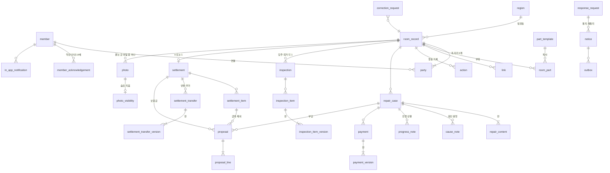

# ERD 초안

> `03-상태와-규칙.md`의 상태 기계 12개(A~L)와 불변식 21개를 테이블과 제약으로 옮긴 **첫 초안**이에요. 칸 이름과 세부 타입은 구현하면서 다듬어요.
> 데이터 모델의 원칙(왜 이렇게 나눴나)은 `04-인프라-아키텍처.md`의 「4-0. 데이터 모델 원칙」에 있어요. 결정의 이유는 `../decisions.md`.

---

## 0. 읽는 법

### 테이블 세 종류

| 표시 | 종류 | 수정 | 설명 |
|---|---|---|---|
| **A** | 행동 기록 | 안 됨 | 누가, 언제, 무엇을 눌렀나. 원본 |
| **B** | 사실 행 | 안 됨 | 사람이 입력한 내용. 고치면 이전 행을 가리키는 새 행(판) |
| **C** | 상태 행 | 상태·기한·version·"지금 판" 칸만 | 지금 어디까지 왔나. 행동 기록에서 다시 계산할 수 있는 사본. 그 밖의 칸은 만들 때 한 번만 쓴다 |

### 모든 테이블의 공통 칸

| 칸 | 내용 |
|---|---|
| `id` | UUID v7(Hibernate가 저장할 때 생성, 앱·화면은 넣지 않음) |
| `room_record_id` | 호실 기록. 계정·템플릿·법정동(`region`)·삭제 기록·아웃박스·횟수 세기(`rate_counter`)를 뺀 모든 테이블. 보관 삭제와 탈퇴를 호실 기록 하나 기준으로 처리하려고. `in_app_notification`은 호실과 무관한 서비스 안내(번호 인증 해제 등)면 NULL |
| `created_at` | 서버 시각(`timestamptz`). 고정 데이터(`part_template`, `region`)와 `rate_counter`에는 없음 |
| `version` | C 테이블만. 낙관적 잠금. `rate_counter`는 `INSERT … ON CONFLICT DO UPDATE`로만 바뀌어 두지 않음 |

### 원칙의 예외: 신원·연락처 칸

A·B·C 원칙은 **기록**을 지키려는 것이다. 사람의 신원·연락처는 기록이 아니라 개인정보라서 오히려 **고치고 지울 수 있어야** 한다(정정·삭제 권리, 탈퇴, 번호 변경, 수신 거부).

| 예외 칸 | 규칙 |
|---|---|
| `member`의 이메일·비밀번호 해시·이름·번호·설정, `party.invite_phone`, `refresh_token`, `phone_verification` | 고치고 지울 수 있다. 바꾼 사실은 행동 기록에 남기되 **값은 남기지 않는다**("초대 번호 변경", "이름 변경"). 기록 테이블은 이 칸들을 복사하지 않고 ID로만 가리킨다(불변식 1) |

### 두 가지 반복 모양

이 두 모양만 익히면 나머지 테이블은 같은 방식으로 읽을 수 있어요.

**① 고칠 수 있는 것 = C 머리 + B 판**

```
repair_case (C)  current_content_id ──▶ repair_content (B) 판 #3 ──previous──▶ #2 ──▶ #1
```

수리 건, 지불, 점검 항목, 정산 송금이 이 모양이에요. 머리(C)는 두 곳을 가리켜요: **지금 모습**(가장 최근 판, `current_*_id`)과 **같이 확인한 모습**(상대가 확인한 판, `confirmed_*_id`). 같이 확인하기 전에 고치면 새 판을 만들고 두 가리킴을 함께 옮겨요(아직 확인 전이라 같이 확인한 모습은 비어 있음). 같이 확인한 뒤 고치면(무엇이든) 판을 바로 만들지 않고 **고친 내용(칸 + 새 값 + 기준 판)**과 확인 요청(기록당 하나)을 남겨요. 상대가 확인하면 **지금 도장 찍힌 판에 그 칸만 합쳐** 새 판을 만들고 두 가리킴을 함께 옮겨요(하나를 확인해도 다른 고친 내용이 딸려 가지 않게). 계산은 같이 확인한 모습(없으면 지금 모습)만 읽어요(03-상태 G).

**② 무엇에 대한 것인가 = 종류별 외래 키 + "정확히 하나" CHECK**

```sql
repair_case_id  uuid NULL REFERENCES repair_case,
payment_id      uuid NULL REFERENCES payment,
inspection_id   uuid NULL REFERENCES inspection,
...
CHECK (num_nonnulls(repair_case_id, payment_id, inspection_id, ...) = 1)
```

행동 기록, 사진, 제안, 응답 요청, 고친 내용이 이 모양이에요. DB가 대상이 실제로 있는지 검사해요.

---

## 1. 전체 그림




---

## 2. 테이블

### 2-1. 계정

| 테이블 | 종류 | 칸 | 제약·메모 |
|---|---|---|---|
| `member` 회원 | C | `email`, `password_hash`, `display_name`, `phone`(인증 번호), `phone_verified_at`, `sms_enabled`, `status`(ACTIVE/WITHDRAWN), `withdrawn_at` | `UNIQUE(email)`, `UNIQUE(phone) WHERE phone IS NOT NULL`(불변식 8). 다른 계정이 같은 번호를 인증하면 이전 계정의 `phone`을 NULL로. 탈퇴하면 email·이름·번호·해시를 지우고(NULL) 행은 남김(행동 기록이 가리키므로) |
| `refresh_token` | C | `member_id`, `family_id`, `token_hash`, `device_label`, `expires_at`, `revoked_at`, `replaced_by_id` | `UNIQUE(token_hash)`. 폐기 뒤 10초 유예는 `revoked_at`과 `replaced_by_id`로(불변식 12) |
| `phone_verification` | C | `phone`, `purpose`(SIGNUP/RESET/FIND_ID/CHANGE), `code_hash`, `expires_at`, `attempt_count`, `verified_at`, `consumed_at`(인증 표를 쓴 시각) | 짧게 쓰고 지움(하루 뒤 정리). 횟수 제한은 여기서 셈. 인증 표(06 4-1)는 `purpose`가 같은 API에만 쓰고, 바꾸는 일(가입·재설정·번호 변경)에는 **한 번만**: 그 작업이 성공하는 트랜잭션에서 `UPDATE … SET consumed_at = now() WHERE id = ? AND consumed_at IS NULL`(0줄이면 `CODE_EXPIRED`). 아이디 찾기는 `consumed_at`을 채우지 않음(06 ACC-1f·5a) |
| `member_acknowledgement` 약관·안내 확인 기록(공유 동의는 여기가 아니라 행동 기록 `SHARE_CONSENT`) | B | `member_id`, `kind`(AGE_14_CONFIRMED/TERMS_AGREED/PRIVACY_NOTICE_ACK), `text_version`(예: `2026-11-12`), `agreed_at` | 문구는 판 번호가 붙은 정적 페이지. 내용이 바뀌면 새 판에 다시 확인. 탈퇴하면 계정과 함께 삭제(보관 삭제 경로). **기록 공유 동의는 여기 두지 않고 `action`의 `SHARE_CONSENT`(payload에 문구 판)로**: 호실 기록과 함께 보관·삭제되어 공유된 기록이 남는 동안 동의 증빙도 남는다 |
| `sms_opt_out` 수신 거부 | B | `phone_hmac`(PK), `created_at` | 번호는 비밀 키 HMAC. 번호 주인이 가입·인증하면 행을 지움(보관 삭제 경로) |

### 2-2. 호실과 참여

| 테이블 | 종류 | 칸 | 제약·메모 |
|---|---|---|---|
| `part_template` 부위 템플릿 | 고정 | `zone`, `name`, `sort_order`, `optional` | Flyway 기본 데이터, 6구역 28개 |
| `region` 법정동 | 고정 | `code`(법정동 코드 `char(10)`, PK), `sido`, `sigungu`(NULL 허용: 세종특별자치시는 시·군·구가 없음), `dong`, `active` | Flyway 기본 데이터(별도 V 파일): 행정표준코드관리시스템 법정동코드 전체자료에서 지금 있는 읍·면·동만(리·행정동 제외). 없어진 동은 지우지 않고 `active = false`(가리키는 호실 기록이 있을 수 있어서). 검색용 인덱스 `(dong)`, 단계 선택은 코드 앞자리(시·도 2자리, 시·군·구 5자리)로 |
| `room_record` 호실 기록 | C | `region_code`(`REFERENCES region(code)`, NOT NULL, 주소는 이 칸 하나. 이름은 `region`에서 읽음), `alias`, `move_in_date`, `status`(LIVING/ENDED/SETTLED), `created_by_side`, `counterpart_first_connected_at`, `ended_at`, `settled_at`, `autoclose_due_at`, `delete_due_at`, `inactivity_notice_due_at`(마지막 당사자 행동 시각은 이 행에 두지 않고 `action`의 `(room_record_id, created_at)` 인덱스로 계산. 모든 행동이 이 행의 version을 올리면 같은 호실의 다른 건끼리 충돌함) | `counterpart_first_connected_at`이 NULL이면 탈퇴 때 통째 삭제. **`joined_into_id`, `joined_at`**: 합류 전 기록이면 합류한 호실 기록을 가리킴(새 행동 없음, 예외는 `ERASE_PHOTO`, 쓴 사람만 읽기, 삭제는 그 기록을 따라감), `CHECK(joined_into_id <> id)`, 합류한 기록은 다시 합류할 수 없음(서비스 검사). 기한 칸은 사건이 생길 때 저장. `move_in_date`는 고치기가 반영될 때만 바뀜(같이 확인한 뒤 고친 값은 내가 고친 내용 `correction_request`에) |
| `party` 당사자(측 자리) | C | `side`(TENANT/LANDLORD), `member_id`, `invite_phone`, `status`(EMPTY/NUMBER_ONLY/INVITED/CONNECTED/SHARING_STOPPED/REJECTED/WITHDRAWN), `connected_at`, `sharing_stopped_at`(공유 그만두기 시각, 그 사람이 다시 공유하면 NULL) | `UNIQUE(room_record_id, side)`, `UNIQUE(room_record_id, member_id)`(불변식 13). 자기 번호 초대 금지는 서비스 검사. `invite_phone`은 문자를 보내야 해서 평문(RDS 저장소 암호화), 연결·수신 거부·탈퇴 때 NULL |
| `room_part` 호실 부위 | C | `template_id`, `zone`, `name`, `sort_order`, `enabled`, `hidden_at` | 지우지 않고 숨기기만 |
| `link` 링크 | C | `kind`(INVITE/SETTLEMENT_INVITE), `party_id`(받는 자리), `repair_case_id` / `inspection_id`(공유한 기록, 없으면 호실 초대 화면), `token_hash`, `issued_by_member_id`, `invalidated_at`, `invalidated_reason`, `failed_view_count` | `UNIQUE(token_hash)`. 무효가 되면 다시 유효해지지 않음(불변식 7) |

### 2-3. 행동 기록

| 테이블 | 종류 | 칸 | 제약·메모 |
|---|---|---|---|
| `action` 행동 기록 | **A** | `actor_member_id`(서버 행동은 NULL), `actor_side`, `actor_key`(회원 ID 또는 `server`), `type`, `idempotency_key`, `room_seq`·`prev_hash`·`hash`(해시 체인, 호실마다, **NOT NULL, 첫 마이그레이션부터**), `content_digest`(당시 본 판의 내용·사진 지문을 묶은 SHA-256, bytea 32바이트, 내용 대상이 없으면 NULL), `seen_version_no`(확인할 때 본 모습의 번호 = 판 테이블의 `no`, 정산 끝내기 확인 `CONFIRM_FINISH`면 본 정산 모습 번호 `settlement.snapshot_no`, 06 `seenVersionNo`), payload에 `while_open_objection`(그 순간 보류·이견이 열려 있었으면 NEED_MORE/DISPUTE: 강행 표시), 대상 칸(`party_id`, `link_id`, `room_part_id`(부위 추가·숨김), `notice_id`(다시 보내기·전달 안 됨 표시), `repair_case_id`, `payment_id`, `inspection_id`, `inspection_item_id`, `settlement_id`, `settlement_item_id`, `settlement_transfer_id`, `proposal_id`, `response_request_id`, `correction_request_id`, `cause_note_id`, `progress_note_id`, `photo_id`), `reason`, `payload`(jsonb, 작은 부가 값만) | `actor_key`는 회원 ID, `server`, 링크 열람이면 `link:<링크 ID>`(가입 전 사람, `actor_member_id`는 NULL), 운영 명령이면 `ops:<담당>`(작업 대장과 짝). `UNIQUE(actor_key, idempotency_key)`(한 요청의 여러 행동은 `<키>#2`…), `UNIQUE(room_record_id, room_seq)`(호실 기록 행을 잠그고 다음 번호. 작업자도 호실마다 트랜잭션을 나눔. 해시 입력 모양은 1주차에 테스트로 고정). `CHECK(num_nonnulls(대상 칸들) <= 1)`(0이면 호실 기록 자체: 이사함, 정산 끝내기). 트리거: UPDATE 거절, DELETE는 `app.purge`일 때만(호실 기록 통째 삭제, 탈퇴 때 초안 지우기 2-10). 대상 칸마다 부분 인덱스. 이름·번호를 복사하지 않음(불변식 1) |

내용 지문과 행동 해시는 나눠 계산한다. `content_digest`는 당시 본 판의 내용과 그 판에 포함된 사진 지문을 정해진 입력 형식으로 묶은 SHA-256이고, `action.hash`는 이전 해시·행동 정보·대상 ID·판 번호·`content_digest`를 포함해 계산한다. 같은 판의 내용 지문은 재사용할 수 있지만, 실제 내용을 확인할 때는 본문·사진 지문으로 다시 계산해 비교한다. **행동 체인 검증만으로 본문까지 검증했다고 보지 않는다.** 내용 대상이 없는 행동만 NULL이며, 어떤 행동에 어떤 판을 연결하는지는 해시 계산 구현에서 입력 형식과 함께 테스트로 고정한다. DB는 지문의 길이만 검사하며 계산·내용 대상 행동의 필수 여부는 앱이 보장한다. 지문은 암호화나 익명화가 아니므로 개인정보 위험이 없어지는 것은 아니다.

`type` **전체 목록(기준)**. `apply`의 분기와 API 끝 단어가 이 목록을 따른다. 새 행동은 여기에 먼저 더한다.

| 영역 | 행동 종류 |
|---|---|
| 호실·참여 | `CREATE_ROOM`, `EDIT_ROOM_INFO`(내 쪽·주소·별칭, 처음 알리기·초대 전만), `ADD_PART`, `HIDE_PART`, `TOGGLE_PART`, `INVITE`, `CHANGE_INVITE_PHONE`, `REJECT_INVITE`, `CONNECT`, `JOIN`, `SHARE_CONSENT`, `STOP_SHARING`, `RESUME_SHARING`, `MOVE_OUT`, `REQUEST_END`, `CONFIRM_END`, `REJECT_END`("아직 살고 있어요", 사유, 06 4-3 `/move-out/reject`), `CONFIRM_LIVING` |
| 링크·통지 | `LINK_VIEW`(`link:<ID>`), `OPT_OUT`, `RESEND_NOTICE`, `RENOTIFY`(서버), `MARK_UNCONFIRMED`(서버), `MARK_UNDELIVERED`(서버) |
| 수리 | `REGISTER`, `SUPPLEMENT`, `RESPOND_DEFECT`, `START_REPAIR`, `REQUEST_CLOSE`, `CONFIRM_CLOSE`, `NOT_YET`, `CLOSE_ALONE`, `REOPEN`, `ADD_PHOTO`, `ASK_PROGRESS`, `NOTE_PROGRESS`, `RESPOND_SITUATION`, `NOTE_CAUSE`, `RESPOND_CAUSE` |
| 고치기 | `CORRECT`, `RESPOND_CORRECTION`, `ACCEPT_ALL_CORRECTIONS`, `RESUBMIT_CORRECTION`, `WITHDRAW_CORRECTION` |
| 돈·제안 | `RECORD_PAYMENT`, `RESPOND_AMOUNT`, `SUPPLEMENT_PAYMENT`, `PROPOSE`, `AGREE`, `DISPUTE_PROPOSAL`, `COUNTER`, `WITHDRAW` |
| 점검 | `START_INSPECTION`, `ADD_ITEM`, `ADD_PART_PHOTO`, `REQUEST_INSPECTION_CONFIRM`, `RESPOND_ITEM`, `SUPPLEMENT_ITEM`, `CONFIRM_ALL`, `LOCK`(서버), `FINISH_INSPECTION` |
| 정산 | `OPEN_SETTLEMENT`, `INCLUDE_CANDIDATE`, `ADD_SETTLEMENT_ITEM`, `PROPOSE_EXCLUDE`, `RECORD_TRANSFER`, `RESPOND_TRANSFER`, `PROPOSE_FINISH`, `CONFIRM_FINISH`, `NOT_YET_FINISH`, `FINISH_ALONE`, `CLOSE_FINISH_REQUEST`(서버, 정산이 바뀌어 닫힘), `AUTOCLOSE`(서버) |
| 사진 | `HIDE_PHOTO`, `SHOW_PHOTO`, `MARK_PHOTO_WRONG`, `UNMARK_PHOTO_WRONG`(올린 사람), `ERASE_PHOTO`(올린 사람 또는 `ops:<담당>`) |
| 계정(호실 밖) | 회원 변경은 행동 기록이 아니라 신원 칸 예외라 값 없이 내부 기록만: 이름 변경, 번호 변경, 탈퇴 |

`RESPOND_*` 행동은 값 `ACK` / `NEED_MORE` / `DISPUTE`(보류·이견은 사유 필수)를 가진다. 보류·이견 뒤에는 같은 행동으로 `ACK`를 다시 남길 수 있고(정산 완료 전), `ACK` 뒤의 응답은 거절한다(`ACK_FINAL`).

### 2-4. 공통 장치: 돈 안건 장치와 기다림 타이머

| 테이블 | 종류 | 칸 | 제약·메모 |
|---|---|---|---|
| `proposal` 제안 | B | 대상 칸(`repair_case_id` 부담 / `settlement_item_id` 정산 항목 / `settlement_id` 보증금), `proposed_by_side`, `counter_of_id`(역제안이면 상대의 이전 제안), `replaces_id`(답 전에 [바꾸기]로 바꾼 내 이전 안), `round`, `no_cost`, `exclude`, `reason`(정산 항목 [바꾸기]의 사유, 06 SET-2d `REASON_REQUIRED`) | `CHECK(num_nonnulls(대상) = 1)`. 공통 칸과 대상 칸만 둔다(기능별 내용은 그 기능의 테이블에. 정산 항목의 금액·방향은 제안 줄, 사유는 `reason`). B라 상태 칸이 없다. **어느 안이 기다리는 중인지는 안건 머리(C)가 정한다**: `repair_case.current_proposal_id`, `settlement_item.current_proposal_id`, `settlement.current_deposit_proposal_id`. 가리키는 칸이 하나라 **한 안건에 기다리는 안은 구조상 하나**다(제안 행에 부분 유니크를 걸지 않음, 동시 요청은 호실 기록 행 잠금으로 한 줄로 섬). **기다리는 안** = 머리가 가리키고 그 안건의 `PROPOSAL` 응답 요청이 WAITING 또는 UNCONFIRMED인 안. 규칙(03-상태 1-2·E): ① **미확인도 정산 완료 전까지는 기다리는 안**이다. 합의는 그대로 쓰이고 "바꾸자는 안 있음"이 함께 보이며, 상대는 늦게라도 동의할 수 있다(06 MONEY-3d) ② 답 전에 바꾸면(미확인 안 포함) 새 제안 행(`replaces_id` = 이전 안)을 만들고 머리를 옮긴다. 응답 요청은 안건을 가리키므로 같은 요청에 그대로 묶이고(미확인이었으면 WAITING으로 돌아감) 문자는 다시 가지 않으며 기한만 다시 정한다(06 SET-2e) ③ 상대의 안이 기다리는 중에 낸 안은(합의 뒤 바꾸자는 안 포함) 그 안에 대한 **다른 안**(역제안, `counter_of_id`)이다. 머리를 옮기고 이전 안의 요청은 ANSWERED, 다른 안에 새 요청 ④ 바탕 금액이 같이 확인돼 바뀌어 **합의가 풀리면**(03-상태 E "지불 합계 변경") 같은 트랜잭션에서 머리의 `current_*`·`agreed_*` 가리킴을 비우고 기다리던 요청은 `CLOSED`(`closed_reason = AMOUNT_CHANGED`, "금액이 바뀌어 닫힘")로 닫는다. 이전 합의는 제안 행과 `AGREE` 행동으로 참고 표시 |
| `proposal_line` 제안 줄 | B | `proposal_id`, `line_kind`(TENANT/LANDLORD/THIRD_PARTY 부담 · DEDUCT/ADD 정산 · DEPOSIT 보증금), `third_party_label`, `amount` | `amount bigint CHECK (amount >= 0)`. 부담 줄의 합 = 전체 금액은 서비스 검사. 비율 칸 없음 |
| `response_request` 응답 요청 | C | `kind`(DEFECT_CONFIRM/SITUATION_CHECK/CORRECTION_CONFIRM(기록당 하나, 대상은 기록: 수리 건·지불·점검·송금. 대기 중인 고친 내용이 0개가 되면 ANSWERED)/AMOUNT_CONFIRM/PROPOSAL/CLOSE_CONFIRM/INSPECTION_CONFIRM/RECEIPT_CONFIRM/SETTLE_FINISH/END_REQUEST/PROGRESS_CHECK), 대상 칸(`repair_case_id`, `payment_id`, `inspection_id`, `inspection_item_id`, `settlement_item_id`, `settlement_id`, `settlement_transfer_id`, 없으면 호실 기록. `PROPOSAL`은 제안이 아니라 **안건**(수리 건 부담·정산 항목·정산 보증금)을 가리킨다: 기다리는 안이 바뀌어도 같은 요청), `requested_by_side`, `first_notified_at`(첫 통지가 전달된 시각 = min(전달됨, 링크 열람)), `renotify_due_at`, `unconfirmed_due_at`, `status`(WAITING/ANSWERED/UNCONFIRMED/WITHDRAWN(요청한 쪽이 거둠)/CLOSED), `closed_reason`·`closed_at`(CLOSED일 때만, 아래), `solo_reason`(UNCONFIRMED/OPTED_OUT/COUNTERPART_WITHDRAWN(상대 탈퇴)/SHARING_STOPPED/SMS_UNDELIVERED/NOT_CONNECTED(초대했지만 연결 전, 화면 "아직 연결하지 않았어요")/NO_COUNTERPART(번호 없음·초대 전)) | `CHECK(num_nonnulls(대상) <= 1)`. 작업자는 이 테이블만 본다: 부분 인덱스 `(renotify_due_at) WHERE status = 'WAITING'`와 `(unconfirmed_due_at) WHERE status = 'WAITING'`, `FOR UPDATE SKIP LOCKED`. "혼자 진행할 수 있나" 함수도 이 행을 본다. 요청 종류마다 "기한이 지나면 혼자 진행이 열리나"를 코드의 성질로 둔다(칸 없음, 확인 카드의 두 칸 나누기에 씀). 같은 기록의 고친 칸이 더해지거나 기다리는 안이 바뀌면 같은 트랜잭션에서 기한을 다시 정한다. `PROPOSAL`은 안건마다 기다리는 요청 하나: 부분 유니크 `(COALESCE(repair_case_id, settlement_item_id, settlement_id)) WHERE kind = 'PROPOSAL' AND status IN ('WAITING', 'UNCONFIRMED')`(미확인도 기다리는 안이라서, 2-4 `proposal`. NULL이 섞인 복합 유니크는 걸리지 않아 한 값으로 합침, ID가 UUID라 세 칸이 겹치지 않음). **닫힌 이유**: `CHECK((status = 'CLOSED') = (closed_reason IS NOT NULL))`, `closed_at`도 같이 채움(나중에 더하면 이미 닫힌 행은 이유를 알 수 없어 첫 마이그레이션부터). 값과 화면 말: `SHARING_STOPPED`("공유 중단으로 닫힘", 03-상태 B), `COUNTERPART_WITHDRAWN`("상대 탈퇴로 닫힘", 03-상태 L), `SETTLED`("정산 완료로 닫힘", 03-상태 G), `CLOSED_BY_BOTH`("처리 완료로 닫힘", 06 REP-7l), `SETTLEMENT_CHANGED`("정산 내용이 바뀌어 닫혔어요", 06 SET-5b), `AMOUNT_CHANGED`("금액이 바뀌어 닫힘", 03-상태 E), `ROOM_ENDED`("거주 종료로 닫힘": 거주 종료가 되는 트랜잭션에서 WAITING인 `DEFECT_CONFIRM`·`PROGRESS_CHECK`·`SITUATION_CHECK`, 03-상태 K "거주 종료 뒤", 06 ROOM-9a). `SETTLE_FINISH`는 요청 행에 정산 모습을 따로 두지 않는다: 정산을 바꾸는 행동이 같은 트랜잭션에서 `settlement.snapshot_no`를 올리고 기다리는 끝내기 요청을 `CLOSED`(`SETTLEMENT_CHANGED`)로 닫는다. 상대의 확인(`CONFIRM_FINISH`)은 본 번호(`seen_version_no`)가 지금 `snapshot_no`와 다르면 `VERSION_CONFLICT`(03-상태 1-4, 06 SET-5e) |

### 2-5. 수리와 돈

| 테이블 | 종류 | 칸 | 제약·메모 |
|---|---|---|---|
| `repair_case` 수리 건 | C | `current_content_id`, `confirmed_content_id`(같이 확인한 모습), `status`(NOT_STARTED/IN_PROGRESS/CLOSE_WAIT/DONE)(수리 진행, 하자 인정과 따로), `closed_by`(BOTH/TENANT/LANDLORD), `defect_ack`(PENDING/ACK/NEED_MORE(보류)/DISPUTE/UNCONFIRMED), `money_status`(UNDECIDED/PENDING/AGREED/DISPUTE/NO_COST), `current_proposal_id`(답 기다리는 제안, 2-4), `agreed_proposal_id`, `previous_case_id`(재발), `related_case_id`(수리 중 새로 찾은 별개 하자면 원래 건), `created_by_side`, `solo`, `first_shown_at` | 상태 칸은 `apply` 결과로만 바뀜. `first_shown_at`이 NULL이면 탈퇴 때 지우는 초안(2-10) |
| `repair_content` 수리 건 내용 판 | B | `repair_case_id`, `no`(판 번호, 1부터), `room_part_id`, `title`(필수), `description`(NULL 허용), `previous_id`, `created_by_side` | 고치면 새 판. `UNIQUE(repair_case_id, no)`. 처리 완료(양측 확인)된 수리 건은 새 판을 만들지 않음(`CLOSED_BY_BOTH`, 06 REP-7k) |
| `cause_note` 원인 설명 | B | `repair_case_id`, `side`, `text`, `basis`(GUESS/SEEN/EXPERT/HEARD), `expert_name`, `previous_id` | 고치면(문장이든 근거 종류든) **언제나 새 행**(`previous_id`로 이전 설명), 고친 내용(`correction_request`)을 쓰지 않음(06 REP-8c). 상대 응답(ACK/NEED_MORE/DISPUTE)은 행동 기록(`cause_note_id`)이고 그 행에만 붙음 |
| `progress_note` 진행 상황 | B | `repair_case_id`, `side`, `text`, `answers_request_id`(진행 상황 묻기에 대한 답이면), `asks_check`("상황이 바뀌었어요" 확인 요청이면 true. 상대 응답은 작은 C 행 `progress_note_response`(맞아요 / 보류 / 이견)와 응답 요청 `SITUATION_CHECK`) | 수리 상태·돈 상태와 무관. 고치려면 새 행. 사진은 `photo.progress_note_id`. 행동 `ASK_PROGRESS`(응답 요청 `PROGRESS_CHECK`), `NOTE_PROGRESS`. "오래 멈춘 건"은 저장하지 않고 조회로 계산(마지막 당사자 행동 시각) |
| `progress_note_response` 상황 변화 응답 | C | `progress_note_id`, `side`(응답한 측), `answer`(ACK/NEED_MORE/DISPUTE), `reason` | `asks_check = true`인 진행 상황에만. `UNIQUE(progress_note_id)`(지금 답 하나, 바뀐 이력은 행동 `RESPOND_SITUATION`). 보류·이견 → ACK는 정산 완료 전까지, ACK 뒤는 거절(`ACK_FINAL`). 06 4-6 `progress-notes/{id}/respond` |
| `payment` 지불 | C | `repair_case_id`, `current_version_id`, `confirmed_version_id`, `confirm_strength`(ONE_SIDE/EVIDENCE/BOTH), `response`(NONE/ACK/NEED_MORE/DISPUTE), `first_shown_at` | 한 수리 건에 지불 여러 개, 지불 하나는 한 수리 건에만. 나누기 기준 금액은 `response = ACK`인 지불의 확인된 판 금액의 합 |
| `payment_version` 지불 판 | B | `payment_id`, `no`(판 번호), `payer_kind`(TENANT/LANDLORD/THIRD_PARTY), `payer_label`(제3자면 이름 대신 관계: 가족·윗집·보험사), `payee_kind`(VENDOR/COUNTERPART/THIRD_PARTY), `payee_label`, `amount`, `paid_on`(사용자 입력 날짜), `recorded_by_side`(보낸 쪽/받은 쪽), `evidence_kind`, `previous_id` | `amount >= 0`. `UNIQUE(payment_id, no)`. 중복 검사(같은 수리 건·방향·금액 30일)는 서비스. 증빙이 있었는지는 붙은 사진 카드로 판단(탈퇴로 파일이 지워져도 카드는 남음) |
| `correction_request` 고친 내용 | C(만든 뒤에는 상태만 바뀜) | (같이 확인한 뒤 고칠 때 생김. **칸 하나 + 새 값 + 기준 판**: `field`, `new_value`(jsonb), `base_version_id`(그때 도장 찍힌 판), 칸마다 확인 전은 하나(아래 부분 UNIQUE), 다시 고치면 이전 것은 `SUPERSEDED`), 대상 칸(`repair_case_id`, `payment_id`, `inspection_item_id`, `settlement_transfer_id`, 없으면 호실 기록의 입주일), `target_key`(대상 종류 + ID를 합친 NOT NULL 문자열, 칸마다 하나 제약에 씀), `retry_of_id`(거절된 고친 내용을 근거를 더해 다시 보낼 때 이전 행), `requested_by_side`, `reason`, `status`(WAITING/ACCEPTED/REJECTED/UNCONFIRMED/WITHDRAWN/SUPERSEDED/CLOSED), `closed_reason`·`closed_at`(CLOSED일 때만: `SHARING_STOPPED`/`COUNTERPART_WITHDRAWN`/`SETTLED`/`CLOSED_BY_BOTH`, 값과 화면 말은 2-4 `response_request`와 같음) | 미리 만든 판을 두지 않는다(통째 반영 방지). 상대가 확인하면 **그때의 도장 찍힌 판 + 이 칸만** 합쳐 새 판을 만들고 두 가리킴을 함께 옮김. 기준 판 이후 같은 칸이 바뀌었으면 합치지 않고 다시 확인. 부분 UNIQUE는 `(target_key, field) WHERE status = 'WAITING'`. 대상이 아닌 것: 처리 완료(양측 확인)된 수리 건의 내용(`CLOSED_BY_BOTH`), 원인 설명(고치면 새 `cause_note`). 처리 완료(양측)가 되는 트랜잭션에서 그 수리 건 내용의 WAITING 고친 내용과 그 응답 요청을 `CLOSED`(`CLOSED_BY_BOTH`)로(지불 고친 내용은 그대로, 06 REP-7l). `CHECK((status = 'CLOSED') = (closed_reason IS NOT NULL))` |

### 2-6. 점검

| 테이블 | 종류 | 칸 | 제약·메모 |
|---|---|---|---|
| `inspection` 점검 | C | `kind`(MOVE_IN/MOVE_OUT), `author_side`, `status`(DRAFT/REQUESTED/LOCKED), `late`, `locked_at`, `lock_reason`(ALL_RESOLVED/NO_ITEMS), `first_shown_at` | `UNIQUE(room_record_id, kind)`(먼저 저장된 측이 기준). 퇴거 점검의 잠김은 거주 종료와 별개 |
| `inspection_item` 점검 항목 | C | `inspection_id`, `current_version_id`, `confirmed_version_id`, `status`(PENDING/ACK/NEED_MORE/DISPUTE/UNCONFIRMED, 수리 건 `defect_ack`와 같은 값이라 06 API의 응답 값 ACK·NEED_MORE·DISPUTE를 바꾸지 않고 씀), `added_by_side`, `added_after_lock`(잠긴 뒤 추가), `added_after_end` | 항목 = 적은 하자만. 빠뜨린 하자 더하기는 새 기록(누구든, 더하지 않은 쪽이 확인). 확인 요청 `INSPECTION_CONFIRM`은 점검 × 요청 방향마다 하나(부분 유니크 `(inspection_id, requested_by_side) WHERE WAITING`), 두 방향이 모두 끝나야 잠김. 적지 않은 부위는 행이 없음("기록 없음") |
| `inspection_item_version` 점검 항목 판 | B | `inspection_item_id`, `no`(판 번호), `room_part_id`, `description`, `previous_id` | `UNIQUE(inspection_item_id, no)` |

부위 사진(하자 아님)은 따로 테이블을 두지 않고 `photo`의 단계(MOVE_IN/MOVE_OUT) + `inspection_id`로 남겨요.

### 2-7. 정산

| 테이블 | 종류 | 칸 | 제약·메모 |
|---|---|---|---|
| `settlement` 정산 | C | `opened_at`, `deposit_status`(NOT_ENTERED/PENDING/AGREED/DISPUTE, 화면 말은 "보증금 확인 전"/"둘 다 확인". "미확인"과 헷갈리지 않게 UNCONFIRMED라 부르지 않음), `current_deposit_proposal_id`(답 기다리는 제안), `agreed_deposit_proposal_id`(지금 합의, 바꾸자는 안이 와도 그대로), `snapshot_no`(**정산 모습 번호**, 1부터. 06 SET-5e "정산 모습 3번 → 4번". `version`처럼 바뀌는 칸) | `UNIQUE(room_record_id)`. **정산 모습 번호**: 항목·송금·보증금 제안은 다른 행이라 바뀌어도 `settlement.version`이 오르지 않으므로 따로 센다. 정산에 무엇이든 더해지거나 바뀌면(항목 추가·제외 제안, 금액 제안·응답·이견, 수리 건에서 온 금액이 바뀌어 항목이 확인 대기가 됨, 보증금 제안·응답, 송금 기록·응답·고치기, 누가 했든, 03-상태 1-4) 그 행동의 트랜잭션에서 `UPDATE settlement SET snapshot_no = snapshot_no + 1`(이 행을 잠금). 화면은 이 번호를 받아 끝내기 확인 때 `seenVersionNo`로 돌려보낸다 |
| `settlement_item` 정산 항목 | C | `settlement_id`, `source`(REPAIR/MANUAL), `repair_case_id`, `room_part_id`, `category`, `status`(PENDING/AGREED/DISPUTE/EXCLUDED), `current_proposal_id`(답 기다리는 제안, 2-4), `agreed_proposal_id` | 출처·부위·종류는 만들 때 한 번만 씀(바꾸려면 이 항목을 제외 제안하고 새 항목을 넣음). **금액·방향은 제안 줄, 사유는 제안(`proposal.reason`)에**(정산 항목의 [바꾸기] = 새 제안, 고치기 대상 아님). 합의된 항목만 계산(불변식 6) |
| `settlement_transfer` 정산 송금 | C | `settlement_id`, `direction`(REFUND/EXTRA), `current_version_id`, `confirmed_version_id`, `recorded_by_side`, `response`(NONE/ACK/NEED_MORE/DISPUTE, 그 기록을 남기지 않은 쪽의 응답: 보낸 쪽 기록이면 받은 쪽, [받았어요(혼자)]면 보낸 쪽), `same_as_transfer_id`(받은 쪽이 실제 받은 금액으로 남긴 [받았어요(혼자)]가 보낸 쪽 기록과 같은 송금이면 그 기록, 합계에서 두 번 세지 않음), `receipt_confirmed_at` | 지불 기록과 같은 "C 머리 + B 판". 받은 쪽 응답은 응답 요청(RECEIPT_CONFIRM). 여러 번. 송금 합계는 **상대가 확인한(`response = ACK`) 판만** 더하고, 같은 송금으로 묶인 두 기록은 한 번만 센다 |
| `settlement_transfer_version` 정산 송금 판 | B | `settlement_transfer_id`, `no`(판 번호), `amount`, `paid_on`, `previous_id` | 금액·날짜를 고치면 새 판(고치기). 여러 번. `UNIQUE(settlement_transfer_id, no)` |

정산 후보(수리 건에서 온 금액)와 "합의된 항목으로 계산한 금액"은 **저장하지 않고 계산**해요.

### 2-8. 사진

| 테이블 | 종류 | 칸 | 제약·메모 |
|---|---|---|---|
| `photo` 사진 | B | 대상 칸(`repair_case_id`, `inspection_item_id`, `inspection_id`(부위 사진), `payment_id`, `cause_note_id`, `settlement_item_id`, `progress_note_id`, `correction_request_id`(다시 요청에 더한 근거)), `redacted_from_photo_id`(개인정보 때문에 지운 원본 자리에 올린 가린 사본이면 그 원본 행, 같은 사진이라는 증명은 아님), `room_part_id`(**부위 사진만**, 다른 사진은 NULL), `stage`(MOVE_IN/BEFORE/AFTER/MOVE_OUT/EVIDENCE/BASIS/PROGRESS), `uploaded_by_side`, `device_taken_at`(참고), `original_key`, `thumb_key`, `original_sha256`, `thumb_sha256`(S3 체크섬, 지문값), `size_bytes`, `sort_order` | `CHECK(num_nonnulls(대상) = 1)`, `CHECK((inspection_id IS NOT NULL) = (room_part_id IS NOT NULL))`. **부위는 사진에 복사하지 않는다**: 사진은 B라 복사해 두면 대상의 부위를 고쳐도 옛 부위로 남는다(06 REP-7a·7i). 사진의 부위는 조회 때 대상에서 읽는다: 수리 건·점검 항목 사진은 그 대상의 앞에 보이는 판(같이 확인한 모습, 없으면 지금 모습)의 `room_part_id`, 지불·원인 설명·진행 상황 사진은 그 수리 건의 것, 정산 항목 사진은 `settlement_item.room_part_id`, 고친 내용 사진은 그 고친 내용의 대상의 것. 부위 사진(`inspection_id`)은 대상에 부위가 없어 요청의 부위를 `room_part_id`에 둔다. 나란히 보기(06 INSP-3b)는 판 테이블의 `room_part_id`(인덱스 `repair_content(room_part_id)`, `inspection_item_version(room_part_id)`)와 부위 사진의 `(room_record_id, room_part_id, stage)`로 모은다. 검사를 통과한 뒤에만 행이 생김(불변식 14). `UNIQUE(original_key)`(같은 업로드 표로 두 번 확정 금지). `stage`는 서버가 제출 행동과 대상에서 정함(화면이 보내지 않음). **등록·추가 행동과 같은 트랜잭션에서만 생김**(제출 전에는 행이 없어 화면에서 자유롭게 뺌). 키는 `photos/{room_record_id}/…`(보관 삭제가 접두어로 지움). 개인정보·탈퇴·다른 사람 요청으로 지울 때는 행을 남기고 파일만(`photo_visibility`), 행까지 지우는 것은 호실 기록 통째 삭제(보관 기한 끝, `app.purge`)뿐 |
| `photo_visibility` 사진 공개 상태 | C | `photo_id`(PK), `hidden_on_link`, `marked_wrong_at`(잘못 올린 사진 표시, 뗄 수 있음), `erased_at`(파일을 지운 시각), `erase_reason`(PRIVACY/WITHDRAWAL/THIRD_PARTY) | 행동 "링크에서 숨김 / 다시 보이기", "개인정보 사진 지우기"로만 바뀜. `erased_at`은 한 번 채워지면 되돌릴 수 없음(`apply`), 채워지면 어떤 주소도 발급하지 않고 그 자리에 "지운 사진 · 시각" 표시(화면의 고정 표시 컴포넌트). 파일은 아웃박스로 S3에서 지우고 `photo` 행(지문값 포함)은 흔적으로 남음 |

### 2-9. 통지와 작업

| 테이블 | 종류 | 칸 | 제약·메모 |
|---|---|---|---|
| `notice` 통지 | C | `response_request_id`(있으면), `link_id`, `recipient_party_id`, `kind`(INVITE/REQUEST/RENOTIFY/SETTLEMENT_INVITE/INFO), `channel`(SMS/IN_APP), `status`(REQUESTED/SENT/DELIVERED/VIEWED/FAILED), `sent_at`, `delivered_at`, `viewed_at`, `failed_at`, `provider_message_id`(솔라피 messageId), `batch_lead_id`(같은 문자 한 통으로 나간 통지 묶음의 **대표 통지**: 작업자가 처음 집은 통지. 혼자 나가면 자기 자신. 보낼 때 채움), `next_poll_at`(전달 결과 조회 시각), `scheduled_for`(보낼 예정 시각: 모으기 2분, 21~08시 보류, 한도 미룸. 화면 "내일 아침에 보낼게요") | 통지 상태 화면은 여기서(한 줄 표시, 03-상태 K). **문자 모으기**: 같은 받는 사람·같은 호실의 회원 문자를 한 통으로 보내면 여러 `notice`가 같은 `batch_lead_id`·`provider_message_id`를 갖고 전달 결과·열람이 함께 바뀐다(통지는 요청마다 하나라 불변식 4가 그대로). **솔라피 `customFields`에는 통지 ID 하나만**(06 4-11 ①): `batch_lead_id`를 넣는다. 한 통에 통지가 하나면 그 통지 ID, 모은 문자면 대표 통지 ID다(04 4-2의 "묶음 ID"가 이것, 번호·이름은 넣지 않음). 하루 한도는 `rate_counter`(보낸 문자 한 통마다)로 센다. 전달 결과는 조회 API로 채움(부분 인덱스 `(next_poll_at) WHERE status = 'SENT'`), 보내고 3일이 지나도 결과가 없으면 FAILED. 미확인은 DELIVERED 두 건일 때만. `channel = IN_APP`(문자를 끈 회원, 인증이 풀린 계정)은 만들 때 바로 DELIVERED(`delivered_at` = 생성 시각). 회원이 문자 링크(`/r/…`)나 서비스 안 알림을 열면 `viewed_at`(= "알림 확인", 전달로 봄). FAILED면 보낸 측이 한 번 다시 보내기(같은 응답 요청의 새 `notice`), 그것도 FAILED면 응답 요청의 `solo_reason = SMS_UNDELIVERED`. 타이머 시작점은 min(`delivered_at`, `viewed_at`)(문자를 끈 회원은 서비스 안 알림 생성 시각). 링크 열람이 있으면 결과가 없어도 전달로 봄 |
| `outbox` 아웃박스 | C | `kind`(SMS/S3_DELETE/AUDIT_WRITE/ORPHAN_CHECK), `dedupe_key`(UNIQUE, NULL 허용. 고아 파일 확인은 `orphan-check:<원본 키>`), `payload`(jsonb: 통지 ID, S3 키 등. **번호를 복사하지 않음**, 보낼 때 읽음), `status`(PENDING/SENDING/DONE/FAILED), `attempts`, `next_attempt_at` | 부분 인덱스 `(next_attempt_at) WHERE status = 'PENDING'`, `SKIP LOCKED`. 21~08시 보류는 `next_attempt_at`으로. **SENDING**(문자만, 04 4-2): 업체에 보내기 직전에 그 줄(모은 문자면 함께 잠근 줄 모두)을 `SENDING`으로 먼저 커밋한다. 앱이 켜질 때 `SENDING`으로 남은 줄은 다시 보내지 않고, 조회 API에서 `customFields`의 통지 ID(`notice.batch_lead_id`)로 결과를 찾아 맞춘다. 찾지 못하면 FAILED로 두고 사람이 [다시 보내기]("자동으로 두 번 보내지 않는다"). 통지 상태(03-상태 K)에는 SENDING을 두지 않는다(화면은 "발송 요청됨" 그대로) |
| `in_app_notification` 서비스 안 알림 | C | `member_id`, `kind`(RESPONSE/INFO/SERVICE), `response_request_id`, 이동할 대상, `group_key`(하루 묶음 알림이면, 예: `erase-digest:<호실>:<날짜>`), `group_count`, `read_at`, `expires_at`(30일) | `UNIQUE(member_id, group_key) WHERE group_key IS NOT NULL`(같은 날 같은 묶음은 한 행에 개수만 더함: 사진 지우기 알림 등). 탈퇴하면 바로 삭제 |
| `rate_counter` 횟수 세기 | C | `counter_key`(예: `upload:<회원>`, `verify:<번호 HMAC>`, `rerequest:<기록 종류>:<ID>`(다시 요청 7일, 8일 보관), `rerequest:invite:<당사자 자리 ID>`(같은 번호로 초대 다시 보내기 7일)), `window_date`, `count` | `UNIQUE(counter_key, window_date)`, `INSERT … ON CONFLICT DO UPDATE`로 하나씩 셈. 저장하지 않는 것(업로드 표)의 하루 한도를 셀 때 씀. **문자 발송 한도도 여기서 센다**: 실제로 문자 한 통을 보낼 때마다(모은 문자도 한 통, 인증 문자 포함) `sms:<번호 HMAC>`·`sms-member:<회원>`·`sms-total` 세 줄. 이틀 지나면 지움(`rerequest:` 키는 8일). 호실 기록 ID 없음(계정·번호 단위) |
| `deletion_log` 삭제 기록 | B | `target_kind`, `target_id`, `reason`, `phone_hmac`(수신 거부일 때), `chain_room_id`·`room_seq`·`action_hash`(지운 행동일 때만: 그 행동의 호실 기록 ID·번호·해시) | 외래 키 없음(지운 대상을 가리키므로). S3 `audit/deletions/`에도 같은 내용(아웃박스). 호실 기록 칸 이름을 `room_record_id`로 쓰지 않는다(호실 기록 단위 삭제에 같이 지워지지 않게). `room_seq`·`action_hash`는 개인정보가 아니다(행동 내용은 ID만) |

### 2-10. 탈퇴 때 초안 지우기

상대가 연결된 적 있는 호실에서 탈퇴하면 공동 기록은 가려서 남기고, **상대에게 보인 적 없는 초안은 행동 기록까지 지운다**(06 KEEP-4b, 03-상태 6-4, 불변식 1). 상대가 연결된 적 없는 호실은 통째 삭제라 여기에 해당하지 않는다(06 KEEP-4a).

| 무엇 | 규칙 |
|---|---|
| 초안 | 탈퇴하는 측이 만든 `repair_case`·`payment`·`inspection` 중 `first_shown_at IS NULL`인 것(작성 중 점검 포함). 다른 기록(정산 항목 등)이 가리키고 있으면 보인 것으로 보고 지우지 않는다 |
| 지우는 것 | 초안과 딸린 행 전부: 머리(C), 판(B), 원인 설명·진행 상황, 제안·제안 줄, 고친 내용, 응답 요청·통지(있으면), 사진 카드(파일은 아웃박스 `S3_DELETE`), **그 초안을 대상으로 한 행동 행**. 한 트랜잭션, `app.purge`. 외래 키 때문에 행동 행 → 딸린 행 → 머리 순서로 지운다. 보인 적이 없어 상대의 행동은 없다 |
| 남기는 것 | 보인 기록과 그 행동 전부(공동 기록, 회원 한 줄만 가림). 다른 행동 행은 고치지 않아 `prev_hash`도 그대로다 |
| 해시 체인 | 지운 행동마다 `deletion_log` 한 줄(`target_kind = ACTION`, `chain_room_id`, `room_seq`, `action_hash`). 검증은 `room_seq`를 차례로 따라가다 빈 번호를 만나면 그 번호의 삭제 기록을 찾아 `action_hash`를 이전 해시로 쓴다. 삭제 기록이 없거나 해시가 맞지 않으면 끊김(위조 의심), 맞으면 "탈퇴로 지운 초안 자리". DB를 복구하면 S3 `audit/deletions/`로 다시 적용하므로 빈 번호의 근거도 함께 돌아온다 |

한계는 지금과 같다: DB를 다룰 수 있는 사람은 행동을 지우고 삭제 기록을 꾸밀 수 있어 관리자 위조까지 증명하지는 못한다(04 해시 체인).

---

## 3. 불변식은 어디서 지키나

| # | 불변식 | DB | 서비스(`apply`) + 테스트 |
|---|---|---|---|
| 1 | 행동 기록 수정·삭제 없음(지우는 것은 통째 삭제와 상대에게 보인 적 없는 초안만), 이름·번호 복사 없음 | 트리거(DELETE는 `app.purge`만), `@Immutable` | 행동 기록에 이름·번호 칸이 없음. 초안 지우기는 빈 번호를 `deletion_log`에 남겨 체인 검증이 이어짐(2-10) |
| 2 | 합의됨은 같은 안에 양 측 행동이 있을 때만 | | `apply`: `agreed_proposal_id`는 상대 측 AGREE가 같은 `proposal_id`를 가리킬 때만 |
| 3 | 처리 완료(양측 확인)는 한쪽의 종료 행동(종료 요청 또는 혼자 종료) + 다른 쪽의 종료 확인 | | `apply` |
| 4 | 미확인은 통지 두 건 전달 + 시간 경과 | | 작업자: 같은 응답 요청의 `notice`가 DELIVERED(또는 VIEWED) 두 건이고 기한이 지났을 때만 `UNCONFIRMED`. 가짜 발송기로 전달됨·최종 실패·결과 없음 세 경우 테스트 |
| 5 | 링크 열람자는 기록의 내용과 상태를 바꿀 수 없음(예외: 열람 기록, 문자 그만 받기) | | 링크 토큰 인증은 읽기 API와 `links/stop`만. 남는 행동은 `LINK_VIEW`·`OPT_OUT`뿐 |
| 6 | 정산 계산은 합의된 항목만 | | 계산 쿼리가 `status = 'AGREED'`만 |
| 7 | 무효 링크로는 볼 수 없음(사진 주소 5분) | 무효 칸은 되돌리지 않음(트리거: `invalidated_at`이 채워진 뒤 바꾸기 거절) | 서명 함수 |
| 8 | 한 번호는 한 계정 | `UNIQUE(phone)` | |
| 9 | 거주 종료 뒤 새 수리 건 없음 | | `apply` |
| 10 | 시각은 서버가 | `created_at DEFAULT now()` 대신 앱 `Clock`(테스트용) | |
| 11 | 저장된 사진에 위치 정보(GPS 태그) 없음 | | 업로드 확정 검사 |
| 12 | 폐기된 리프레시 토큰 재사용 시 묶음 폐기 | `UNIQUE(token_hash)` | 서비스 |
| 13 | 한 계정은 한 호실에서 한 측 | `UNIQUE(room_record_id, member_id)` | 자기 번호 초대 검사 |
| 14 | 사진은 원본·썸네일이 검사를 통과해야, 제출 트랜잭션에서만 | `original_key`, `thumb_key` NOT NULL | 제출 처리(검사 → 복사 → 행 생성) |
| 15 | 양 측이 확인한 사실은 혼자 바꾸지 못함 | | `apply`: 확인된 판은 상대 확인 없이 머리를 옮기지 않음 |
| 16 | 사진은 올린 측만 지우고(예외: 다른 사람의 요청은 운영 명령), 지운 사진은 되돌릴 수 없음 | `photo` 행은 트리거로 보호(남음) | `apply`: `ERASE_PHOTO`는 올린 측 또는 `ops:<담당>`(운영 명령)만, `erased_at`이 있으면 거절·주소 발급 안 함 |
| 17 | 카드 없는 정식 사진 파일은 반드시 지워지고, 카드 있는 파일은 지우지 않음 | `outbox.dedupe_key` UNIQUE | 등록: 복사 전 확인 줄 저장, 카드 트랜잭션에서 줄 삭제. 확인 작업: 줄 `FOR UPDATE` → 카드 재확인 → 삭제 |
| 18 | 상대가 공유를 그만둔 뒤 남긴 기록은 나에게 안 보임(보이는 범위 전체는 03-상태 3-1 표) | `party.sharing_stopped_at` | 권한 검사 함수 한 곳: 두 측 중 **어느 쪽이든** 공유를 그만둔 시각(둘 다면 이른 쪽) 이후의 상대 측 행동은 뺀다. 그만둔 사람에게도, 남은 사람에게도 같은 규칙(양방향). 그만둔 뒤의 상태는 C 행을 그대로 보여 주지 않고 **그 시각까지의 행동으로 다시 계산**해 보여 준다(03 6-6의 9, "○월 ○일 기준") |
| 19 | 정산 끝내기는 상대가 본 정산 모습과 지금이 같을 때만 완료 | | 정산을 바꾸는 행동이 같은 트랜잭션에서 `settlement.snapshot_no`를 올리고 기다리는 끝내기 요청을 닫음. 확인(`CONFIRM_FINISH`)의 `seen_version_no`가 지금 `snapshot_no`와 다르면 `VERSION_CONFLICT` |
| 20 | 연결 전 상대에게 돈 확인 요청이 생기지 않고 링크에 돈 내용이 없음 | | 요청을 만드는 곳 한 곳(`notification`)에서 "돈 요청이고 `party.status <> CONNECTED`면 만들지 않음", 링크 응답은 `has_money`만 |
| 21 | 점검은 모든 항목에 쓰지 않은 쪽의 답 또는 미확인이 있을 때만 잠김 | `INSPECTION_CONFIRM` 부분 유니크(점검 × 방향) | `apply`: 두 방향 요청이 모두 끝나고 모든 항목이 네 상태 중 하나일 때만 LOCKED |

---

## 4. 한 장면이 테이블에 남는 모습

시나리오 1의 앞부분(세입자가 하자를 올리고 집주인에게 알림)을 예로 들어요.

| 단계 | A 행동 기록 | B 사실 행 | C 상태 행 | 작업 |
|---|---|---|---|---|
| 하자 등록 + 알리기 | `REGISTER`, `INVITE`, `SHARE_CONSENT` | `repair_content` 판 #1, `photo` 2장 | `repair_case`(NOT_STARTED, `defect_ack` PENDING, UNDECIDED), `party`(INVITED), `link`, `response_request`(DEFECT_CONFIRM, WAITING), `notice`(REQUESTED) | `outbox`(SMS) |
| (등록 전) 사진 확인 줄 | | | | `outbox`(ORPHAN_CHECK, 사진마다, 복사보다 먼저 커밋) |
| 문자 발송 | | | `notice`(SENT, `sent_at`, `next_poll_at`) | 작업자가 발송 |
| 전달 결과 조회 | | | `notice`(DELIVERED, `delivered_at`), `response_request`(`first_notified_at`, `renotify_due_at` = 전달 + 48h) | 1분·5분·15분마다 조회 |
| 집주인 링크 열람 | `LINK_VIEW` | | `notice`(VIEWED) | |
| 가입·연결 | `CONNECT`, `SHARE_CONSENT`(집주인) | | `party`(CONNECTED), `room_record.counterpart_first_connected_at`, `link`(무효) | |
| 확인 | `RESPOND_DEFECT`(ACK, 본 판 번호) | | `repair_case`(`defect_ack` ACK, 수리 진행은 그대로), `response_request`(ANSWERED) | 세입자에게 서비스 안 알림 |

한 줄마다 **A·B·C와 아웃박스가 한 트랜잭션**이에요.

---

## 5. 남은 것

| 항목 | 어디서 |
|---|---|
| 칸 이름·타입 다듬기, 인덱스 목록 | 첫 마이그레이션을 쓰면서 |
| 하루 한 번 어긋남 검사 | 여유가 있을 때(선택) |

숫자(문자 하루 한도, 사진 장수·크기, 하루 업로드 한도)는 `06-요구사항-명세.md` 설정값 표에 정해져 있고, 해시 체인 칸은 첫 마이그레이션에 넣는다(검증 API·화면은 Should).
