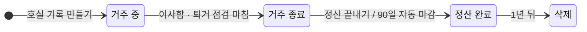
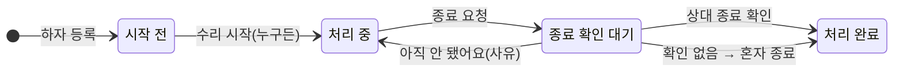
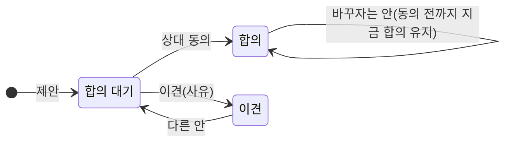
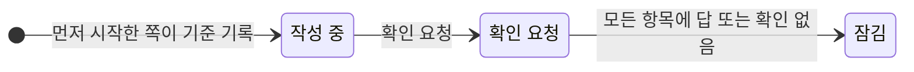

# homestamp 상태와 규칙

기록이 어떤 상태를 거치고, 누가 무엇을 할 수 있는지 정리한 문서입니다.

---

## 1. 기본 원칙

| # | 원칙 |
|---|---|
| 1 | 모든 변화는 행동 기록(누가·언제·무엇을)으로 남고, 고치거나 지우지 않는다 |
| 2 | 사실은 혼자 남길 수 있고, 합의는 혼자 만들 수 없다 |
| 3 | 서비스는 누가 옳은지 판정하지 않는다 |
| 4 | 기다림에는 끝이 있다(48시간 재통지 + 24시간 → 확인 없음) |
| 5 | 시각은 서버 시각만 쓴다 |
| 6 | 확인과 합의는 연결한 사람끼리만 한다 |

---

## 2. 상태 목록

| 대상 | 상태 |
|---|---|
| 호실 기록 | 거주 중 → 거주 종료 → 정산 완료 → 삭제(1년 뒤) |
| 당사자 연결 | 비어 있음 / 번호만 → 초대됨 → 연결됨 ⇄ 공유 중단 / 거절됨 / 탈퇴함 |
| 링크 | 유효 / 무효 |
| 하자 인정 | 확인 기다림 / 맞아요 / 보충 요청됨 / 이견 / 확인 없음 |
| 수리 진행 | 시작 전 → 처리 중 → 종료 확인 대기 → 처리 완료 |
| 수리비 | 미정 / 합의 대기 / 합의 / 이견 / 비용 없음 |
| 지불 · 송금 | 한쪽 기록 → 둘 다 확인 |
| 점검(입주·퇴거) | 작성 중 → 확인 요청 → 잠김 |
| 정산 항목 | 확인 기다림 / 합의 / 이견 / 제외됨 |
| 계정 | 활성 → 탈퇴 |

---

## 3. 호실 기록

| 행동 | 누가 | 결과 |
|---|---|---|
| 이사함 · 퇴거 점검 마침 | 세입자 | 바로 거주 종료 |
| 이사함 · 퇴거 점검 마침 | 집주인 | 세입자에게 거주 종료 확인 요청(답이 없으면 72시간 뒤 적용) |
| 정산 끝내기 | 누구든 | 상대 확인 → 정산 완료 |
| 자동 마감 | 서버 | 거주 종료 90일 뒤 정산 완료 |
| 삭제 | 서버 | 정산 완료 1년 뒤 전체 삭제(30일·7일 전 알림) |

- 거주 종료 뒤에는 새 수리 건을 만들 수 없고, 정산 완료 뒤에는 읽기와 내려받기만 됩니다.

---

## 4. 확인과 기다림

| 규칙 | 내용 |
|---|---|
| 응답 | [맞아요] / [아니에요 · 더 필요해요] → 보류(근거 더 필요) 또는 이견(사실과 다름, 사유 필수) |
| [맞아요] | 되돌릴 수 없음. 보류·이견은 정산 완료 전까지 [맞아요]로 바꿀 수 있음 |
| 다시 요청 | 보류·이견이 달리면 근거를 하나 이상 더해 다시 확인 요청(한 기록에 7일에 한 번) |
| 기다림 | 전달 뒤 48시간 재통지, 24시간 더 지나면 "확인 없음" |
| 확인 없음 뒤 | 하자 확인·종료·점검·정산 끝내기는 요청한 쪽이 혼자 진행 가능, 그 밖(돈 확인 등)은 표시만 |
| 늦은 답 | 정산 완료 전까지 언제든 답할 수 있음 |
| 받지 못한 경우 | 문자가 전달되지 않으면 확인 없음으로 보지 않음(번호 고치기·다시 보내기) |
| 연결 전 상대 | 볼 수 있는 기록만 링크로 알림. 돈은 확인 요청 없이 혼자 기록 |
| 확인 카드 | 답할 요청을 한곳에 모아 한 건씩 보고 마지막에 한 번에 보냄 |

---

## 5. 수리 건

수리 건은 **하자 인정**, **수리 진행**, **수리비** 세 줄이 따로 움직입니다. 돈이 정해지지 않아도 수리는 끝날 수 있습니다.

| 행동 | 누가 | 결과 |
|---|---|---|
| 하자 등록 | 누구든 | 사진 1장 이상, 상대에게 확인 요청 |
| 하자 확인 | 상대 | 맞아요 / 보충 요청 / 이견 |
| 수리 시작 | 누구든 | 확인 전이나 이견이 있어도 가능 |
| 종료 요청 → 확인 | 누구든 → 상대 | 처리 완료(둘 다 확인) |
| 혼자 종료 | 요청한 쪽 | 상대가 확인 없음이면 "처리 완료(○○ 확인)", 상대는 나중에 확인하거나 다시 열 수 있음 |
| 재발 | 누구든 | 둘 다 확인으로 끝난 건은 다시 열지 않고 새 수리 건으로 |
| 진행 상황 | 누구든 | 14일 넘게 멈추면 "오래 멈춘 건", 진행 상황 남기기·묻기 |

---

## 6. 고치기

| 상황 | 결과 |
|---|---|
| 상대가 확인하기 전 | 바로 고쳐짐 |
| 상대가 확인한 뒤 | 확인된 내용은 그대로, 고친 내용이 아래에 붙어 상대에게 확인 요청 |
| 상대가 확인 | 고친 내용이 반영됨 |
| 상대가 거절 · 답 없음 | 확인된 내용 그대로, 고친 내용은 이력에 남음 |

| 하는 일 | 구분 | 상대 확인 |
|---|---|---|
| 사진 추가, 진행 상황, 원인 설명, 잘못 올린 사진 표시 | 덧붙이기 | 필요 없음(계산에 들어가지 않음) |
| 새 수리 건, 새 지불, 정산 항목, 송금, 빠뜨린 하자 | 새 기록 | 그 기록마다 필요 |
| 확인된 내용 바꾸기(설명, 부위, 금액, 날짜) | 고치기 | 필요 |

- 사진은 고치지 않고, 더하거나 "잘못 올린 사진"으로 표시합니다. 개인정보가 찍힌 사진은 올린 사람이 언제든 지울 수 있습니다.

---

## 7. 돈: 제안과 합의

수리비 나누기, 정산 항목, 보증금은 같은 방식으로 움직입니다.

| 규칙 | 내용 |
|---|---|
| 합의 | 같은 제안에 두 사람이 모두 동의할 때만 |
| 합의 뒤 바꾸기 | [바꾸기]로 새 제안, 상대가 동의할 때까지 지금 합의가 그대로 쓰임 |
| 합의가 풀리는 경우 | 바탕 금액(확인된 지불의 합)이 바뀔 때만 |
| 계산 | 확인된 금액과 합의된 항목만. 확인 중인 것은 따로 표시 |
| 보증금 | 한쪽이 금액을 적고 상대가 [맞아요] → "둘 다 확인". 확인 전에도 정산은 진행(참고값 표시) |
| 다른 안 | 횟수 제한 없음, 3회째부터 직접 이야기를 권하는 안내 |

---

## 8. 점검

| 규칙 | 내용 |
|---|---|
| 항목 | 사용자가 적은 하자만. 적지 않은 부위는 "기록 없음"(이상 없음이라고 쓰지 않음) |
| 빠뜨린 하자 | 누구든 더할 수 있고, 더하지 않은 쪽이 확인. 잠긴 뒤면 "잠긴 뒤 추가(날짜)" |
| 잠금 | 모든 항목에 그 항목을 쓰지 않은 쪽의 답(맞아요·보류·이견) 또는 확인 없음이 붙으면 |
| 작성 중 멈춤 | 7일이 지나면 상대가 지금까지 쓴 것으로 확인 요청 가능 |
| 퇴거 점검 | 같은 규칙, 입주 점검과 같은 부위를 나란히 보기. 거주 종료와 따로 잠김 |
| 늦은 입주 점검 | 거주 중에도 작성 가능, "입주 후 등록(날짜)" 표시 |

---

## 9. 정산

| 규칙 | 내용 |
|---|---|
| 열기 | 퇴거 점검을 시작하면 자동, 열린 수리 건을 먼저 보여 줌 |
| 항목 | 수리 건에서 온 후보 넣기 또는 직접 입력. 넣기·빼기 모두 상대 확인 |
| 계산 | 보증금 ± 합의된 항목. 정해지지 않은 금액은 따로 표시 |
| 반환·송금 | 보낸 쪽이 기록하고 받은 쪽이 수령 확인. 받은 쪽이 확인한 송금만 합계에 |
| 정산 끝내기 | 따로 문자로 요청. 기다리는 동안 정산이 바뀌면 다시 요청 |
| 반대 | 상대는 "아직 안 끝났어요"(사유)로 답할 수 있음. 거주 종료 90일 뒤 자동 마감 |
| 연결 전 상대 | 혼자 정리해 끝낼 수 있음("혼자 정리한 정산") |

---

## 10. 연결과 공유

| 행동 | 결과 |
|---|---|
| 초대 | 상대 번호로 문자(링크). 처음 보여 줄 때 공유 동의 |
| 연결 | 초대받은 번호로 인증한 사람이 연결 확인. 초대한 쪽에 알림, 앞서 남긴 기록을 모두 봄 |
| 링크 열람 | 가입 전에는 그 기록만 읽기(이름·상세 주소·금액 없음) |
| 공유 그만두기 | 그 뒤 남긴 기록은 서로 보이지 않음, 걸린 확인 요청은 닫힘. 다시 공유하면 이어짐 |
| 탈퇴 | 상대가 연결된 적 있는 기록은 가린 채 보관 기간까지 남음 |
| 문자 그만 받기 | 그 번호로 더 보내지 않음, 상대는 혼자 진행 가능 |

---

## 11. 권한 요약

| 행동 | 기록한 쪽 | 상대 | 링크 열람자 |
|---|---|---|---|
| 기록 남기기(하자·지불·점검 항목) | ○ | ○ | ✕ |
| 확인 · 이견 | ✕ | ○ | ✕ |
| 고치기 | ○ | ✕ | ✕ |
| 제안 · 바꾸기 | ○ | ○ | ✕ |
| 동의 | ✕(자기 제안) | ○ | ✕ |
| 사진 지우기(개인정보) | 올린 사람만 | ✕ | ✕ |
| 보기 | ○ | ○ | 공유된 기록 하나(돈 제외) |

---

## 12. 문자 규칙

| 규칙 | 내용 |
|---|---|
| 보내는 것 | 답해야 하는 일만. 나머지는 서비스 안 알림 |
| 모으기 | 같은 사람에게 거의 동시에 가는 문자는 한 통 |
| 한도 | 받는 번호당 하루 5통, 계정당 20통 |
| 시간 | 21~08시에는 보내지 않고 아침에 |
| 다시 요청 | 한 기록에 7일에 한 번 |
| 본문 | 서비스명, 가린 이름, 호실 별칭, 요청 내용, 링크, 수신 거부 방법(금액·홍보 문구 없음) |

---

## 13. 지켜야 할 규칙(불변식)

1. 행동 기록에는 수정·삭제 API가 없다.
2. 합의는 같은 안에 두 사람의 행동이 모두 있을 때만 생긴다.
3. 처리 완료(둘 다 확인)는 종료 요청과 상대 확인이 모두 있을 때만 생긴다.
4. 확인 없음은 통지 두 건이 실제로 전달된 뒤에만 붙는다.
5. 링크 열람자는 어떤 상태도 바꿀 수 없다.
6. 정산 계산에는 합의된 항목만 들어간다.
7. 무효가 된 링크로는 아무것도 볼 수 없다.
8. 한 번호는 한 계정에만 인증된다.
9. 거주 종료 뒤에는 새 수리 건이 생기지 않는다.
10. 기록 시각은 서버가 정한다.
11. 저장된 사진에는 위치 정보가 없다.
12. 폐기된 리프레시 토큰을 다시 쓰면 같은 묶음 전체가 폐기된다.
13. 한 사람은 한 호실에서 한 측에만 속한다.
14. 사진 기록은 원본과 썸네일이 검사를 통과하고 등록 행동과 함께일 때만 생긴다.
15. 둘이 확인한 사실은 상대 확인 없이 바뀌지 않는다.
16. 사진은 올린 사람만 지울 수 있고, 지운 사진은 되살릴 수 없다.
17. 기록이 없는 사진 파일은 반드시 지워진다.
18. 공유를 그만둔 뒤 남긴 기록은 상대에게 보이지 않는다.
19. 정산 끝내기는 상대가 본 정산과 지금 정산이 같을 때만 완료된다.
20. 연결 전 상대에게는 돈 확인 요청이 생기지 않는다.
21. 점검은 모든 항목에 쓰지 않은 쪽의 답 또는 확인 없음이 있을 때만 잠긴다.
