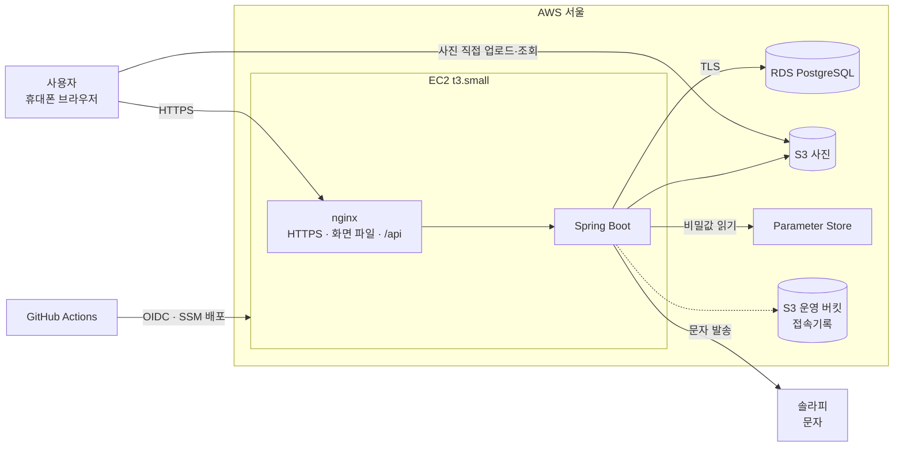
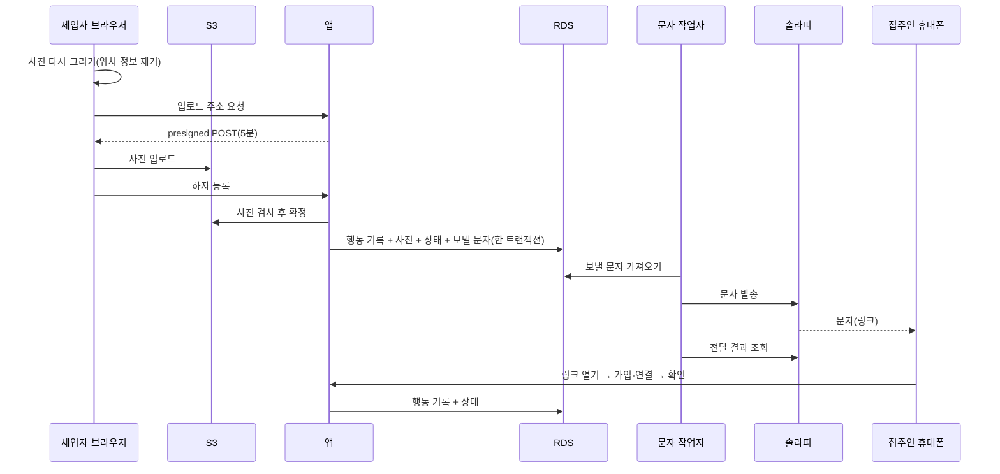
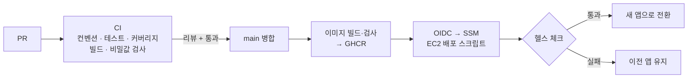

# homestamp 인프라 아키텍처

EC2 한 대에 nginx와 Spring Boot를 두고, 데이터는 RDS PostgreSQL, 사진은 S3에 저장합니다.

---

## 1. 한눈에 보기

| 구성 | 사양 | 역할 |
|---|---|---|
| EC2 | t3.small 1대 | nginx(입구) + Spring Boot 앱 |
| RDS | PostgreSQL micro, 단일 AZ | 기록 저장 |
| S3 | 사진 버킷, 운영 버킷 | 사진 / Terraform 상태·접속기록 |
| Parameter Store | SecureString | 비밀값 |
| 외부 | 솔라피, GitHub | 문자 발송 / CI·CD·이미지 저장소 |

---

## 2. 기술 선택

| 영역 | 선택 | 이유 |
|---|---|---|
| 프론트엔드 | React, Vite, TypeScript, shadcn/ui | 모바일 우선, 같은 도메인에서 nginx로 제공 |
| 백엔드 | Java 25, Spring Boot 4.1.2 | 최신 LTS·정식 버전 |
| 입구 | nginx | HTTPS, 정적 파일, API 프록시, 요청 수 제한을 한곳에서 |
| DB | PostgreSQL(RDS), Flyway | 부분 인덱스·`SKIP LOCKED`로 작업 큐 처리 |
| 사진 | S3 + presigned URL | 서버를 거치지 않고 브라우저가 직접 업로드·조회 |
| 문자 | 솔라피(전달 결과는 조회 API) | 서버가 꺼진 시간에도 결과를 놓치지 않음 |
| 비밀값 | Parameter Store + IAM 역할 | 액세스 키를 두지 않음 |
| 인프라 코드 | Terraform | 같은 구성을 다시 만들 수 있음 |
| 배포 | GitHub Actions, GHCR, SSM | 키 없이 OIDC로 배포 |
| 관측 | Actuator, Prometheus, Grafana, k6 | 지표 수집과 부하 테스트 |

---

## 3. 요청 흐름

세입자가 하자를 등록하고 집주인이 문자로 받아 확인하는 흐름입니다.

---

## 4. 데이터 처리

| 항목 | 방식 |
|---|---|
| 테이블 구분 | 행동 기록(수정 불가) / 사실 행(수정하면 새 판) / 상태 행(상태·기한만 변경) |
| 수정·삭제 방지 | `@Immutable` + DB 트리거, 수정·삭제 API 없음 |
| 변경 감지 | 해시 체인: 호실마다 행동 기록에 순번과 앞 기록의 해시를 이어 저장해, 중간에 바뀌거나 빠지면 드러남(검증 화면은 이후 추가) |
| 상태 계산 | 상태 전이 함수 `apply(상태, 행동)` 하나, 행동 기록을 다시 계산해 상태와 비교하는 테스트 |
| 동시 처리 | 낙관적 잠금(version), 작업자는 `FOR UPDATE SKIP LOCKED` |
| 중복 방지 | 요청마다 멱등 키 |
| 문자 전달 | 아웃박스(기록과 같은 트랜잭션), 재시도, 서버 재시작 때 밀린 것부터 |
| 기본 키 | UUID v7 |
| 시간 | `timestamptz`(UTC 저장), 화면에서 한국 시간 |
| 백업 | RDS 자동 백업 7일 |
| 보관 | 정산 완료 1년 뒤 호실 기록 전체 삭제 |

---

## 5. 보안과 개인정보

| 항목 | 방식 |
|---|---|
| 액세스 키 | 사용하지 않음. 앱은 EC2 IAM 역할, CI는 GitHub OIDC |
| 비밀값 | Parameter Store, 앱이 시작할 때 직접 읽음(이미지·환경변수에 넣지 않음) |
| 유출 방지 | gitleaks, GitHub Secret scanning·push protection, Trivy |
| 네트워크 | 외부에는 80·443만, RDS는 앱에서만, SSH 없음(SSM으로 접근) |
| 암호화 | RDS·S3 저장 암호화, DB 연결 TLS(`verify-full`), HTTPS |
| 인증 | JWT(15분) + 리프레시 토큰(HttpOnly 쿠키, 로테이션) |
| 사진 | 브라우저에서 위치 정보 제거, 서버에서 다시 검사, 짧은 수명의 주소로만 조회 |
| 링크 | 토큰은 주소의 `#` 뒤(로그에 남지 않음), 화면에는 최소 정보만 |
| 로그 | 개인정보·요청 본문 기록하지 않음 |
| 운영 접근 | 2명, 사람별 DB 역할, 접속기록 1년 보관 |

---

## 6. 배포

| 항목 | 내용 |
|---|---|
| CI | PR마다: 브랜치·커밋 규칙, Spotless, Testcontainers 테스트, JaCoCo(`*Service`·`*Transitions` 줄 80%·분기 70%), 프론트 빌드, gitleaks |
| CD | main 병합 시: 이미지 → GHCR → OIDC → SSM → 배포 |
| 무중단 | 1~2주차 컨테이너 교체, 3주차부터 블루/그린(헬스 체크 실패 시 자동 롤백) |
| 환경 | 운영 1개(PR 단계는 Testcontainers로 검증) |

---

## 7. 관측과 부하 테스트

| 항목 | 내용 |
|---|---|
| 지표 | Actuator + Micrometer → Prometheus → Grafana |
| 서비스 지표 | 문자 대기 건수, 발송 성공·실패, 사진 거절 수 |
| 알림 | 앱 중단, 문자 적체, 5xx 비율, 디스크 → Slack |
| 로그 | JSON, 요청별 추적 ID |
| 부하 테스트 | k6, 시나리오 "장마철 하자 등록 몰림", 가짜 문자 발송기 사용 |
| 비교 | 같은 데이터로 개선 전후 처리량·지연 비교 |

---

## 8. 비용

평일 09~18시 실행(월 약 200시간) 기준, 지원 금액 약 75,000원 안에서 운영합니다.

| 항목 | 기준 |
|---|---|
| EC2 t3.small | 운영 시간만 실행 |
| RDS PostgreSQL micro | 단일 AZ, 20GB |
| S3 | 사진 + 운영 버킷 |
| 탄력적 IP | 1개(중지 시간에도 과금) |
| CloudTrail · 로그 보관 | 관리 이벤트 추적 1개 |
| 문자 | 솔라피 건당 요금 |

정확한 금액은 AWS 요금 계산기와 Cost Explorer로 1주차에 확인합니다.
