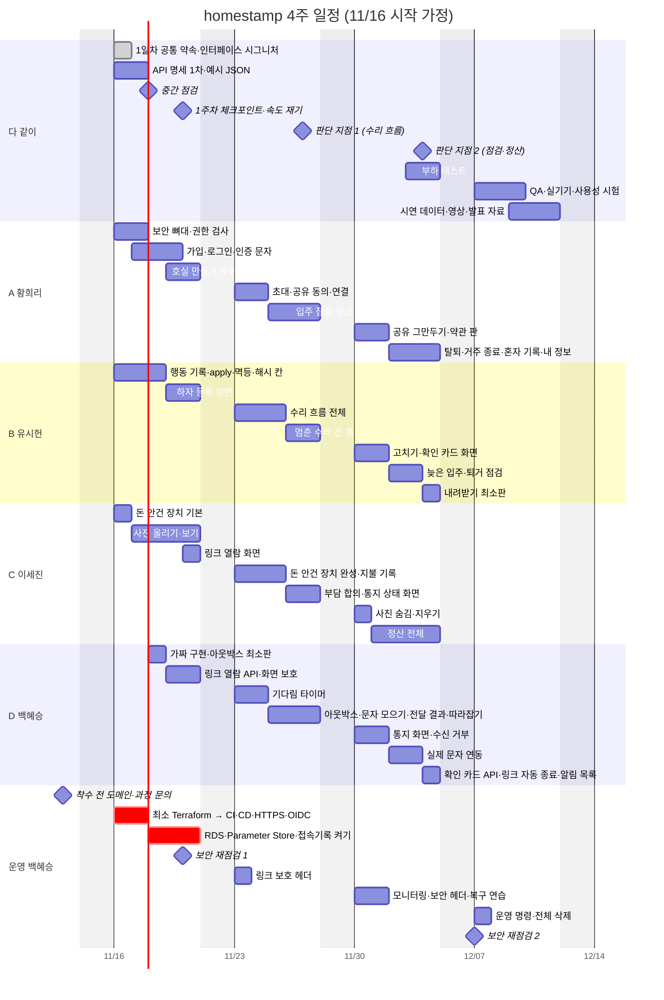

# homestamp WBS

4주(11/16 시작 가정), 4명이 도메인을 나눠 맡고 운영(배포)은 별도 역할로 둡니다.

---

## 1. 역할 분담

| 역할 | 담당 | 맡은 도메인 | 리뷰 짝 |
|---|---|---|---|
| A | 황희리 | 회원·인증·호실·점검 | D |
| B | 유시헌 | 행동 기록·수리 | C |
| C | 이세진 | 돈(제안·지불·정산)·사진 | B |
| D | 백혜승 | 기다림·통지·링크 | A |
| 운영 | 백혜승 | 인프라·CI/CD·배포 | + 1명 |

- **주인**: 그 도메인의 테이블·인터페이스·API 명세·리뷰를 책임집니다(바뀌지 않음).
- **이번 주 손**: 일이 몰리면 그 주에 코드를 쓰는 사람을 바꿉니다(주인이 리뷰).

---

## 2. 일정

| 날짜 | 점검 |
|---|---|
| 1주차 수 | 중간 점검(운영·권한 검사 우선) |
| 1주차 금 | 체크포인트: 실제 속도 재기 |
| 2주차 금 | 판단 지점 1: 수리 흐름 |
| 3주차 금 | 판단 지점 2: 점검·정산 |
| 4주차 | QA, 실기기 테스트, 사용성 시험, 발표 |

---

## 3. 주차별 목표

| 주차 | 목표 | 완료 기준 |
|---|---|---|
| 1주차 | 뼈대와 공통 장치 | 배포 주소에서 가입 → 호실 → 하자 등록 → 문자(가짜) → 링크 열람 |
| 2주차 | 수리 흐름 + 입주 점검 | 하자 등록 → 통지 → 확인 → 수리 → 종료 + 수리비 합의, 입주 점검 잠금 |
| 3주차 | 퇴거·정산 + 마무리 | 입주 점검 → 퇴거 점검 → 정산 계산 → 반환 기록, 공유 그만두기·탈퇴·내려받기 |
| 4주차 | 안정화와 발표 | 시연 시나리오 2개를 막힘없이, 통합 테스트 CI 통과 |

---

## 4. 주차별 업무

| 사람 | 1주차 | 2주차 | 3주차 | 4주차 |
|---|---|---|---|---|
| A 황희리 | 보안 뼈대·권한 검사, 가입·로그인·인증 문자, 호실·부위 | 초대·공유 동의·연결, 입주 점검·잠금 | 공유 그만두기, 약관, 탈퇴, 거주 종료, 내 정보 | QA·버그 수정 |
| B 유시헌 | 행동 기록·`apply`·멱등·해시 체인, 하자 등록 화면 | 수리 흐름, 응답 공통 처리(맞아요·보류·이견), 멈춘 수리 건, 홈 | 고치기, 확인 카드 화면, 퇴거 점검·나란히 보기, 내려받기 | QA·버그 수정 |
| C 이세진 | 돈 안건 장치 기본, 사진 올리기·보기, 링크 열람 화면 | 돈 안건 장치 완성, 지불·금액 확인, 수리비 합의, 통지 상태 화면 | 사진 숨김·지우기, 정산 전체 | QA·버그 수정 |
| D 백혜승 | 아웃박스·가짜 발송기, 링크 열람 API | 기다림 타이머, 아웃박스·문자 모으기·전달 결과, 따라잡기, 알림 저장 | 통지 화면·수신 거부, 실제 문자 연동, 확인 카드 API, 링크 자동 종료, 정산 자동 마감 | QA·버그 수정 |
| 운영 백혜승 | Terraform, CI/CD·HTTPS·OIDC, RDS·Parameter Store·접속기록, 보안 재점검 1 | 링크 보호 헤더 | 모니터링·알림, 보안 헤더·CSP, 블루/그린, 복구 연습 | 운영 명령, 보안 재점검 2 |
| 다 같이 | 공통 약속·인터페이스, API 명세 1차 | - | 부하 테스트(k6) | 사용성 시험, 시연 데이터·영상·발표 |

---

## 5. 업무량 (인-일)

| 사람 | 1주 | 2주 | 3주 | 4주 | 공동 업무 | 합계 |
|---|---|---|---|---|---|---|
| A 황희리 | 6.5 | 6.5 | 6.5 | - | 2.25 | 21.75 |
| B 유시헌 | 6 | 7 | 6 | - | 2.25 | 21.25 |
| C 이세진 | 5.5 | 6.5 | 7 | - | 2.25 | 21.25 |
| 백혜승(D + 운영) | 6.5 | 6 | 7 | 1 | 2.25 | 22.75 |
| **팀** | 24.5 | 26 | 26.5 | 1 | 9 | **87** |

---

## 6. 일정 관리

| 항목 | 방법 |
|---|---|
| 속도 재기 | 1주차 끝에 "완료된 기능의 인-일 ÷ 계획 인-일" |
| 밀릴 때 | 판단 지점마다 줄이기 순서대로 뺌: 다른 안(역제안) → 실제 문자 연동. 그래도 밀리면 여유 목록을 만들지 않고 화면 꾸미기를 최소로 |
| 빠를 때 | 4주차에 여유 목록에서 가져감(무활동 알림, 내려받기 완성판, 원인 설명, 해시 검증 화면 등) |
| 서로 돕기 | GitHub Projects 보드 하나, 반나절~하루 단위 카드, 수요일 중간 점검에서 넘길 일 정함 |

**완료(Done) 기준**

1. 수용 기준(Gherkin 시나리오) 테스트 통과
2. 화면 명세대로 구현
3. 운영 서버에 배포
4. PR 리뷰 1명(주인이 아닌 사람이 썼으면 주인이 리뷰)
5. 관련 불변식 테스트 통과
